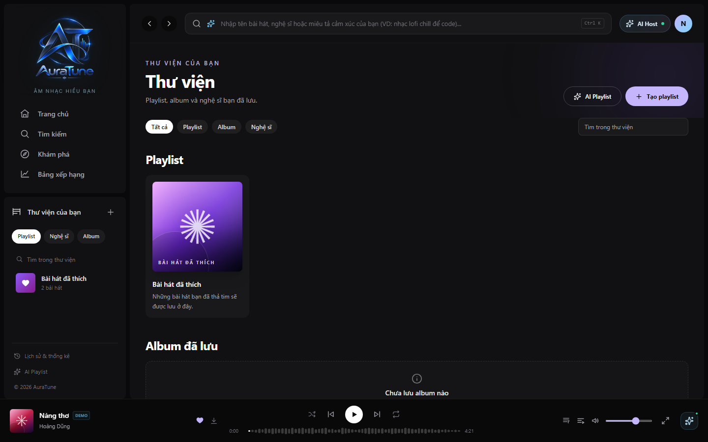

# UC-060-001 – View Playlists in Library

## 1. Metadata

| Field | Value |
|---|---|
| Use Case ID | UC-060-001 |
| Use Case Name | View Playlists in Library |
| Functional Group | 060 – Playlist Management |
| Primary Actor | Listener |
| Supporting Actors | None |
| Related FR IDs | FR-004 |
| Related Feature ID | 061-playlist-crud |
| Related Spec Kit File | [specs/060-playlist-management/061-playlist-crud/spec.md](../../../../specs/060-playlist-management/061-playlist-crud/spec.md) |
| Writer | Mai Đăng Khoa |
| Reviewer | [FULL NAME] |
| Status | Draft |
| Last Updated | 2026-11-03 |

## 2. Goal

The listener wants to browse their music collection and access previously created or bookmarked playlists from the Library page.

## 3. Description

This use case describes the steps for a listener to navigate to the Library and view all their personal playlists, including the default "Bài hát đã thích" (Liked Songs) and custom user-created playlists.

## 4. Preconditions

- The listener is authenticated.

## 5. Trigger

The listener clicks on the "Thư viện" (Library) link in the main navigation.

## 6. Basic Flow

1. **Listener:** Clicks "Thư viện" on the sidebar or navigation menu.
2. **System:** Retrieves the list of playlists owned by or shared with the current user.
3. **System:** Displays the Library page with a collection of playlist cards.
4. **Listener:** Browses the list of playlists.

## 7. Alternative Flows

### AF-01 – Filter by Playlist

- **Starting step:** 3
- **Condition:** Listener wants to see only playlists (hiding albums or artists).

1. **Listener:** Clicks on the "Playlist" filter tab.
2. **System:** Filters the display to show only playlist entities.

- **Outcome:** Resume at Basic Flow step 4.

## 8. Exception Flows

### EX-01 – No Playlists Found

- **Starting step:** 2
- **Condition:** User has not created any playlists yet.
1. **System:** Displays a message or button encouraging the user to create their first playlist.

- **Outcome:** Use case ends successfully (empty state).

## 9. Postconditions

### 9.1 Success Postconditions
- The listener sees their playlists displayed on the Library page.

### 9.2 Failure Postconditions
- System displays an error message if the playlist list cannot be retrieved.

## 10. Special Requirements

- **Performance:** The "My Library" page loads the list of user playlists in under 1 second.

## 11. Business Rules

No additional business rules identified.

## 12. Prototype and Screenshots

### 12.1 Basic Flow

**Covered steps:** 1-4

**Prototype type:** Implemented UI

## 13. Related Use Cases

- UC-060-002 – Create Playlist
- UC-060-003 – View Playlist Details

## 14. Traceability and Sources

| Source Type | ID / File | Relevant Section |
|---|---|---|
| Functional Requirement | FR-004 | System MUST allow users to retrieve a list of all playlists created by the current authenticated user. |
| Spec Kit Specification | specs/060-playlist-management/061-playlist-crud/spec.md | User Story 1 |

## 15. Open Questions

None
