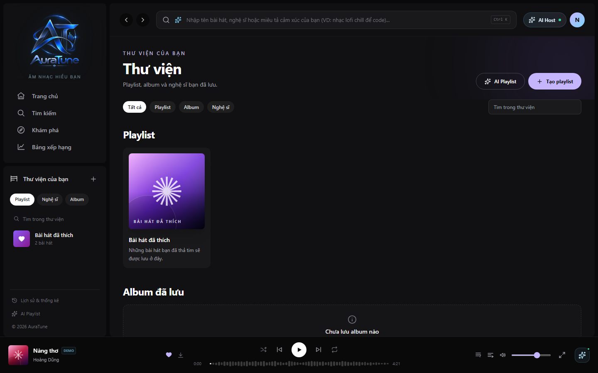

# UC-060-001 – View Playlists in Library
Performed by: Mai Đăng Khoa | Reviewed by: Group 10 team | Edited by: Lê Công Minh Nhựt

## 1. Metadata
Performed by: Mai Đăng Khoa | Reviewed by: Group 10 team | Edited by: Lê Công Minh Nhựt

| Field | Value |
|---|---|
| Use Case ID | UC-060-001 |
| Use Case Name | View Playlists in Library |
| Functional Group | 060 – Playlist Management |
| Primary Actor | Listener |
| Supporting Actors | None |
| Related FR IDs | 061-FR-004, 061-FR-010, 062-FR-002 |
| Related Feature ID | 061-playlist-crud |
| Related Spec Kit File | [specs/060-playlist-management/061-playlist-crud/spec.md](../../../../specs/060-playlist-management/061-playlist-crud/spec.md) |
| Writer | Lê Công Minh Nhựt |
| Original Writer (PA3 draft) | Mai Đăng Khoa |
| Reviewer | Group 10 team |
| Status | Draft |
| Last Updated | 2026-11-03 |

## 2. Goal
Performed by: Mai Đăng Khoa | Reviewed by: Group 10 team | Edited by: Lê Công Minh Nhựt

The listener wants to browse their music collection and access previously created or bookmarked playlists from the Library page.

## 3. Description
Performed by: Mai Đăng Khoa | Reviewed by: Group 10 team | Edited by: Lê Công Minh Nhựt

This use case describes how a listener views playlists they created, public playlists they bookmarked, and their Liked Songs collection in the Library.

## 4. Preconditions
Performed by: Mai Đăng Khoa | Reviewed by: Group 10 team | Edited by: Lê Công Minh Nhựt

- The listener is authenticated.

## 5. Trigger
Performed by: Mai Đăng Khoa | Reviewed by: Group 10 team | Edited by: Lê Công Minh Nhựt

The listener clicks on the "Thư viện" (Library) link in the main navigation.

## 6. Basic Flow
Performed by: Mai Đăng Khoa | Reviewed by: Group 10 team | Edited by: Lê Công Minh Nhựt

1. **Listener:** Clicks "Thư viện" on the sidebar or navigation menu.
2. **System:** Retrieves playlists created by the current user, public playlists they saved, and the user's Liked Songs collection.
3. **System:** Displays the Library page with a collection of playlist cards.
4. **Listener:** Browses the list of playlists.

## 7. Alternative Flows
Performed by: Mai Đăng Khoa | Reviewed by: Group 10 team | Edited by: Lê Công Minh Nhựt

### AF-01 – Filter by Playlist
Performed by: Mai Đăng Khoa | Reviewed by: Group 10 team | Edited by: Lê Công Minh Nhựt

- **Starting step:** 3
- **Condition:** Listener wants to see only playlists (hiding albums or artists).

1. **Listener:** Clicks on the "Playlist" filter tab.
2. **System:** Filters the display to show only playlist entities.

- **Outcome:** Resume at Basic Flow step 4.

## 8. Exception Flows
Performed by: Mai Đăng Khoa | Reviewed by: Group 10 team | Edited by: Lê Công Minh Nhựt

### EX-01 – No Playlists Found
Performed by: Mai Đăng Khoa | Reviewed by: Group 10 team | Edited by: Lê Công Minh Nhựt

- **Starting step:** 2
- **Condition:** User has not created any playlists yet.
1. **System:** Displays a message or button encouraging the user to create their first playlist.

- **Outcome:** Use case ends successfully (empty state).

## 9. Postconditions
Performed by: Mai Đăng Khoa | Reviewed by: Group 10 team | Edited by: Lê Công Minh Nhựt

### 9.1 Success Postconditions
Performed by: Mai Đăng Khoa | Reviewed by: Group 10 team | Edited by: Lê Công Minh Nhựt
- The listener sees their playlists displayed on the Library page.

### 9.2 Failure Postconditions
Performed by: Mai Đăng Khoa | Reviewed by: Group 10 team | Edited by: Lê Công Minh Nhựt
- System displays an error message if the playlist list cannot be retrieved.

## 10. Special Requirements
Performed by: Mai Đăng Khoa | Reviewed by: Group 10 team | Edited by: Lê Công Minh Nhựt

- **Performance:** The "My Library" page loads the list of user playlists in under 1 second.

## 11. Business Rules
Performed by: Mai Đăng Khoa | Reviewed by: Group 10 team | Edited by: Lê Công Minh Nhựt

No additional business rules identified.

## 12. Prototype and Screenshots
Performed by: Mai Đăng Khoa | Reviewed by: Group 10 team | Edited by: Lê Công Minh Nhựt

### 12.1 Basic Flow
Performed by: Mai Đăng Khoa | Reviewed by: Group 10 team | Edited by: Lê Công Minh Nhựt

**Covered steps:** 1-4

**Prototype type:** Implemented UI

## 13. Related Use Cases
Performed by: Mai Đăng Khoa | Reviewed by: Group 10 team | Edited by: Lê Công Minh Nhựt

- UC-060-002 – Create Playlist
- UC-060-003 – View Playlist Details

## 14. Traceability and Sources
Performed by: Mai Đăng Khoa | Reviewed by: Group 10 team | Edited by: Lê Công Minh Nhựt

| Source Type | ID / File | Relevant Section |
|---|---|---|
| Functional Requirement | 061-FR-004 | System MUST allow users to retrieve a list of all playlists created by the current authenticated user. |
| Functional Requirement | 061-FR-010 | Saved public playlists appear as read-only references in the user's personal library. |
| Functional Requirement | 062-FR-002 | The Liked Songs collection is maintained from song Like actions. |
| Spec Kit Specification | specs/060-playlist-management/061-playlist-crud/spec.md | User Story 1 |

## 15. Open Questions
Performed by: Mai Đăng Khoa | Reviewed by: Group 10 team | Edited by: Lê Công Minh Nhựt

None

## PA4 implementation evidence and acceptance record
Performed by: Mai Đăng Khoa | Reviewed by: Group 10 team | Edited by: Lê Công Minh Nhựt

Playlist routes, `playlistService.js`, `playlistRepository.js` and SQL migration `003_playlist_management.sql` exist. Verify current owner/collaborator authorization and committed read-back for mutations, including failure outcomes. Feature 064 currently uses keyword-selected candidates in the Python service; this does not demonstrate the required semantic/vector generation path.

The flows above state required behavior. This revision records source inspection only; no browser acceptance or new feature-test run is claimed. Before acceptance, execute the basic flow and its applicable alternative/exception flows, checking the documented success and failure postconditions. Record results against this UC ID in [the PA4 review register](../../use-case-model.md#11-pa4-decisions-and-source-review).
