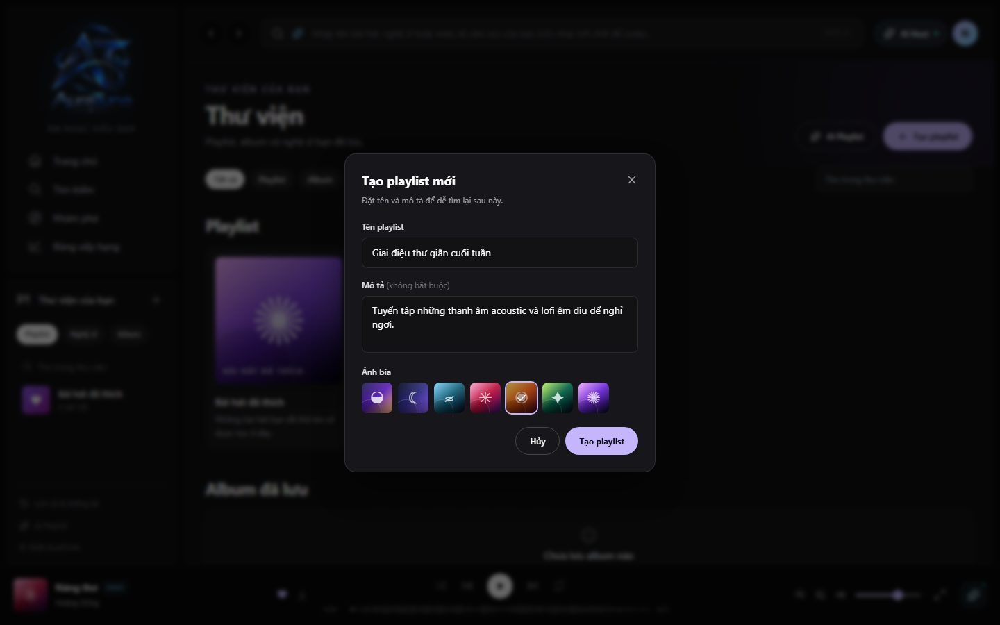

# UC-060-002 – Create Playlist

## 1. Metadata

| Field | Value |
|---|---|
| Use Case ID | UC-060-002 |
| Use Case Name | Create Playlist |
| Functional Group | 060 – Playlist Management |
| Primary Actor | Listener |
| Supporting Actors | None |
| Related FR IDs | 061-FR-001, 061-FR-002, 061-FR-003, 061-FR-009 |
| Related Feature ID | 061-playlist-crud |
| Related Spec Kit File | [specs/060-playlist-management/061-playlist-crud/spec.md](../../../../specs/060-playlist-management/061-playlist-crud/spec.md) |
| Writer | Mai Đăng Khoa |
| Reviewer | [FULL NAME] |
| Status | Draft |
| Last Updated | 2026-11-03 |

## 2. Goal

The listener wants to create a new playlist to start organizing their music collection.

## 3. Description

This use case describes the process of creating a new playlist by providing a title, optional description, and selecting a cover art theme.

## 4. Preconditions

- The listener is authenticated.

## 5. Trigger

The listener clicks on the "Tạo playlist" (Create Playlist) button in the Library page or global navigation.

## 6. Basic Flow

1. **Listener:** Clicks "Tạo playlist".
2. **System:** Opens the "Tạo playlist" modal dialog.
3. **Listener:** Enters a title for the playlist.
4. **Listener:** (Optional) Enters a description.
5. **Listener:** (Optional) Selects a cover art color palette.
6. **Listener:** Clicks "Tạo" (Create).
7. **System:** Validates the input (title is required and within character limits).
8. **System:** Creates the new playlist with `Private` status by default.
9. **System:** Redirects the listener to the detail page of the newly created playlist.

## 7. Alternative Flows

### AF-01 – Cancel Creation

- **Starting step:** 2
- **Condition:** Listener decides not to create a playlist.

1. **Listener:** Clicks "Hủy" (Cancel) or closes the modal.
2. **System:** Closes the modal without creating any playlist.

- **Outcome:** Use case ends.

## 8. Exception Flows

### EX-01 – Missing Required Fields

- **Starting step:** 7
- **Condition:** Title field is empty.
1. **System:** Displays a validation error message and keeps the modal open.

- **Outcome:** Resume at Basic Flow step 3.

### EX-02 – Character Limit Exceeded

- **Starting step:** 7
- **Condition:** Title > 80 characters or Description > 300 characters.
1. **System:** Prevents saving and displays a validation error message.

- **Outcome:** Resume at Basic Flow step 3 or 4.

## 9. Postconditions

### 9.1 Success Postconditions
- A new playlist is created in the database.
- The listener is on the playlist detail page.
- The playlist appears in the listener's Library.

### 9.2 Failure Postconditions
- No playlist is created.

## 10. Special Requirements

- **Performance:** Users can create a new playlist in under 15 seconds.

## 11. Business Rules

| Rule ID | Rule Description | Source |
|---|---|---|
| BR-060-01 | Default Status | [061-FR-002] Playlists must default to Private. |
| BR-060-02 | Character Limits | [061-FR-003] Title (max 80), Description (max 300). |

## 12. Prototype and Screenshots

### 12.1 Basic Flow

**Covered steps:** 2-6

**Prototype type:** Implemented UI

## 13. Related Use Cases

- UC-060-001 – View Playlists in Library
- UC-060-003 – View Playlist Details

## 14. Traceability and Sources

| Source Type | ID / File | Relevant Section |
|---|---|---|
| Functional Requirement | 061-FR-001 | System MUST allow authenticated users to create a playlist with a required name and optional description. |
| Functional Requirement | 061-FR-002 | System MUST default new playlists to Private status. |
| Functional Requirement | 061-FR-003 | Playlist title and description are limited to 80 and 300 characters respectively. |
| Functional Requirement | 061-FR-009 | Provide a default cover image when no cover URL is supplied. |
| Spec Kit Specification | specs/060-playlist-management/061-playlist-crud/spec.md | User Story 2 |

## 15. Open Questions

None
