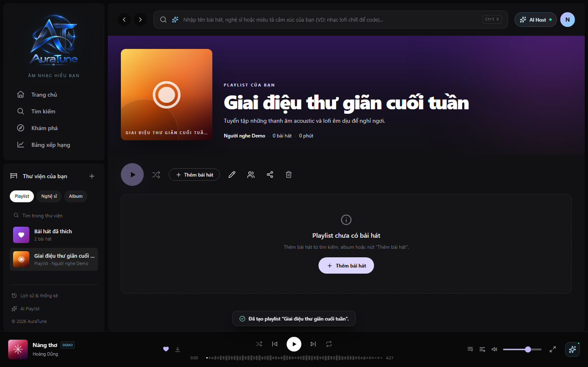

# UC-060-003 – View Playlist Details

## 1. Metadata

| Field | Value |
|---|---|
| Use Case ID | UC-060-003 |
| Use Case Name | View Playlist Details |
| Functional Group | 060 – Playlist Management |
| Primary Actor | Listener |
| Supporting Actors | None |
| Related FR IDs | 061-FR-005, 061-FR-006, 065-FR-010 |
| Related Feature ID | 061-playlist-crud |
| Related Spec Kit File | [specs/060-playlist-management/061-playlist-crud/spec.md](../../../../specs/060-playlist-management/061-playlist-crud/spec.md) |
| Writer | Mai Đăng Khoa |
| Reviewer | [FULL NAME] |
| Status | Draft |
| Last Updated | 2026-11-03 |

## 2. Goal

The listener wants to view the full details of a playlist, including its metadata and the list of tracks.

## 3. Description

This use case describes how a listener accesses the dedicated page for a playlist to see its header information (title, description, duration, owner) and the table of songs it contains.

## 4. Preconditions

- The playlist exists.
- Authentication is required to view a private playlist; public playlists can be viewed by guests.

## 5. Trigger

The listener clicks on a playlist card in the Library, Search results, or via a direct link.

## 6. Basic Flow

1. **Listener:** Clicks on a playlist.
2. **System:** Verifies the user has permission to view the playlist (is the owner, or the playlist is public).
3. **System:** Retrieves playlist metadata and tracklist.
4. **System:** Displays the playlist detail page with hero cover art, title, description, owner name, total song count, and total duration.
5. **System:** Renders the tracklist using the song table component.

## 7. Alternative Flows

### AF-01 – View Public Playlist as Guest

- **Starting step:** 2
- **Condition:** User is not logged in but accesses a public playlist link.

1. **System:** Allows viewing of metadata and tracks for public playlists without authentication.

- **Outcome:** Resume at Basic Flow step 3.

## 8. Exception Flows

### EX-01 – Unauthorized Access

- **Starting step:** 2
- **Condition:** User tries to view a private playlist they do not own.
1. **System:** Displays a "403 Forbidden" or "Access Denied" message.

- **Outcome:** Use case ends unsuccessfully.

### EX-02 – Playlist Not Found

- **Starting step:** 2
- **Condition:** The playlist ID does not exist.
1. **System:** Displays a "404 Not Found" page.

- **Outcome:** Use case ends unsuccessfully.

## 9. Postconditions

### 9.1 Success Postconditions
- The listener sees the full playlist information and tracklist.

### 9.2 Failure Postconditions
- The listener sees an error page.

## 10. Special Requirements

- **Performance:** Playlist details load within reasonable timeframes.

## 11. Business Rules

| Rule ID | Rule Description | Source |
|---|---|---|
| BR-060-03 | Visibility Restriction | [061-FR-006] Restrict viewing of private playlists to the owner only. |

## 12. Prototype and Screenshots

### 12.1 Basic Flow

**Covered steps:** 4-5

**Prototype type:** Implemented UI

## 13. Related Use Cases

- UC-060-001 – View Playlists in Library
- UC-060-007 – Add Songs to Playlist
- UC-060-008 – Remove Song from Playlist

## 14. Traceability and Sources

| Source Type | ID / File | Relevant Section |
|---|---|---|
| Functional Requirement | 061-FR-005 | System MUST allow users to view the metadata of any playlist marked as public. |
| Functional Requirement | 061-FR-006 | System MUST restrict viewing of private playlists to the owner only. |
| Functional Requirement | 065-FR-010 | Collaborative playlists are public by default; only joined collaborators can modify them. |
| Spec Kit Specification | specs/060-playlist-management/061-playlist-crud/spec.md | User Story 3 |

## 15. Open Questions

None
