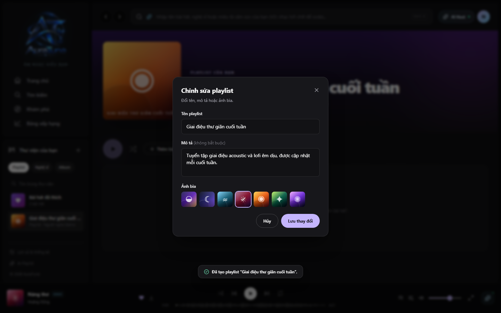

# UC-060-004 – Edit Playlist Metadata
Performed by: Mai Đăng Khoa | Reviewed by: Group 10 team | Edited by: Lê Công Minh Nhựt

## 1. Metadata
Performed by: Mai Đăng Khoa | Reviewed by: Group 10 team | Edited by: Lê Công Minh Nhựt

| Field | Value |
|---|---|
| Use Case ID | UC-060-004 |
| Use Case Name | Edit Playlist Metadata |
| Functional Group | 060 – Playlist Management |
| Primary Actor | Playlist Owner |
| Supporting Actors | None |
| Related FR IDs | 061-FR-007, 065-FR-006 |
| Related Feature ID | 061-playlist-crud |
| Related Spec Kit File | [specs/060-playlist-management/061-playlist-crud/spec.md](../../../../specs/060-playlist-management/061-playlist-crud/spec.md) |
| Writer | Lê Công Minh Nhựt |
| Original Writer (PA3 draft) | Mai Đăng Khoa |
| Reviewer | Group 10 team |
| Status | Draft |
| Last Updated | 2026-11-03 |

## 2. Goal
Performed by: Mai Đăng Khoa | Reviewed by: Group 10 team | Edited by: Lê Công Minh Nhựt

The playlist owner wants to update the title, description, or cover theme of their playlist.

## 3. Description
Performed by: Mai Đăng Khoa | Reviewed by: Group 10 team | Edited by: Lê Công Minh Nhựt

This use case describes how the owner of a playlist modifies its descriptive information using the edit modal.

## 4. Preconditions
Performed by: Mai Đăng Khoa | Reviewed by: Group 10 team | Edited by: Lê Công Minh Nhựt

- The listener is authenticated and owns the playlist.
- The playlist detail page is open.

## 5. Trigger
Performed by: Mai Đăng Khoa | Reviewed by: Group 10 team | Edited by: Lê Công Minh Nhựt

The listener clicks the "Chỉnh sửa chi tiết" (Edit Details) button (pencil icon) on the playlist detail page.

## 6. Basic Flow
Performed by: Mai Đăng Khoa | Reviewed by: Group 10 team | Edited by: Lê Công Minh Nhựt

1. **Playlist Owner:** Clicks the Edit button.
2. **System:** Opens the "Chỉnh sửa chi tiết" modal dialog, pre-filled with current title, description, and cover theme.
3. **Playlist Owner:** Modifies the title, description, or cover theme.
4. **Playlist Owner:** Clicks "Lưu" (Save).
5. **System:** Validates the input (character limits).
6. **System:** Updates the playlist record in the database.
7. **System:** Updates the UI in real-time to reflect changes.
8. **System:** Displays a success toast notification.

## 7. Alternative Flows
Performed by: Mai Đăng Khoa | Reviewed by: Group 10 team | Edited by: Lê Công Minh Nhựt

### AF-01 – Change Visibility
Performed by: Mai Đăng Khoa | Reviewed by: Group 10 team | Edited by: Lê Công Minh Nhựt

- **Starting step:** 3
- **Condition:** Owner wants to change the playlist from Private to Public (or vice versa).

1. **Playlist Owner:** Toggles the "Công khai" (Public) switch.
2. **System:** Records the status change.

- **Outcome:** Resume at Basic Flow step 4.

## 8. Exception Flows
Performed by: Mai Đăng Khoa | Reviewed by: Group 10 team | Edited by: Lê Công Minh Nhựt

### EX-01 – Unauthorized Edit Attempt
Performed by: Mai Đăng Khoa | Reviewed by: Group 10 team | Edited by: Lê Công Minh Nhựt

- **Starting step:** 1
- **Condition:** User is not the owner of the playlist.
1. **System:** Does not display the Edit button, or if accessed via URL, returns a "403 Forbidden" error.

- **Outcome:** Use case ends unsuccessfully.

### EX-02 – Validation Errors
Performed by: Mai Đăng Khoa | Reviewed by: Group 10 team | Edited by: Lê Công Minh Nhựt

- **Starting step:** 5
- **Condition:** Title > 80 characters or Description > 300 characters.
1. **System:** Prevents saving and displays validation messages.

- **Outcome:** Resume at Basic Flow step 3.

## 9. Postconditions
Performed by: Mai Đăng Khoa | Reviewed by: Group 10 team | Edited by: Lê Công Minh Nhựt

### 9.1 Success Postconditions
Performed by: Mai Đăng Khoa | Reviewed by: Group 10 team | Edited by: Lê Công Minh Nhựt
- The playlist metadata is updated in the database.
- The UI reflects the new metadata.

### 9.2 Failure Postconditions
Performed by: Mai Đăng Khoa | Reviewed by: Group 10 team | Edited by: Lê Công Minh Nhựt
- The playlist metadata remains unchanged.

## 10. Special Requirements
Performed by: Mai Đăng Khoa | Reviewed by: Group 10 team | Edited by: Lê Công Minh Nhựt

- **Security:** 100% of unauthorized attempts to edit are blocked by the backend.
- **Concurrency:** If multiple edits happen, the last write wins.

## 11. Business Rules
Performed by: Mai Đăng Khoa | Reviewed by: Group 10 team | Edited by: Lê Công Minh Nhựt

| Rule ID | Rule Description | Source |
|---|---|---|
| BR-060-04 | Ownership Check | [061-FR-007] Only the owner can update playlist metadata. |

## 12. Prototype and Screenshots
Performed by: Mai Đăng Khoa | Reviewed by: Group 10 team | Edited by: Lê Công Minh Nhựt

### 12.1 Basic Flow
Performed by: Mai Đăng Khoa | Reviewed by: Group 10 team | Edited by: Lê Công Minh Nhựt

**Covered steps:** 2-4

**Prototype type:** Implemented UI

## 13. Related Use Cases
Performed by: Mai Đăng Khoa | Reviewed by: Group 10 team | Edited by: Lê Công Minh Nhựt

- UC-060-003 – View Playlist Details

## 14. Traceability and Sources
Performed by: Mai Đăng Khoa | Reviewed by: Group 10 team | Edited by: Lê Công Minh Nhựt

| Source Type | ID / File | Relevant Section |
|---|---|---|
| Functional Requirement | 061-FR-007 | System MUST allow the owner of a playlist to update its name, description, cover_url, and status. |
| Functional Requirement | 065-FR-006 | Only the playlist owner may edit playlist metadata. |
| Spec Kit Specification | specs/060-playlist-management/061-playlist-crud/spec.md | User Story 4 |

## 15. Open Questions
Performed by: Mai Đăng Khoa | Reviewed by: Group 10 team | Edited by: Lê Công Minh Nhựt

None

## PA4 implementation evidence and acceptance record
Performed by: Mai Đăng Khoa | Reviewed by: Group 10 team | Edited by: Lê Công Minh Nhựt

Playlist routes, `playlistService.js`, `playlistRepository.js` and SQL migration `003_playlist_management.sql` exist. Verify current owner/collaborator authorization and committed read-back for mutations, including failure outcomes. Feature 064 currently uses keyword-selected candidates in the Python service; this does not demonstrate the required semantic/vector generation path.

The flows above state required behavior. This revision records source inspection only; no browser acceptance or new feature-test run is claimed. Before acceptance, execute the basic flow and its applicable alternative/exception flows, checking the documented success and failure postconditions. Record results against this UC ID in [the PA4 review register](../../use-case-model.md#11-pa4-decisions-and-source-review).
