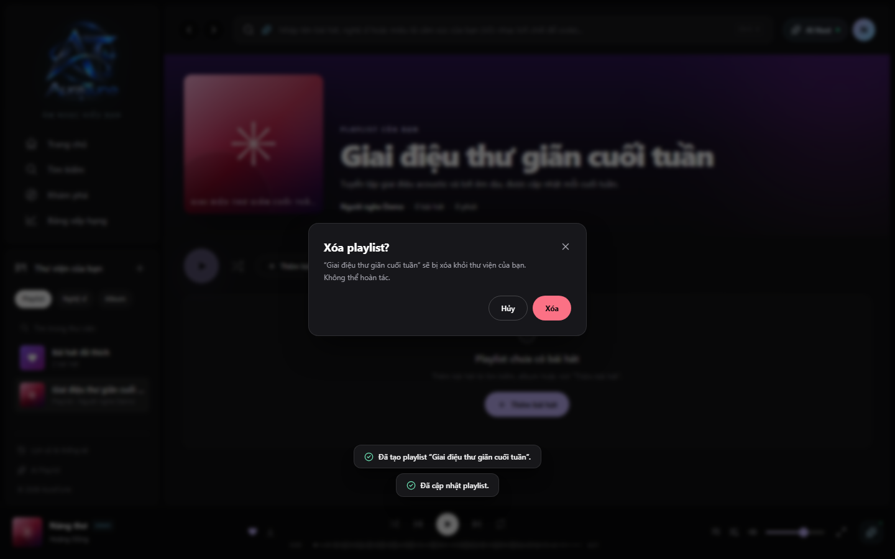

# UC-060-005 – Delete Playlist

## 1. Metadata

| Field | Value |
|---|---|
| Use Case ID | UC-060-005 |
| Use Case Name | Delete Playlist |
| Functional Group | 060 – Playlist Management |
| Primary Actor | Playlist Owner |
| Supporting Actors | None |
| Related FR IDs | 061-FR-008, 065-FR-006 |
| Related Feature ID | 061-playlist-crud |
| Related Spec Kit File | [specs/060-playlist-management/061-playlist-crud/spec.md](../../../../specs/060-playlist-management/061-playlist-crud/spec.md) |
| Writer | Mai Đăng Khoa |
| Reviewer | [FULL NAME] |
| Status | Draft |
| Last Updated | 2026-11-03 |

## 2. Goal

The playlist owner wants to permanently remove a playlist they no longer need.

## 3. Description

This use case describes the safe deletion process for a playlist, including a mandatory confirmation step to prevent accidental loss.

## 4. Preconditions

- The listener is authenticated and owns the playlist.
- The playlist detail page is open.

## 5. Trigger

The listener clicks the "Xóa playlist" (Delete Playlist) button (trash icon) on the playlist detail page.

## 6. Basic Flow

1. **Playlist Owner:** Clicks the Delete button.
2. **System:** Displays a confirmation modal warning that the deletion is permanent.
3. **Playlist Owner:** Clicks "Xóa" (Delete) to confirm.
4. **System:** Permanently deletes the playlist and its associations from the database.
5. **System:** Redirects the listener to the Library page.
6. **System:** Displays a success toast notification.

## 7. Alternative Flows

### AF-01 – Cancel Deletion

- **Starting step:** 2
- **Condition:** Owner decides not to delete the playlist.

1. **Playlist Owner:** Clicks "Hủy" (Cancel) or closes the modal.
2. **System:** Closes the modal and keeps the playlist.

- **Outcome:** Use case ends.

## 8. Exception Flows

### EX-01 – Unauthorized Deletion Attempt

- **Starting step:** 1
- **Condition:** User is not the owner of the playlist.
1. **System:** Does not display the Delete button, or returns a "403 Forbidden" error if forced.

- **Outcome:** Use case ends unsuccessfully.

## 9. Postconditions

### 9.1 Success Postconditions
- The playlist is removed from the database and the listener's library.

### 9.2 Failure Postconditions
- The playlist remains in the library.

## 10. Special Requirements

- **Security:** Requires a confirmation step.
- **Performance:** Successful deletion is reflected across the UI within 500ms.

## 11. Business Rules

| Rule ID | Rule Description | Source |
|---|---|---|
| BR-060-05 | Permanent Deletion | [Spec 061] Immediate permanent deletion (no soft delete). |

## 12. Prototype and Screenshots

### 12.1 Basic Flow

**Covered steps:** 2-3

**Prototype type:** Implemented UI

## 13. Related Use Cases

- UC-060-001 – View Playlists in Library

## 14. Traceability and Sources

| Source Type | ID / File | Relevant Section |
|---|---|---|
| Functional Requirement | 061-FR-008 | System MUST allow the owner of a playlist to delete the playlist permanently after a confirmation step. |
| Functional Requirement | 065-FR-006 | Only the playlist owner may delete the playlist. |
| Spec Kit Specification | specs/060-playlist-management/061-playlist-crud/spec.md | User Story 3 |

## 15. Open Questions

None
