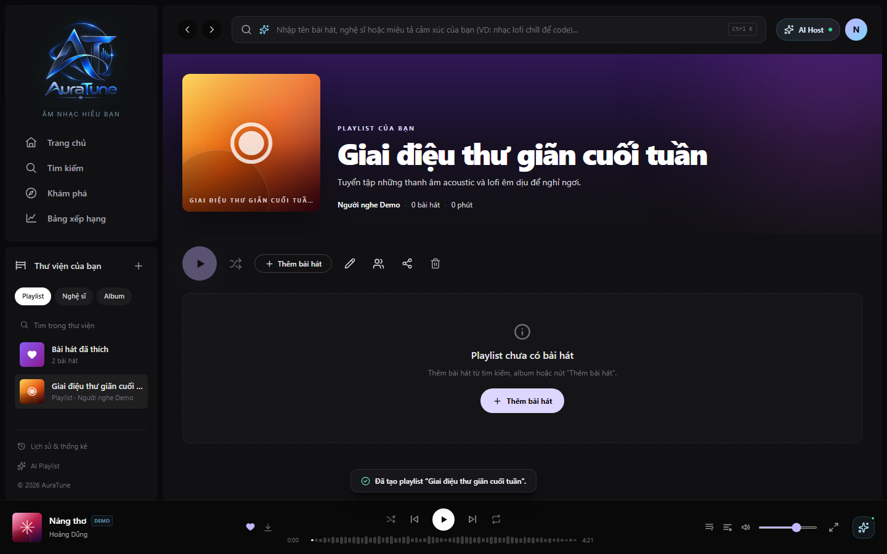

# UC-060-006 – Bookmark Public Playlist
Performed by: Mai Đăng Khoa | Reviewed by: Group 10 team | Edited by: Lê Công Minh Nhựt

## 1. Metadata
Performed by: Mai Đăng Khoa | Reviewed by: Group 10 team | Edited by: Lê Công Minh Nhựt

| Field | Value |
|---|---|
| Use Case ID | UC-060-006 |
| Use Case Name | Bookmark Public Playlist |
| Functional Group | 060 – Playlist Management |
| Primary Actor | Listener |
| Supporting Actors | None |
| Related FR IDs | 061-FR-010 |
| Related Feature ID | 061-playlist-crud |
| Related Spec Kit File | [specs/060-playlist-management/061-playlist-crud/spec.md](../../../../specs/060-playlist-management/061-playlist-crud/spec.md) |
| Writer | Lê Công Minh Nhựt |
| Original Writer (PA3 draft) | Mai Đăng Khoa |
| Reviewer | Group 10 team |
| Status | Draft |
| Last Updated | 2026-11-03 |

## 2. Goal
Performed by: Mai Đăng Khoa | Reviewed by: Group 10 team | Edited by: Lê Công Minh Nhựt

The listener wants to save a public playlist created by another user to their Library for quick access.

## 3. Description
Performed by: Mai Đăng Khoa | Reviewed by: Group 10 team | Edited by: Lê Công Minh Nhựt

This use case describes how a user "follows" or "bookmarks" a public playlist, adding it to their Library collection as a read-only reference.

## 4. Preconditions
Performed by: Mai Đăng Khoa | Reviewed by: Group 10 team | Edited by: Lê Công Minh Nhựt

- The listener is authenticated.
- The listener is viewing a public playlist owned by someone else.

## 5. Trigger
Performed by: Mai Đăng Khoa | Reviewed by: Group 10 team | Edited by: Lê Công Minh Nhựt

The listener clicks the "Lưu playlist" (Save to Library) button.

## 6. Basic Flow
Performed by: Mai Đăng Khoa | Reviewed by: Group 10 team | Edited by: Lê Công Minh Nhựt

1. **Listener:** Clicks "Lưu playlist".
2. **System:** Creates a reference link between the listener's library and the target playlist in the database.
3. **System:** Toggles the button state to "Đã lưu" (Saved).
4. **System:** Displays a success toast notification.
5. **System:** Adds the playlist to the listener's Library view.

## 7. Alternative Flows
Performed by: Mai Đăng Khoa | Reviewed by: Group 10 team | Edited by: Lê Công Minh Nhựt

No alternative flow is defined by the current 061 functional requirements.

## 8. Exception Flows
Performed by: Mai Đăng Khoa | Reviewed by: Group 10 team | Edited by: Lê Công Minh Nhựt

None identified.

## 9. Postconditions
Performed by: Mai Đăng Khoa | Reviewed by: Group 10 team | Edited by: Lê Công Minh Nhựt

### 9.1 Success Postconditions
Performed by: Mai Đăng Khoa | Reviewed by: Group 10 team | Edited by: Lê Công Minh Nhựt
- The playlist appears in the listener's Library.
- The reference is read-only (listener cannot edit metadata or tracks).

### 9.2 Failure Postconditions
Performed by: Mai Đăng Khoa | Reviewed by: Group 10 team | Edited by: Lê Công Minh Nhựt
- The playlist is not added to the library.

## 10. Special Requirements
Performed by: Mai Đăng Khoa | Reviewed by: Group 10 team | Edited by: Lê Công Minh Nhựt

- **Other:** The bookmarked playlist stays synchronized with the owner's updates.

## 11. Business Rules
Performed by: Mai Đăng Khoa | Reviewed by: Group 10 team | Edited by: Lê Công Minh Nhựt

| Rule ID | Rule Description | Source |
|---|---|---|
| BR-060-06 | Read-only Access | [061-FR-010] Bookmarking does not grant edit rights. |

## 12. Prototype and Screenshots
Performed by: Mai Đăng Khoa | Reviewed by: Group 10 team | Edited by: Lê Công Minh Nhựt

### 12.1 Basic Flow
Performed by: Mai Đăng Khoa | Reviewed by: Group 10 team | Edited by: Lê Công Minh Nhựt

**Covered steps:** 1 (The "Save" button is typically in the action toolbar)

**Prototype type:** Implemented UI

## 13. Related Use Cases
Performed by: Mai Đăng Khoa | Reviewed by: Group 10 team | Edited by: Lê Công Minh Nhựt

- UC-060-001 – View Playlists in Library
- UC-060-003 – View Playlist Details

## 14. Traceability and Sources
Performed by: Mai Đăng Khoa | Reviewed by: Group 10 team | Edited by: Lê Công Minh Nhựt

| Source Type | ID / File | Relevant Section |
|---|---|---|
| Functional Requirement | 061-FR-010 | System MUST allow authenticated users to save (bookmark/follow) public playlists to their personal library as read-only references. |
| Spec Kit Specification | specs/060-playlist-management/061-playlist-crud/spec.md | User Story 4 |

## 15. Open Questions
Performed by: Mai Đăng Khoa | Reviewed by: Group 10 team | Edited by: Lê Công Minh Nhựt

| Question ID | Question | Owner | Status | Resolution |
|---|---|---|---|---|
| Q-061-01 | Does 061-FR-010 also require users to remove/unfollow a saved public playlist? | Group Owner | Resolved | No removal behavior is specified by 061-FR-010 or its clarification, so this UC covers saving only. Add a separate FR before modeling unfollow behavior. |

## PA4 implementation evidence and acceptance record
Performed by: Mai Đăng Khoa | Reviewed by: Group 10 team | Edited by: Lê Công Minh Nhựt

Playlist routes, `playlistService.js`, `playlistRepository.js` and SQL migration `003_playlist_management.sql` exist. Verify current owner/collaborator authorization and committed read-back for mutations, including failure outcomes. Feature 064 currently uses keyword-selected candidates in the Python service; this does not demonstrate the required semantic/vector generation path.

The flows above state required behavior. This revision records source inspection only; no browser acceptance or new feature-test run is claimed. Before acceptance, execute the basic flow and its applicable alternative/exception flows, checking the documented success and failure postconditions. Record results against this UC ID in [the PA4 review register](../../use-case-model.md#11-pa4-decisions-and-source-review).
