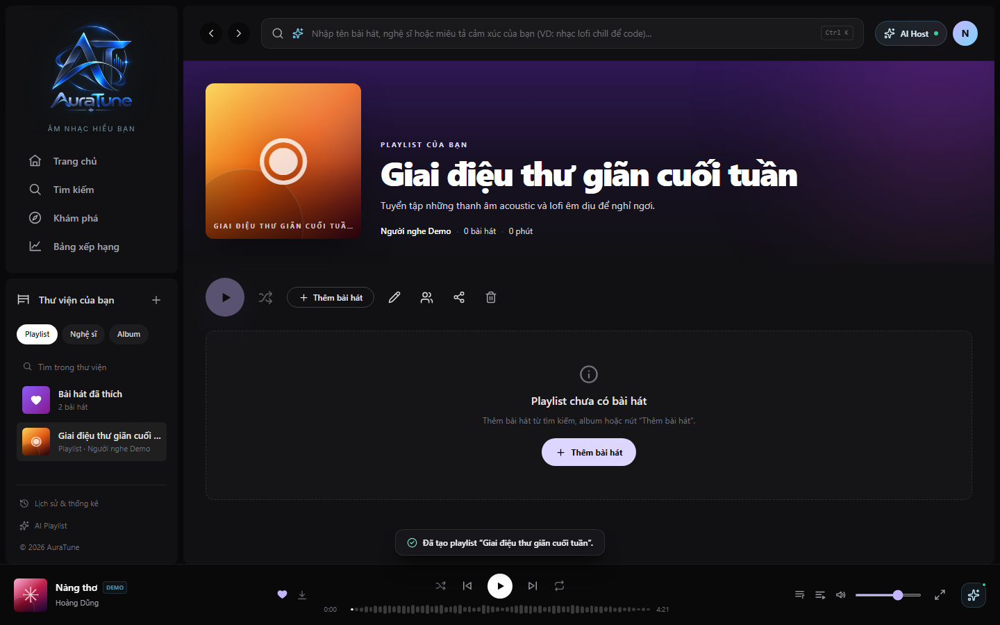

# UC-060-006 – Bookmark Public Playlist

## 1. Metadata

| Field | Value |
|---|---|
| Use Case ID | UC-060-006 |
| Use Case Name | Bookmark Public Playlist |
| Functional Group | 060 – Playlist Management |
| Primary Actor | Listener |
| Supporting Actors | None |
| Related FR IDs | FR-010 |
| Related Feature ID | 061-playlist-crud |
| Related Spec Kit File | [specs/060-playlist-management/061-playlist-crud/spec.md](../../../../specs/060-playlist-management/061-playlist-crud/spec.md) |
| Writer | Mai Đăng Khoa |
| Reviewer | [FULL NAME] |
| Status | Draft |
| Last Updated | 2026-11-03 |

## 2. Goal

The listener wants to save a public playlist created by another user to their Library for quick access.

## 3. Description

This use case describes how a user "follows" or "bookmarks" a public playlist, adding it to their Library collection as a read-only reference.

## 4. Preconditions

- The listener is authenticated.
- The listener is viewing a public playlist owned by someone else.

## 5. Trigger

The listener clicks the "Lưu playlist" (Save to Library) button.

## 6. Basic Flow

1. **Listener:** Clicks "Lưu playlist".
2. **System:** Creates a reference link between the listener's library and the target playlist in the database.
3. **System:** Toggles the button state to "Đã lưu" (Saved).
4. **System:** Displays a success toast notification.
5. **System:** Adds the playlist to the listener's Library view.

## 7. Alternative Flows

### AF-01 – Unbookmark Playlist

- **Starting step:** 1
- **Condition:** Listener already has the playlist saved and wants to remove it.

1. **Listener:** Clicks "Đã lưu" (Saved).
2. **System:** Removes the reference link from the database.
3. **System:** Toggles the button state back to "Lưu playlist".
4. **System:** Removes the playlist from the listener's Library view.

- **Outcome:** Use case ends successfully.

## 8. Exception Flows

None identified.

## 9. Postconditions

### 9.1 Success Postconditions
- The playlist appears in the listener's Library.
- The reference is read-only (listener cannot edit metadata or tracks).

### 9.2 Failure Postconditions
- The playlist is not added to the library.

## 10. Special Requirements

- **Other:** The bookmarked playlist stays synchronized with the owner's updates.

## 11. Business Rules

| Rule ID | Rule Description | Source |
|---|---|---|
| BR-060-06 | Read-only Access | [FR-010] Bookmarking does not grant edit rights. |

## 12. Prototype and Screenshots

### 12.1 Basic Flow

**Covered steps:** 1 (The "Save" button is typically in the action toolbar)

**Prototype type:** Implemented UI

## 13. Related Use Cases

- UC-060-001 – View Playlists in Library
- UC-060-003 – View Playlist Details

## 14. Traceability and Sources

| Source Type | ID / File | Relevant Section |
|---|---|---|
| Functional Requirement | FR-010 | System MUST allow authenticated users to save (bookmark/follow) public playlists to their personal library as read-only references. |
| Spec Kit Specification | specs/060-playlist-management/061-playlist-crud/spec.md | User Story 4 |

## 15. Open Questions

None
