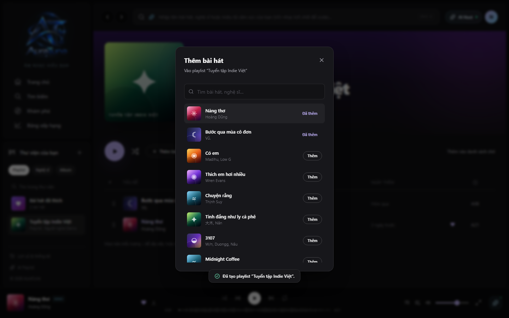

# UC-060-007 – Add Songs to Playlist

## 1. Metadata

| Field | Value |
|---|---|
| Use Case ID | UC-060-007 |
| Use Case Name | Add Songs to Playlist |
| Functional Group | 060 – Playlist Management |
| Primary Actor | Playlist Editor |
| Supporting Actors | None |
| Related FR IDs | 062-FR-001, 062-FR-003, 062-FR-006, 062-FR-007, 062-FR-008, 065-FR-004, 065-FR-008 |
| Related Feature ID | 062-playlist-song-management |
| Related Spec Kit File | [specs/060-playlist-management/062-playlist-song-management/spec.md](../../../../specs/060-playlist-management/062-playlist-song-management/spec.md) |
| Writer | Mai Đăng Khoa |
| Reviewer | [FULL NAME] |
| Status | Draft |
| Last Updated | 2026-11-03 |

## 2. Goal

The playlist editor wants to add new tracks to a playlist to expand its content.

## 3. Description

This use case describes how an authorized user searches for songs and appends them to a playlist.

## 4. Preconditions

- The listener is authenticated and has edit rights for the playlist (is owner or collaborator).
- The playlist detail page is open.

## 5. Trigger

The listener clicks the "Thêm bài hát" (Add songs) button.

## 6. Basic Flow

1. **Playlist Editor:** Clicks "Thêm bài hát".
2. **System:** Opens the `AddSongsDialog` modal with a search input.
3. **Playlist Editor:** Types a song title or artist name.
4. **System:** Displays a list of matching songs from the platform's catalog.
5. **Playlist Editor:** Clicks the "Thêm" (Add) button next to a song.
6. **System:** Appends the song to the playlist in the database.
7. **System:** Toggles the button label to "Đã thêm" (Added) and disables it.
8. **System:** Updates the playlist's total song count and duration in the UI.
9. **System:** Displays a success toast notification.

## 7. Alternative Flows

### AF-01 – Add from Song Menu

- **Starting step:** 1
- **Condition:** Editor wants to add a song while browsing other pages (e.g., Search or Album).

1. **Playlist Editor:** Opens the `TrackMenu` (three dots) for a song.
2. **Playlist Editor:** Selects "Thêm vào playlist" (Add to playlist).
3. **System:** Displays a list of the user's editable playlists.
4. **Playlist Editor:** Selects the target playlist.
5. **System:** Adds the song to the selected playlist.

- **Outcome:** Use case ends successfully.

## 8. Exception Flows

### EX-01 – Song Already in Playlist

- **Starting step:** 5
- **Condition:** The song is already present in the target playlist.
1. **System:** Displays the button as "Đã thêm" (Added) and disabled, or shows a notification that the track already exists.

- **Outcome:** Resume at Basic Flow step 4.

## 9. Postconditions

### 9.1 Success Postconditions
- The song is added to the `playlist_songs` table.
- The playlist metadata (count, duration) is updated.

### 9.2 Failure Postconditions
- The playlist content remains unchanged.

## 10. Special Requirements

- **Performance:** Adding a song completes in under 800ms.

## 11. Business Rules

| Rule ID | Rule Description | Source |
|---|---|---|
| BR-060-07 | Authorization | [062-FR-007] Only owners or collaborators can add songs. |
| BR-060-08 | Duplicate Prevention | [062-FR-008] Prevent duplicate songs in the same playlist. |

## 12. Prototype and Screenshots

### 12.1 Basic Flow

**Covered steps:** 2-5

**Prototype type:** Implemented UI

## 13. Related Use Cases

- UC-060-003 – View Playlist Details
- UC-060-008 – Remove Song from Playlist

## 14. Traceability and Sources

| Source Type | ID / File | Relevant Section |
|---|---|---|
| Functional Requirement | 062-FR-001 | System MUST allow authenticated users to add any song to their owned or collaborative playlists. |
| Functional Requirement | 062-FR-003, 062-FR-006 | Persist playlist-song association/order and update playlist count/duration after additions. |
| Functional Requirement | 062-FR-007, 065-FR-008 | Only owners and authorized collaborators can modify the playlist. |
| Functional Requirement | 062-FR-008 | Prevent duplicate tracks in the same playlist. |
| Functional Requirement | 065-FR-004 | Authorized collaborators can add tracks to a collaborative playlist. |
| Spec Kit Specification | specs/060-playlist-management/062-playlist-song-management/spec.md | User Story 2 |

## 15. Open Questions

None
