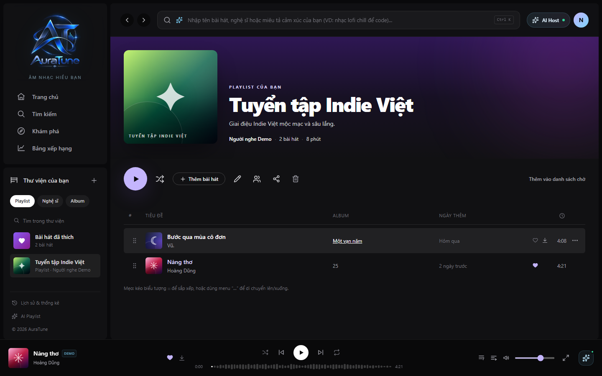

# UC-060-009 – Reorder Songs in Playlist
Performed by: Mai Đăng Khoa | Reviewed by: Group 10 team | Edited by: Lê Công Minh Nhựt

## 1. Metadata
Performed by: Mai Đăng Khoa | Reviewed by: Group 10 team | Edited by: Lê Công Minh Nhựt

| Field | Value |
|---|---|
| Use Case ID | UC-060-009 |
| Use Case Name | Reorder Songs in Playlist |
| Functional Group | 060 – Playlist Management |
| Primary Actor | Playlist Editor |
| Supporting Actors | None |
| Related FR IDs | 062-FR-003, 062-FR-004, 062-FR-007, 065-FR-004, 065-FR-008 |
| Related Feature ID | 062-playlist-song-management |
| Related Spec Kit File | [specs/060-playlist-management/062-playlist-song-management/spec.md](../../../../specs/060-playlist-management/062-playlist-song-management/spec.md) |
| Writer | Lê Công Minh Nhựt |
| Original Writer (PA3 draft) | Mai Đăng Khoa |
| Reviewer | Group 10 team |
| Status | Draft |
| Last Updated | 2026-11-03 |

## 2. Goal
Performed by: Mai Đăng Khoa | Reviewed by: Group 10 team | Edited by: Lê Công Minh Nhựt

The playlist editor wants to change the sequence of songs in a playlist.

## 3. Description
Performed by: Mai Đăng Khoa | Reviewed by: Group 10 team | Edited by: Lê Công Minh Nhựt

This use case describes how an authorized user uses drag-and-drop handles to rearrange the order of tracks in the playlist detail view.

## 4. Preconditions
Performed by: Mai Đăng Khoa | Reviewed by: Group 10 team | Edited by: Lê Công Minh Nhựt

- The listener is authenticated and has edit rights for the playlist.
- The playlist detail page is open and contains at least two songs.

## 5. Trigger
Performed by: Mai Đăng Khoa | Reviewed by: Group 10 team | Edited by: Lê Công Minh Nhựt

The listener clicks and drags the grip handle (`⋮⋮`) on a song row.

## 6. Basic Flow
Performed by: Mai Đăng Khoa | Reviewed by: Group 10 team | Edited by: Lê Công Minh Nhựt

1. **Playlist Editor:** Drags a song row to a new position in the list.
2. **System:** Provides visual feedback (60fps) during the drag operation.
3. **Playlist Editor:** Drops the row at the desired position.
4. **System:** Updates the `sort_order` or position of the tracks in the database.
5. **System:** Persists the new sequence for all future views.
6. **System:** Displays a success toast notification.

## 7. Alternative Flows
Performed by: Mai Đăng Khoa | Reviewed by: Group 10 team | Edited by: Lê Công Minh Nhựt

None identified.

## 8. Exception Flows
Performed by: Mai Đăng Khoa | Reviewed by: Group 10 team | Edited by: Lê Công Minh Nhựt

### EX-01 – Persistence Failure
Performed by: Mai Đăng Khoa | Reviewed by: Group 10 team | Edited by: Lê Công Minh Nhựt

- **Starting step:** 4
- **Condition:** Database update fails due to network error.
1. **System:** Reverts the UI list to the previous order.
2. **System:** Displays an error toast notification.

- **Outcome:** Resume at Basic Flow step 1.

## 9. Postconditions
Performed by: Mai Đăng Khoa | Reviewed by: Group 10 team | Edited by: Lê Công Minh Nhựt

### 9.1 Success Postconditions
Performed by: Mai Đăng Khoa | Reviewed by: Group 10 team | Edited by: Lê Công Minh Nhựt
- The new song order is saved in the database.

### 9.2 Failure Postconditions
Performed by: Mai Đăng Khoa | Reviewed by: Group 10 team | Edited by: Lê Công Minh Nhựt
- The song order remains unchanged.

## 10. Special Requirements
Performed by: Mai Đăng Khoa | Reviewed by: Group 10 team | Edited by: Lê Công Minh Nhựt

- **Performance:** Drag-and-drop provides smooth 60fps feedback.
- **Concurrency:** Last state received by the server wins.

## 11. Business Rules
Performed by: Mai Đăng Khoa | Reviewed by: Group 10 team | Edited by: Lê Công Minh Nhựt

| Rule ID | Rule Description | Source |
|---|---|---|
| BR-060-10 | Order Persistence | [062-FR-003] System MUST persist sort_order or position. |

## 12. Prototype and Screenshots
Performed by: Mai Đăng Khoa | Reviewed by: Group 10 team | Edited by: Lê Công Minh Nhựt

### 12.1 Basic Flow
Performed by: Mai Đăng Khoa | Reviewed by: Group 10 team | Edited by: Lê Công Minh Nhựt

**Covered steps:** 1 (Grip handles are visible)

**Prototype type:** Implemented UI

## 13. Related Use Cases
Performed by: Mai Đăng Khoa | Reviewed by: Group 10 team | Edited by: Lê Công Minh Nhựt

- UC-060-003 – View Playlist Details

## 14. Traceability and Sources
Performed by: Mai Đăng Khoa | Reviewed by: Group 10 team | Edited by: Lê Công Minh Nhựt

| Source Type | ID / File | Relevant Section |
|---|---|---|
| Functional Requirement | 062-FR-004 | System MUST support drag-and-drop reordering of songs within the playlist detail view. |
| Functional Requirement | 062-FR-003 | Persist each playlist-song association with its position. |
| Functional Requirement | 062-FR-007, 065-FR-008 | Only owners and authorized collaborators can modify the playlist. |
| Functional Requirement | 065-FR-004 | Authorized collaborators can reorder tracks in a collaborative playlist. |
| Spec Kit Specification | specs/060-playlist-management/062-playlist-song-management/spec.md | User Story 3 |

## 15. Open Questions
Performed by: Mai Đăng Khoa | Reviewed by: Group 10 team | Edited by: Lê Công Minh Nhựt

None

## PA4 implementation evidence and acceptance record
Performed by: Mai Đăng Khoa | Reviewed by: Group 10 team | Edited by: Lê Công Minh Nhựt

Playlist routes, `playlistService.js`, `playlistRepository.js` and SQL migration `003_playlist_management.sql` exist. Verify current owner/collaborator authorization and committed read-back for mutations, including failure outcomes. Feature 064 currently uses keyword-selected candidates in the Python service; this does not demonstrate the required semantic/vector generation path.

The flows above state required behavior. This revision records source inspection only; no browser acceptance or new feature-test run is claimed. Before acceptance, execute the basic flow and its applicable alternative/exception flows, checking the documented success and failure postconditions. Record results against this UC ID in [the PA4 review register](../../use-case-model.md#11-pa4-decisions-and-source-review).
