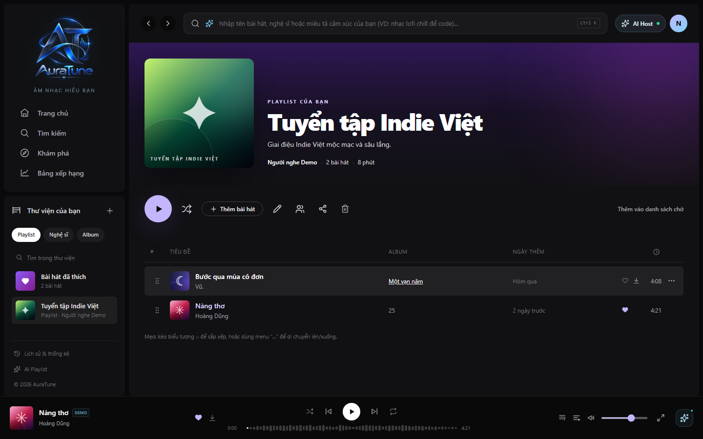

# UC-060-010 – Toggle Like Song

## 1. Metadata

| Field | Value |
|---|---|
| Use Case ID | UC-060-010 |
| Use Case Name | Toggle Like Song |
| Functional Group | 060 – Playlist Management |
| Primary Actor | Listener |
| Supporting Actors | None |
| Related FR IDs | 062-FR-002 |
| Related Feature ID | 062-playlist-song-management |
| Related Spec Kit File | [specs/060-playlist-management/062-playlist-song-management/spec.md](../../../../specs/060-playlist-management/062-playlist-song-management/spec.md) |
| Writer | Mai Đăng Khoa |
| Reviewer | [FULL NAME] |
| Status | Draft |
| Last Updated | 2026-11-03 |

## 2. Goal

The listener wants to quickly add or remove a song from their "Liked Songs" collection.

## 3. Description

This use case describes how the listener uses the heart icon on any song row or player to manage their personal "Liked Songs" playlist.

## 4. Preconditions

- The listener is authenticated.

## 5. Trigger

The listener clicks the heart icon next to a song title or in the player controls.

## 6. Basic Flow

1. **Listener:** Clicks the heart icon for a song that is NOT currently liked.
2. **System:** Adds the song to the listener's system-managed "Liked Songs" playlist.
3. **System:** Sets the heart icon to an active (filled) state.
4. **System:** Displays a brief success notification.

## 7. Alternative Flows

### AF-01 – Unlike Song

- **Starting step:** 1
- **Condition:** The song is already in the "Liked Songs" playlist.

1. **Listener:** Clicks the active heart icon.
2. **System:** Removes the song from the "Liked Songs" playlist.
3. **System:** Returns the heart icon to an inactive (outline) state.

- **Outcome:** Use case ends successfully.

## 8. Exception Flows

None identified.

## 9. Postconditions

### 9.1 Success Postconditions
- The "Liked Songs" playlist is synchronized with the heart toggle state.
- The UI reflects the correct state across all components.

### 9.2 Failure Postconditions
- The liked status remains unchanged.

## 10. Special Requirements

- **Performance:** Heart toggle updates the UI within 300ms.

## 11. Business Rules

| Rule ID | Rule Description | Source |
|---|---|---|
| BR-060-11 | Liked Songs Sync | [062-FR-002] Sync additions/removals with the song "Like" toggle. |

## 12. Prototype and Screenshots

### 12.1 Basic Flow

**Covered steps:** 1 (Heart icons are visible in the song table)

**Prototype type:** Implemented UI

## 13. Related Use Cases

- UC-060-001 – View Playlists in Library

## 14. Traceability and Sources

| Source Type | ID / File | Relevant Section |
|---|---|---|
| Functional Requirement | 062-FR-002 | System MUST automatically maintain a "Liked Songs" playlist for every user. |
| Spec Kit Specification | specs/060-playlist-management/062-playlist-song-management/spec.md | User Story 2 |

## 15. Open Questions

None
