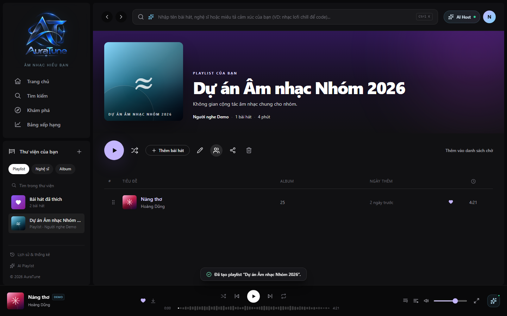

# UC-060-011 – Enable Collaboration on Playlist

## 1. Metadata

| Field | Value |
|---|---|
| Use Case ID | UC-060-011 |
| Use Case Name | Enable Collaboration on Playlist |
| Functional Group | 060 – Playlist Management |
| Primary Actor | Playlist Owner |
| Supporting Actors | None |
| Related FR IDs | FR-065-01 |
| Related Feature ID | 065-collaborative-playlists |
| Related Spec Kit File | [specs/060-playlist-management/065-collaborative-playlists/spec.md](../../../../specs/060-playlist-management/065-collaborative-playlists/spec.md) |
| Writer | Mai Đăng Khoa |
| Reviewer | [FULL NAME] |
| Status | Draft |
| Last Updated | 2026-11-03 |

## 2. Goal

The playlist owner wants to allow other users to contribute to their playlist.

## 3. Description

This use case describes how the owner of a playlist toggles the collaborative status to enable sharing editing rights with others.

## 4. Preconditions

- The listener is authenticated and owns the playlist.
- The playlist detail page is open.

## 5. Trigger

The listener clicks the "Quản lý cộng tác" (Manage collaboration) button (users icon) on the toolbar.

## 6. Basic Flow

1. **Playlist Owner:** Clicks the "Quản lý cộng tác" button.
2. **System:** Opens the `CollaboratorsDialog` modal.
3. **Playlist Owner:** Toggles the "Cho phép cộng tác" (Allow collaboration) switch to ON.
4. **System:** Updates the playlist's `is_collaborative` status in the database.
5. **System:** Updates the UI to show collaborative playlist indicators (badge, member count).
6. **System:** Enables the invitation form in the modal.

## 7. Alternative Flows

### AF-01 – Disable Collaboration

- **Starting step:** 3
- **Condition:** Owner wants to stop collaboration.

1. **Playlist Owner:** Toggles the "Cho phép cộng tác" switch to OFF.
2. **System:** Updates the status in the database.
3. **System:** Revokes editing rights for all collaborators (except the owner).
4. **System:** Removes collaborative indicators from the UI.

- **Outcome:** Use case ends.

## 8. Exception Flows

None identified.

## 9. Postconditions

### 9.1 Success Postconditions
- The playlist is marked as collaborative.
- The owner can now invite collaborators.

### 9.2 Failure Postconditions
- The playlist remains in its previous state.

## 10. Special Requirements

- **Usability:** Transition from private to collaborative happens in under 3 clicks.

## 11. Business Rules

| Rule ID | Rule Description | Source |
|---|---|---|
| BR-060-12 | Owner Control | [FR-065-01] Only owners can toggle collaborative status. |

## 12. Prototype and Screenshots

### 12.1 Basic Flow

**Covered steps:** 1-2

**Prototype type:** Implemented UI

## 13. Related Use Cases

- UC-060-012 – Invite Collaborators
- UC-060-014 – View Collaborative Playlist Details

## 14. Traceability and Sources

| Source Type | ID / File | Relevant Section |
|---|---|---|
| Functional Requirement | FR-065-01 | Playlist owners MUST be able to toggle the is_collaborative status of any playlist they own. |
| Spec Kit Specification | specs/060-playlist-management/065-collaborative-playlists/spec.md | User Story 1 |

## 15. Open Questions

None
