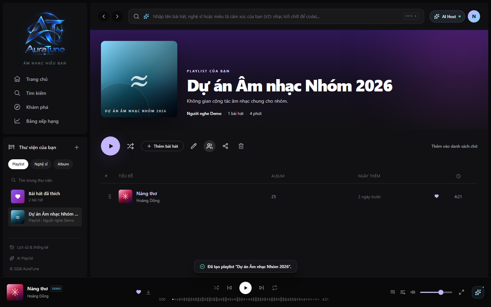

# UC-060-011 – Enable Collaboration on Playlist
Performed by: Mai Đăng Khoa | Reviewed by: Group 10 team | Edited by: Lê Công Minh Nhựt

## 1. Metadata
Performed by: Mai Đăng Khoa | Reviewed by: Group 10 team | Edited by: Lê Công Minh Nhựt

| Field | Value |
|---|---|
| Use Case ID | UC-060-011 |
| Use Case Name | Enable Collaboration on Playlist |
| Functional Group | 060 – Playlist Management |
| Primary Actor | Playlist Owner |
| Supporting Actors | None |
| Related FR IDs | 065-FR-001, 065-FR-009 |
| Related Feature ID | 065-collaborative-playlists |
| Related Spec Kit File | [specs/060-playlist-management/065-collaborative-playlists/spec.md](../../../../specs/060-playlist-management/065-collaborative-playlists/spec.md) |
| Writer | Lê Công Minh Nhựt |
| Original Writer (PA3 draft) | Mai Đăng Khoa |
| Reviewer | Group 10 team |
| Status | Draft |
| Last Updated | 2026-11-03 |

## 2. Goal
Performed by: Mai Đăng Khoa | Reviewed by: Group 10 team | Edited by: Lê Công Minh Nhựt

The playlist owner wants to allow other users to contribute to their playlist.

## 3. Description
Performed by: Mai Đăng Khoa | Reviewed by: Group 10 team | Edited by: Lê Công Minh Nhựt

This use case describes how the owner of a playlist toggles the collaborative status to enable sharing editing rights with others.

## 4. Preconditions
Performed by: Mai Đăng Khoa | Reviewed by: Group 10 team | Edited by: Lê Công Minh Nhựt

- The listener is authenticated and owns the playlist.
- The playlist detail page is open.

## 5. Trigger
Performed by: Mai Đăng Khoa | Reviewed by: Group 10 team | Edited by: Lê Công Minh Nhựt

The listener clicks the "Quản lý cộng tác" (Manage collaboration) button (users icon) on the toolbar.

## 6. Basic Flow
Performed by: Mai Đăng Khoa | Reviewed by: Group 10 team | Edited by: Lê Công Minh Nhựt

1. **Playlist Owner:** Clicks the "Quản lý cộng tác" button.
2. **System:** Opens the `CollaboratorsDialog` modal.
3. **Playlist Owner:** Toggles the "Cho phép cộng tác" (Allow collaboration) switch to ON.
4. **System:** Updates the playlist's `is_collaborative` status in the database.
5. **System:** Updates the UI to show collaborative playlist indicators (badge, member count).
6. **System:** Enables the invitation form in the modal.

## 7. Alternative Flows
Performed by: Mai Đăng Khoa | Reviewed by: Group 10 team | Edited by: Lê Công Minh Nhựt

### AF-01 – Disable Collaboration
Performed by: Mai Đăng Khoa | Reviewed by: Group 10 team | Edited by: Lê Công Minh Nhựt

- **Starting step:** 3
- **Condition:** Owner wants to stop collaboration.

1. **Playlist Owner:** Toggles the "Cho phép cộng tác" switch to OFF.
2. **System:** Updates the status in the database.
3. **System:** Revokes editing rights for all collaborators (except the owner).
4. **System:** Removes collaborative indicators from the UI.

- **Outcome:** Use case ends.

## 8. Exception Flows
Performed by: Mai Đăng Khoa | Reviewed by: Group 10 team | Edited by: Lê Công Minh Nhựt

None identified.

## 9. Postconditions
Performed by: Mai Đăng Khoa | Reviewed by: Group 10 team | Edited by: Lê Công Minh Nhựt

### 9.1 Success Postconditions
Performed by: Mai Đăng Khoa | Reviewed by: Group 10 team | Edited by: Lê Công Minh Nhựt
- The playlist is marked as collaborative.
- The owner can now invite collaborators.

### 9.2 Failure Postconditions
Performed by: Mai Đăng Khoa | Reviewed by: Group 10 team | Edited by: Lê Công Minh Nhựt
- The playlist remains in its previous state.

## 10. Special Requirements
Performed by: Mai Đăng Khoa | Reviewed by: Group 10 team | Edited by: Lê Công Minh Nhựt

- **Usability:** Transition from private to collaborative happens in under 3 clicks.

## 11. Business Rules
Performed by: Mai Đăng Khoa | Reviewed by: Group 10 team | Edited by: Lê Công Minh Nhựt

| Rule ID | Rule Description | Source |
|---|---|---|
| BR-060-12 | Owner Control | [065-FR-001] Only owners can toggle collaborative status. |

## 12. Prototype and Screenshots
Performed by: Mai Đăng Khoa | Reviewed by: Group 10 team | Edited by: Lê Công Minh Nhựt

### 12.1 Basic Flow
Performed by: Mai Đăng Khoa | Reviewed by: Group 10 team | Edited by: Lê Công Minh Nhựt

**Covered steps:** 1-2

**Prototype type:** Implemented UI

## 13. Related Use Cases
Performed by: Mai Đăng Khoa | Reviewed by: Group 10 team | Edited by: Lê Công Minh Nhựt

- UC-060-012 – Invite Collaborators
- UC-060-014 – View Collaborative Playlist Details

## 14. Traceability and Sources
Performed by: Mai Đăng Khoa | Reviewed by: Group 10 team | Edited by: Lê Công Minh Nhựt

| Source Type | ID / File | Relevant Section |
|---|---|---|
| Functional Requirement | 065-FR-001 | Playlist owners MUST be able to toggle the is_collaborative status of any playlist they own. |
| Spec Kit Specification | specs/060-playlist-management/065-collaborative-playlists/spec.md | User Story 1 |

## 15. Open Questions
Performed by: Mai Đăng Khoa | Reviewed by: Group 10 team | Edited by: Lê Công Minh Nhựt

None

## PA4 implementation evidence and acceptance record
Performed by: Mai Đăng Khoa | Reviewed by: Group 10 team | Edited by: Lê Công Minh Nhựt

Playlist routes, `playlistService.js`, `playlistRepository.js` and SQL migration `003_playlist_management.sql` exist. Verify current owner/collaborator authorization and committed read-back for mutations, including failure outcomes. Feature 064 currently uses keyword-selected candidates in the Python service; this does not demonstrate the required semantic/vector generation path.

The flows above state required behavior. This revision records source inspection only; no browser acceptance or new feature-test run is claimed. Before acceptance, execute the basic flow and its applicable alternative/exception flows, checking the documented success and failure postconditions. Record results against this UC ID in [the PA4 review register](../../use-case-model.md#11-pa4-decisions-and-source-review).
