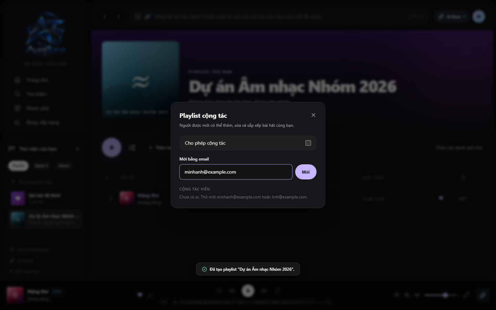

# UC-060-012 – Invite Collaborators
Performed by: Mai Đăng Khoa | Reviewed by: Group 10 team | Edited by: Lê Công Minh Nhựt

## 1. Metadata
Performed by: Mai Đăng Khoa | Reviewed by: Group 10 team | Edited by: Lê Công Minh Nhựt

| Field | Value |
|---|---|
| Use Case ID | UC-060-012 |
| Use Case Name | Invite Collaborators |
| Functional Group | 060 – Playlist Management |
| Primary Actor | Playlist Owner |
| Supporting Actors | None |
| Related FR IDs | 065-FR-002, 065-FR-003, 065-FR-009 |
| Related Feature ID | 065-collaborative-playlists |
| Related Spec Kit File | [specs/060-playlist-management/065-collaborative-playlists/spec.md](../../../../specs/060-playlist-management/065-collaborative-playlists/spec.md) |
| Writer | Lê Công Minh Nhựt |
| Original Writer (PA3 draft) | Mai Đăng Khoa |
| Reviewer | Group 10 team |
| Status | Draft |
| Last Updated | 2026-11-03 |

## 2. Goal
Performed by: Mai Đăng Khoa | Reviewed by: Group 10 team | Edited by: Lê Công Minh Nhựt

The playlist owner wants to invite specific users to collaborate on their playlist.

## 3. Description
Performed by: Mai Đăng Khoa | Reviewed by: Group 10 team | Edited by: Lê Công Minh Nhựt

This use case describes how the owner of a collaborative playlist invites other registered users by entering their email address.

## 4. Preconditions
Performed by: Mai Đăng Khoa | Reviewed by: Group 10 team | Edited by: Lê Công Minh Nhựt

- The listener is authenticated and owns the playlist.
- Collaborative mode is enabled for the playlist.
- The `CollaboratorsDialog` is open.

## 5. Trigger
Performed by: Mai Đăng Khoa | Reviewed by: Group 10 team | Edited by: Lê Công Minh Nhựt

The listener enters an email address in the invitation input and clicks "Mời" (Invite).

## 6. Basic Flow
Performed by: Mai Đăng Khoa | Reviewed by: Group 10 team | Edited by: Lê Công Minh Nhựt

1. **Playlist Owner:** Enters a valid email of a registered AuraTune user.
2. **Playlist Owner:** Clicks the "Mời" button.
3. **System:** Validates that the email belongs to a registered user.
4. **System:** Creates a record in the `playlist_shared_users` table with the role `Collaborator`.
5. **System:** Adds the user to the collaborators roster in the modal.
6. **System:** Displays a success toast: `"<Tên hiển thị> có thể cùng chỉnh sửa playlist này."`
7. **System:** (Implicitly) Grants the invited user editing access.

## 7. Alternative Flows
Performed by: Mai Đăng Khoa | Reviewed by: Group 10 team | Edited by: Lê Công Minh Nhựt

None identified.

## 8. Exception Flows
Performed by: Mai Đăng Khoa | Reviewed by: Group 10 team | Edited by: Lê Công Minh Nhựt

### EX-01 – User Not Found
Performed by: Mai Đăng Khoa | Reviewed by: Group 10 team | Edited by: Lê Công Minh Nhựt

- **Starting step:** 3
- **Condition:** The entered email does not belong to any registered user.
1. **System:** Displays an error message: "Không tìm thấy người dùng với email này."

- **Outcome:** Resume at Basic Flow step 1.

### EX-02 – User Already a Collaborator
Performed by: Mai Đăng Khoa | Reviewed by: Group 10 team | Edited by: Lê Công Minh Nhựt

- **Starting step:** 3
- **Condition:** The user is already invited or is the owner.
1. **System:** Displays a message stating the user is already a member.

- **Outcome:** Resume at Basic Flow step 1.

## 9. Postconditions
Performed by: Mai Đăng Khoa | Reviewed by: Group 10 team | Edited by: Lê Công Minh Nhựt

### 9.1 Success Postconditions
Performed by: Mai Đăng Khoa | Reviewed by: Group 10 team | Edited by: Lê Công Minh Nhựt
- The invited user is linked to the playlist with collaborator permissions.
- The playlist appears in the invited user's Library.

### 9.2 Failure Postconditions
Performed by: Mai Đăng Khoa | Reviewed by: Group 10 team | Edited by: Lê Công Minh Nhựt
- No new collaborator is added.

## 10. Special Requirements
Performed by: Mai Đăng Khoa | Reviewed by: Group 10 team | Edited by: Lê Công Minh Nhựt

- **Other:** Invited users immediately receive collaborator access.

## 11. Business Rules
Performed by: Mai Đăng Khoa | Reviewed by: Group 10 team | Edited by: Lê Công Minh Nhựt

| Rule ID | Rule Description | Source |
|---|---|---|
| BR-060-13 | Targeted Invitation | [Spec 065] Owner invites registered users by entering their email address. |

## 12. Prototype and Screenshots
Performed by: Mai Đăng Khoa | Reviewed by: Group 10 team | Edited by: Lê Công Minh Nhựt

### 12.1 Basic Flow
Performed by: Mai Đăng Khoa | Reviewed by: Group 10 team | Edited by: Lê Công Minh Nhựt

**Covered steps:** 1-2

**Prototype type:** Implemented UI

## 13. Related Use Cases
Performed by: Mai Đăng Khoa | Reviewed by: Group 10 team | Edited by: Lê Công Minh Nhựt

- UC-060-011 – Enable Collaboration on Playlist
- UC-060-013 – Manage Collaborators

## 14. Traceability and Sources
Performed by: Mai Đăng Khoa | Reviewed by: Group 10 team | Edited by: Lê Công Minh Nhựt

| Source Type | ID / File | Relevant Section |
|---|---|---|
| Functional Requirement | 065-FR-002 | System MUST allow playlist owners to invite registered AuraTune users by entering their email address. |
| Functional Requirement | 065-FR-003 | Invited users MUST immediately receive collaborator access upon invitation. |
| Spec Kit Specification | specs/060-playlist-management/065-collaborative-playlists/spec.md | User Story 2 |

## 15. Open Questions
Performed by: Mai Đăng Khoa | Reviewed by: Group 10 team | Edited by: Lê Công Minh Nhựt

None

## PA4 implementation evidence and acceptance record
Performed by: Mai Đăng Khoa | Reviewed by: Group 10 team | Edited by: Lê Công Minh Nhựt

Playlist routes, `playlistService.js`, `playlistRepository.js` and SQL migration `003_playlist_management.sql` exist. Verify current owner/collaborator authorization and committed read-back for mutations, including failure outcomes. Feature 064 currently uses keyword-selected candidates in the Python service; this does not demonstrate the required semantic/vector generation path.

The flows above state required behavior. This revision records source inspection only; no browser acceptance or new feature-test run is claimed. Before acceptance, execute the basic flow and its applicable alternative/exception flows, checking the documented success and failure postconditions. Record results against this UC ID in [the PA4 review register](../../use-case-model.md#11-pa4-decisions-and-source-review).
