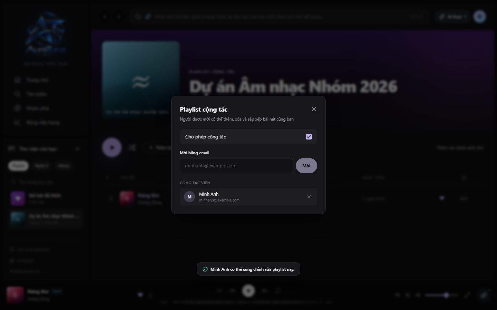

# UC-060-013 – Manage Collaborators

## 1. Metadata

| Field | Value |
|---|---|
| Use Case ID | UC-060-013 |
| Use Case Name | Manage Collaborators |
| Functional Group | 060 – Playlist Management |
| Primary Actor | Playlist Owner |
| Supporting Actors | None |
| Related FR IDs | FR-065-07 |
| Related Feature ID | 065-collaborative-playlists |
| Related Spec Kit File | [specs/060-playlist-management/065-collaborative-playlists/spec.md](../../../../specs/060-playlist-management/065-collaborative-playlists/spec.md) |
| Writer | Mai Đăng Khoa |
| Reviewer | [FULL NAME] |
| Status | Draft |
| Last Updated | 2026-11-03 |

## 2. Goal

The playlist owner wants to view the list of active collaborators and remove any if necessary.

## 3. Description

This use case describes how the owner of a collaborative playlist manages the roster of users who have editing access to the playlist.

## 4. Preconditions

- The listener is authenticated and owns the playlist.
- The `CollaboratorsDialog` is open.
- There are active collaborators in the playlist.

## 5. Trigger

The listener views the collaborator list or clicks a remove button.

## 6. Basic Flow

1. **Playlist Owner:** Reviews the list of collaborators (avatar, name, email).
2. **Playlist Owner:** Clicks the "Gỡ" (Remove) button next to a collaborator's name.
3. **System:** Removes the user's entry from the `playlist_shared_users` table for this playlist.
4. **System:** Updates the UI by removing the collaborator from the list.
5. **System:** Revokes the user's editing rights immediately.
6. **System:** Updates the collaborator count in the playlist header.

## 7. Alternative Flows

None identified.

## 8. Exception Flows

### EX-01 – Owner Removal Attempt

- **Starting step:** 2
- **Condition:** User tries to remove themselves (as the owner).
1. **System:** Does not provide a remove button for the owner entry.

- **Outcome:** Resume at Basic Flow step 1.

## 9. Postconditions

### 9.1 Success Postconditions
- The removed user no longer has editing access to the playlist.
- The user list and member count are updated.

### 9.2 Failure Postconditions
- The collaborator roster remains unchanged.

## 10. Special Requirements

- **Performance:** Revoking access takes effect within 1 second.

## 11. Business Rules

| Rule ID | Rule Description | Source |
|---|---|---|
| BR-060-14 | Owner Authority | [FR-065-07] Playlist owners MUST be able to view and revoke collaborator access. |

## 12. Prototype and Screenshots

### 12.1 Basic Flow

**Covered steps:** 1-2

**Prototype type:** Implemented UI

## 13. Related Use Cases

- UC-060-011 – Enable Collaboration on Playlist
- UC-060-012 – Invite Collaborators

## 14. Traceability and Sources

| Source Type | ID / File | Relevant Section |
|---|---|---|
| Functional Requirement | FR-065-07 | Playlist owners MUST be able to view a list of all current collaborators and revoke their access. |
| Spec Kit Specification | specs/060-playlist-management/065-collaborative-playlists/spec.md | User Story 3 |

## 15. Open Questions

None
