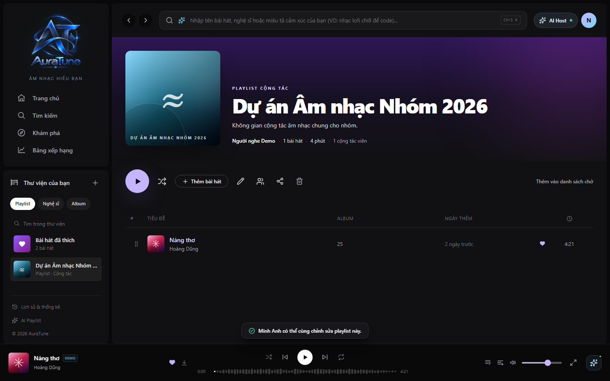

# UC-060-014 – View Collaborative Playlist Details

## 1. Metadata

| Field | Value |
|---|---|
| Use Case ID | UC-060-014 |
| Use Case Name | View Collaborative Playlist Details |
| Functional Group | 060 – Playlist Management |
| Primary Actor | Participant |
| Supporting Actors | None |
| Related FR IDs | FR-065-04, FR-065-05, FR-065-10 |
| Related Feature ID | 065-collaborative-playlists |
| Related Spec Kit File | [specs/060-playlist-management/065-collaborative-playlists/spec.md](../../../../specs/060-playlist-management/065-collaborative-playlists/spec.md) |
| Writer | Mai Đăng Khoa |
| Reviewer | [FULL NAME] |
| Status | Draft |
| Last Updated | 2026-11-03 |

## 2. Goal

The participant wants to view and interact with a shared collaborative playlist.

## 3. Description

This use case describes the unique visual and functional aspects of a collaborative playlist, including contributor indicators and shared editing rights.

## 4. Preconditions

- The listener is authenticated and is a joined collaborator of the playlist.
- The playlist detail page is open.

## 5. Trigger

The participant navigates to the collaborative playlist.

## 6. Basic Flow

1. **Participant:** Navigates to the collaborative playlist.
2. **System:** Displays the hero header with the prominent badge `"PLAYLIST CỘNG TÁC"`.
3. **System:** Displays the number of collaborators in the header (e.g., `"1 cộng tác viên"`).
4. **System:** Renders the tracklist, showing the name or avatar of the contributor who added each song next to the track metadata.
5. **System:** Grants the participant full rights to add, remove, and reorder songs.

## 7. Alternative Flows

None identified.

## 8. Exception Flows

### EX-01 – Revoked Access

- **Starting step:** 1
- **Condition:** Participant's access was revoked while they were viewing the page.
1. **System:** Prevents further modifications (add/remove/reorder) and displays an authorization error toast.

- **Outcome:** Use case ends unsuccessfully.

## 9. Postconditions

### 9.1 Success Postconditions
- The participant can identify who added each song.
- The participant can contribute to the playlist.

### 9.2 Failure Postconditions
- The participant cannot see contributor information or edit the playlist.

## 10. Special Requirements

- **Other:** The 'Added by' indicator correctly identifies the contributor for 100% of tracks.

## 11. Business Rules

| Rule ID | Rule Description | Source |
|---|---|---|
| BR-060-15 | Contributor Record | [FR-065-05] System MUST record the user_id of the member who added each track. |

## 12. Prototype and Screenshots

### 12.1 Basic Flow

**Covered steps:** 2-4

**Prototype type:** Implemented UI

## 13. Related Use Cases

- UC-060-003 – View Playlist Details
- UC-060-007 – Add Songs to Playlist
- UC-060-008 – Remove Song from Playlist
- UC-060-009 – Reorder Songs in Playlist

## 14. Traceability and Sources

| Source Type | ID / File | Relevant Section |
|---|---|---|
| Functional Requirement | FR-065-04 | Authorized collaborators MUST be able to add, remove, and reorder tracks. |
| Functional Requirement | FR-065-10 | Collaborative playlists MUST be public by default, but only joined collaborators can modify them. |
| Spec Kit Specification | specs/060-playlist-management/065-collaborative-playlists/spec.md | User Story 4 |

## 15. Open Questions

None
