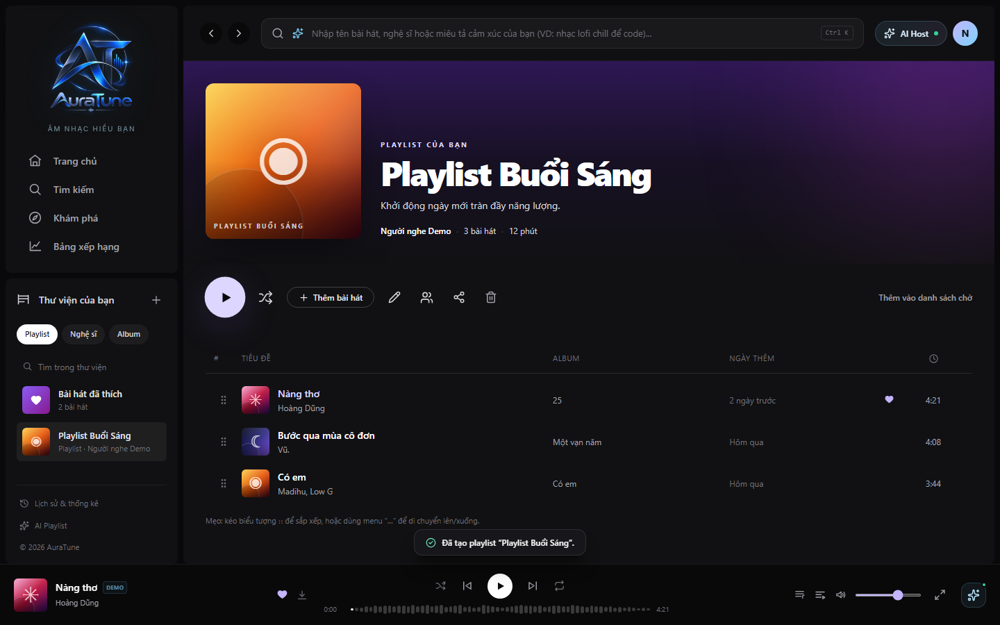
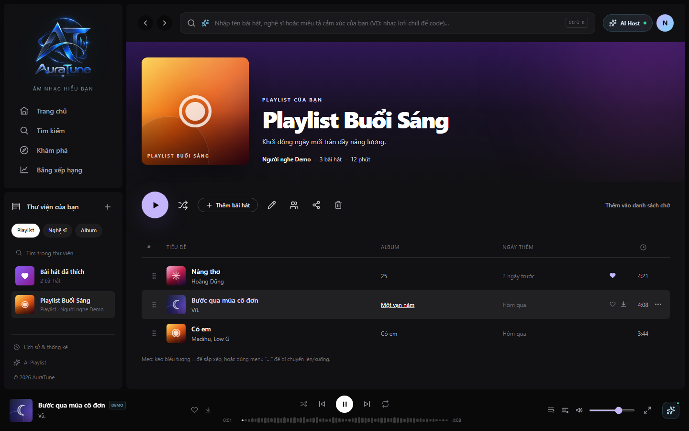

# UC-060-015 – Play Playlist

## 1. Metadata

| Field | Value |
|---|---|
| Use Case ID | UC-060-015 |
| Use Case Name | Play Playlist |
| Functional Group | 060 – Playlist Management |
| Primary Actor | Listener |
| Supporting Actors | AuraTune Player / Queue Management |
| Related FR IDs | 063-FR-001 through 063-FR-009 |
| Related Feature ID | 063-playlist-playback |
| Related Spec Kit File | [specs/060-playlist-management/063-playlist-playback/spec.md](../../../../specs/060-playlist-management/063-playlist-playback/spec.md) |
| Writer | Mai Đăng Khoa |
| Reviewer | [FULL NAME] |
| Status | Draft |
| Last Updated | 2026-11-04 |

## 2. Goal

The listener wants to start or queue music from a playlist and retain the playlist as playback context.

## 3. Description

The listener can play a playlist in order, shuffle its tracks, start at a selected track, or append the playlist to the existing queue. The player shows the current source and advances through playable tracks.

## 4. Preconditions

- The playlist exists and its tracks are available to the listener.
- The listener can use the AuraTune player.

## 5. Trigger

The listener selects Play, Shuffle, a track in the playlist, or Add Playlist to Queue.

## 6. Basic Flow – Play Playlist

1. **Listener:** Selects Play on a playlist card or detail page.
2. **System:** Retrieves the playlist tracks in their defined order.
3. **System:** Replaces the current playback queue with the playable playlist tracks.
4. **System:** Starts the first track and sets the playback source to the playlist.
5. **System:** Displays the playlist name as the playback context.
6. **System:** Starts the next queued track when the current track ends.

## 7. Alternative Flows

### AF-01 – Shuffle Playlist

- **Starting step:** 1
- **Condition:** The listener selects Shuffle.

1. **System:** Randomizes the playable playlist tracks and replaces the current queue.
2. **System:** Starts playback and records the playlist as the playback source.

- **Outcome:** Resume at Basic Flow step 5.

### AF-02 – Start at a Selected Track

- **Starting step:** 1
- **Condition:** The listener selects a track from the playlist tracklist.

1. **System:** Replaces the queue with the playlist tracks in their original order.
2. **System:** Starts the selected track, retaining the remaining playlist tracks in the queue.

- **Outcome:** Resume at Basic Flow step 5.

### AF-03 – Append Playlist to Queue

- **Starting step:** 1
- **Condition:** The listener selects Add Playlist to Queue.

1. **System:** Appends the playlist's playable tracks to the end of the current queue.
2. **System:** Leaves the current track playing and confirms the tracks were queued.

- **Outcome:** Use case ends successfully.

## 8. Exception Flows

### EX-01 – Empty Playlist

- **Starting step:** 2
- **Condition:** The playlist contains no tracks.
1. **System:** Shows a temporary “This playlist is empty” notification and leaves the queue unchanged.

- **Outcome:** Use case ends successfully without changing playback.

### EX-02 – Unavailable Tracks

- **Starting step:** 3
- **Condition:** One or more playlist tracks are unavailable to the listener.
1. **System:** Skips unavailable tracks when populating or advancing the queue.
2. **System:** Continues with the remaining playable tracks.

- **Outcome:** Resume at Basic Flow step 4 when at least one track is playable; otherwise end without playback.

## 9. Postconditions

### 9.1 Success Postconditions
- The player is playing the selected playlist track or the playlist has been appended to the queue.
- Playlist playback context is available to the player and changes to queue context when playback leaves the playlist source.

### 9.2 Failure Postconditions
- An empty or wholly unavailable playlist does not replace or interrupt the current queue.

## 10. Special Requirements

- **Performance:** Playlist playback should start from one action; the queue operation should not delay playback unnecessarily.
- **Accessibility:** Play and shuffle actions must have accessible labels.

## 11. Business Rules

| Rule ID | Rule Description | Source |
|---|---|---|
| BR-063-01 | Play replaces the queue; Add to Queue appends without interrupting current playback. | 063-FR-001, 063-FR-004 |
| BR-063-02 | Selected-track playback retains the full playlist order and begins at the selected track. | 063-FR-003; clarification in 063 spec |
| BR-063-03 | Unavailable tracks are skipped; an empty playlist produces a temporary notification. | 063-FR-008, 063-FR-009 |

## 12. Prototype and Screenshots

### 12.1 Basic Flow

**Covered steps:** 1–5

**Prototype type:** Implemented UI

### 12.2 Alternative Flow – Start at a Selected Track

**Covered steps:** AF-02 steps 1–2

**Prototype type:** Implemented UI

## 13. Related Use Cases

- UC-060-003 – View Playlist Details
- UC-060-007 – Add Songs to Playlist
- UC-060-009 – Reorder Songs in Playlist

## 14. Traceability and Sources

| Source Type | ID / File | Relevant Section |
|---|---|---|
| Functional Requirement | 063-FR-001 through 063-FR-009 | Playlist playback behaviors |
| Spec Kit Specification | specs/060-playlist-management/063-playlist-playback/spec.md | User Stories 1–5, Requirements |

## 15. Open Questions

No behavioral questions remain. The use case follows 063-FR-001..009 and the 063 clarification that selected-track playback replaces the queue and jumps to the selected track. The prototype assets do not show every required state (shuffle and append-to-queue); this is a prototype coverage gap, not a behavior decision.
