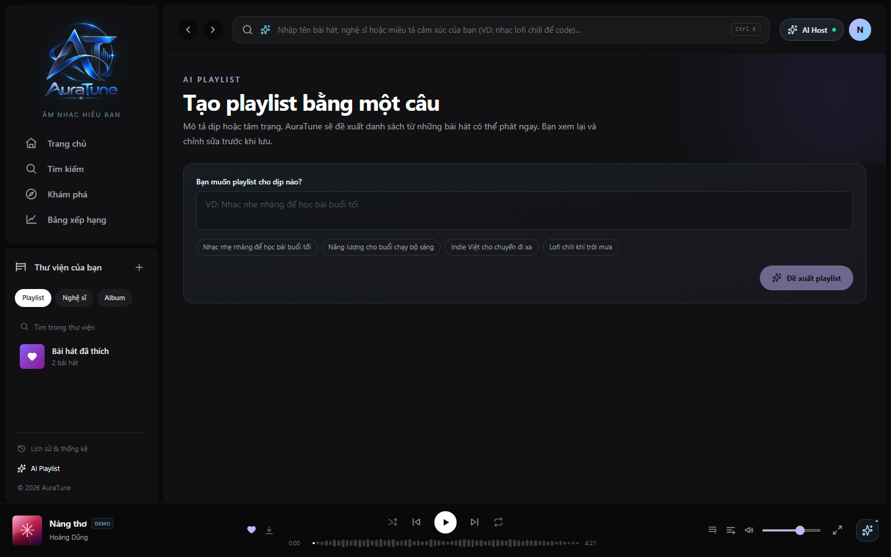
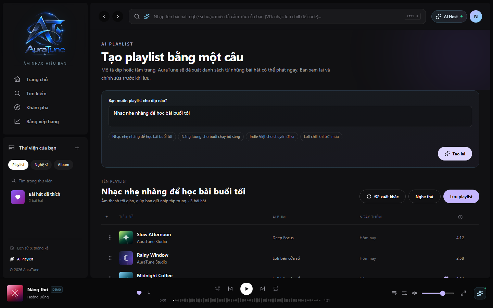
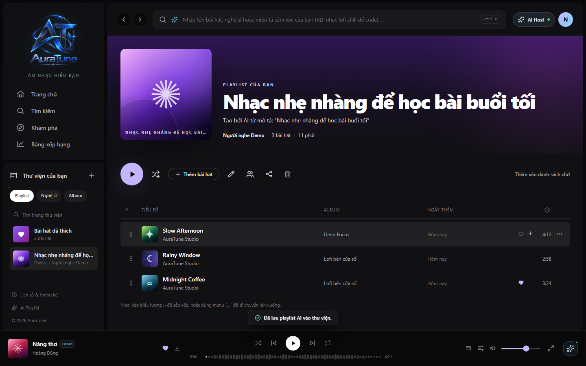

# UC-060-016 – Generate AI Playlist

## 1. Metadata

| Field | Value |
|---|---|
| Use Case ID | UC-060-016 |
| Use Case Name | Generate AI Playlist |
| Functional Group | 060 – Playlist Management |
| Primary Actor | Listener |
| Supporting Actors | AI Recommendation Service |
| Related FR IDs | 064-FR-001 through 064-FR-010 |
| Related Feature ID | 064-ai-playlist-generation |
| Related Spec Kit File | [specs/060-playlist-management/064-ai-playlist-generation/spec.md](../../../../specs/060-playlist-management/064-ai-playlist-generation/spec.md) |
| Writer | Mai Đăng Khoa |
| Reviewer | [FULL NAME] |
| Status | Draft |
| Last Updated | 2026-11-04 |

## 2. Goal

The listener wants to describe a mood, occasion, or preference and receive a playlist proposal they can refine and save.

## 3. Description

The listener submits a natural-language prompt. AuraTune returns a proposal of playable tracks with an explanation. The listener can preview and refine the proposal before saving it as a private playlist.

## 4. Preconditions

- The listener is authenticated.
- The AI playlist generation feature is available.

## 5. Trigger

The listener opens the AI Playlist page and submits a prompt.

## 6. Basic Flow

1. **Listener:** Opens the AI Playlist page.
2. **System:** Displays the prompt field and any example prompts.
3. **Listener:** Enters a description of the desired playlist (up to 200 characters) and submits it.
4. **System:** Uses semantic search to find matching tracks and filters out tracks unavailable to the listener.
5. **System:** Displays a proposal containing 10–20 tracks and an explanation for their selection.
6. **Listener:** Reviews the proposal and optionally previews tracks.
7. **Listener:** Accepts the proposal for saving.
8. **System:** Creates a standard private playlist through the playlist service and adds the finalized tracks.
9. **System:** Confirms the save and opens the new playlist in the Library/detail view.

## 7. Alternative Flows

### AF-01 – Refine the Proposal

- **Starting step:** 6
- **Condition:** The listener wants to modify the generated proposal.

1. **Listener:** Removes or reorders tracks, edits the proposed playlist name, or requests another set of suggestions.
2. **System:** Updates the proposal to reflect the requested changes.
3. **Listener:** Continues reviewing the proposal.

- **Outcome:** Resume at Basic Flow step 6.

### AF-02 – No Matching Tracks

- **Starting step:** 4
- **Condition:** The service cannot find suitable tracks for the prompt.

1. **System:** Explains that there are no suitable matches and suggests broadening or changing the prompt.
2. **Listener:** Revises and resubmits the prompt.

- **Outcome:** Resume at Basic Flow step 3.

## 8. Exception Flows

### EX-01 – AI Service Unavailable

- **Starting step:** 4
- **Condition:** The generation service is unavailable or fails.
1. **System:** Displays a service-unavailable notice and a shortcut to manual playlist creation.
2. **Listener:** Selects the manual creation shortcut if desired.
3. **System:** Opens the standard Create Playlist flow (UC-060-002).

- **Outcome:** Use case ends unsuccessfully for generation, or continues in UC-060-002.

### EX-02 – Authentication Required

- **Starting step:** 3
- **Condition:** The listener's authenticated session has expired.
1. **System:** Requests authentication before generation or saving.

- **Outcome:** Resume after authentication; preservation of the proposal across session expiry is unspecified.

## 9. Postconditions

### 9.1 Success Postconditions
- A private playlist containing the listener-approved tracks exists in the listener's Library.

### 9.2 Failure Postconditions
- If generation or saving fails, no partial playlist is represented as successfully saved.

## 10. Special Requirements

- **Security:** Generation and saving require authentication.
- **Usability:** The input is limited to 200 characters and the proposal exposes the reason for track selection.
- **Availability:** When the AI service is unavailable, offer a manual creation shortcut.

## 11. Business Rules

| Rule ID | Rule Description | Source |
|---|---|---|
| BR-064-01 | Successful generation returns 10–20 playable tracks. | 064-FR-003, 064-FR-009 |
| BR-064-02 | A saved generated playlist is private by default. | 064-FR-007; clarification in 064 spec |
| BR-064-03 | The prompt is limited to 200 characters. | 064-FR-001 |

## 12. Prototype and Screenshots

### 12.1 Basic Flow

**Covered steps:** 1–3

**Prototype type:** Implemented UI

### 12.2 Proposal Review

**Covered steps:** 5–8

**Prototype type:** Implemented UI

### 12.3 Saved Playlist

**Covered steps:** 8–9

**Prototype type:** Implemented UI

## 13. Related Use Cases

- UC-060-002 – Create Playlist
- UC-060-015 – Play Playlist

## 14. Traceability and Sources

| Source Type | ID / File | Relevant Section |
|---|---|---|
| Functional Requirement | 064-FR-001 through 064-FR-010 | Prompt, generation, refinement, save, and fallback requirements |
| Spec Kit Specification | specs/060-playlist-management/064-ai-playlist-generation/spec.md | User Stories 1–4, Requirements |

## 15. Open Questions

| Question ID | Question | Owner | Status | Resolution |
|---|---|---|---|---|
| Q-064-01 | Does “rename tracks/playlists” in 064-FR-006 mean track metadata can be renamed, or only the proposed playlist title? | Group Owner | Resolved | Track renaming is not allowed. Users may rename the proposed playlist only; 064-FR-006 now states this explicitly. |
