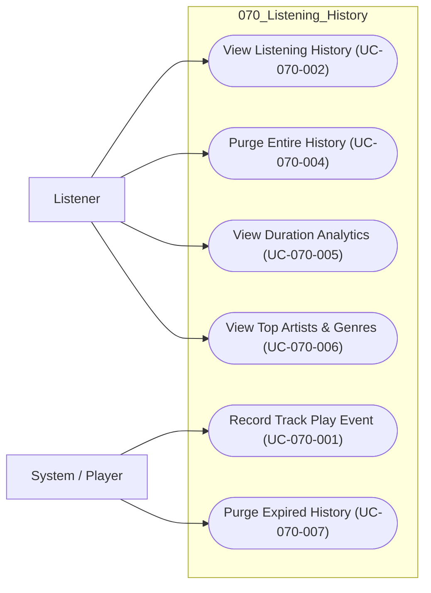

# 070 – Listening History

## 1. Group Overview

| Field | Description |
|---|---|
| Group ID | 070 |
| Group Name | Listening History |
| Group Owner | Mai Đăng Khoa |
| Purpose | Captures user playback activity and generates personal listening habit analytics. |
| Status | In Progress |

## 2. Scope

### 2.1 In Scope
- Automatic play event recording upon reaching 30s playback threshold.
- Recently played history list display with chronological grouping.
- Full history purge.
- Cumulative listening duration tracking (daily, weekly, total).
- Top-five artist ranking by listening duration and duration analytics under 072; 073 adds a top-ten artist/genre view as defined by its FRs.
- Top genres ranked by qualifying play count under 073-FR-002 across the 7-day, 30-day, and 365-day ranges in 073-FR-003.

### 2.2 Out of Scope
- Global platform-wide playback statistics (Group 110).
- Public sharing of listening history (strictly private to user).
- Offline playback history synchronization.

## 3. Requirement and Feature Traceability

| Feature ID | Feature Name | Related FR IDs | Spec Kit Specification |
|---|---|---|---|
| 071 | Listening History | `071-FR-001..013` | [`specs/070-listening-history/071-listening-history/spec.md`](../../../../specs/070-listening-history/071-listening-history/spec.md) |
| 072 | Listening Duration Analytics | `072-FR-001..008` | [`specs/070-listening-history/072-listening-duration-analytics/spec.md`](../../../../specs/070-listening-history/072-listening-duration-analytics/spec.md) |
| 073 | Top Artists and Genres | `073-FR-001..010` | [`specs/070-listening-history/073-top-artists-and-genres/spec.md`](../../../../specs/070-listening-history/073-top-artists-and-genres/spec.md) |

## 4. Actors

| Actor | Actor Type | Description | Goals |
|---|---|---|---|
| Listener | Primary | Authenticated standard user. | View their past listening activity and understand their musical taste. |
| System | Primary | Internal service. | Automatically record playback events without user intervention. |

## 5. Use-Case Diagram

## 6. Use-Case Summary

| UC ID | Use-Case Name | Primary Actor | Related FR IDs | Specification |
|---|---|---|---|---|
| UC-070-001 | Record Track Play Event | Player / System | `071-FR-001..003`, `071-FR-010` | [./UC-070-001-record-track-play-event.md](./UC-070-001-record-track-play-event.md) |
| UC-070-002 | View Listening History | Listener | `071-FR-004..007`, `071-FR-009`, `071-FR-011` | [./UC-070-002-view-listening-history.md](./UC-070-002-view-listening-history.md) |
| UC-070-004 | Purge Entire History | Listener | `071-FR-008`, `071-FR-013` | [./UC-070-004-purge-entire-history.md](./UC-070-004-purge-entire-history.md) |
| UC-070-005 | View Duration Analytics | Listener | `072-FR-001..008`, `071-FR-013` | [./UC-070-005-view-duration-analytics.md](./UC-070-005-view-duration-analytics.md) |
| UC-070-006 | View Top Artists & Genres | Listener | `073-FR-001..010`, `071-FR-013`, `072-FR-004` | [./UC-070-006-view-top-artists-and-genres.md](./UC-070-006-view-top-artists-and-genres.md) |
| UC-070-007 | Purge Expired History | System | `071-FR-012` | [./UC-070-007-purge-expired-history.md](./UC-070-007-purge-expired-history.md) |

## 7. Prototype Summary

| UC ID | Basic Flow Prototype | Alternative Flow Prototypes | Notes |
|---|---|---|---|
| UC-070-001 | N/A | N/A | Background event recording; no UI prototype. |
| UC-070-002 | `specs/070-listening-history/071-listening-history/ui/01-listening-history-page.png` | `specs/070-listening-history/071-listening-history/ui/04-listening-history-empty-state.png` | Implemented UI |
| UC-070-004 | `specs/070-listening-history/071-listening-history/ui/03-listening-history-details.png` | `specs/070-listening-history/071-listening-history/ui/04-listening-history-empty-state.png` | Implemented UI |
| UC-070-005 | `specs/070-listening-history/072-listening-duration-analytics/ui/01-listening-analytics-overview.png` | `specs/070-listening-history/072-listening-duration-analytics/ui/02-listening-duration-summary.png`, `specs/070-listening-history/072-listening-duration-analytics/ui/03-listening-duration-breakdown.png` | Implemented UI |
| UC-070-006 | `specs/070-listening-history/073-top-artists-and-genres/ui/01-top-artists-and-genres.png` | `specs/070-listening-history/073-top-artists-and-genres/ui/02-top-artists-ranking.png`, `specs/070-listening-history/073-top-artists-and-genres/ui/03-top-genres-breakdown.png` | Implemented UI |
| UC-070-007 | N/A | N/A | Background process; no UI prototype |

## 8. Open Issues and Decisions

| ID | Issue / Decision Needed | Impacted UC/FR | Owner | Status |
|---|---|---|---|---|
| Q-070-1 | SQL vs. pre-aggregated implementation for genre analytics is not prescribed by the use-case requirements; defer the design choice to implementation architecture. | UC-070-006 | Mai Đăng Khoa | Resolved |
| Q-070-2 | 071-FR-012 requires automatic 365-day purge but does not specify schedule or operational owner; defer those details to operations/design. | UC-070-007 | Mai Đăng Khoa | Resolved |
| Q-070-3 | For 073, explicit FRs take precedence over conflicting narrative and reconstructed UI prose: use duration-first artists (FR-001), genre play counts (FR-002), and 7-day/30-day/365-day ranges (FR-003). The genre-count prototype state is still a coverage gap. | UC-070-006 | Mai Đăng Khoa | Resolved |
| Q-070-4 | 072-FR-002 requires a top-five artist ranking. Keep that behavior; the current prototype does not illustrate it, so this is a prototype coverage gap to address during design/review. | UC-070-005 | Mai Đăng Khoa | Resolved |

## 9. Review Record

| Reviewer | Review Date | Result | Summary of Changes |
|---|---|---|---|
| [PEER REVIEWER] | 2026-11-03 | Draft | Initial creation of group documentation. |
