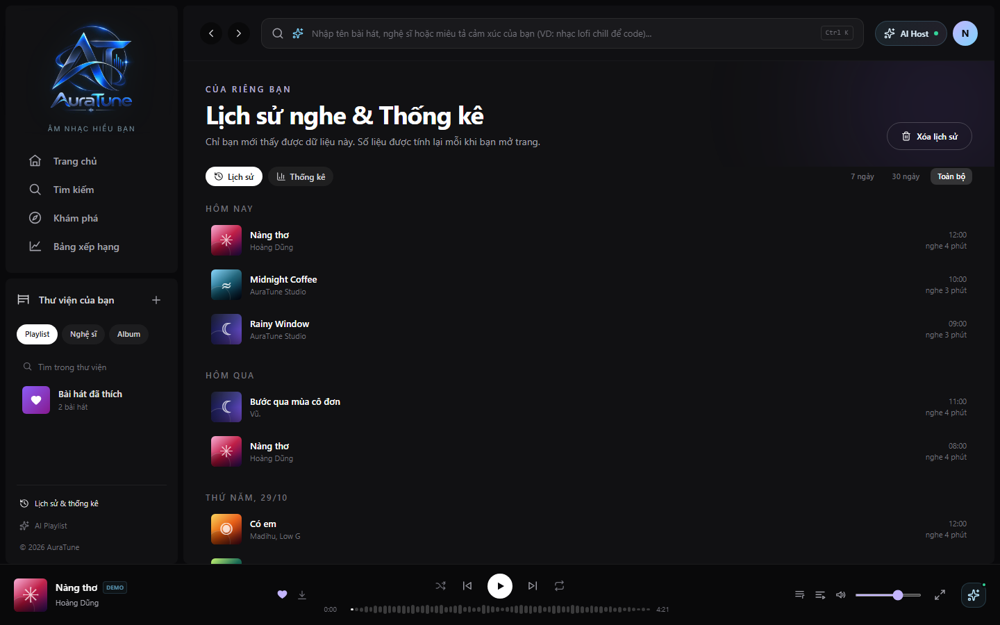
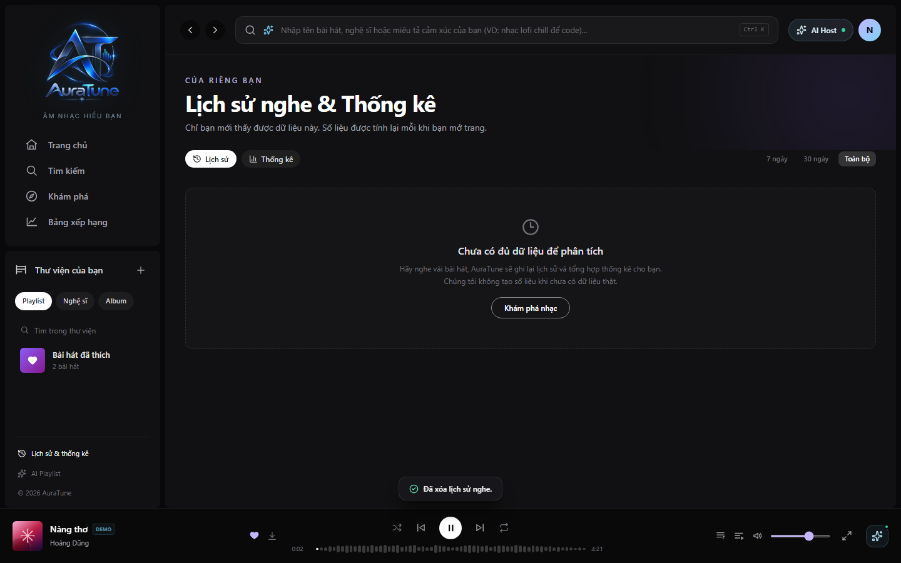

# UC-070-002 – View Listening History

---

## 1. Metadata

| Field | Value |
|---|---|
| Use Case ID | UC-070-002 |
| Use Case Name | View Listening History |
| Functional Group | 070 – Listening History |
| Primary Actor | Listener |
| Supporting Actors | None |
| Related FR IDs | `071-FR-004`, `071-FR-005`, `071-FR-006`, `071-FR-007`, `071-FR-009`, `071-FR-011` |
| Related Feature ID | 071 |
| Related Spec Kit File | [`specs/070-listening-history/071-listening-history/spec.md`](../../../../specs/070-listening-history/071-listening-history/spec.md) |
| Writer | Mai Đăng Khoa |
| Reviewer | [FULL NAME] |
| Status | Draft |
| Last Updated | 2026-11-03 |

---

## 2. Goal
The listener wants to review their past musical activity and easily find songs they have recently played.

## 3. Description
This use case allows an authenticated user to access their "Lịch sử & thống kê" page to see a chronological list of their played tracks. History items are grouped by date for better readability.

---

## 4. Preconditions
- The Listener is authenticated.

---

## 5. Trigger
The Listener clicks on "Lịch sử & thống kê" in the sidebar or navigation menu.

---

## 6. Basic Flow

1. **Actor:** Navigates to the History page (`/history`).
2. **System:** Fetches the current user's history records subject to the pagination requirement.
3. **System:** Sorts the records in reverse chronological order (newest first) (`071-FR-005`).
4. **System:** Groups the records by day (e.g., "Hôm nay", "Hôm qua", "27/10/2026").
5. **System:** Displays track title, artist name, optional album, track duration, and play timestamp (`071-FR-006`).
6. **System:** Displays a page of results and provides access to subsequent pages when more records exist (`071-FR-009`).
7. **Actor:** Reviews the list.

---

## 7. Alternative Flows

### AF-01 – View Another Page
- **Starting step:** 6
- **Condition:** More history records exist than fit on the current page.
1. **Actor:** Requests the next page of results.
2. **System:** Displays the next page in reverse chronological order.
- **Outcome:** Resume at step 7.

### AF-02 – Play Song from History
- **Starting step:** 7
- **Condition:** Listener wants to replay a song from the list.
1. **Actor:** Clicks on a track entry in the history list (`071-FR-007`).
2. **System:** Starts playback of the selected track immediately.
- **Outcome:** Use case ends successfully.

---

## 8. Exception Flows

### EF-01 – No History Found
- **Starting step:** 2
- **Condition:** The user has no listening history records.
1. **System:** Displays a dedicated empty state with a "Start Listening" action that leads to Home (`071-FR-011`).
- **Outcome:** Use case ends successfully (empty state).

---

## 9. Postconditions

### 9.1 Success Postconditions
- The listener sees their playback history displayed correctly.

### 9.2 Failure Postconditions
- Error message is displayed if data retrieval fails.

---

## 10. Special Requirements
- **Performance:** The history list should load in under 1 second for up to 5,000 records.
- **Privacy:** History is strictly private; users can only see their own history.

---

## 11. Business Rules

| Rule ID | Rule Description | Source |
|---|---|---|
| BR-070-02 | History retention is limited to the last 365 days. | 071/spec.md |

---

## 12. Prototype and Screenshots

### 12.1 Basic Flow

*Figure 1: History page showing chronological records.*

### 12.2 Empty State (EF-01)

*Figure 2: Empty state for users without history.*

---

## 13. Related Use Cases
- UC-070-001 – Record Track Play Event
- UC-070-004 – Purge Entire History

---

## 14. Traceability and Sources

| Source Type | ID / File | Relevant Section |
|---|---|---|
| Functional Requirement | 071-FR-004..007, 071-FR-009, 071-FR-011 | History page, ordering, display, replay, pagination, and empty-state requirements. |
| Spec Kit Specification | specs/070-listening-history/071-listening-history/spec.md | User Story 2 |

---

## 15. Open Questions
- None
