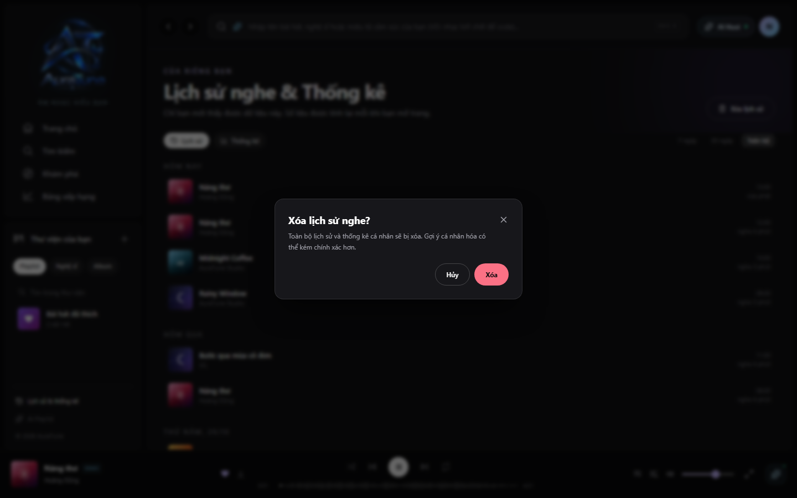

# UC-070-004 – Purge Entire History
Performed by: Mai Đăng Khoa | Reviewed by: Group 10 team | Edited by: Lê Công Minh Nhựt

---

## 1. Metadata
Performed by: Mai Đăng Khoa | Reviewed by: Group 10 team | Edited by: Lê Công Minh Nhựt

| Field | Value |
|---|---|
| Use Case ID | UC-070-004 |
| Use Case Name | Purge Entire History |
| Functional Group | 070 – Listening History |
| Primary Actor | Listener |
| Supporting Actors | None |
| Related FR IDs | `071-FR-008`, `071-FR-013` |
| Related Feature ID | 071 |
| Related Spec Kit File | [`specs/070-listening-history/071-listening-history/spec.md`](../../../../specs/070-listening-history/071-listening-history/spec.md) |
| Writer | Lê Công Minh Nhựt |
| Original Writer (PA3 draft) | Mai Đăng Khoa |
| Reviewer | Group 10 team |
| Status | Draft |
| Last Updated | 2026-11-03 |

---

## 2. Goal
Performed by: Mai Đăng Khoa | Reviewed by: Group 10 team | Edited by: Lê Công Minh Nhựt
The listener wants to reset their entire listening activity record to start fresh or for maximum privacy.

## 3. Description
Performed by: Mai Đăng Khoa | Reviewed by: Group 10 team | Edited by: Lê Công Minh Nhựt
This use case allows a user to delete all recorded history entries at once. This action triggers a full purge that resets the listener's personal taste profile and historical statistics.

---

## 4. Preconditions
Performed by: Mai Đăng Khoa | Reviewed by: Group 10 team | Edited by: Lê Công Minh Nhựt
- The Listener is authenticated.
- The Listener is on the History page (`/history`).
- History records exist.

---

## 5. Trigger
Performed by: Mai Đăng Khoa | Reviewed by: Group 10 team | Edited by: Lê Công Minh Nhựt
The Listener clicks the "Xóa lịch sử" (Clear All History) button on the History page header.

---

## 6. Basic Flow
Performed by: Mai Đăng Khoa | Reviewed by: Group 10 team | Edited by: Lê Công Minh Nhựt

1. **Actor:** Clicks "Xóa lịch sử".
2. **System:** Displays a confirmation modal dialog warning about the loss of data and its impact on recommendations (`071-FR-008`).
3. **Actor:** Confirms the deletion.
4. **System:** Issues a request to purge all history records for the user.
5. **System:** Clears the user's history and excludes the cleared records from personal statistics and recommendation inputs (`071-FR-013`).
6. **System:** Updates the History page to display the empty state.

---

## 7. Alternative Flows
Performed by: Mai Đăng Khoa | Reviewed by: Group 10 team | Edited by: Lê Công Minh Nhựt

### AF-01 – User Cancels Deletion
Performed by: Mai Đăng Khoa | Reviewed by: Group 10 team | Edited by: Lê Công Minh Nhựt
- **Starting step:** 2
- **Condition:** User decides not to proceed.
1. **Actor:** Clicks "Hủy" or closes the modal.
2. **System:** Closes the modal without making changes.
- **Outcome:** Use case ends successfully (no deletion).

---

## 8. Exception Flows
Performed by: Mai Đăng Khoa | Reviewed by: Group 10 team | Edited by: Lê Công Minh Nhựt

### EF-01 – Batch Deletion Failure
Performed by: Mai Đăng Khoa | Reviewed by: Group 10 team | Edited by: Lê Công Minh Nhựt
- **Starting step:** 5
- **Condition:** Server error or timeout during the purge process.
1. **System:** Displays an error message: "Không thể xóa sạch lịch sử. Vui lòng thử lại sau."
- **Outcome:** Use case ends in failure.

---

## 9. Postconditions
Performed by: Mai Đăng Khoa | Reviewed by: Group 10 team | Edited by: Lê Công Minh Nhựt

### 9.1 Success Postconditions
Performed by: Mai Đăng Khoa | Reviewed by: Group 10 team | Edited by: Lê Công Minh Nhựt
- The user's history is empty.
- Cleared records are excluded from personal statistics and recommendation inputs.
- The user is presented with the History empty state.

### 9.2 Failure Postconditions
Performed by: Mai Đăng Khoa | Reviewed by: Group 10 team | Edited by: Lê Công Minh Nhựt
- History remains intact.

---

## 10. Special Requirements
Performed by: Mai Đăng Khoa | Reviewed by: Group 10 team | Edited by: Lê Công Minh Nhựt
- **Security:** Requires a second confirmation step due to the destructive nature of the action.

---

## 11. Business Rules
Performed by: Mai Đăng Khoa | Reviewed by: Group 10 team | Edited by: Lê Công Minh Nhựt
- Purging history permanently removes data; this action is irreversible.

---

## 12. Prototype and Screenshots
Performed by: Mai Đăng Khoa | Reviewed by: Group 10 team | Edited by: Lê Công Minh Nhựt

*Figure 1: Confirmation dialog for purging history.*

---

## 13. Related Use Cases
Performed by: Mai Đăng Khoa | Reviewed by: Group 10 team | Edited by: Lê Công Minh Nhựt
- UC-070-002 – View Listening History

---

## 14. Traceability and Sources
Performed by: Mai Đăng Khoa | Reviewed by: Group 10 team | Edited by: Lê Công Minh Nhựt

| Source Type | ID / File | Relevant Section |
|---|---|---|
| Functional Requirement | 071-FR-008, 071-FR-013 | Clear all history and exclude cleared records from statistics/recommendations. |
| Spec Kit Specification | specs/070-listening-history/071-listening-history/spec.md | User Story 3 |

---

## 15. Open Questions
Performed by: Mai Đăng Khoa | Reviewed by: Group 10 team | Edited by: Lê Công Minh Nhựt
- None

## PA4 implementation evidence and acceptance record
Performed by: Mai Đăng Khoa | Reviewed by: Group 10 team | Edited by: Lê Công Minh Nhựt

`AppStore.jsx` records and clears browser-side history. Backend analysis readers exist, but the integrated history write/delete/retention path is not established. Clearing local state does not prove removal from database statistics or recommendation inputs. The history-recording threshold also needs alignment across source features.

The flows above state required behavior. This revision records source inspection only; no browser acceptance or new feature-test run is claimed. Before acceptance, execute the basic flow and its applicable alternative/exception flows, checking the documented success and failure postconditions. Record results against this UC ID in [the PA4 review register](../../use-case-model.md#11-pa4-decisions-and-source-review).
