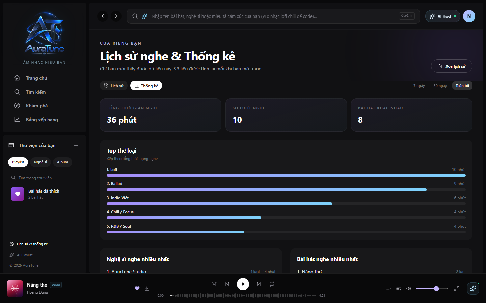

# UC-070-005 – View Duration Analytics

---

## 1. Metadata

| Field | Value |
|---|---|
| Use Case ID | UC-070-005 |
| Use Case Name | View Duration Analytics |
| Functional Group | 070 – Listening History |
| Primary Actor | Listener |
| Supporting Actors | None |
| Related FR IDs | `072-FR-001` through `072-FR-008`, `071-FR-013` |
| Related Feature ID | 072 |
| Related Spec Kit File | [`specs/070-listening-history/072-listening-duration-analytics/spec.md`](../../../../specs/070-listening-history/072-listening-duration-analytics/spec.md) |
| Writer | Mai Đăng Khoa |
| Reviewer | [FULL NAME] |
| Status | Draft |
| Last Updated | 2026-11-03 |

---

## 2. Goal
The listener wants to understand their music consumption habits through time-based metrics.

## 3. Description
This use case allows a user to view detailed statistics about their total listening time, number of plays, and count of unique songs discovered within various time horizons.

---

## 4. Preconditions
- The Listener is authenticated.

---

## 5. Trigger
The Listener clicks on the "Thống kê" (Statistics) tab on the History page.

---

## 6. Basic Flow

1. **Actor:** Navigates to the History page (`/history`).
2. **Actor:** Clicks on the "Thống kê" tab.
3. **System:** Fetches private, backend-aggregated data for the default period, excluding hidden history and sessions below the 30-second threshold (`072-FR-004`, `072-FR-005`, `072-FR-007`, `072-FR-008`, `071-FR-013`).
4. **System:** Displays cumulative listening duration for the selected period (`072-FR-001`).
5. **System:** Displays the top five artists ranked by listening duration (`072-FR-002`).
6. **System:** Displays daily listening totals for the previous seven days (`072-FR-003`).
7. **Actor:** Reviews the metrics.

---

## 7. Alternative Flows

### AF-01 – Switch Time Range
- **Starting step:** 4
- **Condition:** Listener wants to see stats for a different period.
1. **Actor:** Selects "30 ngày" or "Toàn bộ".
2. **System:** Updates period-based duration metrics and artist ranking (`072-FR-001`, `072-FR-002`).
- **Outcome:** Resume at step 7.

---

## 8. Exception Flows

### EF-01 – Analytics Unavailable
- **Starting step:** 3
- **Condition:** The aggregation service cannot return the user's metrics.
1. **System:** Displays an unavailable/error state without exposing another user's data.
- **Outcome:** Use case ends unsuccessfully.

---

## 9. Postconditions

### 9.1 Success Postconditions
- The user sees accurate time-based metrics reflecting their listening history.

### 9.2 Failure Postconditions
- System shows an error if stats cannot be aggregated.

---

## 10. Special Requirements
- **Performance:** The dashboard should load and render in under 1.5 seconds for users with up to 10,000 history records.
- **Privacy:** Analytics are private to the account owner.

---

## 11. Business Rules
- Cumulative duration only counts playback sessions >= 30 seconds.
- "All Time" is capped at the last 365 days.

---

## 12. Prototype and Screenshots

*Figure 1: Metric cards for duration and play counts.*

**Prototype coverage gap:** The 072 UI assets do not show the top-five artist ranking required by 072-FR-002. This UC includes the FR-required ranking; add a corresponding prototype state before review.

---

## 13. Related Use Cases
- UC-070-002 – View Listening History
- UC-070-006 – View Top Artists & Genres

---

## 14. Traceability and Sources

| Source Type | ID / File | Relevant Section |
|---|---|---|
| Functional Requirement | 072-FR-001..008, 071-FR-013 | Duration, artist ranking, daily trend, privacy, backend aggregation, threshold, and cleared-history requirements. |
| Spec Kit Specification | specs/070-listening-history/072-listening-duration-analytics/spec.md | User Story 1 |

---

## 15. Open Questions

| Question ID | Question | Owner | Status | Resolution |
|---|---|---|---|---|
| Q-072-01 | 072-FR-002 requires ranking top five artists by duration, but the available screenshots do not illustrate that state. | Group Owner | Resolved | The explicit FR defines the behavior; this is a prototype coverage gap, recorded above, rather than a behavioral ambiguity. |
