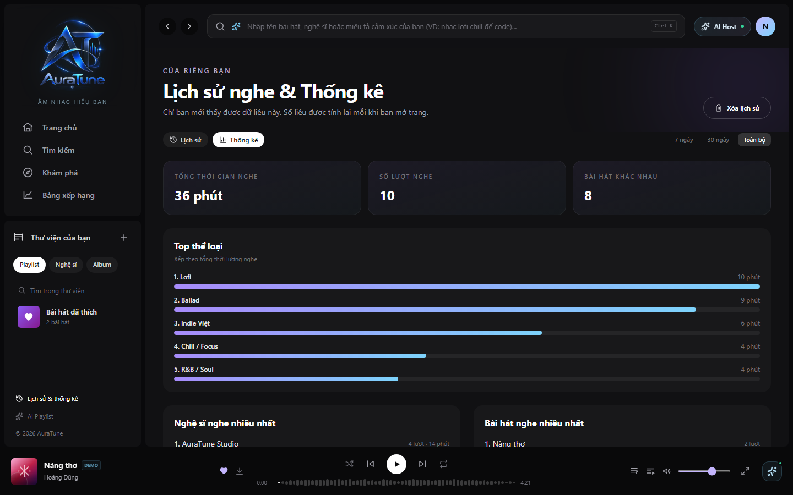
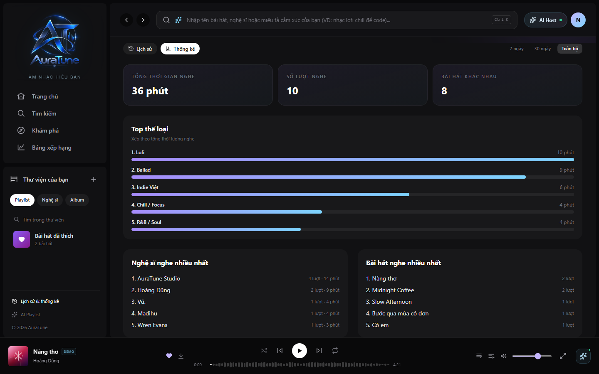

# UC-070-006 – View Top Artists and Genres

---

## 1. Metadata

| Field | Value |
|---|---|
| Use Case ID | UC-070-006 |
| Use Case Name | View Top Artists and Genres |
| Functional Group | 070 – Listening History |
| Primary Actor | Listener |
| Supporting Actors | None |
| Related FR IDs | `073-FR-001` through `073-FR-010`, `071-FR-013`, `072-FR-004` |
| Related Feature ID | 073 |
| Related Spec Kit File | [`specs/070-listening-history/073-top-artists-and-genres/spec.md`](../../../../specs/070-listening-history/073-top-artists-and-genres/spec.md) |
| Writer | Mai Đăng Khoa |
| Reviewer | [FULL NAME] |
| Status | Draft |
| Last Updated | 2026-11-03 |

---

## 2. Goal
The listener wants to see a ranked summary of their favorite creators and musical styles to understand their taste profile.

## 3. Description
This use case provides a duration-first ranking of top artists, a play-count distribution of genres, and a play-count ranking of tracks. It uses the selected time range and excludes hidden or cleared history.

---

## 4. Preconditions
- The Listener is authenticated.
- The listener is authenticated. Sparse history is handled by the specified empty state.

---

## 5. Trigger
The Listener navigates to the "Thống kê" tab on the History page.

---

## 6. Basic Flow

1. **Actor:** Selects the "Thống kê" tab on the History page.
2. **System:** Aggregates qualifying, non-hidden events on the backend for the selected range (`073-FR-004`, `073-FR-005`, `072-FR-004`).
3. **System:** Ranks up to ten artists primarily by total listening duration, then play count (`073-FR-001`).
4. **System:** Ranks genres by qualifying play count, counting each associated genre tag, and shows the top 5–10 with remaining genres grouped as Other (`073-FR-002`, `073-FR-009`).
5. **System:** Ranks up to ten tracks by play count and allows a track to start playback immediately (`073-FR-010`).
6. **System:** Displays the results in the History page with a responsive layout (`073-FR-006`, `073-FR-008`).
7. **Actor:** Reviews the rankings and distributions.

---

## 7. Alternative Flows

### AF-01 – Change Time Horizon
- **Starting step:** 2
- **Condition:** Listener wants to compare short-term vs long-term habits.
1. **Actor:** Selects "7 ngày", "30 ngày", or "Toàn bộ".
2. **System:** Re-aggregates data for the new period and updates the rankings and charts (`073-FR-003`).
- **Outcome:** Resume at step 7.

### AF-02 – Navigate to Artist Profile
- **Starting step:** 6
- **Condition:** Listener wants more info on a top artist.
1. **Actor:** Clicks on an artist name in the ranking.
2. **System:** Redirects the user to the corresponding Artist Profile page (`/artist/:id`).
- **Outcome:** Use case ends successfully.

### AF-03 – Play a Top Track
- **Starting step:** 6
- **Condition:** The listener wants to replay a track in the top tracks ranking.
1. **Actor:** Selects a track in the ranking.
2. **System:** Starts playback of that track immediately (`073-FR-010`).
- **Outcome:** Use case ends successfully.

---

## 8. Exception Flows

### EF-01 – Not Enough Data
- **Starting step:** 2
- **Condition:** Fewer than five qualifying play events are available, per the 073 specification's minimal-data assumption.
1. **System:** Displays a "Not enough data yet" empty state illustration (`073-FR-007`).
- **Outcome:** Use case ends successfully (empty state).

---

## 9. Postconditions

### 9.1 Success Postconditions
- User has a clear visualization of their musical taste profile.

### 9.2 Failure Postconditions
- System displays an error if data cannot be retrieved.

---

## 10. Special Requirements
- **Performance:** Aggregation should be performed on the backend; frontend renders in < 1.5s.
- **Usability:** Genre charts should be legible on mobile devices.

---

## 11. Business Rules

| Rule ID | Rule Description | Source |
|---|---|---|
| BR-070-03 | Artists are ranked primarily by total listening duration and secondarily by qualifying play count. | 073-FR-001 |
| BR-070-04 | Genres are ranked by qualifying play count for their tags; multi-genre tracks count toward each tag. | 073-FR-002 |
| BR-070-05 | Show the top 5–10 genres and group remaining genres as "Other". | 073-FR-009 |

---

## 12. Prototype and Screenshots

### 12.1 Top Artists and Genres Overview

*Figure 1: Full overview of taste statistics.*

### 12.2 Genre Breakdown

*Figure 2: Horizontal bars showing genre preference.*

**Prototype coverage gap:** The reconstructed 073 UI description and screenshot show genre duration, while 073-FR-002 requires genre play counts. This UC follows the FR; update or identify a count-based prototype state before review.

---

## 13. Related Use Cases
- UC-070-002 – View Listening History
- UC-070-005 – View Duration Analytics

---

## 14. Traceability and Sources

| Source Type | ID / File | Relevant Section |
|---|---|---|
| Functional Requirement | 073-FR-001..010, 071-FR-013, 072-FR-004 | Ranking, filters, privacy, integration, empty-state, responsive, and hidden-history requirements. |
| Spec Kit Specification | specs/070-listening-history/073-top-artists-and-genres/spec.md | Section 2 |

---

## 15. Open Questions

| Question ID | Question | Owner | Status | Resolution |
|---|---|---|---|---|
| Q-073-01 | 073's narrative refers to 4 weeks/6 months, while FR-003 and UI artifacts use 7 days/30 days/all time. Which is authoritative? | Group Owner | Resolved | Follow the explicit FR-003 and matching UI artifacts: 7 days, 30 days, and all time (365-day retention window). |
| Q-073-02 | The 073 user story/acceptance scenario and FR-001 disagree on whether artist ranking is frequency-first or duration-first. | Group Owner | Resolved | Follow FR-001: rank primarily by duration, then by qualifying play count. |
| Q-073-03 | The reconstructed 073 UI description ranks genres by listening duration, while 073-FR-002 requires counting plays. | Group Owner | Resolved | Follow FR-002: rank by qualifying play count for every associated genre tag. |
