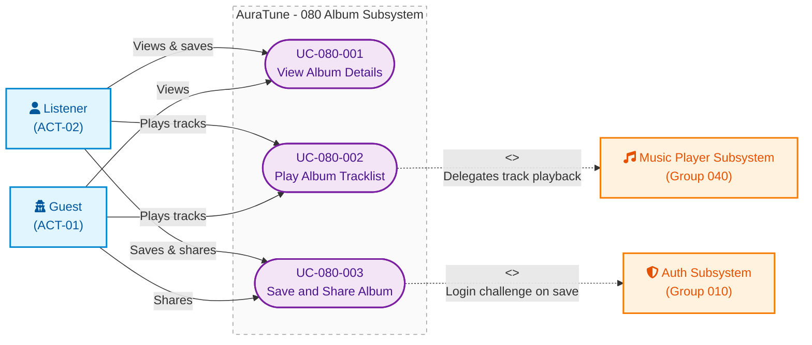

# Functional Group 080: Album – Use-Case Documentation

---

## 1. Group Information

| Attribute | Details |
|---|---|
| **Group ID** | 080 |
| **Group Name** | Album |
| **Group Owner** | Nguyễn Khánh Đăng |
| **Module Purpose** | Manages the album discovery and playback experience, including viewing album metadata, exploring tracklists, initiating album playback, and saving/sharing album links. |
| **Documentation Status** | Draft — Baseline for Sprint 3 (PA3) Review |
| **Applicable Standards** | AuraTune Use-Case Documentation Guide, Spec Kit Architecture, PA3 Use-Case Specification Standard |

---

## 2. Scope

### 2.1 Purpose and Objectives
Functional Group 080 provides the core catalog browsing experience for releases. It allows listeners and guests to explore an album's complete metadata (cover art, artist, release year, total duration), view its ordered tracklist with individual play counts, seamlessly transition into playback for the full album or a specific track, and engage with the album by saving it to a personal library or sharing its URL.

### 2.2 In-Scope Capabilities
The verified capabilities within Group 080 comprise three distinct subfeatures:

1. **Album Details (Feature 081)**:
   - Retrieving and rendering album metadata (cover art, artist, year, total duration).
   - Displaying release type badges ("Đĩa đơn" for 1 track, "Album" for 2+ tracks).
   - Rendering a flat tracklist in artist-intended order with individual play counts.
   - Calculating total album duration by summing valid track lengths.
   - Graceful handling of missing artwork, zero/unavailable play counts, and non-existent album states.

2. **Album Tracklist Playback (Feature 082)**:
   - Initiating playback for an entire album starting from the first playable track.
   - Forcing Shuffle mode off when playing the full album to respect artist-intended order.
   - Starting playback from a specific selected track within the album.
   - Integrating playback seamlessly with the persistent Music Player and its upcoming queue.
   - Skipping unavailable tracks without interrupting the playback sequence.

3. **Save and Share Album (Feature 083)**:
   - Authenticated bookmarking of albums into a personal library (`Saved Albums`).
   - Toggling the saved state with dynamic UI feedback (Bookmark vs. BookmarkCheck icons).
   - Public sharing of album URLs via the Web Share API or clipboard copy.
   - Enforcing authentication checks before allowing save actions.

### 2.3 Out-of-Scope Exclusions
To maintain strict architectural boundaries, the following capabilities are explicitly excluded from Group 080:
- **Audio Streaming Internals**: Actual fetching and decoding of audio chunks are owned by **Group 040 – Music Player**.
- **Playlist Management**: Custom user-created playlists and their logic belong to **Group 060 – Playlist**.
- **Catalog Management**: Uploading, editing, or deleting albums from the system database by admins.

### 2.4 Dependencies
- **Group 010 (Authentication)**: Provides authentication checks for the "Save Album" action and scopes saved states to the `user_id`.
- **Group 040 (Music Player)**: Receives track data and queue arrays to execute actual audio playback.

---

## 3. Related Requirements and Features

| Feature ID | Feature Name | Related FR IDs | Spec Path |
|---|---|---|---|
| **081** | Album Details | `FR-001` to `FR-016` | `spec-081.md` |
| **082** | Album Tracklist Playback | `FR-001` to `FR-016` | `spec-082.md` |
| **083** | Save and Share Album | `FR-001` to `FR-014` | `spec-083.md` |

---

## 4. Actors

| Actor | Actor Type | Description | Related Use Cases |
|---|---|---|---|
| **Listener** (`ACT-02`) | Primary Human Actor | Authenticated platform user who views details, plays tracks, and saves albums to their library. | `UC-080-001`, `UC-080-002`, `UC-080-003` |
| **Guest / Visitor** (`ACT-01`) | Primary Human Actor | Unauthenticated user who views public details, plays tracks, and shares albums. | `UC-080-001`, `UC-080-002`, `UC-080-003` |
| **Music Player** (`Group 040`) | External System (Supporting Actor) | Internal subsystem responsible for receiving track data and executing audio playback. | `UC-080-002` |

---

## 5. Use-Case Diagram

The following Mermaid diagram visualizes the boundary, actors, confirmed use cases, and external relationships for **Group 080 – Album**.



### Diagram Legend
- **Ovals (`([ ... ])`)**: Confirmed Use Cases.
- **Solid Arrow (`-->`)**: Direct primary actor invocation.
- **Dashed Arrow (`-.->`)**: External system dependency or cross-group inclusion (`<<include>>` / `<<extend>>`).
- **Subsystem Boundary (`subgraph`)**: Scope boundary of Group 080.

---

## 6. Use-Case List

| UC ID | Use-Case Name | Primary Actor | Related FRs | Specification File |
|---|---|---|---|---|
| **UC-080-001** | View Album Details | Listener, Guest | `FR-001` to `FR-016` | [`UC-080-001-view-album-details.md`](./UC-080-001-view-album-details.md) |
| **UC-080-002** | Play Album Tracklist | Listener, Guest | `FR-001` to `FR-016` | [`UC-080-002-play-album-tracklist.md`](./UC-080-002-play-album-tracklist.md) |
| **UC-080-003** | Save and Share Album | Listener, Guest | `FR-001` to `FR-014` | [`UC-080-003-save-and-share-album.md`](./UC-080-003-save-and-share-album.md) |

---

## 7. Dependencies and Integration

```
                 +---------------------------+
                 |    Group 010: Auth        |
                 |  (JWT Token / User Scope) |
                 +-------------+-------------+
                               |
                               v
+------------------+     +-------------------+
| Group 040:       | <-- |   Group 080:      |
| Music Player     |     |   Album           |
| (Playback Stream)|     +-------------------+
+------------------+               
```

1. **Authentication Token Flow**: Saving an album requires the user to be authenticated via Group 010. Guest users attempting to save are redirected to login.
2. **Playback Delegation**: Selecting "Play Album" or an individual track dispatches an array of tracks to Group 040 for playback execution and queue management.

---

## 8. Open Issues and Architecture Clarifications

| ID | Issue / Decision Needed | Impacted UC/FR | Owner | Status |
|---|---|---|---|---|
| `ISSUE-080-01` | Should large albums paginate tracks server-side? | `UC-080-001` | Nguyễn Khánh Đăng | **Resolved**: No. API returns full tracklist, UI renders progressively. |

---

## 9. References

- `docs/proposal/proposal.md`
- `docs/management/team-contract.md`
- `docs/requirements/use-case-model.md`
- `spec-081.md`
- `spec-082.md`
- `spec-083.md`