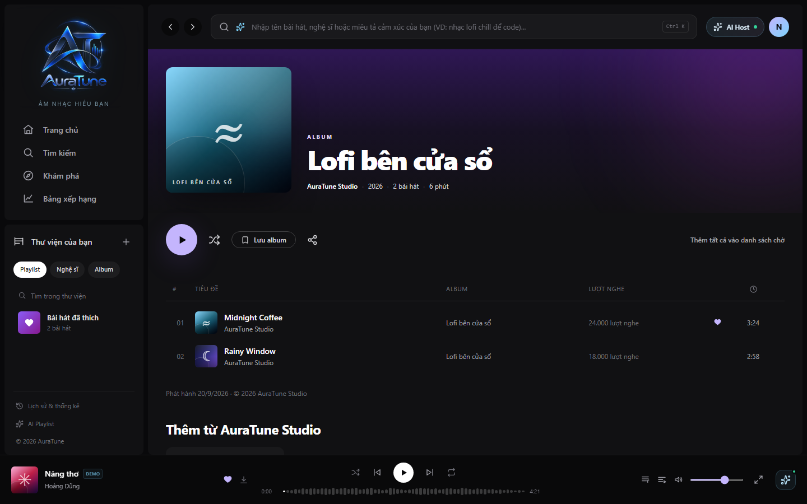
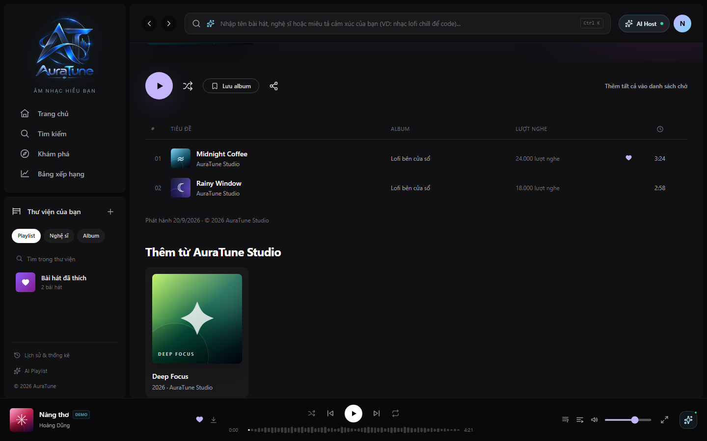
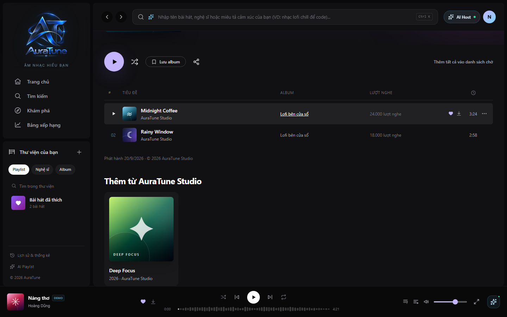
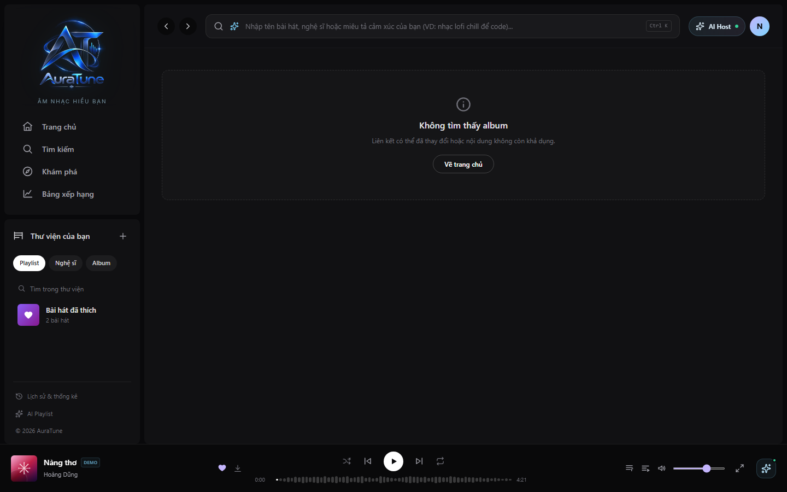

# UC-080-001 – View Album Details

---

## 1. Metadata

| Field | Value |
|---|---|
| **Use Case ID** | UC-080-001 |
| **Use Case Name** | View Album Details |
| **Functional Group** | 080 – Album |
| **Primary Actor** | Listener (`ACT-02`), Guest/Visitor (`ACT-01`) |
| **Supporting Actors** | None |
| **Related FR IDs** | `081-FR-001` to `081-FR-016` |
| **Related Feature/Spec** | Feature 081: Album Details (`specs/080-album-interaction/081-album-details/spec.md`) |
| **Status** | Draft |
| **Writer** | Nguyễn Khánh Đăng |
| **Reviewer** | TBD |

---

## 2. Description

The visitor wants to open an album and see its key details to understand its context and browse its tracks. The system retrieves album metadata and its complete tracklist via the `GET /albums/:id` API, calculates the total duration by summing valid track lengths, and renders a flat tracklist (ignoring multi-disc complexities) with individual track play counts. It gracefully handles missing artwork, zero/unavailable play counts, and non-existent album states.

---

## 3. Preconditions

- The system is online and the catalog database is reachable.
- Authentication is explicitly not required to view album details (`081-FR-013`).

---

## 4. Trigger

The visitor navigates to an album URL (e.g., `/album/:id`) or clicks an album card from anywhere in the application.

---

## 5. Basic Flow
1. **Actor:** Navigates to an album's detail page.
2. **System:** Shows a loading state while fetching data from `GET /albums/:id`.
3. **System:** Extracts the available metadata: cover art, title, artist name, release year, and the complete tracklist.
4. **System:** Calculates total album duration by summing up the durations of all tracks with available duration data (`081-FR-004`).
5. **System:** Renders the Album Details header, displaying the cover art, title, artist, year, calculated total duration, track count, and a release type badge ("Đĩa đơn" if 1 track, "Album" if 2+ tracks) (`081-FR-003`).
6. **System:** Renders the tracks as one flat list in the order provided by the album response. Each track row displays its index, title, artist, album name, play count (formatted with locale grouping, e.g., "24.000 lượt nghe"), and duration (`081-FR-005`, `081-FR-005a`, `081-FR-006`).
7. **System:** Renders the "More from [Artist]" ("Thêm từ [Nghệ sĩ]") section at the bottom of the page showing other available albums by the same artist (`081-FR-016`).
8. **Actor:** Reviews the album information and tracklist.

## 6. Alternative Flows

### AF-01 – Empty Tracklist
- **Starting step:** Step 3 of the Basic Flow.
- **Condition:** The album response contains no tracks (`081-FR-010`).
1. **System:** Displays an empty track-list state and does not invent track data or duration.
- **Outcome:** Use case completes with album details and an empty track list.

### AF-02 – Progressive Tracklist Rendering
- **Starting step:** Step 6 of the Basic Flow
- **Condition:** The album contains a very large number of tracks.
1. **System:** Renders the first batch of track rows immediately for UI responsiveness while the total duration in the header still accurately reflects the complete tracklist (`081-FR-014`).
2. **Actor:** Scrolls down the tracklist.
3. **System:** Progressively renders the remaining track rows in order.
- **Outcome:** Resume at Basic Flow step 8.

### AF-03 – Return to Previously Viewed Album
- **Starting step:** Step 1 of the Basic Flow
- **Condition:** The visitor uses browser navigation to return to an album viewed recently.
1. **System:** Immediately displays previously loaded details for that album (`081-FR-015`).
2. **System:** Silently fetches fresh data in the background and refreshes the page content when the request completes.
- **Outcome:** Resume at Basic Flow step 8.

## 7. Exception Flows

### EX-01 – Album Not Found
- **Starting step:** Step 3 of the Basic Flow
- **Condition:** The requested album ID does not exist.
1. **System:** Returns a not-found error.
2. **System:** Renders a clear "Không tìm thấy album" (Album not found) state with navigation to return home, avoiding display of stale or incorrect details (`081-FR-010`).
- **Outcome:** Use case ends unsuccessfully.

### EX-02 – Service Unavailable
- **Starting step:** Step 3 of the Basic Flow
- **Condition:** Network error or API service failure.
1. **System:** Renders a clear error state indicating the connection failure.
2. **System:** Provides a "Retry" action button (`081-FR-011`).
- **Outcome:** Retry returns to step 2; otherwise, use case ends unsuccessfully.

### EX-03 – Missing Metadata or Cover Art
- **Starting step:** Step 5 of the Basic Flow
- **Condition:** The album data is missing the cover image or specific text fields.
1. **System:** Displays a default placeholder image within the responsive cover-art frame (`081-FR-009a`).
2. **System:** Displays an em dash for unavailable duration or play-count values, preserves valid zero values as zero, and safely handles other missing optional values (`081-FR-009`).
- **Outcome:** Resume at Basic Flow step 6.

### EX-04 – Requested Album Changes While Loading
- **Starting step:** Step 2 of the Basic Flow.
- **Condition:** The visitor navigates to another album before the current request completes (`081-FR-012`).
1. **System:** Displays only data corresponding to the currently requested album ID; a late response for the previous album is not shown as current.
- **Outcome:** Continue with the Basic Flow for the currently requested album.

---

## 8. Postconditions

### Success
- The visitor can view the accurate album metadata, total duration, and play counts for each track.

### Failure
- An appropriate empty/error state is displayed safely. No incorrect or mixed album data is shown.

---

## 9. Special Requirements

- **Duration Aggregation**: Total duration is calculated from all tracks in the API response, not just the rows currently rendered (`081-FR-014`).
- **Flat Tracklist**: Multi-disc albums are presented as a single flat list without disc-number sections (`081-FR-005a`).
- **Unavailable vs Zero**: Valid zero play counts display as "0". Unavailable data (duration or count) displays as an em-dash ("—") (`081-FR-009`).
- **Formatting**: Durations must be formatted as `m:ss` or `h:mm:ss`. Play counts must use locale-appropriate digit grouping.

---

## 10. Prototype and Screenshots

### Basic Flow - Album Header

**Covered steps:** Basic Flow steps 5.
**Prototype type:** Available; source type to verify

### Basic Flow - Album Metadata & Related

**Covered steps:** Basic Flow step 7.
**Prototype type:** Available; source type to verify

### Basic Flow - Track Play Counts

**Covered steps:** Basic Flow step 6.
**Prototype type:** Available; source type to verify

### Exception Flow - Album Not Found

**Covered steps:** EX-01.
**Prototype type:** Available; source type to verify

---

## 11. Related Use Cases

- **Related Use Case**: `UC-080-002` (Play Album Tracklist) – Can be initiated directly from this view.

---

## 12. Source References

- `specs/080-album-interaction/081-album-details/spec.md` – Requirements 081-FR-001 through 081-FR-016, including lettered requirements.
- `docs/proposal/proposal.md`

---

## 13. Notes and Open Questions

- **Tracklist Pagination**: As resolved, large albums do not paginate server-side. API returns full tracklist, UI renders progressively (`Q-080-01`).
