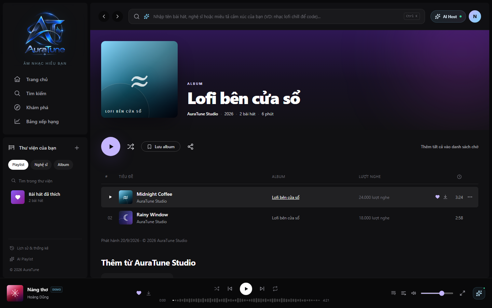
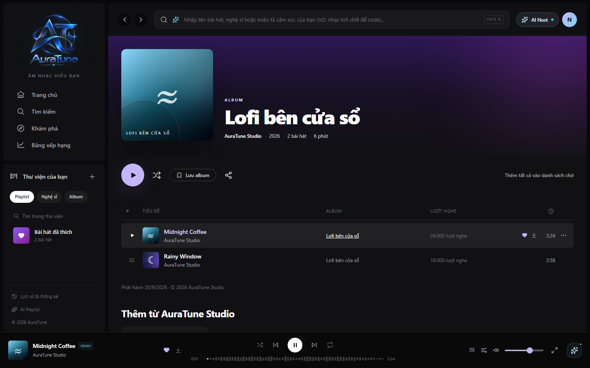
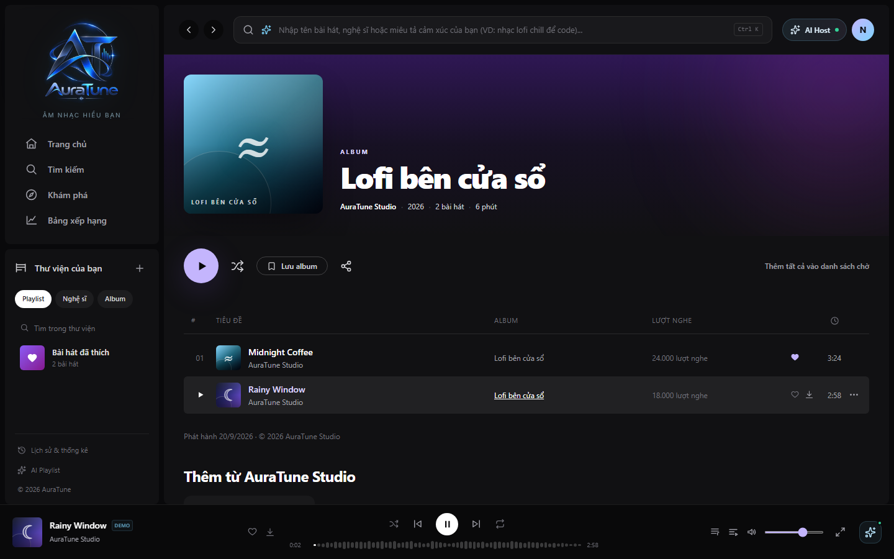
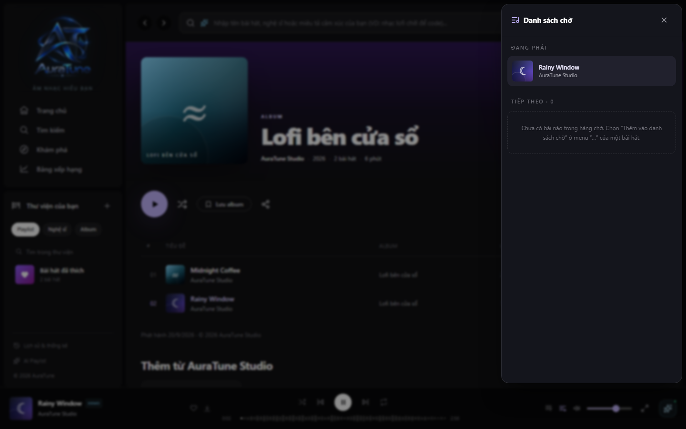

# UC-080-002 – Play Album Tracklist

---

## 1. Metadata

| Field | Value |
|---|---|
| **Use Case ID** | UC-080-002 |
| **Use Case Name** | Play Album Tracklist |
| **Functional Group** | 080 – Album |
| **Primary Actor** | Listener (`ACT-02`), Guest/Visitor (`ACT-01`) |
| **Supporting Actors** | Music Player (`Group 040`) |
| **Related FR IDs** | `082-FR-001` to `082-FR-016` |
| **Related Feature/Spec** | Feature 082: Album Tracklist Playback (`spec-082.md`) |
| **Status** | Draft |
| **Writer** | Nguyễn Khánh Đăng |
| **Reviewer** | TBD |

---

## 2. Description

Initiates playback by sending track data to the Music Player. When playing the full album, it forces Shuffle mode off to maintain intended order, loads the tracks into the queue, and preserves any unrelated tracks previously queued. The visitor can alternatively start playback from a specific track within the album.

---

## 3. Preconditions

- The visitor is viewing an album with at least one playable track.
- The global Music Player component is active in the application shell.

---

## 4. Trigger

The visitor clicks the "Play Album" (Phát album) button or clicks a specific playable track row.

---

## 5. Basic Flow

1. **Actor:** Clicks the "Play Album" button.
2. **System:** Verifies there are playable tracks. Turns off "Shuffle" mode if it is currently enabled (`082-FR-013`).
3. **System:** Clears any existing album segment in the upcoming queue to avoid duplicates, while preserving queued tracks that are not part of this album (`082-FR-012`).
4. **System:** Starts playback immediately with the first playable track in the album.
5. **System:** Inserts the remaining playable album tracks in artist-intended order immediately after the current track in the upcoming queue (`082-FR-004`).
6. **System:** Updates the persistent mini-player at the bottom with the new active track context (cover art, title, artist) and visually highlights the playing track row in the tracklist.
7. **Actor:** Listens to the album seamlessly, even if navigating to other pages (`082-FR-008`).

---

## 6. Alternative Flows

### AF-01 – Play Selected Track
- **Starting step:** Step 1 of the Basic Flow.
- **Condition:** The visitor clicks on a specific track instead of the main Play Album button.
1. **Actor:** Clicks the play action on a specific playable track row.
2. **System:** Makes the selected track the current active track.
3. **System:** Inserts all playable tracks that *follow* it in the album into the upcoming queue (ignoring tracks before it) (`082-FR-006`).
- **Continuation:** Resumes at Step 6 of the Basic Flow.

### AF-02 – Add All to Queue
- **Starting step:** Step 1 of the Basic Flow.
- **Condition:** The visitor selects the "Thêm tất cả vào danh sách chờ" (Add all to queue) context menu action.
1. **Actor:** Clicks "Thêm tất cả vào danh sách chờ".
2. **System:** Appends all playable tracks from the album to the *end* of the current playback queue, without interrupting the song currently playing (`082-FR-016`).
- **Continuation:** Use Case ends successfully.

---

## 7. Exception Flows

### EF-01 – Unavailable Tracks
- **Starting step:** Step 5 of the Basic Flow.
- **Condition:** One or more tracks in the album are unavailable due to licensing or deletion.
1. **System:** Disables the track row visually with a clear reason.
2. **System:** Omits the unavailable tracks from the playback queue entirely, jumping to the next playable track automatically (`082-FR-011`).
- **Continuation:** Resume playback with the remaining valid sequence.

### EF-02 – Empty or Completely Unavailable Album
- **Starting step:** Step 2 of the Basic Flow.
- **Condition:** The album has zero playable tracks.
1. **System:** Disables the "Play Album" button.
2. **System:** Displays a state indicating no tracks are available and does not start the player or modify the queue (`082-FR-010`).
- **Continuation:** Use Case ends unsuccessfully.

---

## 8. Postconditions

### Success
- The selected track is playing in the persistent player.
- The playback queue accurately reflects the remaining album sequence in proper order.
- Shuffle mode is turned off.

### Failure
- If playback fails, the existing player state is maintained and unrelated queue items are unharmed.

---

## 9. Special Requirements

- **Shuffle Override**: Playing a full album automatically disables Shuffle to respect artist-intended order (`082-FR-013`).
- **Queue Insertion Strategy**: Album tracks are inserted *before* pre-existing upcoming tracks, unless explicitly using "Add all to queue" (which appends to the end) (`082-FR-006`).
- **Re-play Handling**: Clicking Play Album on an already playing album restarts it from track 1 and rebuilds the queue block without duplicating tracks (`082-FR-012`).
- **State Persistence**: The player and queue must remain active while the user navigates across different pages.

---

## 10. Prototype and Screenshots

### Basic Flow - Album Tracklist View

**Covered steps:** Basic Flow step 1.
**Prototype type:** Implemented UI

### Basic Flow - Play Album Action

**Covered steps:** Basic Flow steps 1-4.
**Prototype type:** Implemented UI

### Alternative Flow - Play Selected Track (AF-01)

**Covered steps:** AF-01 steps 1-2.
**Prototype type:** Implemented UI

### Basic Flow - Album Playback Queue Integration

**Covered steps:** Basic Flow step 5.
**Prototype type:** Implemented UI

---

## 11. Related Use Cases

- **Target Player**: `UC-040-001` (Control Audio Playback)
- **Target Queue**: `UC-050-001` (Manage Queue)

---

## 12. Source References

- `spec-082.md` – Requirements FR-001 through FR-016.
- `docs/proposal/proposal.md`

---

## 13. Notes and Open Questions

- **Queue Logic**: Standardized integration implies that album chunks are placed at the front of the "upcoming" list, pushing previously manually-queued items down safely.