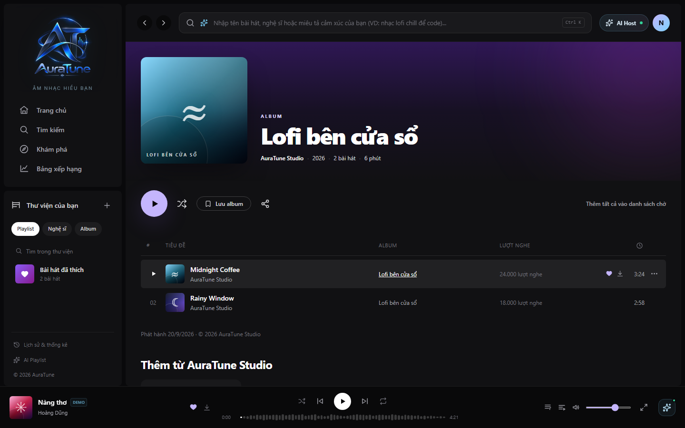
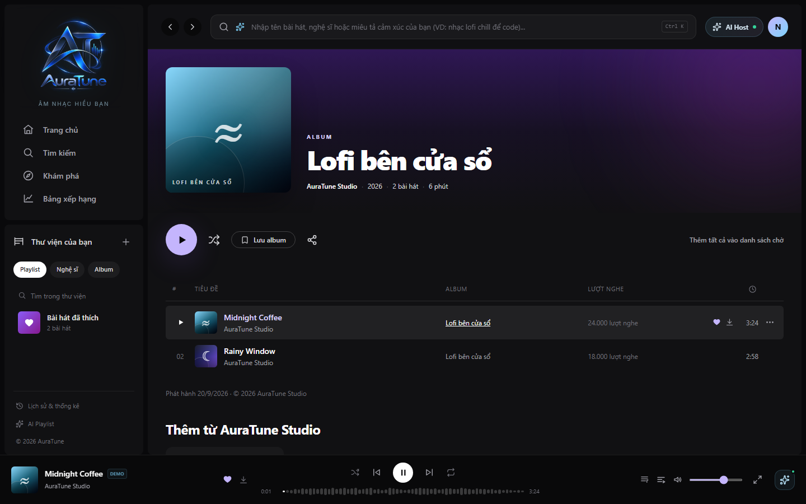
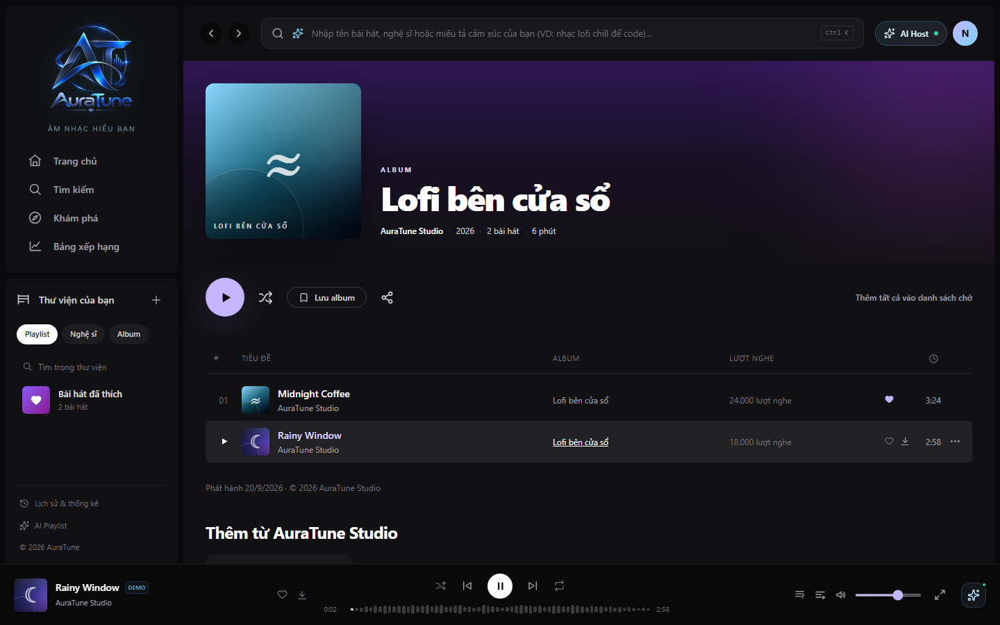
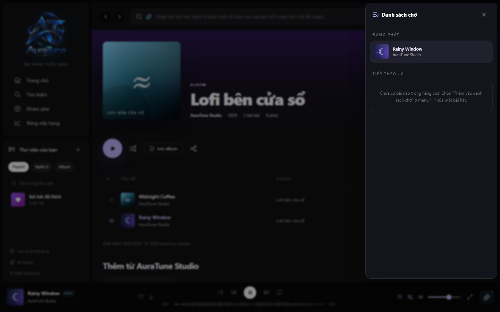

# UC-080-002 – Play Album Tracklist
Performed by: Nguyễn Khánh Đăng | Reviewed by: Group 10 team | Edited by: Lê Công Minh Nhựt

---

## 1. Metadata
Performed by: Nguyễn Khánh Đăng | Reviewed by: Group 10 team | Edited by: Lê Công Minh Nhựt

| Field | Value |
|---|---|
| **Use Case ID** | UC-080-002 |
| **Use Case Name** | Play Album Tracklist |
| **Functional Group** | 080 – Album |
| **Primary Actor** | Listener (`ACT-02`) |
| **Supporting Actors** | None; Music Player and Queue are internal AuraTune components |
| **Related FR IDs** | `082-FR-001` to `082-FR-016` |
| **Related Feature/Spec** | Feature 082: Album Tracklist Playback (`specs/080-album-interaction/082-album-tracklist/spec.md`) |
| **Status** | Draft |
| Writer | Lê Công Minh Nhựt |
| Original Writer (PA3 draft) | Nguyễn Khánh Đăng |
| Reviewer | Group 10 team |

---

## 2. Description
Performed by: Nguyễn Khánh Đăng | Reviewed by: Group 10 team | Edited by: Lê Công Minh Nhựt

Allows a listener to start playback from the first playable track of an album or from a selected track, integrating with the existing Music Player and Queue Management behavior.

---

## 3. Preconditions
Performed by: Nguyễn Khánh Đăng | Reviewed by: Group 10 team | Edited by: Lê Công Minh Nhựt

- The listener is viewing an album and its complete track data is available.
- The existing Music Player and Queue Management behavior are available to receive playback requests.

---

## 4. Trigger
Performed by: Nguyễn Khánh Đăng | Reviewed by: Group 10 team | Edited by: Lê Công Minh Nhựt

The listener selects the "Play Album" (Phát album) action or a specific playable track row.

---

## 5. Basic Flow
Performed by: Nguyễn Khánh Đăng | Reviewed by: Group 10 team | Edited by: Lê Công Minh Nhựt

1. **Actor:** Selects the "Play Album" action.
2. **System:** Verifies there are playable tracks. Turns off "Shuffle" mode if it is currently enabled (`082-FR-013`).
3. **System:** Starts a rebuilt album sequence in artist-intended order and retains already queued tracks outside that album after the album sequence. This follows the owner's PA4 decision on 2026-11-20; `082-FR-004` remains an outstanding source-alignment item.
4. **System:** Starts playback from the first playable track in the album (`082-FR-004`).
5. **System:** Makes the remaining playable album tracks available in artist-intended order through the existing queue (`082-FR-004`, `082-FR-007`, `082-FR-009`).
6. **System:** Updates the persistent mini-player at the bottom with the new active track context (cover art, title, artist) and visually highlights the playing track row in the tracklist.
7. **Actor:** Listens to the album seamlessly, even if navigating to other pages (`082-FR-008`).

---

## 6. Alternative Flows
Performed by: Nguyễn Khánh Đăng | Reviewed by: Group 10 team | Edited by: Lê Công Minh Nhựt

### AF-01 – Play Selected Track
Performed by: Nguyễn Khánh Đăng | Reviewed by: Group 10 team | Edited by: Lê Công Minh Nhựt
- **Starting step:** Step 1 of the Basic Flow.
- **Condition:** The listener selects a specific playable track instead of Play Album.
1. **Actor:** Selects the play action on a specific playable track row.
2. **System:** Makes the selected track the current active track.
3. **System:** Inserts playable album tracks following the selected track before previously upcoming tracks, preserving both sequences (`082-FR-006`).
- **Continuation:** Resumes at Step 6 of the Basic Flow.

### AF-02 – Add All to Queue
Performed by: Nguyễn Khánh Đăng | Reviewed by: Group 10 team | Edited by: Lê Công Minh Nhựt
- **Starting step:** Step 1 of the Basic Flow.
- **Condition:** The listener selects the "Thêm tất cả vào danh sách chờ" (Add all to queue) action.
1. **Actor:** Clicks "Thêm tất cả vào danh sách chờ".
2. **System:** Appends all playable tracks from the album to the *end* of the current playback queue, without interrupting the song currently playing (`082-FR-016`).
- **Continuation:** Use Case ends successfully.

---

## 7. Exception Flows
Performed by: Nguyễn Khánh Đăng | Reviewed by: Group 10 team | Edited by: Lê Công Minh Nhựt

### EF-01 – Unavailable Tracks
Performed by: Nguyễn Khánh Đăng | Reviewed by: Group 10 team | Edited by: Lê Công Minh Nhựt
- **Starting step:** Step 5 of the Basic Flow.
- **Condition:** One or more tracks are marked unavailable for playback.
1. **System:** Keeps each unavailable track visible but disabled and shows the applicable reason (`082-FR-005`, `082-FR-011`).
2. **System:** Omits unavailable tracks from playback and continues with the next playable track in album order (`082-FR-011`).
- **Continuation:** Resume playback with the remaining valid sequence.

### EF-02 – Empty or Completely Unavailable Album
Performed by: Nguyễn Khánh Đăng | Reviewed by: Group 10 team | Edited by: Lê Công Minh Nhựt
- **Starting step:** Step 2 of the Basic Flow.
- **Condition:** The album has zero playable tracks.
1. **System:** Disables the "Play Album" button.
2. **System:** Displays a state indicating no tracks are available and does not start the player or modify the queue (`082-FR-010`).
- **Continuation:** Use Case ends unsuccessfully.

### EF-03 – Track Becomes Unavailable at Playback
Performed by: Nguyễn Khánh Đăng | Reviewed by: Group 10 team | Edited by: Lê Công Minh Nhựt
- **Starting step:** Step 4 of the Basic Flow or AF-01, Step 2.
- **Condition:** A track becomes unavailable when playback is attempted (`082-FR-014`).
1. **System:** Uses the existing player error and recovery behavior and does not substitute an unrelated track.
2. **System:** Continues with the next playable album track when possible (`082-FR-014`).
- **Continuation:** Resume the remaining album sequence, or end in a handled failure if no playable track remains.

---

## 8. Postconditions
Performed by: Nguyễn Khánh Đăng | Reviewed by: Group 10 team | Edited by: Lê Công Minh Nhựt

### Success
Performed by: Nguyễn Khánh Đăng | Reviewed by: Group 10 team | Edited by: Lê Công Minh Nhựt
- For Play Album, the first playable album track is active and the playback queue contains the album's playable tracks in the required order.
- For selected-track playback, the selected track is active and following playable tracks are queued in album order.
- Shuffle is off after Play Album; the requirement does not specify changing Shuffle for selected-track playback.

### Failure
Performed by: Nguyễn Khánh Đăng | Reviewed by: Group 10 team | Edited by: Lê Công Minh Nhựt
- If the album has no playable tracks, playback and queue remain unchanged. If a track fails after playback has started, EF-03 applies: use the existing recovery behavior and proceed to the next playable album track where possible; do not claim an automatic rollback of already completed playback.

---

## 9. Special Requirements
Performed by: Nguyễn Khánh Đăng | Reviewed by: Group 10 team | Edited by: Lê Công Minh Nhựt

- **Shuffle Override**: Playing a full album automatically disables Shuffle to respect artist-intended order (`082-FR-013`).
- **Queue Behavior**: Owner decision PA4-D03 (2026-11-20) selects the Feature 082 clarification and FR-012 behavior: album tracks play first, with unrelated upcoming tracks preserved afterward. Repeat Play Album rebuilds the album segment without duplicates. FR-004 and its replacement acceptance example still need a separately authorized spec update.
- **Re-play Handling**: Clicking Play Album on an already playing album restarts it from track 1 and rebuilds the queue block without duplicating tracks (`082-FR-012`).
- **State Persistence**: The player and queue must remain active while the user navigates across different pages.

---

## 10. Prototype and Screenshots
Performed by: Nguyễn Khánh Đăng | Reviewed by: Group 10 team | Edited by: Lê Công Minh Nhựt

### Basic Flow - Album Tracklist View
Performed by: Nguyễn Khánh Đăng | Reviewed by: Group 10 team | Edited by: Lê Công Minh Nhựt

**Covered steps:** Basic Flow step 1.
**Prototype type:** Available; source type to verify

### Basic Flow - Play Album Action
Performed by: Nguyễn Khánh Đăng | Reviewed by: Group 10 team | Edited by: Lê Công Minh Nhựt

**Covered steps:** Basic Flow steps 1-4.
**Prototype type:** Available; source type to verify

### Alternative Flow - Play Selected Track (AF-01)
Performed by: Nguyễn Khánh Đăng | Reviewed by: Group 10 team | Edited by: Lê Công Minh Nhựt

**Covered steps:** AF-01 steps 1-2.
**Prototype type:** Available; source type to verify

### Basic Flow - Album Playback Queue Integration
Performed by: Nguyễn Khánh Đăng | Reviewed by: Group 10 team | Edited by: Lê Công Minh Nhựt

**Covered steps:** Basic Flow step 5.
**Prototype type:** Available; source type to verify

---

## 11. Related Use Cases
Performed by: Nguyễn Khánh Đăng | Reviewed by: Group 10 team | Edited by: Lê Công Minh Nhựt

- **Target Player**: `UC-040-001` (Control Audio Playback)
- **Target Queue**: `UC-050-001` (Manage Queue)

---

## 12. Source References
Performed by: Nguyễn Khánh Đăng | Reviewed by: Group 10 team | Edited by: Lê Công Minh Nhựt

- `specs/080-album-interaction/082-album-tracklist/spec.md` – Requirements 082-FR-001 through 082-FR-016.
- `docs/proposal/proposal.md`

---

## 13. Notes and Open Questions
Performed by: Nguyễn Khánh Đăng | Reviewed by: Group 10 team | Edited by: Lê Công Minh Nhựt

- **Queue Logic**: PA4-D03 settles the required use-case behavior. Current `App.jsx` Play Album replaces the collection, so implementation and FR-004 alignment remain pending.

## PA4 implementation evidence and acceptance record
Performed by: Nguyễn Khánh Đăng | Reviewed by: Group 10 team | Edited by: Lê Công Minh Nhựt

Album UI and playback integration exist. `src/backend/routes/albumRoutes.js` stores saved album IDs in a process-local Map. A successful save response therefore does not establish persistence after backend restart. The owner-selected queue-preservation behavior is documented separately from the current replacement implementation in `App.jsx`.

The flows above state required behavior. This revision records source inspection only; no browser acceptance or new feature-test run is claimed. Before acceptance, execute the basic flow and its applicable alternative/exception flows, checking the documented success and failure postconditions. Record results against this UC ID in [the PA4 review register](../../use-case-model.md#11-pa4-decisions-and-source-review).
