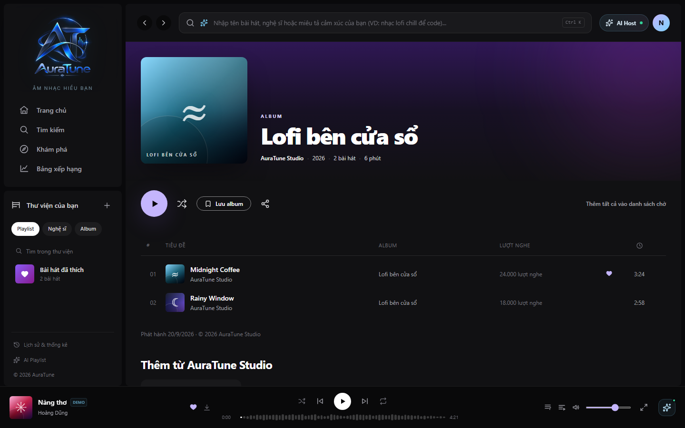
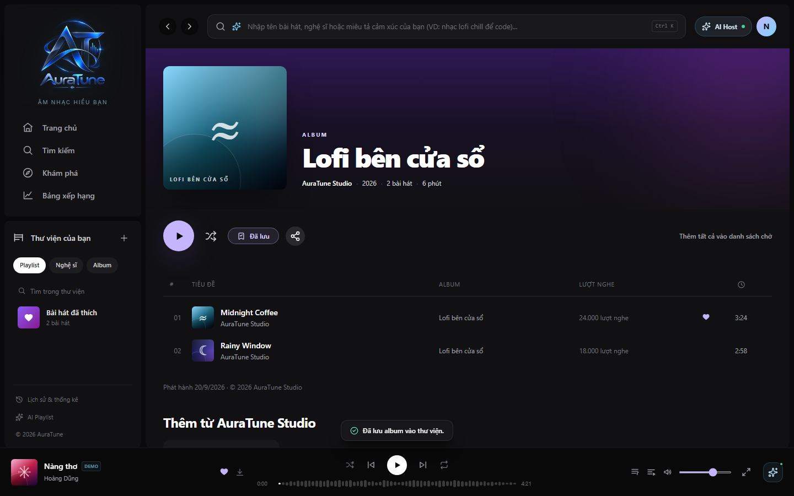
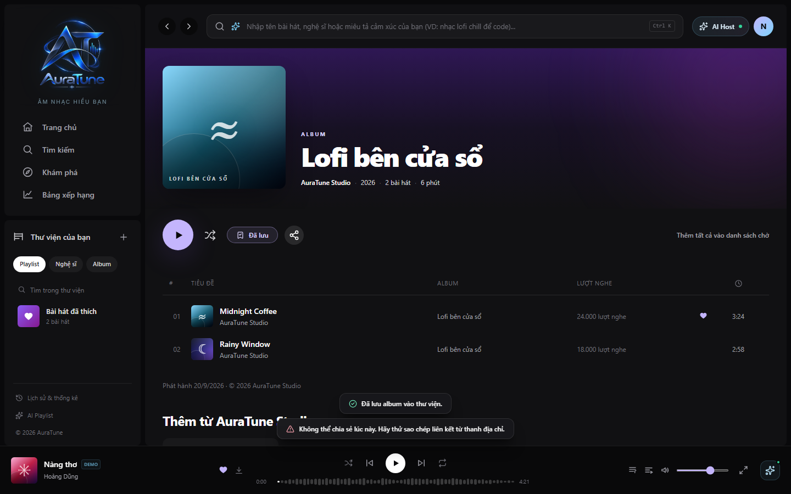

# UC-080-003 – Save and Share Album

---

## 1. Metadata

| Field | Value |
|---|---|
| **Use Case ID** | UC-080-003 |
| **Use Case Name** | Save and Share Album |
| **Functional Group** | 080 – Album |
| **Primary Actor** | Listener (`ACT-02`) (Save), Guest/Visitor (`ACT-01`) (Share) |
| **Supporting Actors** | Auth (`Group 010`) |
| **Related FR IDs** | `083-FR-001` to `083-FR-014` |
| **Related Feature/Spec** | Feature 083: Save and Share Album (`specs/080-album-interaction/083-save-and-share-album/spec.md`) |
| **Status** | Draft |
| **Writer** | Nguyễn Khánh Đăng |
| **Reviewer** | TBD |

---

## 2. Description

Allows a signed-in listener to save or remove an album from their personal library and allows any visitor to share a URL that identifies the album. Save/remove actions use the specified API contracts; sharing controls and user-visible outcomes follow Feature 083 requirements.

---

## 3. Preconditions

- For saving: The user must be authenticated (`Listener`).
- For sharing: None (Guests can share).

---

## 4. Trigger

The actor clicks the "Lưu album" (Save Album) bookmark icon or the "Chia sẻ album" (Share) icon on the album action toolbar.

---

## 5. Basic Flow (Save Album)

1. **Actor:** Selects the "Lưu album" action.
2. **System:** Verifies the user is signed in (`083-FR-007`).
3. **System:** Temporarily disables the button and shows a pending state while sending a `PUT /albums/:id/save` request (`083-FR-005`).
4. **System:** Receives confirmation from the server.
5. **System:** Updates the UI: Changes icon to `BookmarkCheck`, label to "Đã lưu", applies violet active styling (`083-FR-004`).
6. **System:** Makes the confirmed saved state available in the listener's personal saved album library (`083-FR-001`, `083-FR-003`).

---

## 6. Alternative Flows

### AF-01 – Share Album
- **Starting step:** Step 1 of the Basic Flow.
- **Condition:** The actor (Guest or Listener) clicks "Chia sẻ album".
1. **Actor:** Selects the Share action.
2. **System:** Provides Copy Link and sharing controls for Facebook, Instagram, X, and Zalo (`083-FR-008`, `083-FR-011`).
3. **Actor:** Selects a sharing destination.
4. **System:** Provides the URL identifying the current album; opening a valid URL leads to that album's details page (`083-FR-009`, `083-FR-010`).
- **Continuation:** Use Case ends successfully.

### AF-02 – Unsave Album
- **Starting step:** Step 1 of the Basic Flow.
- **Condition:** The album is already saved (button shows "Đã lưu").
1. **Actor:** Selects the "Đã lưu" action.
2. **System:** Temporarily disables the action, shows progress, and retains the last confirmed saved state while sending `DELETE /albums/:id/save` (`083-FR-002`, `083-FR-005`, `083-FR-006`).
3. **System:** After removal is confirmed, shows the unsaved state and removes the album from the currently open Saved Albums list without reload (`083-FR-002`, `083-FR-004`).
- **Continuation:** Use Case ends successfully.

---

## 7. Exception Flows

### EF-01 – Unauthenticated Save Attempt
- **Starting step:** Step 2 of the Basic Flow.
- **Condition:** The visitor is a Guest.
1. **System:** Detects lack of authentication.
2. **System:** Prompts the visitor to sign in before changing a personal library (`083-FR-007`).
3. **System:** Does not alter any personal library state.
- **Continuation:** The save action ends without changing library state; the visitor may sign in and retry.

### EF-02 – Save or Remove Failure
- **Starting step:** Step 4 of the Basic Flow.
- **Condition:** The API request times out or returns an error.
1. **System:** Removes the pending state and retains the last confirmed saved state; if removal fails in Saved Albums, keeps the album visible (`083-FR-002`, `083-FR-005`).
2. **System:** Displays a short, action-specific inline error near the control, with a retry hint where appropriate (`083-FR-012`).
- **Continuation:** Use case ends unsuccessfully; actor can retry.

### EF-03 – Share Failure
- **Starting step:** AF-01, Step 3.
- **Condition:** The selected share action cannot be completed.
1. **System:** Does not indicate that sharing succeeded.
2. **System:** Displays a short, action-specific inline error near the share control, with a retry hint where appropriate (`083-FR-012`).
- **Continuation:** The visitor may retry; otherwise, the share flow ends unsuccessfully.

### EF-04 – Invalid or Unavailable Shared Album
- **Starting step:** AF-01, Step 4.
- **Condition:** The shared URL is invalid or the identified album is unavailable (`083-FR-013`).
1. **System:** Opens the album details destination for the identified album and delegates its not-found/unavailable presentation to `UC-080-001`; it does not display details for another album (`083-FR-010`, `083-FR-013`).
- **Continuation:** The shared-link flow ends with the destination's appropriate state.

---

## 8. Postconditions

### Success
- The album is saved to or removed from the acting listener's personal library only after the action is confirmed.
- The displayed saved state corresponds to the active account.

### Failure
- No false success indicators are shown. State remains securely synchronized with the server's truth.
- Failed save, remove, or share actions do not show false success and provide the required inline feedback.

---

## 9. Special Requirements

- **Account Isolation**: Saved states are strictly bound to the authenticated account. User A's saves do not affect User B (`083-FR-003`).
- **Pending State**: While save or remove is pending, disable the action, show progress, and retain the last confirmed saved state (`083-FR-005`).
- **Library View Deletion**: If a user unsaves an album while actively viewing their Library page, the item remains visible until confirmed, then instantly disappears without requiring a page reload (`083-FR-002`).
- **Quota**: There is no feature-specific quota limiting the number of saved albums (`083-FR-014`).

---

## 10. Prototype and Screenshots

### Basic Flow - Save Album

**Covered steps:** Basic Flow step 1.
**Prototype type:** Available; source type to verify

**Covered steps:** Basic Flow steps 5-6.
**Prototype type:** Available; source type to verify

### AF-01 - Share Album Action

**Covered steps:** AF-01 step 1.
**Prototype type:** Available; source type to verify

### EF-03 - Share Album Failure

**Covered steps:** EF-03.
**Prototype type:** Available; source type to verify

---

## 11. Related Use Cases

- **Preceding Use Case**: `UC-010-002` (Log In with Email)

---

## 12. Source References

- `specs/080-album-interaction/083-save-and-share-album/spec.md` – Requirements 083-FR-001 through 083-FR-014.
- `docs/proposal/proposal.md`

---

## 13. Notes and Open Questions

- **Share Destinations**: Copy Link, Facebook, Instagram, X, and Zalo are required destinations (`083-FR-011`). The technical sharing mechanism is not specified by Feature 083.
