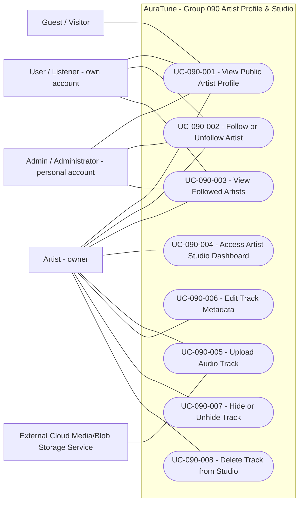

# 090 – Artist Profile & Studio

## 1. Group Overview

| Field | Description |
|---|---|
| Group ID | 090 |
| Group Name | Artist Profile & Studio |
| Group Owner | Thái Hoàng |
| Purpose | Let visitors discover artists and their public releases, let authenticated accounts keep a personal collection of artists, and let artists manage their own tracks. |
| Status | In Progress |

Start with the [inventory](./use-case-inventory.md) for the eight stable UC IDs and requirement allocation. Drafts now exist for [UC-090-001](./UC-090-001-view-public-artist-profile.md), [UC-090-002](./UC-090-002-follow-or-unfollow-artist.md), [UC-090-003](./UC-090-003-view-followed-artists.md), [UC-090-004](./UC-090-004-access-artist-studio-dashboard.md), [UC-090-005](./UC-090-005-upload-audio-track.md), [UC-090-006](./UC-090-006-edit-track-metadata.md), [UC-090-007](./UC-090-007-hide-or-unhide-track.md) and [UC-090-008](./UC-090-008-delete-track-from-studio.md); all eight specification files now exist (eight specifications plus group README, inventory, prototype index and submission notes; editable mockups, PNGs and diagram exports are additional assets). Writer: Thái Hoàng. Reviewer: Not assigned. No peer review or approval has occurred.

The inventory now records UC-090-001 through UC-090-008 as Draft with existing-file links; none is Approved. Current visual observations are recorded in Section 12 of each Draft. None of the eight Drafts has complete prototype evidence or peer review. All eight Drafts now link existing related specifications; obsolete planned references and synchronization notes have been updated.

Authoring follows the supplied extracted group README template (nine sections) and UC template (15 sections), read from `C:/Users/Admin/Downloads/AuraTune_UC_Templates_Extracted/AuraTune_Use_Case_Templates/`, together with `C:/Users/Admin/Downloads/AuraTune_Use_Case_Documentation_Guide.md`. See also the [repository guide](../README.md) and [system model](../../use-case-model.md); their differing template/FR conventions are recorded below rather than silently reconciled.

## 2. Scope

### 2.1 In Scope

- Public artist identity, optional image/biography, eligible featured songs, albums and related playlists; navigation to existing content destinations; privacy-safe empty, not-found, temporary-failure and retry outcomes (091).
- Personal follow/unfollow, recognition of following state and viewing the account's own followed artists, including the visibility and failure rules defined by 092.
- Artist-only Studio access, own-track catalog/statistics, audio upload, metadata editing, hide/unhide and confirmed deletion (093).
- Existing paired goals stay combined: follow/unfollow in UC-090-002 and hide/unhide in UC-090-007.

- Owner-confirmed G090-D18 adds optional public artist-profile-link copying in UC-001, with truthful copy success/failure and unchanged recipient visibility. This supplements Vision G09/091 UI, not an existing source FR.

### 2.2 Out of Scope

- Playback, queue processing and destination album/playlist behavior, owned by their respective groups; this group's public-profile UC only hands off navigation.
- Artist-profile editing and changing profile public visibility, neither defined by 091 nor added here; administrative artist/content actions belong to Group 110.
- Following other users, release notifications, monetization and royalty management.
- Full album organization/management is deferred for this submission at the owner's request. Existing display/navigation and album-name metadata remain; the complete Vision goal is not claimed fulfilled or assigned elsewhere.

## 3. Requirement and Feature Traceability

Feature-qualified references such as `091-FR-001` identify literal `FR-001` in the linked feature spec. Current source requirements, not the model's older mappings, govern this documentation.

| Feature ID | Feature Name | Related FR IDs | Spec Kit Specification |
|---|---|---|---|
| 091 | Artist Profile | 31 actual IDs: FR-001–FR-027 plus FR-010A, FR-010B, FR-014A, FR-018A | [091 spec](../../../../specs/090-artist-profile-studio/091-artist-profile/spec.md) |
| 092 | Follow Artist | 16 actual IDs: FR-001–FR-016 | [092 spec](../../../../specs/090-artist-profile-studio/092-follow-artist/spec.md) |
| 093 | Artist Track Management | 10 actual IDs: FR-001–FR-010 | [093 spec](../../../../specs/090-artist-profile-studio/093-artist-track-management/spec.md) |

The [inventory Coverage Check](./use-case-inventory.md#4-coverage-check) allocates all 57 actual FRs individually, including scope boundaries. This is allocation coverage, not evidence of complete specifications, implementation or tests.

Other sources: [Vision](../../../proposal/Auratune_Vision_Document.md), N-08/N-09, G09 and AD-04/AD-10; [API Contract](../../../analysis-and-design/api-contract.md), Sections 2.4/2.7/2.8; [API conventions](../../../design/api/api-conventions.md); [security principles](../../../design/security/README.md); [data security rules](../../../design/database/security-rules.md). Repository organization and Git sources: [specs README](../../../../specs/README.md) and [Git workflow](../../../management/git-workflow.md).

## 4. Actors

| Actor | Actor Type | Description | Goals |
|---|---|---|---|
| Guest / Visitor | Primary | Unauthenticated public visitor; no artist-management permission is needed. | View a public artist profile (UC-090-001). |
| Listener | Primary | Authenticated standard account; inherits public visitor access. | Public profile; own follow relationship and followed-artists list (UC-090-001–003). |
| Artist | Primary | Inherits Listener capabilities; only the authenticated artist role accesses Studio. | Public/personal goals and own-track Studio goals (UC-090-004–008). |
| Administrator | Primary for personal following | Inherits Listener access in the model; 092 FR-009 permits non-banned Admin accounts to use only their own following data. No Studio permission is inferred. | Public profile and own personal follow/list goals; administrative goals remain in Group 110. |

No supporting actor is confirmed for UC-090-001. UC-090-005 now records External Cloud Media/Blob Storage Service as a logical supporting role based on Vision Section 4.1, which explicitly shows AuraTune services saving uploads to external media storage, and 093-FR-010. This upload-persistence role is not inferred from CDN delivery. Provider, interface and equivalence to the shared model's CDN actor name remain open; the shared model is unchanged. No internal backend, database or UI component is an actor.

## 5. Use-Case Diagram

This is a **Use Case representation using Mermaid flowchart**, not standard UML use-case syntax. Human/service actors are outside the AuraTune system boundary; rounded nodes inside are the eight unchanged user goals. Lines are actor associations, not request order or include/extend relationships. Explicit associations avoid relying on an implicit role inheritance chain.

User, Artist and Admin personal associations to UC-002/003 follow [092-FR-009](../../../../specs/090-artist-profile-studio/092-follow-artist/spec.md); authentication, non-banned access and own-account scope constrain those associations. Studio UC-004-008 requires the Artist role and ownership under [093-FR-001](../../../../specs/090-artist-profile-studio/093-artist-track-management/spec.md); Admin alone has no Studio association. Public-profile access is inherited/public access shown explicitly for each human role.

Storage is a logical supporting role only for upload, supported by [Vision Section 4.1](../../../proposal/Auratune_Vision_Document.md) (AuraTune services save uploads outside the system) and 093-FR-010's actual binary persistence. This is not inferred from the shared CDN label, and does not select a provider or a direct browser-upload interface. No internal UI/backend/database actor or include/extend relation is invented.

IDs, full names and associations were checked against the eight Drafts and inventory. **Actual render verified:** Mermaid 11 rendered the unchanged source in headless Chrome on 2026-11-04; the diagram PNG was visually inspected for boundary, labels and actor associations. [Portable SVG](./prototypes/group-090-use-case-diagram.svg) and [PNG](./prototypes/group-090-use-case-diagram.png) are included so viewing does not depend on Mermaid support. Rendering in the team's exact Markdown host remains unverified. The shared model remains unchanged, including its stale FR/actor mappings.

## 6. Use-Case Summary

| UC ID | Use-Case Name | Primary Actor | Related FR IDs | Specification |
|---|---|---|---|---|
| UC-090-001 | View Public Artist Profile | Guest / Visitor; Listener and inherited public access | All 31 Feature 091 FRs, individually mapped in Draft Section 14 | [Draft specification](./UC-090-001-view-public-artist-profile.md) |
| UC-090-002 | Follow or Unfollow Artist | Listener; Artist; Administrator, own account only | 092-FR-001–006, 009–016 | [Draft specification](./UC-090-002-follow-or-unfollow-artist.md) |
| UC-090-003 | View Followed Artists | Listener; Artist; Administrator, own account only | 092-FR-003, 006–009, 012–016 | [Draft specification](./UC-090-003-view-followed-artists.md) |
| UC-090-004 | Access Artist Studio Dashboard | Artist | 093-FR-001–003 | [Draft specification](./UC-090-004-access-artist-studio-dashboard.md) |
| UC-090-005 | Upload Audio Track | Artist | 093-FR-001, 004, 005, 009, 010 | [Draft specification](./UC-090-005-upload-audio-track.md) |
| UC-090-006 | Edit Track Metadata | Artist | 093-FR-001, 005, 006, 009 | [Draft specification](./UC-090-006-edit-track-metadata.md) |
| UC-090-007 | Hide or Unhide Track | Artist | 093-FR-001, 007, 009 | [Draft specification](./UC-090-007-hide-or-unhide-track.md) |
| UC-090-008 | Delete Track from Studio | Artist | 093-FR-001, 008, 009 | [Draft specification](./UC-090-008-delete-track-from-studio.md) |

092-FR-011 additionally constrains public-profile not-found consistency in UC-090-001, as already allocated in the inventory; it does not introduce a follow flow into this UC.

## 7. Prototype Summary

See the [prototype index](./prototypes/README.md) for all 90 Basic/Alternative/Exception Flow entries, original-source provenance and residual Missing/Partial coverage. Nine author-created mockup boards supplement 16 original PNGs; mockups do not prove backend or passed tests.

| UC ID | Basic Flow Prototype | Alternative Flow Prototypes | Notes |
|---|---|---|---|
| UC-090-001 | [Current storyboard](./prototypes/UC-090-001-basic-flow-and-key-states.png) | [Per-flow index](./prototypes/README.md#uc-090-001--view-public-artist-profile) | Author-created mockup; Basic UI and key alternatives, Partial sequence coverage. |
| UC-090-002 | [Current storyboard](./prototypes/UC-090-002-basic-flow-and-key-states.png) | [Per-flow index](./prototypes/README.md#uc-090-002--follow-or-unfollow-artist) | Author-created mockup; Basic UI and key alternatives, Partial sequence coverage. |
| UC-090-003 | [Current storyboard](./prototypes/UC-090-003-basic-flow-and-key-states.png) | [Per-flow index](./prototypes/README.md#uc-090-003--view-followed-artists) | Author-created mockup; Basic UI and key alternatives, Partial sequence coverage. |
| UC-090-004 | [Current storyboard](./prototypes/UC-090-004-basic-flow-and-key-states.png) | [Per-flow index](./prototypes/README.md#uc-090-004--access-artist-studio-dashboard) | Author-created mockup; Basic UI and key alternatives, Partial sequence coverage. |
| UC-090-005 | [Current storyboard](./prototypes/UC-090-005-basic-flow-and-key-states.png) | [Per-flow index](./prototypes/README.md#uc-090-005--upload-audio-track) | Author-created mockup; Basic UI and key alternatives, Partial sequence coverage. |
| UC-090-006 | [Current storyboard](./prototypes/UC-090-006-basic-flow-and-key-states.png) | [Per-flow index](./prototypes/README.md#uc-090-006--edit-track-metadata) | Author-created mockup; Basic UI and key alternatives, Partial sequence coverage. |
| UC-090-007 | [Current storyboard](./prototypes/UC-090-007-basic-flow-and-key-states.png) | [Per-flow index](./prototypes/README.md#uc-090-007--hide-or-unhide-track) | Author-created mockup; Basic UI and key alternatives, Partial sequence coverage. |
| UC-090-008 | [Current storyboard](./prototypes/UC-090-008-basic-flow-and-key-states.png) | [Per-flow index](./prototypes/README.md#uc-090-008--delete-track-from-studio) | Author-created mockup; Basic UI and key alternatives, Partial sequence coverage. |

## 8. Open Issues and Decisions

Issue IDs below are local documentation tracking labels, not new FR or UC identifiers.

| ID | Issue / Decision Needed | Impacted UC/FR | Owner | Status |
|---|---|---|---|---|
| G090-Q01 | Share artist settled by owner-confirmed G090-D18: copy the public artist-profile link, truthful copy success/failure and unchanged recipient visibility. | UC-001 AF-06/EX-04/BR-09 | Thái Hoàng / group | Resolved |
| G090-Q02 | Full album management deferred for this submission; retain album display/navigation and track album-name metadata. Vision gap retained, not assigned elsewhere. | UC-001/005/006; Vision G09 | Thái Hoàng / group | Deferred for this submission |
| G090-Q03 | Align the source-supported logical external upload-storage role with the shared CDN actor label; provider/interface remain unconfirmed. Vision 4.1 and 093-FR-010 establish the logical boundary, not CDN equivalence. | UC-090-005; 093-FR-010 | Thái Hoàng / group | Open |
| G090-Q04 | Align shared model FR references with current specs and personal-role permissions from 092-FR-009 in a later authorized pass. | All eight UCs; model Group 090 | Thái Hoàng / group | Open |
| G090-Q05 | Correct stale spec image annotations later; 091 album description cites FR-013, now related playlists. Other drift is recorded in inventory. | 091-FR-011–014A; 092 annotations | Thái Hoàng | Open |
| G090-Q06 | Obtain missing flow-state prototype evidence and resolve visual mismatches documented in UC-090-001 Section 12. | UC-090-001 AF/EX flows | Thái Hoàng | Open |
| G090-Q07 | Assign an independent reviewer. Inventory status, links and visual-inspection notes are synchronized for UC-090-001/002/003/004/005/006/007/008; review is still pending. | UC-090-001/002/003/004/005/006/007/008; inventory | Thái Hoàng | Open |
| G090-Q08 | Selection-time unavailable outcome settled by owner-confirmed G090-D17: neutral destination not-found with return action and no target disclosure. Source originally left this open; evidence remains missing. | UC-001 EX-03/BR-08; 091-FR-007/008/015 | Thái Hoàng / group | Resolved |
| G090-Q09 | Authoring choice settled for this group: complete extracted templates (nine README sections, 15 UC sections, prototype-index columns/Asset Rules) and explicitly requested branch are used. Source convention differences remain documented; no shared convention is rewritten. | Documentation conventions | Thái Hoàng / group | Resolved for Group 090 |

### Current status after G090-D01-D18

D01-D16 remain recorded without reconstruction; D17 records the selection-time outcome; D18 records the latest share-artist confirmation. B-02 through B-11 are Resolved in the current register. Earlier decision paragraphs below are historical snapshots: for example, D08-D13 left parts of B-06 open until D14, and D15 left lengths open until D16. Their original recorded substance is retained. A later decision supersedes the historical open-status note only for the topic it actually settles. Historical notes retain their original scope; UC-001 now includes the D17 selection-time exception.

**Remaining business/scope questions (not resolved by 57 Covered FR rows):**

Share artist (G090-Q01) is resolved by D18 within UC-001; prototype evidence remains incomplete.
**B-01 / G090-Q02 - deferred scope:** For this submission, the owner requested deferring full album management while retaining existing public album display/navigation and upload/edit album-name metadata. This does not fulfill the entire Vision G09 album-organization goal and does not assign the deferred work to another group. Broader album creation/editing/deletion, membership and ordering require a later scoped feature; no new UC or source FR is added.
**B-11 / G090-Q08 is resolved by G090-D17:** neutral destination not-found with return action for selected content that has become unavailable; matching prototype evidence remains missing.

**Source alignment:** S-01 remains separate: Admin one-click removal versus confirmed deletion is a conditional conflict only if those mean the same executed action. Removed/deleted state naming and playback wording require scope alignment, not an asserted blanket conflict; no 112 policy is chosen here.

**Technical/model work:** C-01/C-02 and G090-Q03/Q04 cover retrieval, persistence/cleanup, provider/interface/actor-label alignment and stale shared FR/role mappings. **Evidence/review work:** D-01 and G090-Q05/Q06/Q07 cover source annotations, missing flow prototypes, actual renderer verification and independent review. These are not additional business blockers or evidence that the eight Drafts are Approved.

### Shared open issues

One register consolidates duplicated issues. Local Q IDs remain stable cross-references. All eight specifications remain Draft; Reviewer: Not assigned. Only explicitly recorded owner session decisions D01-D18 are adopted; unselected proposals are not business rules.

| ID | Category | Remaining issue |
|---|---|---|
| B-01 | Deferred scope; share resolved | G090-D18 settles sharing. Owner submission instruction defers broader album management; existing album display/navigation and track album-name metadata remain. Vision gap retained; no assignment to another group or claim of full fulfillment. Audio replacement remains only a future scope note. |
| B-02 | Resolved by owner session decision | Owner-confirmed session decision G090-D06 (2026-11-04), own-Artist Studio statistics: active count includes only Artist-public tracks without Admin restriction that are not deleted. Total plays retains all validly recorded historical plays, including tracks later hidden, restricted or deleted; those actions do not themselves subtract historical plays. An empty catalog has active count 0 but retains historical total plays, which is 0 only if there are no recorded plays. Unavailable data must be distinguishable from 0. No technical data source, schema, storage/cleanup policy or Group 113 formula selected. |
| B-03 | Resolved by owner session decision | G090-D01, confirmed by Thái Hoàng on 2026-11-04: MP3 only; maximum 52,428,800 bytes (50 MiB), inclusive. Reject other formats/oversize with appropriate feedback and no upload-success result. Newly confirmed in this session, not a pre-existing source requirement. Format/size closed by G090-D01; B-04 subsequently resolved by G090-D02/D03. |
| B-04 | Resolved by owner session decisions | G090-D02 confirms the checkbox; G090-D03 (2026-11-04) confirms rights declarations. Select one rights type: Self-owned, Licensed, or Open license. For Self-owned material, the G090-D02 checkbox is mandatory but no external source/license link is required. For Licensed or Open license material, content source and distribution-permission basis are both required as non-empty text; uploading proof documents is not required. For every rights type, explicitly state whether attribution is required; if yes, supply non-empty attribution text. These are Artist declarations, not system verification of legal rights or license validity. Missing required information receives corrective feedback before upload/track saving. No schema/API selected. |
| B-05 | Resolved: existing scope confirmed | Owner scope confirmation G090-D04 (2026-11-04): the Artist enters duration at upload and may edit it in metadata. Validate exactly `^\d{1,2}:[0-5]\d$`. Within current scope, no measurement from audio or comparison against actual audio length is required; do not claim system-verified duration. Other validation remains unchanged; no source spec changed. |
| B-06 | Resolved by owner session decisions | G090-D08-D13 settle selected recovery, cancellation/departure, input retention and same-account session recovery. G090-D14 closes partial/stale presentation: preserve successful portions; failed portions have error/manual retry; earlier data clearly not updated, never current or fabricated zero/empty. Original source gaps are supplemented by these session decisions; technical/cache/auth/request-tracking mechanisms and evidence remain open separately. |
| B-07 | Resolved by owner session decision | Owner-confirmed session decision G090-D05 (2026-11-04): an eligible Artist-owner may edit the already-permitted metadata, delete through the existing confirmation/cancel flow, and change only their self-hide preference while Admin restriction remains active. None of these actions clears that restriction, publishes the track or permits a new play start. After Admin lifts restriction, public availability requires Artist-public preference and a non-deleted track. Unhide/unrestrict cannot restore a deleted track. No source change, schema selection or group approval. |
| B-08 | Resolved by owner session decisions | G090-D15 sets title non-empty after edge trim, optional/clearable album and catalog-member genre. G090-D16 (2026-11-04) confirms each edit title/album <= 200 Unicode code points, inclusive; duration remains G090-D04/FR-005. No additional normalization/default or upload-policy expansion, schema/API or approval. |
| B-09 | Resolved by owner session decision | Owner-confirmed session decision G090-D08 (2026-11-04), option A: distinguish Studio errors from valid empty/zero results and offer manual retry. An unanswered submitted operation remains explicitly uncertain; reconcile its actual result before a definitive state claim or resubmission. Retrying the same upload submission must not create another track. Concurrent valid operations take effect in successful processing order, with the last successful applicable change prevailing, subject to current ownership, Admin restriction and deletion rules; deleted content cannot be resurrected. No automatic resubmission, schema/API, transaction or deduplication mechanism is selected. |
| B-10 | Resolved by owner session decision | Owner-confirmed session decision G090-D07 (2026-11-04): after a successful Artist hide or delete, deny new play starts through player, playlist, queue or direct URL; queue skips unavailable tracks. Playback already started before success may finish, but replay/repeat is blocked while the track remains unavailable. A hidden track can start new playback again only when Artist preference is public, no Admin restriction remains and the track is not deleted. Unhide/unrestrict cannot restore a deleted track. No physical-file deletion, URL-revocation or streaming mechanism is selected. Existing public-profile omission and distribution rules remain; exact stale-surface refresh presentation/mechanisms remain C-02/B-06, without a new automatic-refresh requirement. |
| B-11 | Resolved by owner session decision | G090-D17, option A: UC-001 EX-03/BR-08 specifies neutral destination not-found and return action without target disclosure. Source and playback rules remain unchanged; prototype evidence is missing. |
| C-01 | Technical Follow-up | Personal-state retrieval/reconciliation, delayed-response isolation and relationship storage/cleanup outside 092 (002/003). Observable outcomes already follow 092-FR-010/012-016; not a missing Group 090 business decision. |
| C-02 | Technical Follow-up | Provider/interface and storage/CDN actor alignment, protected Studio retrieval, persistence/schema/physical cleanup, contracts and measurement of the existing 500 ms upload/edit target (004-008). These alone do not lower FR coverage. |
| D-01 | Evidence/documentation/review | Section 12 gaps across all eight Drafts; shared model/image annotation alignment, group-diagram render verification and reviewer assignment. Static mockups do not prove backend, ownership, persistence or concurrency. No approval/complete prototype coverage. |
| S-01 | Source assessment | Verbatim quotations and action/state analysis below; distinguish contradictory same-action instructions from absent policy or ambiguous terminology. |

### Session decision G090-D01

Confirmed by Thái Hoàng on 2026-11-04, option B: accept MP3 audio only, each file at most **52,428,800 bytes (50 MiB)**, including exactly that threshold. Reject another format or a file above the threshold with appropriate feedback; do not report upload success. This is a new owner-confirmed decision in this conversation, not a requirement previously present in source specs. [UC-090-005](./UC-090-005-upload-audio-track.md) applies it at Basic 4, AF-06 and BR-07. B-04 and other unresolved issues remain open; no source spec is modified.

### Session decision G090-D02

Confirmed by Thái Hoàng on 2026-11-04, option A: each upload requires a checkbox confirming that the Artist has the right to distribute the content. It is initially unchecked for every upload. If not selected, reject the submission with appropriate feedback before starting audio upload or saving the track; do not report success. The checkbox is the Artist's declaration, not evidence that the system verified a license. This is a newly confirmed session decision, not an original source requirement. [UC-090-005](./UC-090-005-upload-audio-track.md) applies it in Basic 2-4, AF-07 and BR-08. This decision closed the confirmation interaction; G090-D03 subsequently resolved B-04 rights metadata. No source spec or prototype is changed.

### Session decision G090-D03

Confirmed by Thái Hoàng on 2026-11-04, option A: Select one rights type: Self-owned, Licensed, or Open license. For Self-owned material, the G090-D02 checkbox is mandatory but no external source/license link is required. For Licensed or Open license material, content source and distribution-permission basis are both required as non-empty text; uploading proof documents is not required. For every rights type, explicitly state whether attribution is required; if yes, supply non-empty attribution text. These are Artist declarations, not system verification of legal rights or license validity. Missing required information receives appropriate corrective feedback and blocks submission before starting audio upload or saving the track. G090-D02 remains applicable to every upload. This is a newly confirmed session decision, not a requirement originally stated by the source specs. [UC-090-005](./UC-090-005-upload-audio-track.md) applies it in Basic 2-4, AF-08 and BR-09. B-04/Q-02 is resolved; FR-004 input-goal coverage is reassessed as Covered, without claiming complete recovery/prototype/implementation coverage or selecting schema/API.

### Session scope confirmation G090-D04

Confirmed by Thái Hoàng on 2026-11-04, option A: Owner scope confirmation G090-D04 (2026-11-04): the Artist enters duration at upload and may edit it in metadata. Validate exactly `^\d{1,2}:[0-5]\d$`. Within current scope, no measurement from audio or comparison against actual audio length is required; do not claim system-verified duration. This confirms retention of current scope under 093-FR-005/006; no new measurement requirement, mismatch tolerance or schema/API is introduced. [UC-005](./UC-090-005-upload-audio-track.md) and [UC-006](./UC-090-006-edit-track-metadata.md) apply it in duration validation, business rules and traceability. B-05 and both local Q-03 entries are Resolved. All other validation, including session decisions G090-D01/D02/D03, is unchanged.

### Session decision G090-D05

Confirmed by Thái Hoàng on 2026-11-04, option A: Owner-confirmed session decision G090-D05 (2026-11-04): an eligible Artist-owner may edit the already-permitted metadata, delete through the existing confirmation/cancel flow, and change only their self-hide preference while Admin restriction remains active. None of these actions clears that restriction, publishes the track or permits a new play start. After Admin lifts restriction, public availability requires Artist-public preference and a non-deleted track. Unhide/unrestrict cannot restore a deleted track. This is a newly confirmed session decision, not group approval or a source-spec edit. UC-004 links the permitted management goals without executing them; UC-006/008 apply existing edit and confirmation/cancel/delete flows; UC-007 AF-04 handles preference-only changes without a misleading publication result. B-07 and UC-006/007/008 Q-01 are Resolved. B-02 statistics is subsequently resolved by G090-D06; B-06 recovery, B-08 field constraints, B-09 concurrency is subsequently resolved by G090-D08; B-10 playback is subsequently resolved by G090-D07. Restricted preference/result illustrations remain missing; no prototype was created.

### Session decision G090-D06

Confirmed by Thái Hoàng on 2026-11-04, option A: Owner-confirmed session decision G090-D06 (2026-11-04), own-Artist Studio statistics: active count includes only Artist-public tracks without Admin restriction that are not deleted. Total plays retains all validly recorded historical plays, including tracks later hidden, restricted or deleted; those actions do not themselves subtract historical plays. An empty catalog has active count 0 but retains historical total plays, which is 0 only if there are no recorded plays. Unavailable data must be distinguishable from 0. This newly confirmed decision is for the Artist's own Studio only. It selects no data source, schema, history-storage/cleanup mechanism or Group 113 platform formula. UC-004 defines the viewing/empty/availability rules; UC-007/008 apply the visibility/deletion consequences. B-02 and UC-004 Q-01/Q-02 are Resolved; FR-002 is Covered for the specified metric behavior, not implementation/prototype approval. B-06 recovery and all unrelated open issues remain open.

### Session decision G090-D07

Confirmed by Thái Hoàng on 2026-11-04, option A for both Artist hide and delete: Owner-confirmed session decision G090-D07 (2026-11-04): after a successful Artist hide or delete, deny new play starts through player, playlist, queue or direct URL; queue skips unavailable tracks. Playback already started before success may finish, but replay/repeat is blocked while the track remains unavailable. A hidden track can start new playback again only when Artist preference is public, no Admin restriction remains and the track is not deleted. Unhide/unrestrict cannot restore a deleted track. No physical-file deletion, URL-revocation or streaming mechanism is selected. UC-007/008 apply this in success flows, postconditions, business rules and traceability. B-10 and their local Q-02 entries are Resolved. FR-007 is Covered for the specified visibility/playback behavior. Recovery B-06, concurrent/repeated operations B-09 and technical/evidence work remain open. No source spec, shared model or prototype is modified.

### Session decision G090-D08

Confirmed by Thái Hoàng on 2026-11-04, option A: Owner-confirmed session decision G090-D08 (2026-11-04), option A: distinguish Studio errors from valid empty/zero results and offer manual retry. An unanswered submitted operation remains explicitly uncertain; reconcile its actual result before a definitive state claim or resubmission. Retrying the same upload submission must not create another track. Concurrent valid operations take effect in successful processing order, with the last successful applicable change prevailing, subject to current ownership, Admin restriction and deletion rules; deleted content cannot be resurrected. No automatic resubmission, schema/API, transaction or deduplication mechanism is selected. Applied in Studio UC-004 through UC-008 exception/repeated-operation flows, postconditions and traceability. B-09 is Resolved; B-06 is only partially resolved because G090-D08 alone did not settle cancel/input retention/partial presentation; G090-D09 subsequently resolves upload cancel/departure, with other components still open. FR-008 is Covered for the specified delete behavior. Schemas/APIs, streaming/storage/cleanup, transactions and retry/deduplication mechanisms remain unselected; no source/model/prototype is modified.

### Session decision G090-D09

Confirmed by Thái Hoàng on 2026-11-04, option A: Owner-confirmed session decision G090-D09 (2026-11-04), option A: before submission, Cancel/close dismisses the upload form and discards entered form data without starting audio upload or track saving. After submission, leaving/closing the form does not cancel the submitted operation. On returning, reconcile the actual outcome under G090-D08 before claiming success/failure or retrying the same submission. No cancellation request, rollback, file cleanup or technical persistence mechanism is selected. [UC-005](./UC-090-005-upload-audio-track.md) specifies AF-10/11, BR-11 and separate cancellation/unknown-outcome postconditions. Upload cancel/departure is resolved; G090-D10 subsequently resolves pre-save edit cancel/close. B-06 remains partially Open for post-Save closing, input retention during errors/session recovery and partial/stale presentation. No source spec, other UC or prototype is changed.

### Session decision G090-D10

Confirmed by Thái Hoàng on 2026-11-04, option A: Owner-confirmed session decision G090-D10 (2026-11-04), option A: before submitting Save, Cancel/close discards the unsaved metadata edits. Reopening the edit form retrieves the current saved metadata rather than restoring those discarded edits. This pre-save cancellation sends no metadata update and makes no claim about independent concurrent changes. It does not decide cancellation after Save submission, validation/error/session input retention, schema or storage mechanisms. [UC-006](./UC-090-006-edit-track-metadata.md) applies this at AF-04, BR-09 and cancellation postconditions. Only pre-save edit cancel/reopen is resolved. B-06 remains partially Open for other unselected UX components; B-08 field validation is unchanged. No source spec, other UC or prototype is changed.

### Session decision G090-D11

Confirmed by Thái Hoàng on 2026-11-04, option A: Owner-confirmed session decision G090-D11 (2026-11-04), option A: while an upload/edit form remains open, retain entered data after validation or operation errors so the Artist can correct it or retry manually. Retain the selected audio file if it remains accessible; do not promise durable file access after it is lost. A lost response still requires actual-outcome reconciliation before resubmission under G090-D08. This does not override explicit Cancel/close discard decisions or decide session recovery, post-Save departure, schema or storage mechanisms. [UC-005](./UC-090-005-upload-audio-track.md) and [UC-006](./UC-090-006-edit-track-metadata.md) apply this in validation/recovery responses, failure postconditions, rules and traceability. Only validation/operation-error retention while the form is open is resolved; B-06 remains partially Open. Other validations and explicit discard decisions remain unchanged; no source spec, other UC or prototype is modified.

### Session decision G090-D12

Confirmed by Thái Hoàng on 2026-11-04, option A: Owner-confirmed session decision G090-D12 (2026-11-04), option A: after the Artist submits Save metadata and before the result is confirmed, closing/leaving the form is allowed and does not cancel that Save request. On returning, reconcile the actual result and load current saved metadata before further editing or resubmission. An unanswered request is not assumed saved, failed or unchanged. No automatic replay, rollback, schema/API or technical request-tracking mechanism is selected. [UC-006](./UC-090-006-edit-track-metadata.md) applies AF-05, BR-11 and post-departure conditions. Only post-Save departure is resolved; B-06 remains partially Open for session-recovery interaction/retention and partial/stale display. B-08 field validation and other open issues are unchanged. No source, other UC or prototype is modified.

### Session decision G090-D13

Confirmed by Thái Hoàng on 2026-11-04, option A: Owner-confirmed session decision G090-D13 (2026-11-04), option A: on session expiry during upload/edit, retain temporary entered data within the working session only while it remains accessible. Continue only after the same account signs in again and current authorization is rechecked. Reconcile any already-submitted request before retry; expiry does not prove failure or cancellation. A different account must not receive the former account's draft, pending action or delayed result. No durable draft/file retention, automatic replay, authentication mechanism or schema/API is selected. [UC-005](./UC-090-005-upload-audio-track.md) and [UC-006](./UC-090-006-edit-track-metadata.md) apply this in EX-01, postconditions, rules and traceability. Session-recovery behavior is resolved for upload/edit; B-06 remains partially Open for unspecified partial/stale-data presentation. No original validation, other UC, source spec, shared model or prototype is modified.

### Session decision G090-D14

Confirmed by Thái Hoàng on 2026-11-04, option A: Owner-confirmed session decision G090-D14 (2026-11-04), option A: retain successfully loaded Studio catalog/statistics portions when another portion fails; show a distinct error/unavailable state and manual retry for each failed portion. Previously loaded data may remain visible only when clearly marked not updated, never as newly confirmed data or a replacement zero/empty result. Retry does not invalidate successful portions. This selects no endpoint partition, refresh interval, cache/storage mechanism or exact visual layout. [UC-004](./UC-090-004-access-artist-studio-dashboard.md) specifies EX-02, BR-11 and partial-success/failure postconditions. B-06 is now Resolved across its selected components; UC-004 Q-03, UC-005 Q-05 and UC-006 Q-04 are synchronized accordingly. Earlier decision notes saying B-06 was partially Open record their historical scope; this register and G090-D14 state the current resolution. Technical implementation, prototype and reviewer work are not resolved by this business decision. No source spec, shared model or prototype is modified.

### Session decision G090-D15

Confirmed by Thái Hoàng on 2026-11-04, option A: Owner-confirmed session decision G090-D15 (2026-11-04), option A for metadata editing: title must be non-empty after trimming leading/trailing whitespace; album is optional and may be cleared; genre must be a member of the system genre catalog; duration keeps the already-confirmed exact regex. No maximum title/album length is selected. This does not introduce album management, a genre default, further normalization, schema/API or an audio-duration measurement requirement. [UC-006](./UC-090-006-edit-track-metadata.md) applies Basic 4, AF-06, BR-13 and validation postconditions. B-08 is partially resolved; UC-006 Q-02 and FR-006 Needs Clarification now identify only the remaining maximum title/album length decision. Other validation and all prior decisions remain unchanged. No source spec, other UC or prototype is modified.

### Session decision G090-D16

Confirmed by Thái Hoàng on 2026-11-04, option A: Owner-confirmed session decision G090-D16 (2026-11-04), option A for metadata editing: title and album each have a maximum of 200 Unicode code points, inclusive. Count code points, not bytes or UTF-16 code units; do not claim a grapheme-cluster limit. Existing title non-empty/edge-whitespace, optional-clearable album, catalog-genre and exact duration validations remain unchanged. This decision does not automatically extend the new maximum to upload or select schema/API/storage. [UC-006](./UC-090-006-edit-track-metadata.md) applies Basic 4, AF-06, BR-14 and postconditions. B-08 and local Q-02 are Resolved; FR-006 is Covered for the specified metadata-edit behavior. All 57 FRs have specification coverage within their defined scope, not implementation/prototype approval. Earlier notes leaving length Open record the state before this decision. No source, other UC, shared model or prototype is modified.

### Session decision G090-D17

Confirmed by Thái Hoàng on 2026-11-04, option A: when a displayed song, album or related playlist becomes nonexistent or no longer permitted before selection, its existing destination presents the same neutral "Content not found" outcome for either condition, with an action to return to the artist profile. Do not display target metadata, existence, hidden/restricted/deleted state or reason. This is a new owner-confirmed session decision, not an original source requirement or group approval. Artist-not-found and playback rules remain unchanged. Temporary load failures are not reclassified as not-found. No automatic redirect/refresh or technical mechanism is selected. [UC-001](./UC-090-001-view-public-artist-profile.md) specifies EX-03, BR-08, failure postconditions and Q-03 resolution. B-11 / G090-Q08 is Resolved. Share artist and broader album organization remain separate open scope questions. No source, shared artifact or prototype is changed.

### Session decision G090-D18

Confirmed by Thái Hoàng on 2026-11-04, option A: include share artist in the current scope by copying the public artist-profile link. Report success only when copying succeeds; present appropriate failure feedback when copying fails. The recipient remains subject to the existing visibility and artist-not-found rules. This is an owner-confirmed session decision supplementing Vision Section 5.2 G09 and the Share control described in 091 UI Screenshots, not a pre-existing 091 FR or group approval. No external sharing channel, endpoint, clipboard API, URL schema or new UC ID is selected. [UC-001](./UC-090-001-view-public-artist-profile.md) records AF-06, EX-04, BR-09 and postconditions. G090-Q01 is Resolved; B-01 remains open only for broader album organization. Eight UC IDs/names remain unchanged; source specs and shared model/index are not changed. Prototype coverage is incomplete.

### Submission scope treatment - broader album organization

For this submission, the owner requested deferring full album management while retaining existing public album display/navigation and upload/edit album-name metadata. This does not fulfill the entire Vision G09 album-organization goal and does not assign the deferred work to another group. Broader album creation/editing/deletion, membership and ordering require a later scoped feature; no new UC or source FR is added. This records the owner's submission instruction, not a source edit, a new D01-D18 decision or peer approval.

### Submission readiness

See [submission notes](./SUBMISSION.md) for the mandatory/recommended distinction, package layout, checks and remaining limitations. Ten local mockup storyboards supplement the 16 original reference PNGs; each Basic Flow has a locally embedded image. UI coverage remains Partial/Missing as itemized in the prototype index. Reviewer: Not assigned; all specifications: Draft.

### Source assessment S-01

The following are verbatim current-source passages, with exact line references to [112](../../../../specs/110-admin-functions/112-content-moderation/spec.md). No source or precedence decision is changed.

[112 line 19](../../../../specs/110-admin-functions/112-content-moderation/spec.md#L19):

> - Q: Which moderation actions require a reason and confirmation? → A: Only a hide/restrict action and a delete action require a non-blank reason and a confirmation step before execution. A restore/unrestrict action does not require a reason and does not require a second confirmation; it simply clears the moderation restriction for a song that is currently restricted and still exists. A duplicate restore request remains a no-op.

[112 line 25](../../../../specs/110-admin-functions/112-content-moderation/spec.md#L25):

> - Q: What happens when moderation actions are repeated or performed concurrently? → A: Repeating a restrict on an already restricted song is a no-op and must not overwrite the reason; repeating an unrestrict on a non-restricted song is also a no-op. Delete on a missing song returns not-found and creates no side effect. Valid opposing actions are handled in system order, and the last successful action decides the persisted state. Once a song is deleted, later actions must not restore it through 112. Failed actions do not mutate the saved state. The next successful refresh reflects the current state; real-time UI synchronization is not required.

[112 line 30](../../../../specs/110-admin-functions/112-content-moderation/spec.md#L30):

> - Q: How does the admin interface execute song removal and restoration actions? → A: The admin interface supports one-click direct actions with immediate toast notifications (`Đã gỡ “[Tên bài]” vì vi phạm bản quyền.` / `Đã khôi phục “[Tên bài]”.`). When executed without a custom reason prompt, the system assigns a default violation reason ("Vi phạm bản quyền").

[112 line 31](../../../../specs/110-admin-functions/112-content-moderation/spec.md#L31):

> - Q: What is the underlying data preservation policy when a track is removed? → A: Content delisting is non-destructive: the song's status transitions to `removed`, it is skipped in active playback queues and delisted from search/home/public playlists, but historical play counts and moderation audit logs are preserved in the system.

[112 line 192](../../../../specs/110-admin-functions/112-content-moderation/spec.md#L192):

> - **FR-007**: The system MUST allow a valid authenticated admin to remove a song from public availability and maintain a final consistent state, without claiming success when the removal fails. A delete action MUST require both a non-blank reason and a confirmation step before execution. Whether the implementation uses a hard delete or soft delete is a design detail, not a required business decision in this feature.

[112 line 208](../../../../specs/110-admin-functions/112-content-moderation/spec.md#L208):

> - **FR-023**: The system MUST allow an already-started playback to continue until completion, but MUST prevent replay, repeat, or a new play attempt for the same song once it becomes unavailable. A restored song may become playable again only if the Artist remains publicly visible and the song has not been deleted.

[112 line 214](../../../../specs/110-admin-functions/112-content-moderation/spec.md#L214):

> - **FR-029**: The system MUST support direct one-click track removal and restoration actions in the admin content moderation interface, displaying an immediate toast notification and recording the default copyright or community violation reason.

[112 line 215](../../../../specs/110-admin-functions/112-content-moderation/spec.md#L215):

> - **FR-030**: When a track is removed for copyright or community violations, the system MUST non-destructively preserve historical playback records and audit logs while immediately blocking public streaming and skipping the item in active queues.

Action/state assessment:

- **Confirmation: conditional same-action conflict.** FR-007 requires confirmation before Admin delete; FR-029 and line 30 describe executed one-click removal. If both denote the same delete executed on the initial click, both cannot be satisfied. If removal is a distinct delisting action, they concern different actions and a conflict is not established. Source owner must clarify that identity; Group 090 chooses neither reading. Artist confirmation independently follows 093-FR-008/US5.
- **Reason: compatible.** A non-blank system default can satisfy a non-blank reason requirement. Absence of a custom prompt is not itself a conflict. No Artist reason field is introduced.
- **Playback: wording/scope clarification, not a proven conflict.** FR-023 distinguishes already-started playback from new/repeated requests. FR-030's immediate block can govern new public streaming while an existing stream finishes; it does not explicitly require terminating that stream. The earlier blanket conflict claim is withdrawn. Artist hide/delete playback is now independently confirmed by G090-D07; it is not inferred from this moderation wording.
- **Removed/deleted: state/action mapping gap, not a proven conflict.** Non-destructive storage is compatible with final public deletion. Restoration of merely restricted/removed content need not restore finally deleted content. The source does not unambiguously equate these states. No deleted-song recovery is added; source terminology needs alignment before treating a restore control as such recovery. Hard/soft deletion and physical cleanup remain C-02.

### Source-answered subquestions

093-FR-004/005/006 and US3 settle supplied genre, optional upload album, exact duration syntax and the four editable fields. Upload and edit syntax agree; measured duration is not required. US3/US5 do not exclude self-hidden tracks; ordinary edit/confirmed deletion do not add such an exception. G090-D05 separately confirms the owner's restricted-track edit/delete and preference-only changes without bypass. Restricted editing/deletion is confirmed by G090-D05. 112-FR-024/025 settles owner viewing/reason and no bypass. 092-FR-016 settles deleted-artist privacy and excludes storage/cleanup from 092. All eight files are now linked; synchronization is complete, peer review is pending. Published-audio replacement is a scope note, not an upload blocker or a newly permitted/prohibited operation.

## 9. Review Record

| Reviewer | Review Date | Result | Summary of Changes |
|---|---|---|---|
| Not assigned | Not performed | Pending; no peer review or approval | UC-090-001 through UC-090-008 are Draft; README/inventory status, links and evidence notes synchronized. G090-D17 synchronized in UC-001, README and inventory; B-11 resolved. Submission pass adds local mockups/diagram exports and synchronizes all eight Drafts; source specs and shared model/index remain unchanged. Actual Chrome diagram rendering checked; incomplete flow evidence and independent review remain pending. |
