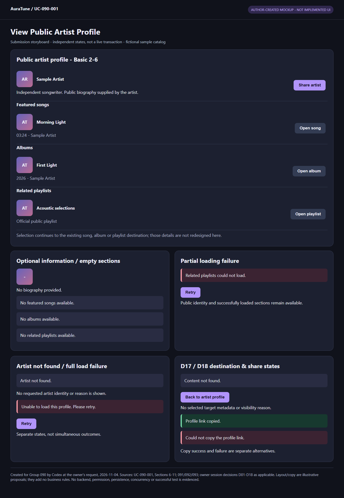
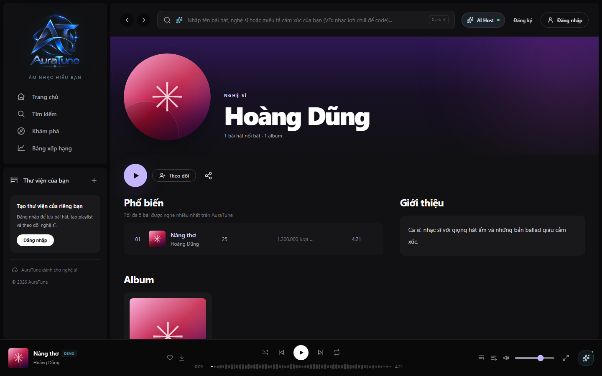
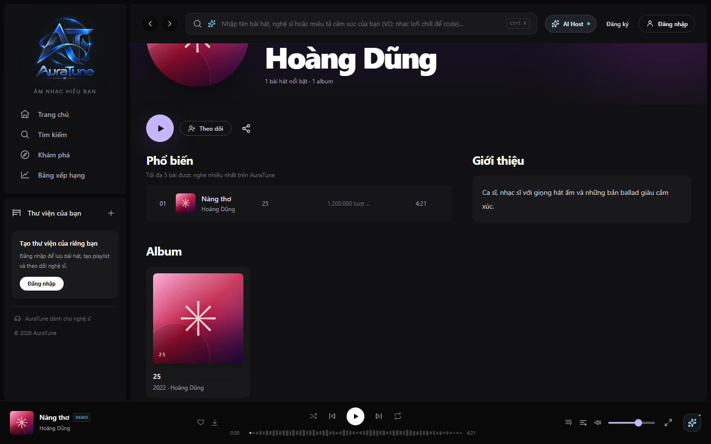
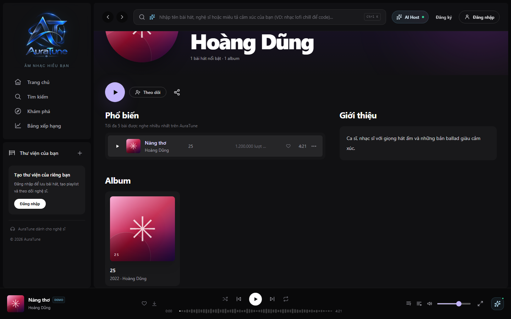
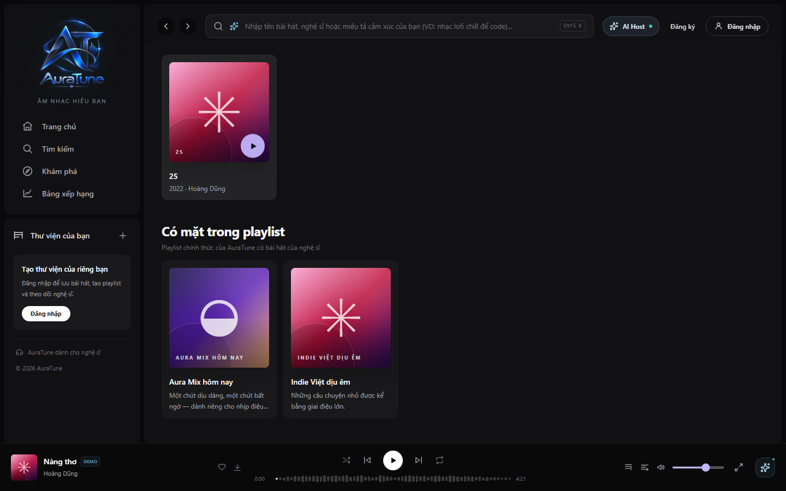
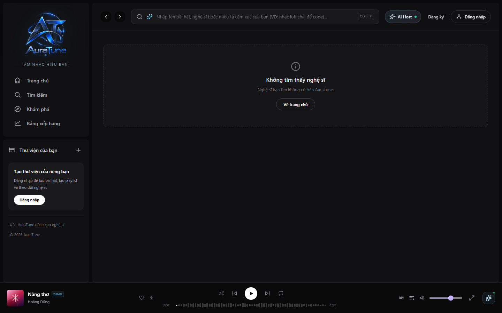

# UC-090-001 – View Public Artist Profile

## 1. Metadata

| Field | Value |
|---|---|
| Use Case ID | UC-090-001 |
| Use Case Name | View Public Artist Profile |
| Functional Group | 090 – Artist Profile & Studio |
| Primary Actor | Guest / Visitor; Listener (Artist and Administrator inherit public access in the model) |
| Supporting Actors | None identified for this use case |
| Related FR IDs | 091-FR-001, 002, 003, 004, 005, 006, 007, 008, 009, 010, 010A, 010B, 011, 012, 013, 014, 014A, 015, 016, 017, 018, 018A, 019, 020, 021, 022, 023, 024, 025, 026, 027; 092-FR-011 (public-profile consistency only) |
| Related Feature ID | 091 – Artist Profile; 092 boundary cross-reference only |
| Related Spec Kit File | [091 spec](../../../../specs/090-artist-profile-studio/091-artist-profile/spec.md) |
| Writer | Thái Hoàng |
| Reviewer | Not assigned |
| Status | Draft |
| Last Updated | 2026-11-04 |

This Draft follows all 15 sections of the extracted `uc-specification/UC.template.md`. Feature-qualified FR references identify the original literal FR IDs in their respective spec. They are not new source identifiers. The [inventory](./use-case-inventory.md) is synchronized with all eight existing Draft specifications; no approval is implied. No peer review or approval is claimed.

## 2. Goal

The visitor identifies an artist, learns about them and discovers their eligible songs, albums and related playlists, with the option to continue to an existing content destination.

## 3. Description

AuraTune presents a public artist profile without requiring sign-in or artist-management permission. The profile shows public identity and eligible content, preserving useful information when optional data is missing or a content section fails. This UC ends at viewing the profile or handing off navigation; following, playback, destination-detail behavior and Studio management remain outside scope. G090-D17 adds the narrow selection-time unavailable outcome; G090-D18 adds optional copying of the public artist-profile link.

## 4. Preconditions

- The visitor can request an artist profile through an existing AuraTune link or navigation entry. Defining search/discovery entry points belongs to their existing features.
- No authentication or artist role is required. Artist existence, public visibility, optional-field availability and successful loading are evaluated during the flow, not assumed as preconditions.
- Public artist identity/visibility and content associations are source dependencies. Their absence or temporary failure follows the applicable alternative/exception flow.

## 5. Trigger

The visitor opens a link or selects an existing navigation entry for an artist profile.

## 6. Basic Flow

This concrete success scenario uses an existing public artist with an image, biography and eligible content in all three sections; data loads successfully. Selection of an album demonstrates navigation. The actor may instead select a song or playlist through AF-04, or complete the goal by reading the profile through AF-05. The numbered presentation below does not require separate screens, clicks, requests or a particular loading order.

1. **Actor (Visitor):** Requests the artist's public profile.
2. **System:** Establishes that the requested artist exists and is publicly viewable, then presents the artist's public name, image and biography without exposing private account or management data.
3. **Actor (Visitor):** Browses the artist's profile content.
4. **System:** Presents the featured-songs, albums and related-playlists sections with distinct eligible items under BR-01–BR-04: up to five playable/displayable songs, all viewable associated albums, and up to six eligible official public playlists. Items are ordered according to those rules; restricted items and evidence of their existence are omitted.
5. **Actor (Visitor):** Selects a displayed album to explore that release.
6. **System:** Navigates to that album's existing destination. This use case ends successfully; album-detail and playback behavior remain outside its boundary.

## 7. Alternative Flows

### AF-01 – Optional Artist Information Is Missing

- **Starting step:** Basic Flow step 2.
- **Condition:** The artist is public, but its optional image, biography or both are unavailable.

1. **System:** Presents the public artist name and any available optional information. For an unavailable image, it shows a neutral fallback that does not imply another identity; for an unavailable biography, it communicates that no biography has been provided.
2. **Actor (Visitor):** Continues browsing the usable profile.

- **Outcome:** Resume at Basic Flow step 4. Missing optional information does not produce artist-not-found or a full-profile load failure.

### AF-02 – One or More Content Sections Have No Eligible Items

- **Starting step:** Basic Flow step 4; also applicable when EX-01 recovers a section.
- **Condition:** A section loads successfully but contains no items satisfying its eligibility rule, including after restricted items have been omitted.

1. **System:** Presents a section-specific empty state for each successfully loaded section with no eligible items, without substitute content or hints about excluded items. It keeps the artist identity and other successful sections usable.
2. **Actor (Visitor):** Browses the remaining available information.

- **Outcome:** Resume at Basic Flow step 5 if the visitor selects an eligible album, or AF-04 if a song/playlist is selected. If the visitor finishes viewing, including when all three sections are empty, AF-05 ends the use case successfully. A failed section is handled by EX-01, never by this empty-state flow.

### AF-03 – Artist Does Not Exist or Is Not Public

- **Starting step:** Basic Flow step 2; also when EX-02 retry establishes this outcome.
- **Condition:** The requested artist is nonexistent or its profile is not permitted to be public.

1. **System:** Presents the same artist-not-found outcome for either condition. It discloses no artist name, image, biography, related content, record existence, visibility state or reason for unavailability.

- **Outcome:** The use case ends unsuccessfully with no requested artist data disclosed. This is not the temporary-load failure in EX-02. No separate hidden-profile page or sign-in workaround is introduced.

### AF-04 – Select a Song or Related Playlist

- **Starting step:** Basic Flow step 5, or the selection continuation from AF-02/EX-01.
- **Condition:** The visitor chooses a displayed song or related playlist instead of an album.

1. **Actor (Visitor):** Selects the displayed song or playlist.
2. **System:** Navigates to the selected item's existing destination without defining playback or playlist-detail behavior here.

- **Outcome:** The use case ends successfully at the navigation handoff, equivalent to Basic Flow step 6. Ordinary destination behavior remains outside scope; EX-03 handles the G090-D17 unavailable-at-selection outcome only.

### AF-05 – Finish Viewing Without Selecting Content

- **Starting step:** Basic Flow step 5, or the viewing continuation from AF-02/EX-01.
- **Condition:** The visitor has read the available profile information and does not choose a content destination.

1. **Actor (Visitor):** Finishes viewing the available artist information and content sections.

- **Outcome:** The use case ends successfully as a viewing goal. No additional confirmation, button or system message is required or introduced.

### AF-06 - Share the Public Artist Profile Link

- **Starting step:** Basic Flow step 5, after viewing the available public profile; also from the viewing continuation of AF-02/EX-01.
- **Condition:** The visitor chooses to share the artist profile instead of opening a content item or finishing viewing.

1. **Actor (Visitor):** Selects the profile's share action.
2. **System:** Applies the current public-profile visibility rules; if the artist no longer exists or is non-public, follows AF-03 without disclosing or copying restricted artist information.
3. **System:** Copies the public artist-profile link and reports copy success only when copying succeeds. If copying fails, follows EX-04.
4. **Actor (Visitor):** May continue viewing the profile. Any recipient opening the link independently follows Basic Flow step 2 and its visibility/not-found/error outcomes; possession of the link grants no additional access.

- **Outcome:** The share action succeeds only when the link is copied. Resume at Basic Flow step 5 for further viewing/selection, or AF-05 to finish. No claim of delivery, external publication or recipient access is made. G090-D18 supplements the source and specifies no external sharing channel.

## 8. Exception Flows

### EX-01 – A Related-Content Section Temporarily Fails

- **Starting step:** Basic Flow step 4.
- **Condition:** Artist identity loads, but one or more related-content sections cannot load temporarily while other data succeeds.

1. **System:** Keeps the loaded identity and every successful section available, shows a section-specific temporary-unavailability state for each failed section, and allows retry of failed content. A failed section is not labeled empty or artist-not-found.
2. **Actor (Visitor):** Requests a retry of the failed content.
3. **System:** Reattempts the failed content for the same artist without requiring navigation to another profile, preserving successful information. On success it presents the recovered content under BR-01–BR-04, or AF-02 if the recovered collection is empty.

- **Outcome:** After recovery, resume at Basic Flow step 5 or AF-04/AF-05 as applicable. If the retry fails again, return to EX-01 step 1; another retry repeats step 2. If the visitor chooses not to retry, they may use an available album through Basic Flow step 5, choose available song/playlist content through AF-04, or finish viewing through AF-05; the failed section remains visibly unavailable and its recovery is not claimed. No automatic retry, timing or specific control is prescribed.

### EX-02 – The Full Profile Temporarily Cannot Load

- **Starting step:** Basic Flow step 2.
- **Condition:** A temporary failure prevents loading the profile, rather than establishing a nonexistent/non-public artist outcome.

1. **System:** Presents a retryable temporary-load error distinguishable from artist-not-found. It does not present unknown artist data or claim that content is empty.
2. **Actor (Visitor):** Requests a retry for the same artist profile.
3. **System:** Reattempts loading the requested profile.

- **Outcome:** Resume at Basic Flow step 2 when the request can be evaluated; apply AF-03 if it establishes nonexistent/non-public status, or EX-01 if identity succeeds but a section fails. A repeated full-profile temporary failure returns to EX-02 step 1. If the visitor does not retry, the use case ends unsuccessfully with the temporary-failure outcome preserved. No endpoint, HTTP status, automatic redirect or retry control design is selected.

### EX-03 - Selected Content Is No Longer Available

- **Starting step:** Basic Flow step 6 or AF-04 step 2, after selection and before destination content is presented.
- **Condition:** The selected displayed song, album or related playlist is now nonexistent or not permitted for the visitor. A temporary loading failure alone does not establish this condition. One song becoming unavailable does not automatically make its album or playlist unavailable.

1. **System:** At the selected item's existing destination, presents the same neutral "Content not found" outcome for nonexistent and non-permitted content, with no target metadata, existence, hidden/restricted/deleted state or reason. Provides an action to return to the artist profile.
2. **Actor (Visitor):** May choose the return action.
3. **System:** If chosen, returns to the requested artist profile and evaluates its current availability under Basic Flow step 2, including AF-03/EX-02 when applicable. Previously displayed restricted content is not restored as current permitted data.

- **Outcome:** Selected-content access ends unsuccessfully with the non-disclosing destination outcome. If the visitor returns, resume at Basic Flow step 2; otherwise remain at that outcome. No automatic return or refresh is required. G090-D17 is an owner-confirmed session addition, not a requirement originally specified by 091.

### EX-04 - Profile Link Cannot Be Copied

- **Starting step:** AF-06 step 3.
- **Condition:** Copying the public artist-profile link fails.

1. **System:** Presents appropriate copy-failure feedback without claiming that the link was copied or the artist was shared. Does not disclose non-public artist information.

- **Outcome:** The share attempt ends unsuccessfully. Resume at Basic Flow step 5 if the visitor continues viewing, or AF-05 to finish. No automatic retry, alternative channel or clipboard implementation is prescribed.

## 9. Postconditions

### 9.1 Success Postconditions

- The visitor has viewed the artist's permitted public identity and available content sections, with truthful missing-information/empty states where applicable.
- Where a section failed, successfully loaded data remained usable; a retry recovered that section or its temporary-unavailability state remained explicit. Partial usability does not certify full recovery.
- If a content item was selected successfully, navigation was handed off to its existing destination; no playback or detail behavior was redefined.
- If AF-06 succeeds, the public artist-profile link is copied and copy success is reported; delivery and recipient access are not claimed.
- This UC makes no follow, catalog-management, artist-profile-editing or administrative changes.

### 9.2 Failure Postconditions

- For nonexistent/non-public artists, the visitor receives the identical not-found outcome and no identifying or restricted information about the requested record.
- For a full-profile temporary failure without successful retry, the visitor receives a distinguishable retryable failure, not a not-found or empty-content claim.
- If profile-link copying fails, EX-04 reports failure without a copy/share-success claim.
- For selected content that becomes unavailable, EX-03 presents the neutral destination outcome and return action without target disclosure; no successful access or playback is claimed.
- No restricted artist/content information is disclosed through counts, labels, placeholders or error details, and no management/personal relationship change is performed by this UC.

## 10. Special Requirements

- **Security:** Enforce public visibility and item permissions, not merely hidden frontend controls (091-FR-006–008, 018/018A; shared security principles). Viewing requires no authentication (091-FR-023). Vision Section 6.2 requires encrypted client/server transmission.
- **Performance:** 091-SC-006 targets artist identity or definitive not-found within two seconds for at least 95% of profile-view attempts under normal operating conditions. This is a requirement target, not a measured result or a timeout rule for these flows.
- **Usability and Accessibility:** Preserve usable identity/content for missing fields, empty sections and partial failures (091-FR-004/005/017/020/027). Distinguish temporary failure from not-found and empty. Vision Section 6.3 requires responsive desktop/mobile web presentation and consistent mouse, keyboard and touch interaction. No additional accessibility certification is asserted.
- **Privacy:** Only designated public artist fields and permitted content may appear. Non-public record existence and excluded content must not be inferable (091-FR-006–008, 018A). No personal following information is loaded or changed as a requirement of this UC.
- **Other:** Use AuraTune-recorded all-time plays for featured-song ranking, not Spotify/external popularity. Filter eligibility before ordering/limiting, suppress duplicates, and never fill undersized results with ineligible substitutes. All-time play counts are read for display/ranking; viewing does not introduce a play-recording action.

## 11. Business Rules

Rule IDs are local labels, not new source FRs. BR-08 and BR-09 are explicitly owner-confirmed session additions; other rules trace existing sources.

| Rule ID | Rule Description | Source |
|---|---|---|
| BR-01 | Present only public artist fields and content the visitor may view. Exclude hidden/private/removed/unauthorized items without inferable counts, labels, placeholders or error details. Suppress duplicate items within each section; apply eligibility filtering before ordering and limits. | [091 spec](../../../../specs/090-artist-profile-studio/091-artist-profile/spec.md), FR-006–008, FR-022, Assumptions |
| BR-02 | Featured songs are associated with the artist and permitted both for display and playback; show at most five. Sort by AuraTune all-time play count descending, release date descending for equal counts, then song ID ascending. External popularity/listening data is not used. | [091 spec](../../../../specs/090-artist-profile-studio/091-artist-profile/spec.md), FR-009/010/010A/010B |
| BR-03 | Show all viewable albums associated with the artist. Sort by release date descending, title ascending for equal dates, then album ID ascending. | [091 spec](../../../../specs/090-artist-profile-studio/091-artist-profile/spec.md), FR-011/012 |
| BR-04 | Related playlists must be official public AuraTune playlists with at least one artist-associated song permitted for display and playback. Show at most six, ordered by update time descending, then playlist ID ascending. | [091 spec](../../../../specs/090-artist-profile-studio/091-artist-profile/spec.md), FR-013/014/014A |
| BR-05 | A successfully loaded section with no eligible items is empty; a section that cannot load is temporarily unavailable. Neither state makes the public artist nonexistent; empty sections receive no ineligible substitutes. | [091 spec](../../../../specs/090-artist-profile-studio/091-artist-profile/spec.md), FR-017/019/020/021/027 |
| BR-06 | Nonexistent and non-public artists have the same not-found outcome, without disclosing identity, content, existence or the reason. Temporary failure is distinguishable. | [091 spec](../../../../specs/090-artist-profile-studio/091-artist-profile/spec.md), FR-018/018A/019; [092 spec](../../../../specs/090-artist-profile-studio/092-follow-artist/spec.md), FR-011 public-access consistency |
| BR-07 | Selection only navigates to an existing destination. Follow/unfollow, track management, artist-profile editing and administration are outside Feature 091. | [091 spec](../../../../specs/090-artist-profile-studio/091-artist-profile/spec.md), FR-015/016/024/025/026 |
| BR-08 | Apply EX-03 to unavailable selected song/album/playlist content: identical neutral destination not-found with return action and no target metadata/state/reason. Artist-not-found, temporary errors and playback remain separate. | Owner-confirmed [G090-D17](./README.md#session-decision-g090-d17), 2026-11-04; supplements the selection-time edge case |
| BR-09 | Share artist copies only the public artist-profile link, reports success only after successful copying and reports failure appropriately. Recipient access remains governed by visibility/not-found rules; the link grants no authorization. | Owner-confirmed [G090-D18](./README.md#session-decision-g090-d18), 2026-11-04; Vision Section 5.2 G09 and 091 overview UI describe sharing but do not specify this behavior |

## 12. Prototype and Screenshots

### 12.0 Current Submission Evidence

**Type/provenance:** Author-created HTML/CSS mockup storyboard, generated by Codex at the owner's request on 2026-11-04; fictional catalog data. [Editable HTML](./prototypes/UC-090-001-basic-flow-and-key-states.html). Sources: this UC's current flows/rules, relevant 091/092/093 requirements and confirmed D01-D18 decisions. Layout and sample feedback wording are illustrative, not additional approved requirements or implemented UI.

**Illustration:** Basic Flow presentation and key UI states for AF-01, AF-02, AF-03, AF-04, AF-05, AF-06, EX-01, EX-02, EX-03, EX-04. Multiple panels are independent alternative states, not one live screen or executed sequence. This is **Partial** evidence: no backend, current permissions, storage, persistence, license validation, concurrency or passed test is established. Per-flow residual Missing/Partial states are recorded in the [prototype index](./prototypes/README.md).

**Historical reference review below:** Earlier source-image observations and missing-state statements describe the original assets only. They do not override the new storyboard or current index. No original source image was changed; new local mockups supersede incompatible old UI for submission illustration.

All six existing Feature 091 PNGs were opened and visually inspected on 2026-11-03. The images are reused in place below as **reference UI mockups**, not evidence of an implemented or deployed system. Their generation/provenance has not been verified. No image was created, copied, cropped or modified. Static visual inspection establishes only the visible presentation, not actual filtering, ordering, permissions, retry or navigation behavior. Prototype coverage remains incomplete.

### 12.1 Basic Flow

**Covered steps:** Basic Flow step 2 public name/avatar and visible biography; partial step 4 featured-song/album presentation. The image shows one featured song, not the five claimed in its spec description. The album card is cut off at the bottom. Follow, play and mini-player controls are outside this UC. The visible Share control is partial entry-point evidence for AF-06 only; it does not illustrate copying or its result.

**Prototype type:** Reference UI mockup; implementation provenance unverified.

**Covered steps:** Basic Flow step 2 biography and step 4 album presentation; the visible album card supplies better album evidence than the file named artist-albums. It does not illustrate missing-biography AF-01 or prove album ordering.

**Prototype type:** Reference UI mockup; implementation provenance unverified.

**Covered steps:** Basic Flow step 4 featured-song presentation only. One song is visible, with a hover-like row treatment and playback control. This does not prove a maximum-five limit, eligibility or tie-breaking, and is not evidence of AF-04 destination navigation.

**Prototype type:** Reference UI mockup; implementation provenance unverified.

**Covered steps:** Basic Flow step 4 related-playlists section, with two visible cards. Their official/public status, eligible-song associations and ordering require separate verification. Navigation after selection is not shown.

**Prototype type:** Reference UI mockup; implementation provenance unverified.

The inspected [04-artist-albums.png](../../../../specs/090-artist-profile-studio/091-artist-profile/ui/04-artist-albums.png) repeats the overview-like view with an album card cut off before its title/year. It is not embedded as proof of complete album presentation; the biography image above visibly contains the complete card. Its source annotation cites FR-013, now the related-playlists section requirement, whereas album presentation is FR-011/012. No source annotation was edited.

### 12.2 Alternative Flow – AF-01

**Evidence missing:** None of the six images shows a missing-image fallback, missing-biography message or both missing. Available biography images show populated data and are not linked as fallback evidence. AF-01 remains without a matching prototype.

### 12.3 Alternative Flow – AF-02

**Evidence missing:** None of the six images shows a section-specific empty songs, albums or related-playlists state. An artist-not-found image is not an empty-section prototype.

### 12.4 Alternative Flow – AF-03

**Covered steps:** AF-03 step 1 visible not-found message, with no requested artist identity or related content shown. It does not prove that unknown and non-public artists actually receive the same result. The visible home-navigation control is not added as a required flow action. A global mini-player remains visible; its unrelated content does not prove requested-artist leakage, but provenance/state isolation must be checked before accepting the image as privacy evidence.

**Prototype type:** Reference UI mockup; implementation provenance unverified. This is not a temporary-load error/retry prototype.

### 12.5 Alternative Flows – AF-04 and AF-05

**Evidence incomplete:** Song/playlist source rows and cards are visible above, but no selected destination or navigation handoff is shown for AF-04 or Basic Flow step 6. AF-05 introduces no distinct confirmation UI; existing profile mockups illustrate the viewed content only.

### 12.6 Exception Flows – EX-01 and EX-02

**Evidence missing:** No matching image shows a section failure with successful content preserved, full-profile temporary failure, retry interaction or recovered section. The not-found image cannot substitute for these states. No placeholder image links are provided.

### 12.7 Exception Flow - EX-03

**Evidence missing:** No existing image demonstrates the G090-D17 selected-content neutral destination and return action. The artist-not-found mockup concerns a different target and is not evidence for EX-03. No prototype was created or copied.

### 12.8 Share Flow - AF-06 and EX-04

**Evidence partial/missing:** The overview mockup in Section 12.1 shows the Share control (AF-06 entry only). No image illustrates the copied-link success result, copy-failure feedback or current-visibility/recipient outcomes. No prototype is created/copied and no backend or clipboard correctness is established.

## 13. Related Use Cases

- UC-090-002 – Follow or Unfollow Artist is a separate personal goal governed by [Feature 092](../../../../specs/090-artist-profile-studio/092-follow-artist/spec.md); no follow flow is included here. Specification: [Draft specification](./UC-090-002-follow-or-unfollow-artist.md).
- UC-090-003 – View Followed Artists may supply an existing link to a public profile. It is not a mandatory predecessor or included behavior. Specification: [Draft specification](./UC-090-003-view-followed-artists.md).
- UC-090-004–008 are separate Studio goals, linked in the [group README](./README.md#6-use-case-summary). No Studio actions are included in this public UC.
- The [shared model catalog](../../use-case-model.md#7-consolidated-use-case-catalog) identifies UC-080-001 for album details, UC-060-002 for playlist details and UC-040-001 for playback. They retain their own behavior after navigation; this Draft adds no include/extend relationships or assumed song destination design.

## 14. Traceability and Sources

Every current Feature 091 FR is listed individually below, including suffix IDs. Coverage describes specified behavior or boundary compliance, not a passed implementation test. The Requirement column follows the current source meaning; the Handling column identifies where this Draft addresses it.

| Source Type | ID / File | Relevant Section |
|---|---|---|
| Authoring guide | `C:/Users/Admin/Downloads/AuraTune_Use_Case_Documentation_Guide.md` | Source review, actor/system flows, prototype honesty and preservation of existing artifacts |
| Extracted template | `C:/Users/Admin/Downloads/AuraTune_UC_Templates_Extracted/AuraTune_Use_Case_Templates/uc-specification/UC.template.md` | All 15 sections retained |
| Repository guide | [Use-case guide](../README.md) | Writing, naming, FR and prototype conventions; structural differences resolved for this pass by the owner's explicit extracted-template instruction |
| Model | [System model](../../use-case-model.md) | Actor catalog, Group 090 IDs and boundary; old FR mapping not reused |
| Inventory | [Group inventory](./use-case-inventory.md) | Eight stable IDs; current per-FR allocation; status/links synchronized |
| Owner session decision | [G090-D18](./README.md#session-decision-g090-d18) | AF-06, EX-04, BR-09 and postconditions; Vision G09/UI Share scope clarification, not an invented 091 FR |
| Spec Kit Specification | [Feature 091](../../../../specs/090-artist-profile-studio/091-artist-profile/spec.md) | Clarification, US1–US4, Functional Requirements, Success Criteria, Assumptions, Dependencies, Out of Scope and UI descriptions |
| Boundary Specification | [Feature 092](../../../../specs/090-artist-profile-studio/092-follow-artist/spec.md) | FR-011 public-profile consistency and separate personal following scope |
| Vision Document | [Vision](../../../proposal/Auratune_Vision_Document.md) | Section 3.4 N-08; Section 5.2 G09; Section 6.2/6.3; Section 4.1/AD-04 media dependency, not an added profile actor |
| API Contract | [API Contract](../../../analysis-and-design/api-contract.md) | Section 2.8 public profile/song/album/playlist retrieval; no new endpoint or transport behavior selected |
| API conventions | [API conventions](../../../design/api/api-conventions.md) | Public access, permissions and non-disclosing error guidance |
| Security | [Security principles](../../../design/security/README.md); [data security rules](../../../design/database/security-rules.md) | Server-side permission enforcement, least privilege and private-data protection; no database technology assumed |
| Related Use Cases | [Group README](./README.md#6-use-case-summary) | UC-090-002–008 boundaries and existing specification links |

| Feature-qualified FR ID | Requirement | Handling in this Draft |
|---|---|---|
| [091-FR-001](../../../../specs/090-artist-profile-studio/091-artist-profile/spec.md) | Request a public artist profile without artist-management capability. | Preconditions; Basic Flow 1–2. |
| [091-FR-002](../../../../specs/090-artist-profile-studio/091-artist-profile/spec.md) | Display the public artist name. | Basic Flow 2; AF-01. |
| [091-FR-003](../../../../specs/090-artist-profile-studio/091-artist-profile/spec.md) | Display image and biography when available. | Basic Flow 2; AF-01. |
| [091-FR-004](../../../../specs/090-artist-profile-studio/091-artist-profile/spec.md) | Neutral missing-image fallback. | AF-01 step 1. |
| [091-FR-005](../../../../specs/090-artist-profile-studio/091-artist-profile/spec.md) | Explicit missing-biography state with usable profile. | AF-01 step 1. |
| [091-FR-006](../../../../specs/090-artist-profile-studio/091-artist-profile/spec.md) | Exclude private account/internal management fields. | Basic Flow 2; BR-01; Security/Privacy. |
| [091-FR-007](../../../../specs/090-artist-profile-studio/091-artist-profile/spec.md) | Only visitor-permitted songs, albums and playlists. | Basic Flow 4; BR-01; EX-03/BR-08 (G090-D17 session addition). |
| [091-FR-008](../../../../specs/090-artist-profile-studio/091-artist-profile/spec.md) | Omit restricted items without indirect disclosure. | Basic Flow 4; AF-02; BR-01; Privacy. |
| [091-FR-009](../../../../specs/090-artist-profile-studio/091-artist-profile/spec.md) | Featured-songs section for associated eligible songs. | Basic Flow 4; BR-02. |
| [091-FR-010](../../../../specs/090-artist-profile-studio/091-artist-profile/spec.md) | At most five associated displayable/playable songs. | Basic Flow 4; BR-02. |
| [091-FR-010A](../../../../specs/090-artist-profile-studio/091-artist-profile/spec.md) | AuraTune all-time play count descending; no external popularity. | BR-02; Special Requirements. |
| [091-FR-010B](../../../../specs/090-artist-profile-studio/091-artist-profile/spec.md) | Song ties: release date descending, then song ID ascending. | BR-02. |
| [091-FR-011](../../../../specs/090-artist-profile-studio/091-artist-profile/spec.md) | Viewable associated albums section. | Basic Flow 4; BR-03. |
| [091-FR-012](../../../../specs/090-artist-profile-studio/091-artist-profile/spec.md) | All viewable albums; date descending, title ascending, ID ascending. | BR-03. |
| [091-FR-013](../../../../specs/090-artist-profile-studio/091-artist-profile/spec.md) | Related-playlists section. | Basic Flow 4; BR-04. |
| [091-FR-014](../../../../specs/090-artist-profile-studio/091-artist-profile/spec.md) | Official public playlists with at least one eligible associated song. | BR-04. |
| [091-FR-014A](../../../../specs/090-artist-profile-studio/091-artist-profile/spec.md) | At most six eligible playlists; update descending, ID ascending. | BR-04. |
| [091-FR-015](../../../../specs/090-artist-profile-studio/091-artist-profile/spec.md) | Navigate selected song, album or playlist to its existing destination. | Basic Flow 5-6; AF-04; EX-03 for the G090-D17 selection-time exception only. |
| [091-FR-016](../../../../specs/090-artist-profile-studio/091-artist-profile/spec.md) | Do not redefine playback or album/playlist details. | Boundary compliance: Basic Flow 6, AF-04, BR-07; ordinary destination/playback behavior unchanged. EX-03/BR-08 is a narrow owner-confirmed addition, not attributed to FR-016. No new UC. |
| [091-FR-017](../../../../specs/090-artist-profile-studio/091-artist-profile/spec.md) | Section-specific empty states preserve the rest of the profile. | AF-02; BR-05. |
| [091-FR-018](../../../../specs/090-artist-profile-studio/091-artist-profile/spec.md) | Same not-found outcome for nonexistent/non-public artists. | AF-03; BR-06. |
| [091-FR-018A](../../../../specs/090-artist-profile-studio/091-artist-profile/spec.md) | Not-found reveals no identity, content, existence, visibility or reason. | AF-03 step 1; failure postconditions; BR-06. |
| [091-FR-019](../../../../specs/090-artist-profile-studio/091-artist-profile/spec.md) | Temporary loading failure differs from not-found. | EX-01/EX-02; BR-05/06. |
| [091-FR-020](../../../../specs/090-artist-profile-studio/091-artist-profile/spec.md) | Preserve successful data and show section-specific failure. | EX-01 step 1; success postconditions. |
| [091-FR-021](../../../../specs/090-artist-profile-studio/091-artist-profile/spec.md) | Retry full-profile or section failure. | EX-01 steps 2–3; EX-02 steps 2–3; explicit continuations. |
| [091-FR-022](../../../../specs/090-artist-profile-studio/091-artist-profile/spec.md) | No duplicate item within a section. | Basic Flow 4; BR-01. |
| [091-FR-023](../../../../specs/090-artist-profile-studio/091-artist-profile/spec.md) | All public sections available without authentication, subject to item visibility. | Preconditions; Basic Flow 2/4; Security. |
| [091-FR-024](../../../../specs/090-artist-profile-studio/091-artist-profile/spec.md) | Follow/unfollow belongs to 092. | Boundary compliance: no following state or controls required by this flow; separate UC-090-002 in Section 13. No new UC. |
| [091-FR-025](../../../../specs/090-artist-profile-studio/091-artist-profile/spec.md) | Upload/edit/hide/delete songs belongs to 093. | Boundary compliance: no track-management action in this UC; separate UC-090-005–008. No new UC. |
| [091-FR-026](../../../../specs/090-artist-profile-studio/091-artist-profile/spec.md) | Exclude artist-profile editing and administrative actions. | Boundary compliance: read-only public presentation; Group 110 retains administrative behavior; no profile editing invented. |
| [091-FR-027](../../../../specs/090-artist-profile-studio/091-artist-profile/spec.md) | Empty sections must not contain ineligible substitutes. | AF-02 step 1; BR-01/05. |
| [092-FR-011](../../../../specs/090-artist-profile-studio/092-follow-artist/spec.md) | Public-profile access uses identical nonexistent/non-public not-found without restricted disclosure. | Cross-feature consistency only: AF-03/BR-06. Follow rejection and hidden-owner unfollow remain outside this UC under 092. |

## 15. Open Questions

Question IDs below are local to this Draft; they do not allocate new UC or FR IDs.

| Question ID | Question | Owner | Status | Resolution |
|---|---|---|---|---|
| Q-01 | Scope: share-artist behavior and assignment. | Thái Hoàng / group | Resolved | Owner-confirmed [G090-D18](./README.md#session-decision-g090-d18): AF-06/EX-04/BR-09 specifies public-profile-link copying, truthful success/failure and unchanged recipient visibility. Not an original 091 FR; evidence remains incomplete. |
| Q-02 | Scope: album metadata versus broader album organization. | Thái Hoàng / group | Deferred for this submission | Owner submission instruction retains album display/navigation and album-name metadata, defers full album management, and preserves the unfulfilled Vision scope gap. [B-01](./README.md#shared-open-issues) |
| Q-03 | Selection-time unavailable outcome. | Thái Hoàng / group | Resolved | Owner-confirmed [G090-D17](./README.md#session-decision-g090-d17), option A, 2026-11-04: EX-03/BR-08 specifies neutral destination not-found and return action. Supplements the source; current P-017 illustrates the neutral result/return action, with full navigation/return sequence still Partial. |
| Q-04 | When will missing-field, empty-section, temporary-failure/retry and navigation evidence be supplied, and how will UI inconsistencies be resolved? | Thái Hoàng | Open | Section 12 records inspected assets and missing evidence; prototype coverage is incomplete. |
| Q-05 | Documentation synchronization completed; independent reviewer still needed. | Thái Hoàng | Open | Inventory status/links now match all eight existing Drafts. Synchronization subquestion resolved; Reviewer remains Not assigned. [Group issue D-01](./README.md#shared-open-issues) |
| Q-06 | When will old shared-model FR mapping and source image annotations be aligned with current specs? | Thái Hoàng / group | Open | Deferred; no shared artifact or spec changed. |

The unresolved upload/storage actor concerns UC-090-005 and remains in the [group open issues](./README.md#8-open-issues-and-decisions); it is not silently introduced as a supporting actor of this public-profile UC.
