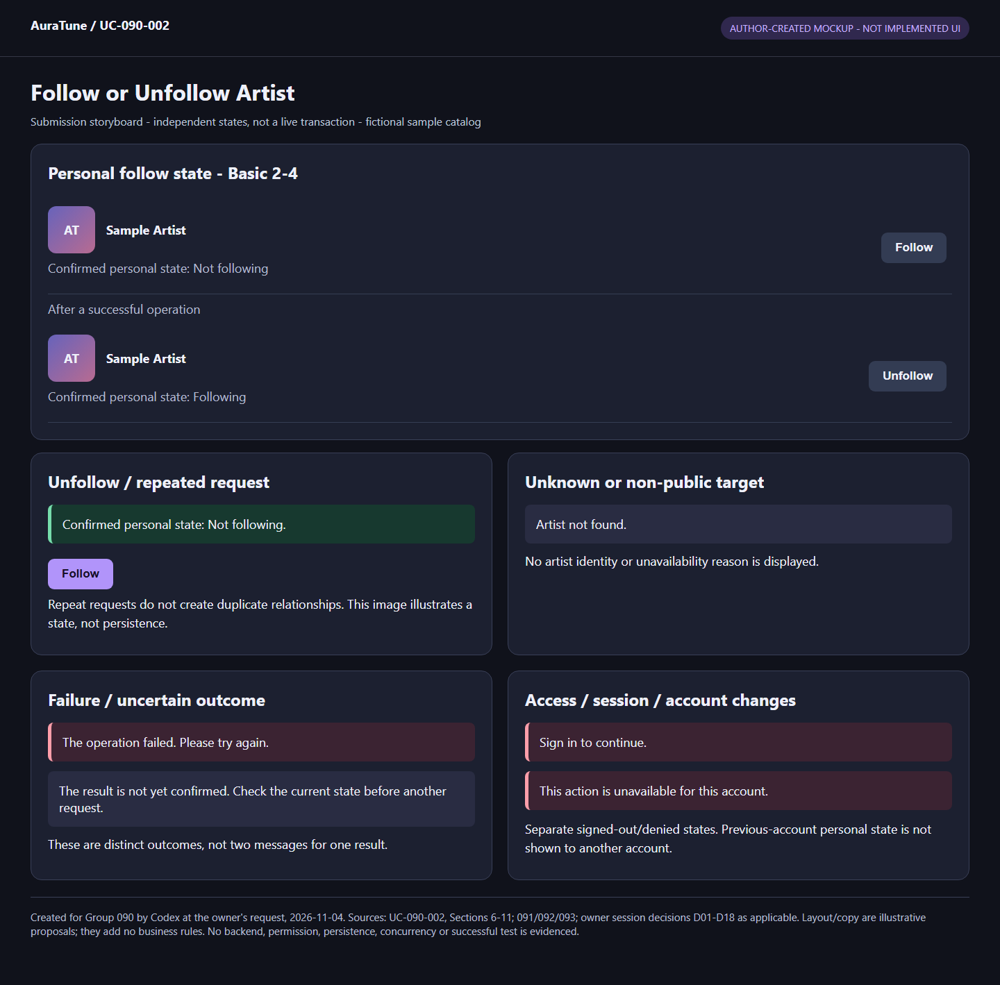
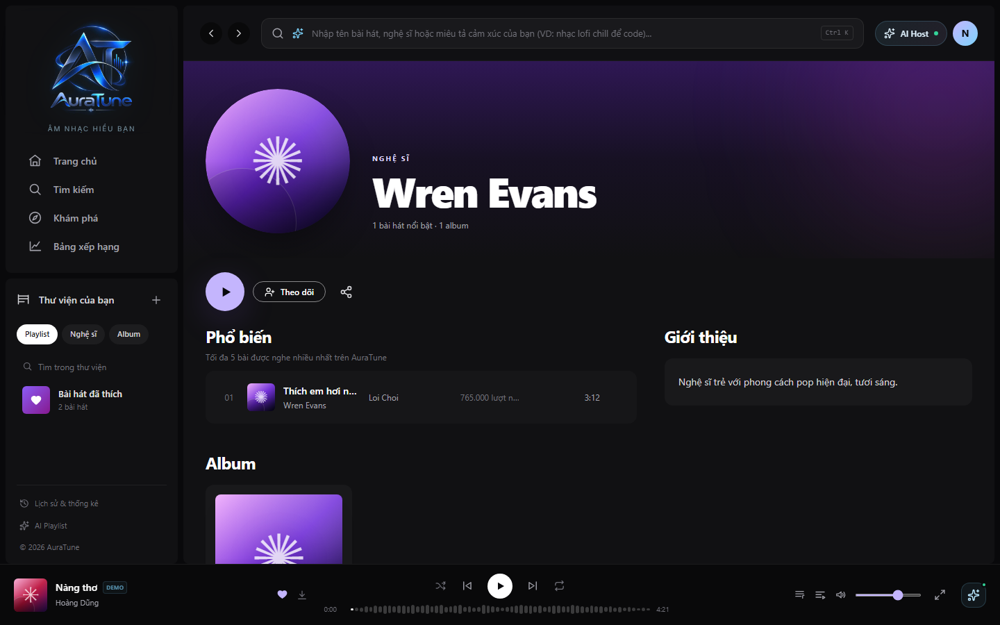
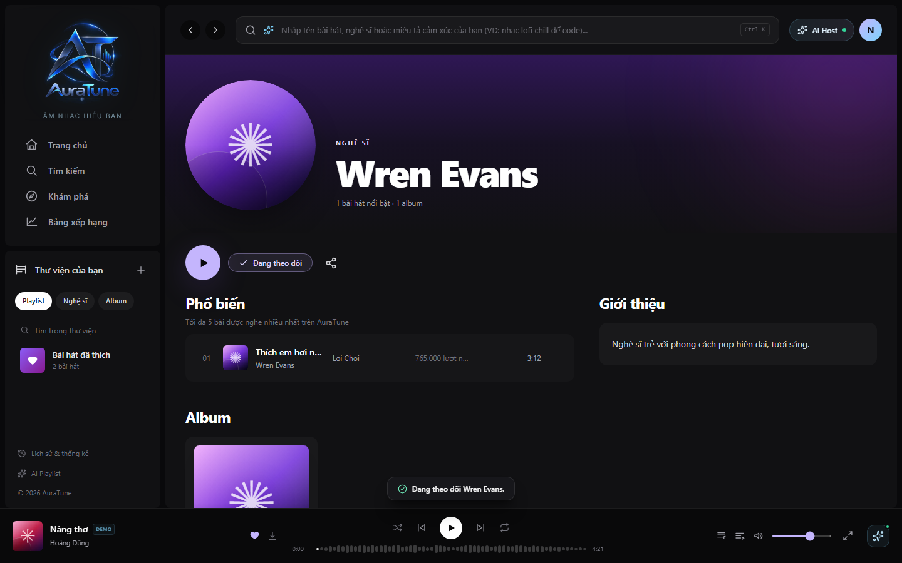

# UC-090-002 – Follow or Unfollow Artist

## 1. Metadata

| Field | Value |
|---|---|
| Use Case ID | UC-090-002 |
| Use Case Name | Follow or Unfollow Artist |
| Functional Group | 090 – Artist Profile & Studio |
| Primary Actor | Listener; Artist; Administrator, acting only for their own authenticated, non-banned account |
| Supporting Actors | None identified |
| Related FR IDs | 092-FR-001, 092-FR-002, 092-FR-003, 092-FR-004, 092-FR-005, 092-FR-006, 092-FR-009, 092-FR-010, 092-FR-011, 092-FR-012, 092-FR-013, 092-FR-014, 092-FR-015, 092-FR-016 |
| Related Feature ID | 092 – Follow Artist |
| Related Spec Kit File | [092 spec](../../../../specs/090-artist-profile-studio/092-follow-artist/spec.md) |
| Writer | Thái Hoàng |
| Reviewer | Not assigned |
| Status | Draft |
| Last Updated | 2026-11-04 |

This Draft follows all 15 sections of the supplied extracted UC template. Feature-qualified references retain the literal FR IDs from the linked specification. List-only requirements 092-FR-007/008 and the list portions of shared requirements remain assigned to UC-090-003; Section 14 records this boundary explicitly. No peer review or approval has occurred.

## 2. Goal

The authenticated account owner starts or stops following an artist and can trust the confirmed personal relationship state without affecting another account or disclosing restricted artist information.

## 3. Description

Follow and unfollow are two directions of the same personal relationship goal. AuraTune permits authenticated, non-banned User, Artist and Admin accounts to act only on their own relationships, displays confirmed state truthfully and handles repeated actions, failures and overlapping operations. Public artist presentation belongs to [UC-090-001](./UC-090-001-view-public-artist-profile.md); viewing the personal followed-artists list belongs to UC-090-003. This UC specifies the effect on later list membership only, not a list-viewing flow.

## 4. Preconditions

- Existing account authentication, artist identity/public eligibility and personal-state retrieval capabilities are available dependencies. This UC does not define a new authentication mechanism or state-retrieval interface.
- A successful change requires the current account to be authenticated, non-banned and to own the relationship being changed. These conditions are checked during processing; denied attempts and expiry are handled below.
- A successful new follow requires an existing public artist. A valid owner unfollow of a retained relationship to an existing hidden artist is permitted without public-profile access (AF-03).
- No global precondition requires Not following or Following. The Basic Flow and the unfollow branches have their own applicable states, so neither direction must first execute the other.

## 5. Trigger

The account owner requests their personal following state on a public artist profile or requests a follow/unfollow action. A valid owner request to unfollow an existing hidden artist may start AF-03 directly; this does not introduce a hidden-artist interface.

## 6. Basic Flow

The main success scenario is following a public artist from a confirmed Not following state, with no overlapping successful opposing operation. Actor means the current account owner in any of the eligible roles. No confirmation dialog, optimistic state change, specific notification style or persistence design is required by this flow.

1. **Actor:** Opens their personal following state for an artist through the existing public-profile experience.
2. **System:** Establishes the current authenticated, non-banned account and public artist eligibility, and presents the account's confirmed Not following state. If the confirmed state is Following, AF-01 branches here before the Not following scenario proceeds.
3. **Actor:** Requests to follow the artist.
4. **System:** Rechecks access, ownership and artist eligibility when processing the request, establishes exactly one relationship for that account–artist pair with the new follow time, and reflects the confirmed result as Following. The saved relationship persists across later authenticated sessions while account and artist continue to exist, subject to subsequent successful operations and the visibility rules in BR-04–BR-06.

**Outcome:** The use case ends successfully. The next successful personal-list load reflects the confirmed relationship subject to public visibility; no list load is required to complete this flow.

## 7. Alternative Flows

### AF-01 – Unfollow a Public Artist

- **Starting step:** Basic Flow step 2, when the account's confirmed state is Following; it replaces Basic Flow steps 3–4.
- **Condition:** The account follows an existing public artist and wants to stop following them.

1. **Actor:** Requests to unfollow the artist from the Following state.
2. **System:** Checks current access and ownership, removes the account's relationship to that artist and reflects the confirmed result as Not following without changing other relationships.

- **Outcome:** Ends successfully with no relationship for the pair. The artist is absent from the next successful personal-list load unless a later follow succeeds. No new follow or Not following state is required before entering this branch; no unfollow confirmation is added.

### AF-02 – Repeat Follow or Unfollow

- **Starting step:** Basic Flow step 4 or AF-01 step 2, including a retry from EX-02/EX-03.
- **Condition:** A follow request repeats for an existing public artist already followed, or an unfollow repeats for an existing public artist already not followed, with no intervening successful opposing action.

1. **System:** Reconciles the repeated request with the saved state. Repeated follow leaves exactly one relationship and preserves its original follow time; repeated unfollow leaves none. No other account or artist relationship changes.
2. **System:** Reflects the confirmed Following or Not following state without presenting duplicate follow as creation of a new relationship.

- **Outcome:** Ends successfully with the required final state. Duplicate/no-op transport responses are not specified. Overlapping opposing actions use AF-07 rather than assuming this repeat condition still holds.

### AF-03 – Owner Unfollows an Existing Hidden Artist

- **Starting step:** Basic Flow step 1, through a valid owner unfollow request; this branch replaces public-profile state loading and all remaining Basic Flow steps.
- **Condition:** The current authenticated, non-banned account owns a retained relationship to an artist whose existing profile is non-public.

1. **Actor:** Submits a valid request to remove their own relationship to that artist.
2. **System:** Verifies access and relationship ownership, removes that relationship without changing other relationships, and does not disclose the artist's name, image or internal profile status.

- **Outcome:** Ends successfully with the owned relationship absent. It does not return to a public-profile Following/Not following display for the hidden artist, add hidden-artist browsing, or prescribe a new entry control. If the profile later becomes public, the removed relationship does not restore; a new successful follow is needed. Unknown/permanently deleted targets use AF-05, not this branch.

### AF-04 – Follow Target Is Nonexistent or Non-Public

- **Starting step:** Basic Flow step 2 or 4 when public access/follow eligibility is evaluated, including a change of visibility after the profile was opened.
- **Condition:** The target artist does not exist or is not publicly accessible when follow is evaluated.

1. **System:** Rejects the new follow without creating a relationship and presents the same artist-not-found outcome for nonexistent and non-public artists, consistent with UC-090-001.
2. **System:** Discloses no target name, image, biography, related content, record existence, visibility state or unavailability reason in that outcome.

- **Outcome:** Ends unsuccessfully; no new relationship is created. An existing retained hidden relationship is not removed by this rejection; its owner may independently use AF-03. Following does not grant access to hidden content.

### AF-05 – Unfollow Target Is Unknown or Permanently Deleted

- **Starting step:** AF-01 step 2 or AF-03 step 2 when the target is evaluated.
- **Condition:** The unfollow request identifies a nonexistent artist or a permanently deleted artist, rather than an existing hidden profile.

1. **System:** Returns the same artist-not-found outcome for both cases, without old artist information or any indication that the artist ever existed.
2. **System:** Leaves all other relationships unchanged and does not disclose target information through placeholders, counts, labels or error details.

- **Outcome:** Ends unsuccessfully as an unfollow request. This UC does not decide storage or cleanup of a relationship whose artist has been deleted. A valid owner unfollow for an existing hidden profile remains AF-03.

### AF-06 – Follow Again After Successful Unfollow / Revisit Saved State

- **Starting step:** Basic Flow step 2 on a later successful personal-state load.
- **Condition:** The same account returns in a later authenticated session or after a confirmed follow/unfollow.

1. **System:** Presents the saved relationship result for this account: Following if a relationship remains, or Not following if none remains, subject to the current public-profile boundary. A hidden artist is not exposed through this state load.
2. **Actor:** Either finishes checking their state or requests another change for a public artist.

- **Outcome:** Ends successfully for state recognition if no change is requested. For a new follow after successful unfollow, resume at Basic Flow step 3; its successful processing creates exactly one relationship using the new follow time. For unfollow of a followed public artist, enter AF-01 step 1. This branch does not specify a list screen or automatic state-refresh schedule.

### AF-07 – Opposing Operations Overlap Across Devices

- **Starting step:** Basic Flow step 4 or AF-01 step 2 while processing actions for the same account and public artist.
- **Condition:** The account issues follow and unfollow from different sessions/devices and their processing overlaps.

1. **Actor:** Sends follow on one device and unfollow on another for their own account–artist pair.
2. **System:** Determines the saved state by successful processing order, regardless of device click times: follow successfully processed last leaves Following; unfollow successfully processed last leaves Not following. A failed operation changes nothing. Repeated follow without an intervening successful unfollow preserves exactly one relationship and the original follow time.
3. **Actor:** Subsequently loads personal state successfully on a device through the existing capability.
4. **System:** Reflects the saved result from the successfully processed operations on that load; a stale local confirmation must not overwrite a newer saved result.

- **Outcome:** Ends with state recognition of the saved result on the next successful load. The same consistency requirement applies to a later UC-090-003 list load, which is not performed here. No real-time synchronization, continuous polling or click-time precedence is introduced. Failed or uncertain results use EX-02/EX-03.

### AF-08 – Unauthenticated, Banned or Cross-Account Request

- **Starting step:** Basic Flow step 2 or 4, AF-01 step 2, AF-03 step 2, or any state/action access in this UC.
- **Condition:** There is no valid authentication, the account is banned, or the request attempts to use another account as owner; this includes Administrator cross-account attempts.

1. **System:** Denies the personal access or action without changing saved relationships or disclosing another account's following state or private collection.
2. **System:** Requires authentication for an unauthenticated attempt. Existing authentication recovery/sign-in remains outside this UC; expiry during an action is further handled by EX-04.

- **Outcome:** Ends without performing the denied change. An account that later has valid access must make a new owner-scoped request; no pending request is silently reassigned or automatically replayed. Public-profile access remains governed separately by 091.

### AF-09 – The Signed-In Account Changes

- **Starting step:** Basic Flow step 2 or 4, AF-01/AF-03 step 2, AF-06 step 1, AF-07 step 4, or any exception recovery before personal data/result presentation.
- **Condition:** Account A signs out and account B signs in while state loading, an operation or a response for A is pending.

1. **System:** Clears or replaces A's displayed personal following state with B's own state; it does not display A's delayed results as B's data or apply A's pending action to B.
2. **Actor:** Requests their own state or action as the currently authenticated account if they wish to continue.

- **Outcome:** The old account's interaction ends; a new request starts at Basic Flow step 1, AF-01 through its own state load, or AF-03 for a valid hidden-owner request. No cancellation/rollback of an action already processed for A is assumed. B's state is not claimed definitive until successfully obtained.

## 8. Exception Flows

### EX-01 – Personal Following State Cannot Be Confirmed

- **Starting step:** Basic Flow step 2, AF-06 step 1 or AF-07 step 4.
- **Condition:** Loading the account's personal state fails or is unresolved.

1. **System:** Distinguishes the unresolved/failed state from confirmed Following and Not following. It does not label unknown state Not following or present an unconfirmed action as successful.
2. **Actor:** Requests personal state again through the existing capability.
3. **System:** Reattempts state retrieval for the same current account, applying access, privacy and account-change rules.

- **Outcome:** On success, resume the originating state-load step with its confirmed result: Basic Flow step 2, AF-06 step 1 or AF-07 step 4. Repeated failure returns to EX-01 step 1. If the actor stops, the interaction ends without a definitive state claim. This load does not itself change any relationship, and no dedicated endpoint, retry control or timing is specified.

### EX-02 – A Change Definitely Fails

- **Starting step:** Basic Flow step 4, AF-01 step 2 or AF-03 step 2.
- **Condition:** The system confirms that the requested change failed; more specific access/eligibility rejections use AF-04/05/08 or EX-04.

1. **System:** Does not modify saved state for the failed change, gives understandable failure feedback and permits retry. It preserves confirmed information for a definite rejection, but does not use an older display to override a newer successful saved result from another operation.
2. **Actor:** Retries the same intended action if they still wish to perform it.
3. **System:** Re-evaluates current access, ownership and target eligibility; repeated requests obey uniqueness rules, and newer overlapping successes obey AF-07.

- **Outcome:** Resume processing at Basic Flow step 4, AF-01 step 2 or AF-03 step 2 for the intended direction. A repeated definite failure returns to EX-02 step 1; an uncertain outcome enters EX-03. If no retry is requested, end unsuccessfully for this action without attributing a saved-state change to it. This does not assert that other devices made no changes.

### EX-03 – The Action Outcome Is Uncertain

- **Starting step:** Basic Flow step 4, AF-01 step 2, AF-03 step 2 or EX-02 retry processing.
- **Condition:** An interrupted/lost response leaves it uncertain whether the system processed the change.

1. **System:** Gives uncertainty feedback and a retry opportunity without claiming definitive success, failure, Following or Not following from the missing result. An uncertain result is not assumed to have left saved state unchanged.
2. **Actor:** Requests retry/recovery of the uncertain action.
3. **System:** Reconciles the current account's actual saved outcome before displaying definitive state; retrying obeys uniqueness and successful-processing-order rules. For a valid hidden-owner unfollow, it must still disclose no hidden artist information.

- **Outcome:** If reconciliation establishes the intended current result, end with confirmed state for a public artist or the privacy-safe hidden-owner removal result. If further action is needed and the actor elects to retry, resume the applicable processing step (Basic Flow 4, AF-01 step 2 or AF-03 step 2) with current checks. If reconciliation still fails, return to EX-03 step 1; an access/target change uses the applicable AF/EX branch. If the actor stops, end unresolved: saved state may have changed, but no definitive outcome is asserted. No automatic resubmission, rollback or dedicated state interface is introduced.

### EX-04 – Authentication Expires During an Action

- **Starting step:** Basic Flow step 4, AF-01/AF-03 step 2, or EX-01/02/03 recovery.
- **Condition:** The session expires and valid authenticated access is not currently available.

1. **System:** Uses the existing authentication recovery flow; if it cannot restore access, directs the actor to sign in again. It does not perform an unauthenticated change or present an unconfirmed result as successful.

- **Outcome:** If access is restored for the same account, re-evaluate the originating step with current state and eligibility; any uncertain prior action follows EX-03 before a definitive claim. If recovery fails, this action ends without a confirmed success and sign-in is handled separately. If a different account signs in, enter AF-09 rather than replaying the old account's action. No expiry-specific transport code or new authentication flow is defined.

## 9. Postconditions

### 9.1 Success Postconditions

- A successful follow leaves exactly one relationship for the current account and target, with Following shown on the public profile. A successful public-artist unfollow leaves none and shows Not following. These describe confirmed outcomes, subject to later successful opposing operations.
- Repeated follow preserves the original follow time; repeated public-artist unfollow leaves none. Follow after successful unfollow creates one new relationship with its new follow time.
- A successful valid hidden-owner unfollow removes only the owner's retained relationship without revealing hidden artist information. Becoming public again does not restore that removed relationship.
- Confirmed relationships persist across later authenticated sessions while account and artist continue to exist. A profile becoming non-public alone retains the relationship/original follow time unless validly unfollowed; list visibility/restoration is handled by UC-090-003.
- The next successful state or list load reflects saved results in successful-processing order. The flow does not promise uninterrupted real-time display synchronization or describe list rendering.
- No other account's relationships, unrelated artists, public visibility, music catalog or playback state is changed by this UC.

### 9.2 Failure Postconditions

- A definite failed/denied action does not change saved relationship state; unrelated concurrent successful operations may still have changed it. No private following data is disclosed through rejected access.
- A follow rejection for a nonexistent/non-public artist creates no relationship and reveals no restricted artist information. Unfollow of unknown/deleted artists returns the same not-found outcome with no prior-existence disclosure; cleanup/storage after deletion is not decided.
- A lost response may conceal a processed action. Until reconciliation succeeds, its outcome remains explicitly unresolved, not falsely confirmed as success, failure or Not following.
- Expired authentication, account switching and delayed results never reassign an old account's action/data to a new account.

## 10. Special Requirements

- **Security:** 092-FR-003/009/012 require authenticated ownership for every access and change, including Admin personal requests; deny banned accounts. Enforce at the server boundary, not solely through control visibility, following [security principles](../../../design/security/README.md) and [data security rules](../../../design/database/security-rules.md).
- **Performance:** No follow-specific response-time target is defined in 092. Do not adopt 091's profile timing target as an action timeout.
- **Usability and Accessibility:** Distinguish confirmed state, unresolved state, definite failure and uncertainty; provide retry according to the source. Existing responsive web and mouse/keyboard/touch requirements apply from [Vision](../../../proposal/Auratune_Vision_Document.md), Section 6.3. No optimistic update, new confirmation or notification type is mandated.
- **Privacy:** Follow grants no private-profile access. Non-public/nonexistent targets and unknown/deleted unfollow targets obey non-disclosure; owner hidden unfollow never reveals hidden identity/status. Account changes must isolate delayed personal results.
- **Other:** Uniqueness, original/new follow times, persistence and successful-processing order are observable behavior, not schema/storage or synchronization implementation choices. No release notifications, automatic playback, sorting controls or follower counts are added.

## 11. Business Rules

Rule IDs are local labels for source requirements, not new FR identifiers.

| Rule ID | Rule Description | Source |
|---|---|---|
| BR-01 | Authenticated non-banned User, Artist and Admin accounts may act only on their own relationships. Admin has no cross-account exception in this feature. | [092 spec](../../../../specs/090-artist-profile-studio/092-follow-artist/spec.md), FR-003/009/012 |
| BR-02 | Each account–artist pair has at most one relationship. Duplicate public follow preserves original follow time; repeated public unfollow leaves none. A follow after successful unfollow uses the new relationship's time. | [092 spec](../../../../specs/090-artist-profile-studio/092-follow-artist/spec.md), FR-004/014 |
| BR-03 | Following and Not following must be confirmed; unresolved state must not masquerade as Not following. Confirmed changes persist across sessions and affect the next successful state/list load. | [092 spec](../../../../specs/090-artist-profile-studio/092-follow-artist/spec.md), FR-005/006/010 |
| BR-04 | New follow requires an existing public artist; nonexistent/non-public follow targets share the privacy-safe not-found outcome. | [092 spec](../../../../specs/090-artist-profile-studio/092-follow-artist/spec.md), FR-001/011; [091 spec](../../../../specs/090-artist-profile-studio/091-artist-profile/spec.md), FR-018/018A |
| BR-05 | Hiding an existing profile retains its relationship and original follow time; valid owner unfollow remains allowed without hidden-artist UI or identity/status disclosure. List omission/restoration belongs to UC-090-003. | [092 spec](../../../../specs/090-artist-profile-studio/092-follow-artist/spec.md), FR-002/013 |
| BR-06 | For overlapping opposing actions, the operation successfully processed last determines saved state, regardless of click times. Failures change nothing; each device reflects saved state on its next successful state/list load. | [092 spec](../../../../specs/090-artist-profile-studio/092-follow-artist/spec.md), FR-015 |
| BR-07 | A definite failure changes no saved relationship; an uncertain outcome must be reconciled before definitive state presentation. Retry preserves uniqueness and does not overwrite newer saved results with stale display. | [092 spec](../../../../specs/090-artist-profile-studio/092-follow-artist/spec.md), FR-004/010/015 |
| BR-08 | Unknown and permanently deleted unfollow targets have the same not-found outcome without old information or prior existence. This does not prescribe relationship cleanup or alter existing-hidden owner unfollow. | [092 spec](../../../../specs/090-artist-profile-studio/092-follow-artist/spec.md), FR-016 |

## 12. Prototype and Screenshots

### 12.0 Current Submission Evidence

**Type/provenance:** Author-created HTML/CSS mockup storyboard, generated by Codex at the owner's request on 2026-11-04; fictional catalog data. [Editable HTML](./prototypes/UC-090-002-basic-flow-and-key-states.html). Sources: this UC's current flows/rules, relevant 091/092/093 requirements and confirmed D01-D18 decisions. Layout and sample feedback wording are illustrative, not additional approved requirements or implemented UI.

**Illustration:** Basic Flow presentation and key UI states for AF-01, AF-02, AF-04, AF-05, AF-06, AF-08, AF-09, EX-01, EX-02, EX-03, EX-04. Multiple panels are independent alternative states, not one live screen or executed sequence. This is **Partial** evidence: no backend, current permissions, storage, persistence, license validation, concurrency or passed test is established. Per-flow residual Missing/Partial states are recorded in the [prototype index](./prototypes/README.md).

**Shared access/recovery illustration:** [P-025 mockup](./prototypes/Group090-access-and-recovery-states.png) illustrates applicable AF-08, AF-09, EX-04. These are independent UI states, not proof of enforcement or a complete recovery sequence.

**Later-result illustration:** [P-026 mockup](./prototypes/Group090-next-load-and-request-results.png) shows applicable AF-07 result snapshots; not a complete executed sequence or proof of runtime ordering.

**Historical reference review below:** Earlier source-image observations and missing-state statements describe the original assets only. They do not override the new storyboard or current index. No original source image was changed; new local mockups supersede incompatible old UI for submission illustration.

The three 092 follow/unfollow PNGs below were opened and visually inspected on 2026-11-03. They are reused in place as **reference UI mockups**, not verified screenshots of a deployed implementation. No image was copied or created. Static images cannot prove authentication, successful persistence, ownership, operation ordering or whether a displayed state was actually confirmed.

### 12.1 Basic Flow

**Covered steps:** Basic Flow step 2 visible Not following presentation, with the Follow control relevant to step 3. The account avatar and library are visible, but role, authentication validity, banned state and confirmed personal state are not proven. Play/share controls and public profile sections are contextual, not additional actions in this UC.

**Prototype type:** Reference UI mockup; implementation provenance unverified.

**Covered steps:** Basic Flow step 4 visible Following label/check and a toast for Wren Evans. This illustrates a result display, not proof that storage succeeded or that the original follow time was preserved. The source's immediate-after-click description does not establish optimistic updating; this Draft requires a confirmed result.

**Prototype type:** Reference UI mockup; implementation provenance unverified. Toast wording/timing is illustrative, not mandated by the current FRs.

### 12.2 Alternative Flow – AF-01

**Covered steps:** AF-01 step 2 visible return to the Follow control and an unfollow toast. Both the earlier follow toast and the unfollow toast remain visible together; the image therefore cannot establish clean chronological feedback, reconciliation or current saved state. No confirmation dialog is shown or added as a requirement.

**Prototype type:** Reference UI mockup; implementation provenance unverified.

### 12.3 Alternative Flows – AF-02 through AF-09

| Flow | Evidence status |
|---|---|
| AF-02 repeated operation | Missing behavioral evidence for uniqueness, unchanged original time and truthful duplicate feedback; static controls alone do not prove them. |
| AF-03 hidden-owner unfollow | No matching evidence. No hidden-artist screen should be created to illustrate this non-UI request path; later evidence must demonstrate privacy-safe removal without hidden identity/status. |
| AF-04 nonexistent/non-public follow | No 092 image demonstrates the rejection/equivalence. UC-090-001's not-found mockup is not evidence of a follow attempt. |
| AF-05 unknown/deleted unfollow | No matching privacy-safe request/outcome evidence; no deletion-cleanup design inferred. |
| AF-06 revisit/refollow | Static Following/Follow presentations exist above; later-session persistence and new follow-time evidence are missing. |
| AF-07 overlap | No multi-device processing-order/next-load evidence. |
| AF-08 denied access | No guest, banned-account or cross-account denial evidence. |
| AF-09 account change | No delayed-response or account-isolation evidence. |

### 12.4 Exception Flows – EX-01 through EX-04

Unresolved/failed state loading, definite change failure/retry, uncertain outcome reconciliation and session-expiry/recovery have no matching images among the three inspected assets. Prototype coverage is incomplete; no placeholder image links are provided. The two 092 list PNGs were not inspected in this pass and are reserved as candidates for UC-090-003.

## 13. Related Use Cases

- [UC-090-001 – View Public Artist Profile](./UC-090-001-view-public-artist-profile.md): public information and privacy-safe profile access. Its public viewing goal remains separate from this personal relationship goal; no include/extend relation is invented.
- UC-090-003 – View Followed Artists: owns list display, empty/load-failure behavior, visibility and order. This UC only supplies confirmed relationship effects for its next successful load. Specification: [Draft specification](./UC-090-003-view-followed-artists.md).
- Existing authentication use cases, cataloged in the [shared model](../../use-case-model.md#7-consolidated-use-case-catalog), own authentication recovery and sign-in. This Draft does not specify their mechanisms or assume automatic replay.
- [Group README](./README.md) and [inventory](./use-case-inventory.md): retain all eight stable IDs and the existing combined follow/unfollow goal.

## 14. Traceability and Sources

The 14 FRs assigned to UC-090-002 in the inventory match the current 092 meaning. Shared requirements are covered only for their relationship/state aspects; their list portions remain assigned to UC-090-003. All 16 current 092 FRs are explicitly accounted for below to make that distinction reviewable.

| Source Type | ID / File | Relevant Section |
|---|---|---|
| Authoring guide | `C:/Users/Admin/Downloads/AuraTune_Use_Case_Documentation_Guide.md` | Verified source behavior, actor/system flows, preservation of existing files and honest prototype evidence |
| Extracted UC template | `C:/Users/Admin/Downloads/AuraTune_UC_Templates_Extracted/AuraTune_Use_Case_Templates/uc-specification/UC.template.md` | Complete 15-section structure |
| Repository guide | [Use-case guide](../README.md) | Naming, traceability and flow principles; extracted template takes precedence for this requested structure |
| Model | [System model](../../use-case-model.md) | Existing ID/goal and actor vocabulary; stale FR mapping is not reused |
| Group artifacts | [README](./README.md); [inventory](./use-case-inventory.md); [UC-090-001](./UC-090-001-view-public-artist-profile.md) | Goal boundaries, existing specification links, ownership and public-profile consistency |
| Spec Kit Specification | [092 spec](../../../../specs/090-artist-profile-studio/092-follow-artist/spec.md) | Entire specification, including clarifications, US1/US2/US4, edge cases, FRs, success criteria and source limits |
| Boundary Specification | [091 spec](../../../../specs/090-artist-profile-studio/091-artist-profile/spec.md) | FR-006–008, FR-018/018A and FR-024; public privacy and separate follow ownership |
| Vision Document | [Vision](../../../proposal/Auratune_Vision_Document.md) | N-08, G09 and Section 6.3 web interaction requirements |
| API Contract | [API Contract](../../../analysis-and-design/api-contract.md) | Existing authentication/authorization conventions and Section 2.8 capabilities; no new endpoint, status, duplicate response or payload defined |
| API/security | [API conventions](../../../design/api/api-conventions.md); [security principles](../../../design/security/README.md); [data security rules](../../../design/database/security-rules.md) | Server-side ownership, least privilege and non-disclosing errors; no storage technology selected |

| Feature-qualified FR | Current requirement / applicable part | Handling / owner |
|---|---|---|
| [092-FR-001](../../../../specs/090-artist-profile-studio/092-follow-artist/spec.md) | Authenticated follow of existing public artist. | Basic Flow; AF-04; BR-04. |
| [092-FR-002](../../../../specs/090-artist-profile-studio/092-follow-artist/spec.md) | Owner unfollow, including valid hidden-owner request; other relationships unchanged. | AF-01/03; postconditions; no hidden UI. |
| [092-FR-003](../../../../specs/090-artist-profile-studio/092-follow-artist/spec.md) | State/changes/lists belong only to authenticated owner, including Admin restrictions. | Basic Flow 2/4; AF-08/09; BR-01. List-access flow stays in UC-090-003. |
| [092-FR-004](../../../../specs/090-artist-profile-studio/092-follow-artist/spec.md) | At most one relationship; repeated public follow/unfollow converges, original time preserved. | AF-02; EX-02/03 retry; BR-02/07; no transport response invented. |
| [092-FR-005](../../../../specs/090-artist-profile-studio/092-follow-artist/spec.md) | Distinguish confirmed Following, Not following and unresolved/failed personal state. | Basic Flow 2/4; AF-01; EX-01/03; BR-03. |
| [092-FR-006](../../../../specs/090-artist-profile-studio/092-follow-artist/spec.md) | Reflect confirmed changes, persist across sessions, update next successful list load, subject to hidden rules. | Basic Flow outcome; AF-01/03/06; success postconditions. List rendering belongs to UC-090-003. |
| [092-FR-007](../../../../specs/090-artist-profile-studio/092-follow-artist/spec.md) | Own public-only followed-artists list, no duplicates or hidden-data inference; profile navigation. | UC-090-003, not a flow of this UC. No list interface added. |
| [092-FR-008](../../../../specs/090-artist-profile-studio/092-follow-artist/spec.md) | Distinguish genuinely empty list, failed load and unfinished load. | UC-090-003, not a flow of this UC. EX-01 addresses personal state, not list emptiness. |
| [092-FR-009](../../../../specs/090-artist-profile-studio/092-follow-artist/spec.md) | Non-banned authenticated User/Artist/Admin personal permissions; guest/banned/unauthorized denial; sign-in if recovery fails. | Metadata; Basic Flow 2/4; AF-08; EX-04. No cross-account exception. |
| [092-FR-010](../../../../specs/090-artist-profile-studio/092-follow-artist/spec.md) | Failed change leaves state unchanged; feedback/retry; uncertain reconciliation; no stale override. | EX-02/03; AF-07; BR-07; failure versus unresolved postconditions. |
| [092-FR-011](../../../../specs/090-artist-profile-studio/092-follow-artist/spec.md) | Reject nonexistent/non-public follow identically without disclosure, preserving hidden-owner unfollow. | AF-04 versus AF-03; BR-04; UC-090-001 owns public-access presentation. |
| [092-FR-012](../../../../specs/090-artist-profile-studio/092-follow-artist/spec.md) | Clear/replace personal state on account change; no delayed-result/action reassignment. | AF-09; EX-04; BR-01. |
| [092-FR-013](../../../../specs/090-artist-profile-studio/092-follow-artist/spec.md) | Hidden profile retains relationship/time; owner can unfollow privately; restore only retained relationships. | AF-03; BR-05; success postconditions. Omission/restoration/list ordering belongs to UC-090-003. |
| [092-FR-014](../../../../specs/090-artist-profile-studio/092-follow-artist/spec.md) | Duplicate follow preserves original time; refollow uses new time; list follows time descending/ID ascending. | Basic Flow 4; AF-02/06; BR-02 for relationship time. Full list order remains in UC-090-003. |
| [092-FR-015](../../../../specs/090-artist-profile-studio/092-follow-artist/spec.md) | Last successfully processed opposing operation wins; failed operation changes nothing; next successful load converges. | AF-07; EX-02/03; BR-06; list-load manifestation remains in UC-090-003. |
| [092-FR-016](../../../../specs/090-artist-profile-studio/092-follow-artist/spec.md) | Unknown/deleted unfollow same not-found without old information; no cleanup prescription; existing hidden unfollow remains allowed. | AF-05 versus AF-03; BR-08; failure postconditions. Deleted-list omission belongs to UC-090-003. |

No important behavioral source conflict was found: 091's hidden-profile not-found outcome applies to public access, while 092 explicitly allows an owner's valid hidden unfollow without granting such access. The shared model's reduced/older FR mapping and role presentation remain documentation alignment issues. The API Contract's lack of a dedicated state interface, hidden lifecycle details or operation-specific duplicate response is a technical contract gap, not permission to invent behavior.

## 15. Open Questions

Question labels are local to this Draft; no new UC or FR IDs are allocated.

| Question ID | Question | Owner | Status | Resolution |
|---|---|---|---|---|
| Q-01 | Technical Follow-up: implement existing personal-state retrieval/reconciliation rules. | Thái Hoàng / group | Open | [Group issue C-01](./README.md#shared-open-issues); 092-FR-005/010/012/015 already define the user-visible outcomes. |
| Q-02 | What evidence will demonstrate privacy-safe hidden-owner unfollow without adding a hidden-artist UI? | Thái Hoàng / group | Open | Source permits a valid request; no new user entry surface or hidden identity display invented. |
| Q-03 | Technical Follow-up: relationship persistence/cleanup after permanent deletion. | Thái Hoàng / group | Open | [Group issue C-01](./README.md#shared-open-issues); 092-FR-016 settles not-found/list omission and explicitly excludes storage/cleanup from 092. |
| Q-04 | When will missing state/failure/retry/session/account-switch/multi-device evidence be supplied and the overlapping toast mockup be assessed? | Thái Hoàng | Open | Section 12 records limitations; prototype coverage incomplete. |
| Q-05 | Who will independently review the Draft and later align shared-model FR/role references and stale image annotations? | Thái Hoàng / group | Open | Reviewer Not assigned; no shared-model/spec/image changes made. |

Share artist is resolved by D18; broader album management is deferred for this submission, while upload-service technical/model follow-ups remain open in the [group README](./README.md#8-open-issues-and-decisions), outside this UC's relationship goal.
