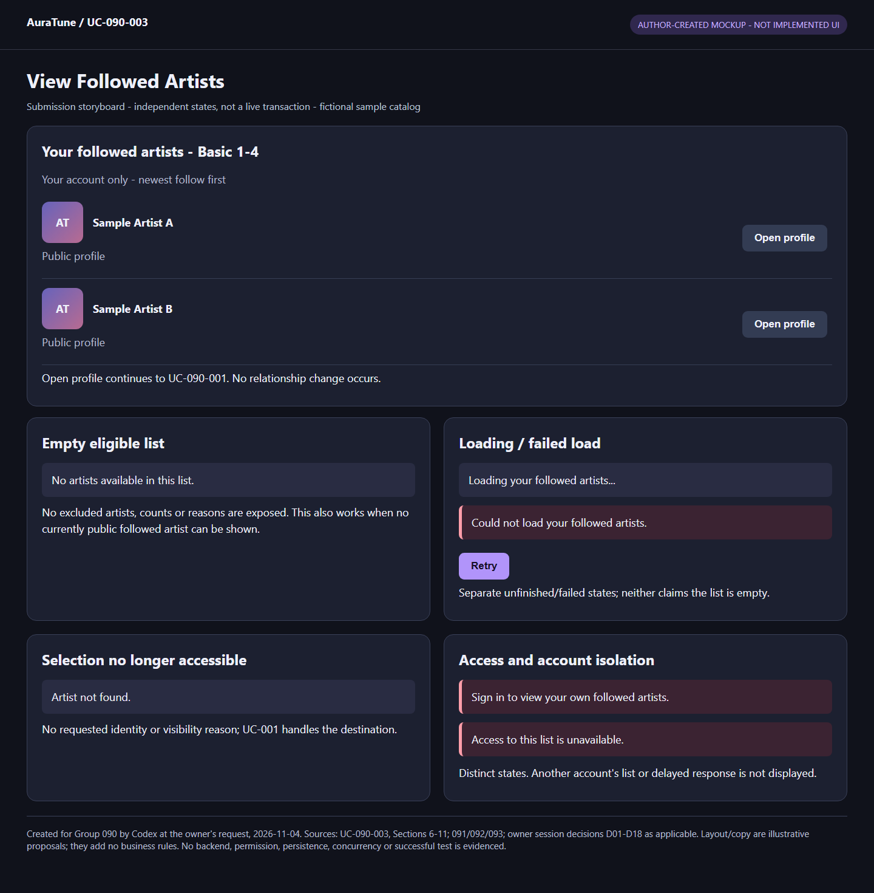
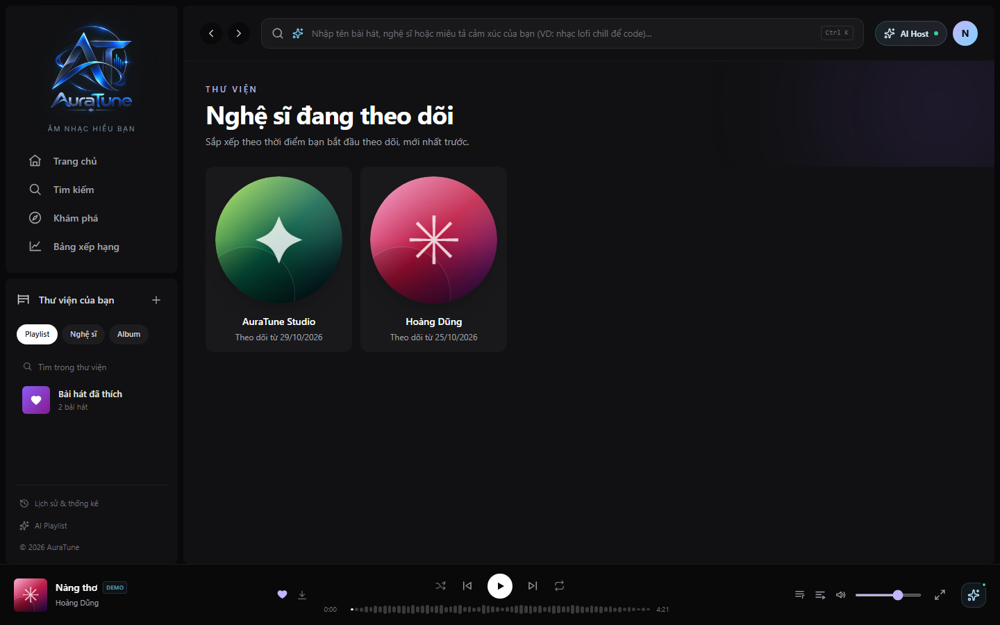
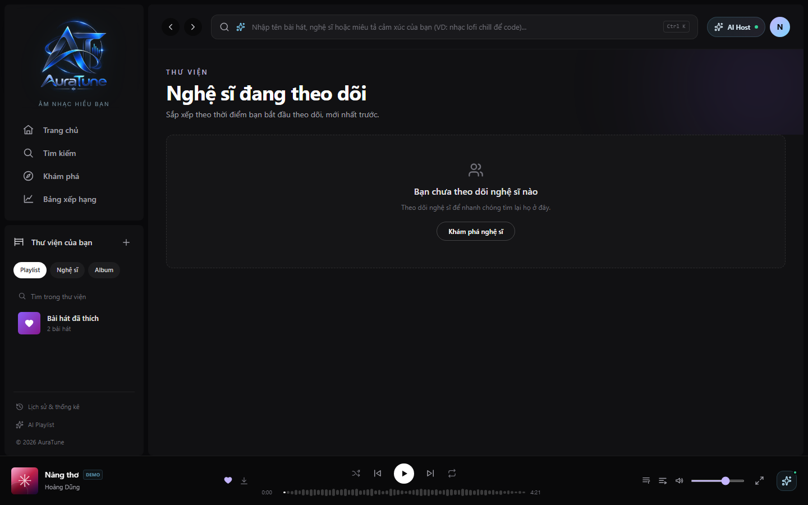

# UC-090-003 – View Followed Artists

## 1. Metadata

| Field | Value |
|---|---|
| Use Case ID | UC-090-003 |
| Use Case Name | View Followed Artists |
| Functional Group | 090 – Artist Profile & Studio |
| Primary Actor | Listener; Artist; Administrator, accessing only their own authenticated, non-banned account's list |
| Supporting Actors | None identified |
| Related FR IDs | 092-FR-003, 092-FR-006, 092-FR-007, 092-FR-008, 092-FR-009, 092-FR-012, 092-FR-013, 092-FR-014, 092-FR-015, 092-FR-016; 091-FR-018/018A for public-profile handoff consistency only |
| Related Feature ID | 092 – Follow Artist |
| Related Spec Kit File | [092 spec](../../../../specs/090-artist-profile-studio/092-follow-artist/spec.md) |
| Writer | Thái Hoàng |
| Reviewer | Not assigned |
| Status | Draft |
| Last Updated | 2026-11-04 |

This Draft uses all 15 sections of the extracted UC template. Feature-qualified references identify the literal FR IDs in the linked source, not new identifiers. Ten 092 FRs apply to this list goal, consistent with the inventory; Section 14 accounts separately for requirements owned by other UCs. No peer review or approval is claimed.

## 2. Goal

The account owner views the publicly accessible artists they follow, in the required order, and can return to an artist's public profile without exposing other accounts' collections or restricted artist information.

## 3. Description

AuraTune loads the current account's own followed-artists list, shows each eligible artist once with a public name and a way to open the public profile, and distinguishes a successfully empty list from an unfinished or failed load. Existing hidden-profile relationships are retained but omitted from presentation; they become visible again when public unless unfollowed. Follow/unfollow actions and uncertain change reconciliation belong to [UC-090-002](./UC-090-002-follow-or-unfollow-artist.md); the public profile itself belongs to [UC-090-001](./UC-090-001-view-public-artist-profile.md).

## 4. Preconditions

- The actor can request their personal followed-artists collection through an existing AuraTune entry point. This UC does not define a new navigation control or route.
- Successful personal-list access requires an authenticated, non-banned User, Artist or Admin account, with the authenticated account as owner. Access checks occur during loading; invalid access and session expiry are covered below rather than assumed impossible.
- Existing authentication, following relationships and public artist eligibility/information are dependencies. The account need not have any relationships or publicly visible followed artists.
- This viewing goal does not require a new follow/unfollow action, successful profile navigation or a particular artist image. A missing image must not prevent recognition by public name (092 Edge Cases).

## 5. Trigger

The actor requests to view the artists followed by their current account.

## 6. Basic Flow

This success scenario uses an authenticated, non-banned owner with at least one publicly accessible followed artist and a successful list load. Selecting a public artist illustrates profile navigation; AF-04 also permits completing the viewing goal without selecting one. Actor refers to any eligible account role, not only the standard User role.

1. **Actor:** Opens their own followed-artists list.
2. **System:** Verifies authenticated access and ownership, then presents the successfully loaded eligible collection. Each publicly accessible followed artist appears once with their public display name and a way to open their public profile. Entries are ordered by follow time descending, with artist ID ascending for equal follow times. Hidden, unauthorized and permanently deleted artists are omitted without revealing their existence through entries, counts, labels, placeholders or error details.
3. **Actor:** Selects a displayed artist to open their public profile.
4. **System:** Opens that artist's existing public-profile experience, handing off to UC-090-001, which enforces current profile visibility. This UC ends successfully; it does not change any following relationship or specify the profile's content again.

The system's presentation at step 2 requires a successful load. While it remains unfinished, AF-08 applies; a failed load uses EX-01. No pagination, search, filter, automatic refresh or new sort control is specified.

## 7. Alternative Flows

### AF-01 – No Publicly Visible Followed Artists

- **Starting step:** Basic Flow step 2, including after a successful EX-01 retry.
- **Condition:** The collection loads successfully and has no publicly visible followed artists. This includes no relationships, retained relationships only to hidden profiles, or no eligible entries after restricted/deleted artists are omitted.

1. **System:** Presents the normal explicit empty state rather than loading or failure. It shows no hidden/deleted artist entries, names, images, placeholders, counts or messages that reveal those artists or their prior existence.
2. **Actor:** Views the empty collection outcome.

- **Outcome:** The viewing goal ends successfully without profile selection. Hidden-profile relationships and original follow times remain retained unless separately unfollowed. No message distinguishes a hidden-only collection from an otherwise empty collection; no new exploration action is required by this flow.

### AF-02 – Some Followed Artists Are Hidden, Unauthorized or Deleted

- **Starting step:** Basic Flow step 2.
- **Condition:** The account's relationships include artists that cannot be publicly represented, alongside publicly visible artists.

1. **System:** Presents only eligible public entries, without placeholders or any count, label or error detail from which excluded entries can be inferred. An existing profile becoming non-public retains its relationship and original follow time; omission does not mean unfollow.
2. **Actor:** Browses the remaining publicly visible followed artists.

- **Outcome:** Resume at Basic Flow step 3 for selection, or AF-04 to finish viewing. If there are no eligible entries, use AF-01. Permanently deleted artists are absent regardless of relationship storage/cleanup; this UC does not select a deletion policy or expose prior existence.

### AF-03 – A Followed Artist Becomes Public Again

- **Starting step:** Basic Flow step 2 on a later successful list load.
- **Condition:** An existing previously hidden artist is public again and the account's original relationship still exists.

1. **System:** Includes the artist again using permitted public information and the position determined by the retained original follow time, with ascending artist ID as the tie-breaker.
2. **Actor:** Browses the resulting list.

- **Outcome:** Resume at Basic Flow step 3, or AF-04 if no selection is made. A relationship successfully removed through UC-090-002 does not reappear unless followed again; a new follow uses its new follow time. This branch does not create a relationship, change profile visibility or introduce automatic refresh.

### AF-04 – Finish Viewing Without Opening a Profile

- **Starting step:** Basic Flow step 3 or the browsing continuation from AF-02/03/07.
- **Condition:** The actor has viewed the list and does not choose an artist profile.

1. **Actor:** Finishes viewing the available followed artists.

- **Outcome:** The use case ends successfully as a viewing goal. No confirmation screen, extra button or feedback message is added.

### AF-05 – Guest, Banned Account or Cross-Account Access

- **Starting step:** Basic Flow step 2 or any retry/load in this UC before personal data is disclosed.
- **Condition:** The requester is unauthenticated, banned or attempts to access another account's private list, including an Administrator doing so.

1. **System:** Denies the personal-list access without disclosing the requested private collection or changing saved relationships.
2. **System:** Requires authentication for an unauthenticated requester; existing sign-in/recovery remains outside this UC. An authenticated role does not receive cross-account permission.

- **Outcome:** Ends unsuccessfully for the denied list access. A later valid owner request starts at Basic Flow step 1; public profile viewing remains independently governed by 091. No denial-specific message, HTTP status or redirect is invented.

### AF-06 – The Current Account Changes During Loading

- **Starting step:** Basic Flow step 2, AF-08 while loading, or EX-01/02 recovery before a list/result is presented.
- **Condition:** Account A signs out and account B signs in while A's list load or delayed result is pending.

1. **System:** Clears or replaces A's personal state with B's own state. It does not display A's collection or delayed response as B's data, nor reassign an old pending action to B.
2. **Actor:** Requests their own followed-artists collection under the newly authenticated account if they wish to continue.

- **Outcome:** A's viewing interaction ends. A new request for B starts at Basic Flow step 1 and must pass its own access check. B's collection is not claimed loaded or empty until successfully obtained. No follow/unfollow operation is replayed here.

### AF-07 – Next Load Reflects Changes Made Elsewhere

- **Starting step:** Basic Flow step 2 on the next successful list load after relationship operations handled by UC-090-002.
- **Condition:** The same account previously followed/unfollowed artists, including opposing operations on different devices or repeated requests.

1. **System:** Presents membership from the saved result of successfully processed operations, subject to current public visibility. If follow was successfully processed last, the public artist appears once; if unfollow was successfully processed last, the artist is absent. Click times do not determine the result, and failed changes do not modify it.
2. **System:** Uses the original follow time for duplicate follows without an intervening successful unfollow, or the new relationship's follow time after successful unfollow/refollow, then applies the required ordering.
3. **Actor:** Browses the successfully loaded collection.

- **Outcome:** Resume at Basic Flow step 3 or AF-04; if no eligible public entries remain, use AF-01. Hidden retention/restoration follows AF-02/03. This flow observes saved outcomes only; UC-090-002 owns issuing changes and reconciling uncertain operation results. No continuous synchronization or automatic list refresh is introduced.

### AF-08 – List Loading Is Not Yet Complete

- **Starting step:** Basic Flow step 2 or EX-01 step 3 while a list request is unfinished.
- **Condition:** The collection has not successfully loaded and no load-failure outcome has yet been established.

1. **System:** Keeps the unfinished state distinguishable from a successfully empty collection; it does not infer that the account follows no artists or expose excluded artists through interim labels/counts.
2. **Actor:** Waits for the current request's outcome or finishes the interaction without a confirmed list result.

- **Outcome:** If loading succeeds, resume at Basic Flow step 2 for the normal presentation or AF-01 for a genuinely empty result. If loading fails, enter EX-01; account change uses AF-06 and expired authentication uses EX-02. If the actor stops, the interaction ends without a confirmed list result. No specific spinner, skeleton, timeout, cancellation mechanism or refresh schedule is prescribed.

### AF-09 – Selected Artist Is No Longer Publicly Accessible

- **Starting step:** Basic Flow step 4 after selecting an entry previously displayed by a successful list load.
- **Condition:** The selected artist no longer exists or its profile is now non-public when public-profile access is evaluated.

1. **System:** Hands off to UC-090-001's identical artist-not-found outcome for nonexistent and non-public artists, without disclosing the requested artist's identity, biography, image, related content, record existence, visibility state or reason in that outcome.

- **Outcome:** This navigation attempt ends without a viewable profile, while the prior list-viewing result remains a completed viewing interaction. No fallback to a private profile, visibility change, automatic list refresh or relationship removal is added. The next successful list load omits the artist as required by AF-02/AF-01. Temporary profile-load errors remain the distinct recovery behavior in UC-090-001, not this not-found flow.

## 8. Exception Flows

### EX-01 – Personal List Loading Fails

- **Starting step:** Basic Flow step 2 or AF-08 on completion with a failure.
- **Condition:** The current account's personal followed-artists collection fails to load.

1. **System:** Shows a failure outcome distinguishable from an empty or unfinished collection and provides a retry opportunity without exposing hidden/deleted artists or another account's information.
2. **Actor:** Requests a retry of their own list.
3. **System:** Reattempts the list load for the current account with authentication, ownership and visibility checks; an unfinished retry follows AF-08.

- **Outcome:** On success, resume at Basic Flow step 2 or AF-01 as appropriate. Repeated failure returns to EX-01 step 1. Expiry uses EX-02; account switching uses AF-06. If the actor does not retry, the list-viewing attempt ends unsuccessfully without claiming an empty collection. Loading/retrying the list makes no relationship changes; stale-list retention, partial-list display and a particular retry control are not specified by the source and are not selected here.

### EX-02 – Authentication Expires During the List Request

- **Starting step:** Basic Flow step 2, AF-08 or EX-01 recovery.
- **Condition:** The session expires while personal-list access is pending and valid access must be recovered.

1. **System:** Uses the existing authentication recovery flow. If it cannot restore access, directs the actor to sign in again without disclosing the private collection or presenting an unconfirmed list result as successful.

- **Outcome:** If recovery restores the same account, return to Basic Flow step 2 for current access checks and loading; do not bypass ownership. If recovery fails, the list attempt ends without a successful personal-list result and sign-in is handled separately. If a different account becomes current, use AF-06. No new authentication mechanism or automatic refresh policy is defined.

## 9. Postconditions

### 9.1 Success Postconditions

- A successful collection load displays each eligible publicly accessible followed artist once, with public name and profile navigation, in follow-time-descending/artist-ID-ascending order; alternatively, a genuinely empty eligible collection has its explicit normal empty state.
- Hidden/unauthorized/deleted artists cannot be inferred through entries, counts, labels, placeholders or error details. A hidden-only eligible result is indistinguishable from another successfully empty collection.
- A hidden existing profile's relationship and original follow time remain retained unless separately unfollowed. Its later public entry uses that original time; a removed relationship does not restore itself. No deletion storage/cleanup policy is implied.
- The next successful load reflects saved successful-operation results, including across devices, without duplicates or an assumed real-time update schedule.
- A selected public profile is handed off to UC-090-001; reading the list alone is also a successful goal. This UC changes no relationships, follow times, profiles, roles or catalog content.

### 9.2 Failure Postconditions

- Denied or unrecoverably expired access discloses no private collection and changes no relationship. Account switching does not attribute A's data to B.
- A failed load remains distinguishable from a successfully empty collection, with retry available. An unfinished/stopped load makes no definitive collection claim.
- A profile navigation target that becomes nonexistent/non-public yields the same privacy-safe not-found outcome under UC-090-001. That failed profile access does not itself remove any relationship or negate the preceding completed list view.

## 10. Special Requirements

- **Security:** Enforce owner-only list access for authenticated non-banned User, Artist and Admin accounts (092-FR-003/009/012), including server-side checks from [security principles](../../../design/security/README.md) and [data security rules](../../../design/database/security-rules.md). Frontend control visibility alone is insufficient.
- **Performance:** No list-specific response-time target, timeout or refresh interval is defined in 092. Do not transfer the public-profile response target to this list.
- **Usability and Accessibility:** Clearly distinguish successful empty, unfinished and failed collection loads (092-FR-008; US4 acceptance scenario 5). Retry is available on failure. A missing artist image does not prevent identification by public name (092 Edge Cases). Existing responsive desktop/mobile and mouse/keyboard/touch requirements apply from [Vision](../../../proposal/Auratune_Vision_Document.md), Section 6.3; no accessibility certification is asserted.
- **Privacy:** List visibility never grants access to non-public profiles or reveals hidden/deleted artists via counts, messages or placeholders. The same normal empty state applies when only hidden profiles are followed. Delayed responses stay isolated by account.
- **Other:** No new pagination policy, filter, search, sorting control, follow limit, follower count or automatic refresh is added. Read-only list retrieval is separate from UC-090-002's changes and uncertain-result reconciliation.

## 11. Business Rules

Rule IDs below are local documentation labels for existing requirements, not new FR identifiers.

| Rule ID | Rule Description | Source |
|---|---|---|
| BR-01 | The authenticated non-banned User, Artist or Admin may read only their own personal collection; no Admin cross-account exception exists here. Account changes clear/replace personal state and isolate delayed results. | [092 spec](../../../../specs/090-artist-profile-studio/092-follow-artist/spec.md), FR-003/009/012 |
| BR-02 | Show publicly accessible followed artists once, using public display names and profile navigation. Omit hidden/unauthorized/deleted artists without indirect disclosure; missing optional images do not prevent recognition. | [092 spec](../../../../specs/090-artist-profile-studio/092-follow-artist/spec.md), FR-007/013/016, Edge Cases |
| BR-03 | Order visible entries by follow time descending, then artist ID ascending for equal follow times. Duplicate follow preserves original time/list position relative to unchanged entries; follow after successful unfollow uses the new relationship's time. | [092 spec](../../../../specs/090-artist-profile-studio/092-follow-artist/spec.md), FR-014 |
| BR-04 | Non-public existing profiles retain relationships/original follow times unless separately unfollowed; public restoration reintroduces only still-existing relationships in their required order. No hidden-artist interface is added. | [092 spec](../../../../specs/090-artist-profile-studio/092-follow-artist/spec.md), FR-013 |
| BR-05 | A successful load with no visible followed artists uses the normal empty state, including hidden-only collections. A failed or unfinished load is never presented as a successfully empty collection. | [092 spec](../../../../specs/090-artist-profile-studio/092-follow-artist/spec.md), FR-008; US4 acceptance scenario 5 |
| BR-06 | The next successful list load reflects confirmed saved relationships. Opposing operations use successful processing order, not device click times; failed changes do not alter saved state and real-time synchronization is not required. | [092 spec](../../../../specs/090-artist-profile-studio/092-follow-artist/spec.md), FR-006/015 |
| BR-07 | Deleted artists never appear or disclose prior existence, regardless of relationship storage/cleanup. Hiding an existing artist and permanently deleting one are not the same lifecycle event. | [092 spec](../../../../specs/090-artist-profile-studio/092-follow-artist/spec.md), FR-016, Source Limits and Decision Consistency |
| BR-08 | Opening an old profile link never bypasses public visibility: nonexistent/non-public artists produce the identical non-disclosing not-found outcome. | [092 spec](../../../../specs/090-artist-profile-studio/092-follow-artist/spec.md), US3 acceptance scenario 4; [091 spec](../../../../specs/090-artist-profile-studio/091-artist-profile/spec.md), FR-018/018A |

## 12. Prototype and Screenshots

### 12.0 Current Submission Evidence

**Type/provenance:** Author-created HTML/CSS mockup storyboard, generated by Codex at the owner's request on 2026-11-04; fictional catalog data. [Editable HTML](./prototypes/UC-090-003-basic-flow-and-key-states.html). Sources: this UC's current flows/rules, relevant 091/092/093 requirements and confirmed D01-D18 decisions. Layout and sample feedback wording are illustrative, not additional approved requirements or implemented UI.

**Illustration:** Basic Flow presentation and key UI states for AF-01, AF-04, AF-05, AF-08, AF-09, EX-01, EX-02. Multiple panels are independent alternative states, not one live screen or executed sequence. This is **Partial** evidence: no backend, current permissions, storage, persistence, license validation, concurrency or passed test is established. Per-flow residual Missing/Partial states are recorded in the [prototype index](./prototypes/README.md).

**Shared access/recovery illustration:** [P-025 mockup](./prototypes/Group090-access-and-recovery-states.png) illustrates applicable AF-05, AF-06, EX-02. These are independent UI states, not proof of enforcement or a complete recovery sequence.

**Later-result illustration:** [P-026 mockup](./prototypes/Group090-next-load-and-request-results.png) shows applicable AF-02, AF-03, AF-07 result snapshots; not a complete executed sequence or proof of runtime ordering.

**Historical reference review below:** Earlier source-image observations and missing-state statements describe the original assets only. They do not override the new storyboard or current index. No original source image was changed; new local mockups supersede incompatible old UI for submission illustration.

Both 092 list PNGs were opened and visually inspected on 2026-11-03. They are referenced in place as **reference UI mockups**, not verified screenshots of a deployed system. No image was created, copied or changed. Static assets illustrate presentation, not actual authorization, relationship retention, filtering, navigation or successful load semantics. Prototype/flow evidence remains incomplete.

### 12.1 Basic Flow

**Covered steps:** Basic Flow step 2 visible populated list: AuraTune Studio appears with follow date 29/10/2026, ahead of Hoàng Dũng with 25/10/2026. The heading/subtitle describes most-recent-follow first. This is consistent with the primary order but does not prove full timestamp ordering or ascending artist-ID tie-breaking. Public names and avatar cards are visible; missing-image usability and actual profile navigation at steps 3–4 are unverified. No selected destination is shown. The account avatar does not prove role or ownership checks.

**Prototype type:** Reference UI mockup; implementation provenance unverified. Global search, library controls and mini-player are contextual, not additional functionality specified by this UC. The spec's accompanying list-image annotation cites FR-005, which now defines profile following-state recognition; list presentation/order are traced here to current FR-007/014 instead. The source was not edited.

### 12.2 Alternative Flow – AF-01

**Covered steps:** AF-01 step 1 visible empty-state illustration, with no artist entries. It includes an Explore artists control; this Draft does not prescribe that control or its destination. The wording says the account has not followed any artists, which cannot establish that no retained hidden relationships exist. Treat this as an empty-state candidate only: hidden-only indistinguishability and truthful wording require review before accepting it for all AF-01 conditions. No replacement wording is selected here.

**Prototype type:** Reference UI mockup; implementation provenance unverified. This is not loading/failure/retry evidence. Its source annotation cites FR-015, now overlapping-operation processing order; current empty-list coverage is FR-008. The annotation was not changed.

### 12.3 Alternative Flows – Remaining Evidence

| Flow | Evidence status |
|---|---|
| AF-02 hidden/unauthorized/deleted omission | Missing mixed-visibility/deleted-target evidence proving no direct or indirect disclosure. |
| AF-03 restoration | Missing before/after visibility and retained-original-time evidence, including non-restoration after successful unfollow elsewhere. |
| AF-04 finish viewing | No distinct confirmation UI is required; populated mockup illustrates viewed content only. |
| AF-05 denied access | Missing guest, banned-account and cross-account denial illustrations/verification. |
| AF-06 account change | Missing delayed-response isolation evidence. |
| AF-07 next-load consistency | Missing successful-processing-order, duplicate, refollow/new-time and equal-time artist-ID tie evidence. |
| AF-08 unfinished load | Missing illustration distinguishing unfinished from successfully empty; no spinner design is selected. |
| AF-09 profile not-found handoff | No list-selection-to-not-found evidence. The separate UC-090-001 not-found mockup does not prove this interaction. |

### 12.4 Exception Flows – EX-01 and EX-02

No matching asset demonstrates list-load failure, retry, successful recovery or session-expiry/recovery. Both existing list images are static result candidates; neither establishes these flows. No placeholder image links or new screenshots are supplied.

## 13. Related Use Cases

- [UC-090-001 – View Public Artist Profile](./UC-090-001-view-public-artist-profile.md): destination of a selected public artist and owner of public-profile/not-found/temporary-load behavior. This is a navigation handoff, not a new include/extend relationship.
- [UC-090-002 – Follow or Unfollow Artist](./UC-090-002-follow-or-unfollow-artist.md): owns relationship changes, repeated operations, hidden-owner unfollow and uncertain-action reconciliation. This list observes their saved results on its next successful load; no mutation flow is repeated here.
- Existing authentication recovery/sign-in belongs to the authentication use cases in the [system catalog](../../use-case-model.md#7-consolidated-use-case-catalog). No new authentication mechanism or automatic replay is added.
- [Group README](./README.md) and [inventory](./use-case-inventory.md) retain all eight stable Group 090 IDs; UC-090-004–008 now have existing Draft Studio specifications, linked in the group README.

## 14. Traceability and Sources

The ten applicable 092 FR IDs match UC-090-003's inventory allocation: FR-003, FR-006–009 and FR-012–016. Each is traced below only for its list aspect. Six other 092 FRs are explicitly recorded as boundaries rather than assigned wholesale to this UC. List-failure retry is supported directly by US4 acceptance scenario 5; FR-010's failed-change/reconciliation behavior remains in UC-090-002.

| Source Type | ID / File | Relevant Section |
|---|---|---|
| Authoring guide | `C:/Users/Admin/Downloads/AuraTune_Use_Case_Documentation_Guide.md` | Verified requirements, actor/system dialogue, branch/outcome structure and source/prototype integrity |
| Extracted template | `C:/Users/Admin/Downloads/AuraTune_UC_Templates_Extracted/AuraTune_Use_Case_Templates/uc-specification/UC.template.md` | All 15 sections retained |
| Group artifacts | [README](./README.md); [inventory](./use-case-inventory.md) | Stable ID/name, expected filename, owner and per-FR allocation |
| Related Use Cases | [UC-090-001](./UC-090-001-view-public-artist-profile.md); [UC-090-002](./UC-090-002-follow-or-unfollow-artist.md) | Public profile handoff and separate relationship-change scope; both preserved unchanged |
| Spec Kit Specification | [092 spec](../../../../specs/090-artist-profile-studio/092-follow-artist/spec.md) | Entire specification, especially clarifications, US3/US4, Edge Cases, FRs, Success Criteria, Scope and Source Limits |
| Boundary Specification | [091 spec](../../../../specs/090-artist-profile-studio/091-artist-profile/spec.md) | FR-006–008, FR-018/018A and FR-019–021; public privacy and distinct not-found versus temporary failure |
| API Contract | [API Contract](../../../analysis-and-design/api-contract.md) | Section 2.8 existing own-followed-artists/public-profile capabilities; no new endpoint/payload/status defined |
| Security | [Security principles](../../../design/security/README.md); [data security rules](../../../design/database/security-rules.md) | Backend ownership, least privilege and private-data protection; no storage technology assumed |
| Vision Document | [Vision](../../../proposal/Auratune_Vision_Document.md) | N-08, G09 and Section 6.3 web/platform interaction requirements |

| Feature-qualified FR | Applicable behavior or boundary | Handling / owner |
|---|---|---|
| [092-FR-001](../../../../specs/090-artist-profile-studio/092-follow-artist/spec.md) | Authenticated follow of public artist. | UC-090-002 only; no follow action specified here. |
| [092-FR-002](../../../../specs/090-artist-profile-studio/092-follow-artist/spec.md) | Unfollow including valid hidden-owner request. | UC-090-002 only; this UC observes the later saved membership through FR-006/013/015. |
| [092-FR-003](../../../../specs/090-artist-profile-studio/092-follow-artist/spec.md) | Personal list belongs to the authenticated account; no cross-account privilege even for Admin. | Basic Flow 2; AF-05/06; BR-01. Mutation aspects remain UC-090-002. |
| [092-FR-004](../../../../specs/090-artist-profile-studio/092-follow-artist/spec.md) | Relationship uniqueness and repeated-operation final states. | UC-090-002 owns changes; list deduplication is independently covered here by FR-007, and original/new time effects by FR-014. |
| [092-FR-005](../../../../specs/090-artist-profile-studio/092-follow-artist/spec.md) | Recognize confirmed Following/Not following/unresolved state on public profile. | UC-090-002; not this list's loading/empty states. |
| [092-FR-006](../../../../specs/090-artist-profile-studio/092-follow-artist/spec.md) | Confirmed relationships persist across sessions and affect the next successful personal-list load. | AF-07; success postconditions; BR-06. Issuing changes remains UC-090-002. |
| [092-FR-007](../../../../specs/090-artist-profile-studio/092-follow-artist/spec.md) | Own public-only list, each artist once, public name and profile navigation; no hidden-data inference. | Basic Flow 2–4; AF-01/02/09; BR-02/08; missing-image recognition in Preconditions/Special Requirements. |
| [092-FR-008](../../../../specs/090-artist-profile-studio/092-follow-artist/spec.md) | Successful empty collection, including hidden-only, differs from failed/unfinished load. | AF-01/08; EX-01; BR-05. Retry additionally traced to US4 scenario 5. |
| [092-FR-009](../../../../specs/090-artist-profile-studio/092-follow-artist/spec.md) | Non-banned authenticated User/Artist/Admin own-list access; deny guest/banned/unauthorized; sign-in if recovery fails. | Metadata; Basic Flow 2; AF-05; EX-02; BR-01. |
| [092-FR-010](../../../../specs/090-artist-profile-studio/092-follow-artist/spec.md) | Failed changes, uncertainty reconciliation and safe mutation retry. | UC-090-002; no change/reconciliation flow added to this read-only list UC. Saved next-load consistency is covered here by FR-015. |
| [092-FR-011](../../../../specs/090-artist-profile-studio/092-follow-artist/spec.md) | Nonexistent/non-public follow rejection and public-profile consistency. | Follow portion: UC-090-002. Public profile: UC-090-001; AF-09 hands off consistently without claiming the whole FR here. |
| [092-FR-012](../../../../specs/090-artist-profile-studio/092-follow-artist/spec.md) | Account changes replace/clear personal data and isolate delayed results. | AF-06; EX-02; BR-01. |
| [092-FR-013](../../../../specs/090-artist-profile-studio/092-follow-artist/spec.md) | Hidden omission with relationship/original-time retention, public restoration unless unfollowed; no hidden UI. | AF-01/02/03; BR-04. Hidden-owner unfollow action remains UC-090-002. |
| [092-FR-014](../../../../specs/090-artist-profile-studio/092-follow-artist/spec.md) | Follow time descending, artist ID ascending ties; duplicate preserves original ordering, refollow uses new time. | Basic Flow 2; AF-03/07; BR-03. No sorting control introduced. |
| [092-FR-015](../../../../specs/090-artist-profile-studio/092-follow-artist/spec.md) | Each next successful load reflects last-successfully-processed saved state; failures do not change it. | AF-07; BR-06; no real-time updates or action processing repeated here. |
| [092-FR-016](../../../../specs/090-artist-profile-studio/092-follow-artist/spec.md) | Deleted artists absent without any prior-existence disclosure; no relationship storage/cleanup prescription. | Basic Flow 2; AF-01/02; BR-07. Unknown/deleted unfollow response remains UC-090-002. |
| [091-FR-018](../../../../specs/090-artist-profile-studio/091-artist-profile/spec.md) | Nonexistent/non-public profiles share not-found. | Boundary handoff: Basic Flow 4; AF-09; UC-090-001. |
| [091-FR-018A](../../../../specs/090-artist-profile-studio/091-artist-profile/spec.md) | No restricted identity/content/existence/visibility/reason disclosed by not-found. | AF-09; BR-08; UC-090-001 retains profile behavior. |

No important unresolved behavioral conflict was found between the current 091/092 rules: public-profile not-found does not cancel a hidden retained relationship, and a successfully empty list need not mean zero saved relationships. The image's empty-state wording and stale FR annotations require presentation/evidence review, not a new hidden-list disclosure rule. The contract does not settle storage/cleanup or a full retrieval design; its omissions do not override 092's explicit ordering/visibility decisions.

## 15. Open Questions

Question IDs are local to this Draft. The categories distinguish missing business decisions from implementation/evidence work; settled 092 business rules are not reopened merely because an image or contract lacks detail.

| Question ID | Question | Owner | Status | Resolution |
|---|---|---|---|---|
| Q-01 | Technical Follow-up: relationship storage/cleanup outside feature 092. | Thái Hoàng / group | Open | [Group issue C-01](./README.md#shared-open-issues); not a missing Group 090 business decision (092-FR-016). |
| Q-02 | Technical Follow-up: retrieval, ordering and delayed-response isolation. | Thái Hoàng / group | Open | [Group issue C-01](./README.md#shared-open-issues); 092-FR-012/014/015 already settle the observable behavior. |
| Q-03 | Prototype/presentation evidence: is the existing empty-state wording suitable for the mandated identical hidden-only empty state? | Thái Hoàng / group | Open | Review before reuse acceptance; no new wording selected and no hidden-count/status disclosure permitted. |
| Q-04 | Prototype/verification evidence: when will equal-time tie cases, hidden/deleted omission, restoration, loading/failure/retry, account/role isolation and profile navigation be demonstrated? | Thái Hoàng | Open | Two mockups inspected; coverage incomplete. |
| Q-05 | Documentation/review: who will independently review, and when will stale image FR annotations/shared-model mappings be aligned? | Thái Hoàng / group | Open | Reviewer Not assigned. Sources/model/images unchanged. |

No additional business decision is needed to use the explicit 092 role, ordering, hidden-retention/restoration and next-successful-load rules in this Draft. Group-level D18 sharing, deferred album scope and upload-service technical/model follow-ups are recorded in the [group open issues](./README.md#8-open-issues-and-decisions), outside this list UC.
