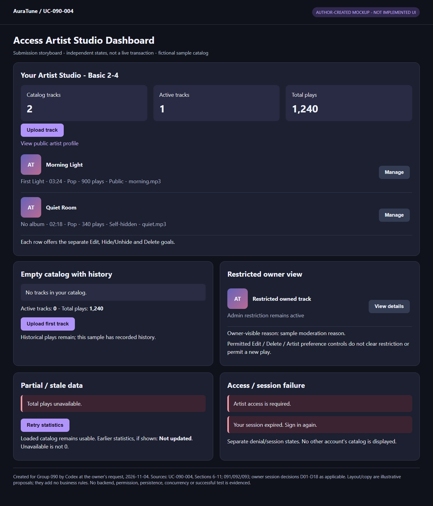
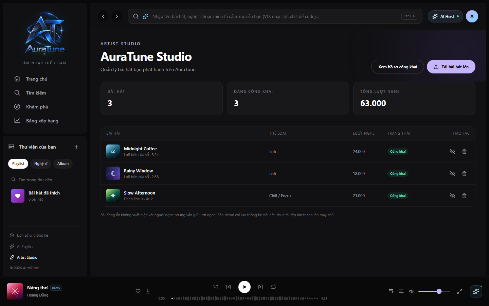

# UC-090-004 – Access Artist Studio Dashboard

## 1. Metadata

| Field | Value |
|---|---|
| Use Case ID | UC-090-004 |
| Use Case Name | Access Artist Studio Dashboard |
| Functional Group | 090 – Artist Profile & Studio |
| Primary Actor | Artist, accessing only their own Studio |
| Supporting Actors | None identified for the dashboard-viewing goal |
| Related FR IDs | 093-FR-001, 093-FR-002, 093-FR-003; 111-FR-011 (protected-access ban constraint); 112-FR-024/025 (restricted-owner viewing and moderation boundary) |
| Related Feature ID | 093 – Artist Track Management |
| Related Spec Kit File | [093 spec](../../../../specs/090-artist-profile-studio/093-artist-track-management/spec.md) |
| Writer | Thái Hoàng |
| Reviewer | Not assigned |
| Status | Draft |
| Last Updated | 2026-11-04 |

This Draft follows all 15 sections of the extracted UC template. Feature-qualified references retain literal source FR IDs. Three current 093 requirements apply directly, matching the inventory; other 093 requirements belong to UC-090-005–008. Cross-group requirements constrain access and the viewing of restricted tracks; they do not add administration to Studio. No peer review or approval has occurred.

## 2. Goal

The artist inspects their own released-track catalog and the three Studio summary statistics to understand their available catalog and recorded plays before choosing any separate management goal.

## 3. Description

AuraTune checks Studio access and ownership, presents the artist header and public-profile link, and shows artist-scoped statistics and track rows. Hidden tracks remain available for owner inspection with preserved play counts. Where the source explicitly permits an active artist-owner to view an admin-restricted track, the view shows the restricted state and reason without private Admin information. This UC is a viewing goal; upload, edit, hide/unhide, deletion and moderation decisions are separate.

## 4. Preconditions

- The requester can attempt to open the existing Studio entry at `/studio` (093 US1/US6). No new route or endpoint is introduced.
- Successful access requires a valid authenticated account holding the artist role, no active account ban, and ownership/authorization for the requested Studio data. These are checked during the flow, not global assumptions excluding denied or expired requests.
- Authentication/session state and the current account's artist association/catalog are dependencies. No minimum number of tracks is required; a successfully empty catalog follows AF-01.
- The Basic Flow assumes a successful authorized data load and ordinary artist-managed active/hidden track states. Load failure and moderation-related aggregation gaps are explicitly recorded below rather than treated as completed behavior.

## 5. Trigger

The requester opens AuraTune Studio to view the catalog and statistics belonging to their current artist account.

## 6. Basic Flow

This successful scenario uses a valid, non-banned artist-owner whose catalog contains tracks with ordinary artist-managed states. The numbered steps describe the viewing interaction, not a requirement for separate requests, screens or additional controls.

1. **Actor (Artist):** Opens their own Studio.
2. **System:** Verifies current authentication, artist-role access and the artist ownership scope. It presents the Studio header, artist name, public-profile link and summary cards for total tracks, active tracks and total play count for that artist (093 US1 scenario 1; FR-001/002), using G090-D06: count only non-deleted, unrestricted Artist-public tracks as active and retain validly recorded historical plays across later hide/restrict/delete. Data that cannot be obtained is distinguished from 0.
3. **Actor (Artist):** Inspects their catalog and statistics.
4. **System:** Presents all artist-associated tracks within that authorized scope, with cover art, title, album, duration, genre, play count, current status and management action controls. An uploaded audio filename is shown when applicable under US1 scenario 2. Ordinary artist-managed states are active ("Công khai") and hidden ("Đang ẩn"); hidden tracks retain historical plays in Studio. The actor can finish reviewing without performing any change.

**Outcome:** The viewing goal ends successfully. No upload, edit, visibility change, deletion, playback or administrative action is executed. Controls identify separate management goals, not additional steps required to complete this UC.

## 7. Alternative Flows

### AF-01 – The Artist Has No Released Tracks

- **Starting step:** Basic Flow step 4, after a successful authorized load.
- **Condition:** The artist's current Studio catalog has no released tracks.

1. **System:** Presents the clean catalog empty state with a prompt to upload the first track, as required by 093 US1 scenario 3. It keeps the three artist-scoped summary cards required by FR-002; empty current track counts imply no current tracks or active tracks, not a new kind of KPI.
2. **Actor (Artist):** Views the empty catalog and available first-upload prompt.

- **Outcome:** Ends successfully as an empty-catalog viewing goal. Selecting upload would start UC-090-005, whose flow is not described here. G090-D06 sets active count to 0 for an empty catalog while preserving validly recorded historical total plays; total plays is 0 only when no such plays exist. A failed/unavailable load is not a genuine empty/zero result. Manual retry follows G090-D08; D14 specifies stale-data labeling and per-portion recovery; exact layout remains illustrative.

### AF-02 – No Authentication or No Artist Role

- **Starting step:** Basic Flow step 2.
- **Condition:** The requester is unauthenticated or has a valid account without the artist role.

1. **System:** For an unauthenticated request, presents the login-required notice prompting login with an artist account, as specified by 093 US6 scenario 1.
2. **System:** For an authenticated non-artist request, presents the forbidden notice explaining that Studio requires an artist account, as specified by 093 US6 scenario 2 and FR-001. It does not disclose private Studio catalog/statistics or grant access to management controls.

- **Outcome:** Ends without Studio access for the denied request. These steps describe mutually exclusive conditions, not two successive notices. A future valid artist request starts at Basic Flow step 1. An Admin role alone does not confer Studio access; admin song-management API permissions remain a separate boundary.

### AF-03 – The Owner Inspects an Admin-Restricted Track

- **Starting step:** Basic Flow step 4, with valid active artist-owner access.
- **Condition:** An existing owned track has an admin moderation restriction.

1. **System:** Allows the valid artist-owner to view their own restricted track with the metadata relevant to ownership/moderation, its current restricted state and the restriction reason, without exposing private information about the Admin who imposed it (112-FR-024).
2. **Actor (Artist):** Reviews that information as a viewing result.
3. **System:** Keeps Artist self-hide preference distinct from effective Admin-restricted availability. G090-D05 permits the owner to start the separate metadata-edit, confirmed-delete or preference-change UC without allowing publication or a new play start; this viewing flow executes none of those mutations.

- **Outcome:** Ends successfully for restricted-track inspection. Viewing does not play, self-unrestrict or republish the track to bypass moderation (112-FR-025), and grants no access to another owner's non-public track. This is not a deleted-track restore flow. G090-D06 excludes Admin-restricted tracks from active count while retaining their valid historical plays. Exact combined-state row presentation remains a C-02 technical/UI follow-up, not an unresolved active-count rule.

### AF-04 – Requested Data Belongs to Another Account

- **Starting step:** Basic Flow step 2 or 4 before returning artist-specific data.
- **Condition:** A request attempts to read another artist's non-public Studio catalog, statistics or track information, including when the current account differs from the data owner.

1. **System:** Checks ownership/authorization at the server boundary and refuses disclosure outside the current artist's permitted scope, under the shared security principles and 112-FR-024 for restricted tracks.

- **Outcome:** Ends without disclosing the other account's private Studio data. This UC does not change either account's catalog. A subsequent own-Studio request starts at Basic Flow step 1 and must pass current access checks. Exact denial UI and handling of previously rendered or delayed data are technical/UX follow-ups, not copied from feature 092's personal-following rules.

### AF-05 – The Artist Account Is Banned

- **Starting step:** Basic Flow step 2, or a later protected data request serving this viewing goal.
- **Condition:** The artist account is currently banned, including a ban applied after authentication while the token has not expired.

1. **System:** Denies the protected request based on the current ban state, without executing it or returning private Studio data (111-FR-011).

- **Outcome:** Ends without a successful Studio load for that request. Unban and login are separate account/authentication behavior; 111 requires sign-in again after unban. No new ban reason, duration or public-browsing restriction is introduced, and no immediate removal of already-rendered UI is assumed.

## 8. Exception Flows

### EX-01 – Authentication Is Expired or Invalid

- **Starting step:** Basic Flow step 2 or any protected data request used by this viewing goal.
- **Condition:** The request lacks valid authenticated access because authentication is expired or invalid.

1. **System:** Rejects protected Studio access without disclosing the private catalog/statistics or performing management actions. Authentication follows the existing shared authentication contract, not a new Studio mechanism.

- **Outcome:** The request ends without a successful Studio load. A later request with valid artist access begins at Basic Flow step 1; no automatic refresh, replay, redirect, new HTTP status or Studio-specific recovery UI is defined. This differs from a successfully loaded empty catalog. If the account is banned, AF-05 remains applicable even if the token is unexpired.

### EX-02 – Partial load or failed reload with manual recovery

- **Starting step:** Basic Flow step 2 or 4, including a later manual reload of the Artist's Studio data.
- **Condition:** Catalog/statistics cannot load fully, one portion fails while another succeeds, or reload fails after earlier data was displayed.

1. **System:** Keeps each successfully loaded portion usable and gives each failed portion its own error/unavailable state with manual retry. It does not label failed or unknown data empty or zero.
2. **System:** If earlier data remains visible after a failed reload, clearly marks it not updated. It does not present that old data as a newly confirmed catalog/statistic or let it override a newer confirmed result. No private data from another account may be retained as the current account's data.
3. **Artist:** Requests manual retry for the failed portion if they wish to continue.
4. **System:** Rechecks current Artist access/ownership and retries the failed portion without invalidating successful portions. A successful retry presents current data under the existing catalog/statistics rules; a truly empty catalog uses AF-01 and confirmed statistics use G090-D06. Failure again keeps the per-portion error and any old data's not-updated distinction.

- **Outcome:** On recovery, resume the relevant Basic Flow presentation at step 2 or 4. Continued failure returns to EX-02 step 1; if the Artist stops, successful portions remain usable but full recovery is not claimed. A total failure has an error/retry outcome, not fabricated zero statistics; only available earlier data may be shown as not updated. Access loss follows EX-01/AF-02/04/05, not retention of unauthorized data. No automatic refresh, backend partition or exact UI layout is selected. Source: G090-D14 and G090-D08.

## 9. Postconditions

### 9.1 Success Postconditions

- Under G090-D14, a partially available Studio remains usable for successful portions. Failed portions remain explicitly unavailable/retryable, and old displayed data is marked not updated; partial usability is not a claim that every portion loaded or recovered.

- Studio statistics follow G090-D06: only non-deleted, unrestricted Artist-public tracks count as active; hide/restrict/delete do not themselves reduce validly recorded historical total plays. Missing statistical data is not reported as 0. No storage/cleanup or platform-wide statistics policy is implied.

- Under G090-D05, a restricted track stays non-public and cannot start new playback after permitted metadata/preference changes. Delete does not create a restore path. A later valid Admin unrestrict permits public availability only if the Artist preference is public and the track has not been deleted; viewing itself changes no state.

- The authorized artist has viewed their own Studio identity/public-profile link, the three defined summary statistics and their permitted track catalog, or the specified empty catalog with a first-upload prompt.
- Track rows contain the source-required metadata and management controls; artist-hidden tracks preserve plays in Studio rather than disappearing as they do from public discovery.
- For valid restricted-track viewing, the owner sees the restriction/state and reason without private Admin information and without gaining moderation-bypass powers.
- No catalog content, visibility, account role, ban state, play count or moderation decision is changed by viewing. Statistical semantics follow G090-D06; implementation correctness is not certified by this Draft.

### 9.2 Failure Postconditions

- G090-D14 preserves successful portions and distinguishes failed/unknown data from empty/zero. Earlier visible values after failed reload are explicitly not updated, not newly confirmed or transferred across accounts.

- G090-D08 requires explicit error/uncertainty feedback and manual recovery; unresolved results do not become definitive saved/unchanged/deleted claims. All ownership/restriction/deleted-state boundaries remain enforced.

- Missing/expired/invalid authentication, non-artist role, ban or insufficient ownership prevents protected data disclosure for the rejected request; no management action is executed by this UC.
- A data-load failure is not reported as a successful catalog/statistics load. Manual recovery and truthful error/uncertainty feedback follow G090-D08/EX-02; G090-D14 specifies per-portion errors/retry, preservation of successful portions and explicit not-updated labeling for earlier data.
- The behavior of previously rendered Studio data after account changes or access revocation is not asserted; backend requests must still enforce current authorization.

## 10. Special Requirements

- **Security:** Artist-role gating from 093-FR-001 applies to dashboard and management capabilities. Shared [security principles](../../../design/security/README.md) and [data security rules](../../../design/database/security-rules.md) require server-side authentication, ownership and least privilege; frontend hiding is insufficient. 111-FR-011 denies protected requests for banned accounts even with an unexpired token.
- **Performance:** 093-SC-002's 500 ms target applies to upload/metadata-edit reflection, not dashboard initial loading. No Studio-load target, timeout or refresh interval is defined here.
- **Usability and Accessibility:** Present the source-defined metadata, statuses and first-upload empty prompt. [Vision](../../../proposal/Auratune_Vision_Document.md), Section 6.3, supplies responsive desktop/mobile and mouse/keyboard/touch requirements. No new accessibility certification or dashboard interaction is assumed.
- **Privacy:** Keep catalog/statistics scoped to the authorized artist. Restricted-owner visibility must expose no private Admin information (112-FR-024). Public profile access remains the separate public boundary in UC-090-001.
- **Other:** Only total tracks, active tracks and total play count are defined summary statistics. Do not introduce admin KPIs, search, filtering, sort order, pagination, automatic refresh, provider choices or storage schemas. Static prototype arithmetic is not verification of aggregation policy.

## 11. Business Rules

Rule labels below identify source rules locally, not new FR IDs.

| Rule ID | Rule Description | Source |
|---|---|---|
| BR-01 | Only authenticated artist-role accounts may enter Studio; guests receive login-required and authenticated non-artists receive forbidden. Admin access to separate management APIs is not artist-role permission. | [093 spec](../../../../specs/090-artist-profile-studio/093-artist-track-management/spec.md), FR-001, US6 |
| BR-02 | Scope Studio data and controls to the artist's own authorized tracks; deny other artists' private data at the server boundary. | [093 spec](../../../../specs/090-artist-profile-studio/093-artist-track-management/spec.md), Input, US1, FR-002/003; [security rules](../../../design/database/security-rules.md), Sections 2/3 |
| BR-03 | Display total tracks, active tracks and total play count, without inventing additional statistics. G090-D06 defines active-count eligibility and historical-play retention after hide/restrict/delete; unavailable data is not 0. | [093 spec](../../../../specs/090-artist-profile-studio/093-artist-track-management/spec.md), FR-002 |
| BR-04 | Catalog rows include cover, title, album, duration, genre, plays, status and management controls; uploaded filename is conditional. Artist-hidden tracks remain inspectable with historical plays preserved. | [093 spec](../../../../specs/090-artist-profile-studio/093-artist-track-management/spec.md), FR-003, US1 scenario 2, clarification on hiding, SC-003 |
| BR-05 | No released tracks yields a clean empty catalog prompting first upload. G090-D06 requires active count 0 with retained historical total plays, 0 only if none exist; unavailable data is not a successful empty/zero result. | [093 spec](../../../../specs/090-artist-profile-studio/093-artist-track-management/spec.md), US1 scenario 3, FR-002 |
| BR-06 | A ban blocks subsequent protected requests even before token expiry and rejects new login until unban; sign-in is required again after unban. | [111 spec](../../../../specs/110-admin-functions/111-user-management/spec.md), FR-011, ban-session clarification |
| BR-07 | A valid artist-owner can view their own restricted track's relevant metadata, restricted state and reason without private Admin information; cannot play or bypass moderation through self-unrestriction/republishing. | [112 spec](../../../../specs/110-admin-functions/112-content-moderation/spec.md), FR-024/025 |
| BR-08 | Owner-confirmed session decision G090-D05 (2026-11-04): an eligible Artist-owner may edit the already-permitted metadata, delete through the existing confirmation/cancel flow, and change only their self-hide preference while Admin restriction remains active. None of these actions clears that restriction, publishes the track or permits a new play start. After Admin lifts restriction, public availability requires Artist-public preference and a non-deleted track. Unhide/unrestrict cannot restore a deleted track. | Owner-confirmed session decision G090-D05, 2026-11-04; not group approval |
| BR-09 | Owner-confirmed session decision G090-D06 (2026-11-04), own-Artist Studio statistics: active count includes only Artist-public tracks without Admin restriction that are not deleted. Total plays retains all validly recorded historical plays, including tracks later hidden, restricted or deleted; those actions do not themselves subtract historical plays. An empty catalog has active count 0 but retains historical total plays, which is 0 only if there are no recorded plays. Unavailable data must be distinguishable from 0. | Owner-confirmed session decision G090-D06, 2026-11-04; not group approval or a source-spec edit |
| BR-10 | Owner-confirmed session decision G090-D08 (2026-11-04), option A: distinguish Studio errors from valid empty/zero results and offer manual retry. An unanswered submitted operation remains explicitly uncertain; reconcile its actual result before a definitive state claim or resubmission. Retrying the same upload submission must not create another track. Concurrent valid operations take effect in successful processing order, with the last successful applicable change prevailing, subject to current ownership, Admin restriction and deletion rules; deleted content cannot be resurrected. No automatic resubmission, schema/API, transaction or deduplication mechanism is selected. | Owner-confirmed session decision G090-D08; not an original 093 requirement or group approval |
| BR-11 | Owner-confirmed session decision G090-D14 (2026-11-04), option A: retain successfully loaded Studio catalog/statistics portions when another portion fails; show a distinct error/unavailable state and manual retry for each failed portion. Previously loaded data may remain visible only when clearly marked not updated, never as newly confirmed data or a replacement zero/empty result. Retry does not invalidate successful portions. This selects no endpoint partition, refresh interval, cache/storage mechanism or exact visual layout. | Owner-confirmed session decision G090-D14; newly confirmed here, not original source requirement or group approval |

## 12. Prototype and Screenshots

### 12.0 Current Submission Evidence

**Type/provenance:** Author-created HTML/CSS mockup storyboard, generated by Codex at the owner's request on 2026-11-04; fictional catalog data. [Editable HTML](./prototypes/UC-090-004-basic-flow-and-key-states.html). Sources: this UC's current flows/rules, relevant 091/092/093 requirements and confirmed D01-D18 decisions. Layout and sample feedback wording are illustrative, not additional approved requirements or implemented UI.

**Illustration:** Basic Flow presentation and key UI states for AF-01, AF-02, AF-03, EX-01, EX-02. Multiple panels are independent alternative states, not one live screen or executed sequence. This is **Partial** evidence: no backend, current permissions, storage, persistence, license validation, concurrency or passed test is established. Per-flow residual Missing/Partial states are recorded in the [prototype index](./prototypes/README.md).

**Shared access/recovery illustration:** [P-025 mockup](./prototypes/Group090-access-and-recovery-states.png) illustrates applicable AF-02, AF-04, AF-05, EX-01. These are independent UI states, not proof of enforcement or a complete recovery sequence.

**Historical reference review below:** Earlier source-image observations and missing-state statements describe the original assets only. They do not override the new storyboard or current index. No original source image was changed; new local mockups supersede incompatible old UI for submission illustration.

### 12.1 Basic Flow

**Covered steps:** Visually inspected on 2026-11-03. Basic Flow step 2 is partially illustrated by the AuraTune Studio header/public-profile link and cards showing 3 tracks, 3 public tracks and 63,000 plays. Step 4 is partially illustrated by three public rows: Midnight Coffee (24,000), Rainy Window (18,000) and Slow Afternoon (21,000), with covers, album/duration text, genres, green public badges and hide/delete controls. The visible numbers add to 63,000, but that arithmetic proves neither correct account scoping nor the aggregation policy. The image does not visibly establish an edit control or uploaded filename, and does not prove artist-name association beyond the header.

**Prototype type:** Reference UI mockup; implementation provenance unverified, not proof of a deployed system. The static image proves no access control, complete catalog retrieval, backend statistics correctness, hidden/restricted state, error behavior or successful operation. Global search/player/library UI is contextual, not extra Studio functionality.

**Source discrepancy:** The footer says the demo only stores track information and does not upload audio to the server, whereas current 093-FR-010 requires cloud audio persistence. This asset is therefore not upload-implementation evidence; UC-090-005 must follow the current requirement. No image/source was changed.

G090-D14 successful/failed portions, old-data not-updated labeling and per-portion retry lack verified prototype evidence; static sample totals do not establish these behaviors.

### 12.2 Alternative Flow – AF-01

**Missing evidence:** This image has three tracks; it does not illustrate an empty Studio or first-upload prompt. Empty-state values are specified by G090-D06 but not demonstrated by this populated mockup; no backend/statistical correctness is inferred.

### 12.3 Alternative Flows – AF-02 through AF-05

| Flow | Evidence status |
|---|---|
| AF-02 login-required / non-artist forbidden | No matching asset inspected or identified for these states; visible account avatar/Studio sidebar does not verify role gating. |
| AF-03 restricted-owner viewing | No restricted row, reason or private-Admin exclusion evidence in the dashboard image. It also contains no hidden track, so hidden-play preservation remains unverified. |
| AF-04 ownership boundary | No two-account or denied cross-artist request evidence. |
| AF-05 ban | No banned-artist protected-access evidence. |

### 12.4 Exception / Recovery Evidence

Expired/invalid-session behavior has no matching image. G090-D14 now specifies partial/failure/not-updated/manual-retry behavior, but these states have no matching prototype evidence here; the original 093 did not specify them. Prototype coverage remains incomplete. No new/copy images or placeholder links are provided; the remaining four 093 images were not inspected in this pass.

## 13. Related Use Cases

- [UC-090-001 – View Public Artist Profile](./UC-090-001-view-public-artist-profile.md): destination identified by the Studio's public-profile link; public visibility and profile behavior remain its responsibility. No new navigation or profile-editing flow is added here.
- UC-090-005 – Upload Audio Track: separate goal reached from upload controls/empty prompt. Specification: [Draft specification](./UC-090-005-upload-audio-track.md).
- UC-090-006 – Edit Track Metadata: separate goal identified by row-management capability. Specification: [Draft specification](./UC-090-006-edit-track-metadata.md).
- UC-090-007 – Hide or Unhide Track: separate visibility goal; no moderation bypass inferred. Specification: [Draft specification](./UC-090-007-hide-or-unhide-track.md).
- UC-090-008 – Delete Track from Studio: separate confirmed-deletion goal. Specification: [Draft specification](./UC-090-008-delete-track-from-studio.md).
- [UC-090-002](./UC-090-002-follow-or-unfollow-artist.md) and [UC-090-003](./UC-090-003-view-followed-artists.md) are personal-following goals, not prerequisites or included Studio behavior. Their retry/account-change rules are not automatically imported here.
- Account bans and moderation actions remain Group 110. Existing authentication mechanisms remain in Group 010. No include/extend relation is invented.

## 14. Traceability and Sources

| Source Type | ID / File | Relevant Section |
|---|---|---|
| Authoring guide | `C:/Users/Admin/Downloads/AuraTune_Use_Case_Documentation_Guide.md` | Source-based actor/system flows, preservation and honest evidence |
| Extracted UC template | `C:/Users/Admin/Downloads/AuraTune_UC_Templates_Extracted/AuraTune_Use_Case_Templates/uc-specification/UC.template.md` | All 15 sections retained |
| Group artifacts | [README](./README.md); [inventory](./use-case-inventory.md) | Stable UC-090-004 name/path and 093-FR-001–003 allocation |
| Existing Drafts | [UC-090-001](./UC-090-001-view-public-artist-profile.md); [UC-090-002](./UC-090-002-follow-or-unfollow-artist.md); [UC-090-003](./UC-090-003-view-followed-artists.md) | Public/personal boundaries and documentation style; unchanged |
| Owner session decision | G090-D05, confirmed by Thái Hoàng on 2026-11-04 | Owner-confirmed session decision G090-D05 (2026-11-04): an eligible Artist-owner may edit the already-permitted metadata, delete through the existing confirmation/cancel flow, and change only their self-hide preference while Admin restriction remains active. None of these actions clears that restriction, publishes the track or permits a new play start. After Admin lifts restriction, public availability requires Artist-public preference and a non-deleted track. Unhide/unrestrict cannot restore a deleted track. Newly confirmed in this conversation; source specs remain unchanged. |
| Owner session decision | G090-D06, confirmed by Thái Hoàng on 2026-11-04 | Owner-confirmed session decision G090-D06 (2026-11-04), own-Artist Studio statistics: active count includes only Artist-public tracks without Admin restriction that are not deleted. Total plays retains all validly recorded historical plays, including tracks later hidden, restricted or deleted; those actions do not themselves subtract historical plays. An empty catalog has active count 0 but retains historical total plays, which is 0 only if there are no recorded plays. Unavailable data must be distinguishable from 0. No technical data source, schema, history-storage/cleanup mechanism or Group 113 formula is selected. |
| Owner session decision | G090-D08, confirmed by Thái Hoàng on 2026-11-04 | Owner-confirmed session decision G090-D08 (2026-11-04), option A: distinguish Studio errors from valid empty/zero results and offer manual retry. An unanswered submitted operation remains explicitly uncertain; reconcile its actual result before a definitive state claim or resubmission. Retrying the same upload submission must not create another track. Concurrent valid operations take effect in successful processing order, with the last successful applicable change prevailing, subject to current ownership, Admin restriction and deletion rules; deleted content cannot be resurrected. No automatic resubmission, schema/API, transaction or deduplication mechanism is selected. Remaining cancel/input-retention/partial-presentation details are B-06; mechanics are C-02. |
| Owner session decision | G090-D14, confirmed by Thái Hoàng on 2026-11-04 | Owner-confirmed session decision G090-D14 (2026-11-04), option A: retain successfully loaded Studio catalog/statistics portions when another portion fails; show a distinct error/unavailable state and manual retry for each failed portion. Previously loaded data may remain visible only when clearly marked not updated, never as newly confirmed data or a replacement zero/empty result. Retry does not invalidate successful portions. This selects no endpoint partition, refresh interval, cache/storage mechanism or exact visual layout. EX-02, postconditions and BR-11. |
| Spec Kit Specification | [093 spec](../../../../specs/090-artist-profile-studio/093-artist-track-management/spec.md) | Complete spec: clarifications, US1/US6, FRs, SCs, dependencies and screenshots |
| Account constraint | [111 spec](../../../../specs/110-admin-functions/111-user-management/spec.md) | FR-011 and ban/session clarification; file exists on this branch |
| Moderation constraint | [112 spec](../../../../specs/110-admin-functions/112-content-moderation/spec.md) | FR-024/025 and restricted-owner clarification; file exists on this branch |
| Vision Document | [Vision](../../../proposal/Auratune_Vision_Document.md) | G09/G11, AD-10 and Section 6.2/6.3; no extra Studio KPI or automatic preapproval imposed |
| API Contract | [API Contract](../../../analysis-and-design/api-contract.md) | Shared protected-access/error conventions; Section 2.4 distinguishes public song reads from artist/admin song operations; no dedicated private Studio dashboard/statistics retrieval contract defined |
| Security | [Security principles](../../../design/security/README.md); [data security rules](../../../design/database/security-rules.md) | Server-side authentication/ownership, least privilege and private-data protection |

| Feature-qualified FR | Current meaning / scope | Handling / owner |
|---|---|---|
| [093-FR-001](../../../../specs/090-artist-profile-studio/093-artist-track-management/spec.md) | Restrict Studio to authenticated artist-role users. | Basic Flow 2; AF-02/04/05; EX-01; BR-01/02/06. Shared gate also constrains UC-090-005–008. |
| [093-FR-002](../../../../specs/090-artist-profile-studio/093-artist-track-management/spec.md) | Total tracks, active tracks and total play count for the artist. | Basic Flow 2; AF-01; BR-03; G090-D06/BR-09 defines active count/history retention; Q-01/02 resolved, data-unavailability feedback still follows the separate B-06 gap. |
| [093-FR-003](../../../../specs/090-artist-profile-studio/093-artist-track-management/spec.md) | All authorized artist-associated tracks with cover/title/album/duration/genre/plays/status/management controls. | Basic Flow 4; AF-01/03/04; BR-02/04; restriction-display alignment Q-02. |
| [093-FR-004](../../../../specs/090-artist-profile-studio/093-artist-track-management/spec.md) | Upload audio with metadata. | UC-090-005; only entry control/prompt is identified here. No upload flow. |
| [093-FR-005](../../../../specs/090-artist-profile-studio/093-artist-track-management/spec.md) | Validate duration input format. | UC-090-005/006; this UC displays existing duration and does not submit input. |
| [093-FR-006](../../../../specs/090-artist-profile-studio/093-artist-track-management/spec.md) | Edit uploaded-track metadata. | UC-090-006; management control only here. |
| [093-FR-007](../../../../specs/090-artist-profile-studio/093-artist-track-management/spec.md) | Toggle active/hidden visibility. | UC-090-007; this UC reads state and retained plays, does not toggle. |
| [093-FR-008](../../../../specs/090-artist-profile-studio/093-artist-track-management/spec.md) | Modal confirmation for permanent deletion. | UC-090-008; no confirmation flow here. |
| [093-FR-009](../../../../specs/090-artist-profile-studio/093-artist-track-management/spec.md) | Toast on upload/update/status toggle/deletion. | UC-090-005–008; no dashboard-load toast invented. |
| [093-FR-010](../../../../specs/090-artist-profile-studio/093-artist-track-management/spec.md) | Cloud persistence/permanent audio URL for upload. | UC-090-005; no upload/CDN actor added to this viewing goal. Prototype footer is stale for this requirement. |
| [111-FR-011](../../../../specs/110-admin-functions/111-user-management/spec.md) | Deny new login and subsequent protected requests after ban, until explicit unban. | Cross-group constraint: AF-05; BR-06. No ban/unban action added. |
| [112-FR-024](../../../../specs/110-admin-functions/112-content-moderation/spec.md) | Active artist-owner may inspect restricted track metadata/state/reason without private Admin information. | Cross-group constraint: AF-03/04; BR-07; aggregate semantics settled by G090-D06; exact row-state presentation remains C-02. |
| [112-FR-025](../../../../specs/110-admin-functions/112-content-moderation/spec.md) | Artist cannot play/self-unrestrict/republish restricted track to bypass moderation; no default deleted-track restore. | Boundary: AF-03 outcome; BR-07. No playback/restore/mutation flow specified. |

093 US1 scenarios 1–3 additionally require the header/public-profile link, conditional filename and first-upload empty prompt. 093 SC-003 and the hiding clarification require preserved historical plays for artist-hidden tracks. The old shared model's mapping of 093-FR-001 alone to this UC is incomplete; current FR-002/003 define statistics/catalog, not upload/edit as in its older mapping. Shared sources are not edited.

Source discrepancies are not silently resolved: 093 describes artist active/hidden state while 112 adds independent moderation restriction/owner-visible reason; they require joint presentation/counting alignment, not collapse into one invented enum. 112's older assumptions say the artist-hide distinction remains open despite later explicit clarifications/FR-024/025; its November removal/restoration wording also differs from earlier deletion/restore descriptions. This UC preserves explicit restricted-owner viewing and moderation safety, and leaves ambiguous removed/deleted terminology to source alignment, without asserting recoverability; G090-D06 independently defines Studio metrics for these visibility/deletion outcomes. Broad Artist/Admin API mutation permission does not override 093's artist-only Studio gate.

## 15. Open Questions

Question IDs are local labels; the categories distinguish business/UX gaps, source alignment and technical/evidence follow-ups.

| Question ID | Question | Owner | Status | Resolution |
|---|---|---|---|---|
| Q-01 | Business: post-deletion historical-play aggregate population. | Thái Hoàng / group | Resolved | Owner-confirmed session decision G090-D06 (2026-11-04), own-Artist Studio statistics: active count includes only Artist-public tracks without Admin restriction that are not deleted. Total plays retains all validly recorded historical plays, including tracks later hidden, restricted or deleted; those actions do not themselves subtract historical plays. An empty catalog has active count 0 but retains historical total plays, which is 0 only if there are no recorded plays. Unavailable data must be distinguishable from 0. [B-02](./README.md#shared-open-issues) resolved. Exact row representation stays a C-02 technical/UI follow-up; B-06 recovery is resolved by D08-D14; technical/evidence work remains. |
| Q-02 | Business: active-count membership under Admin restriction; combined-state presentation. | Thái Hoàng / group | Resolved | Owner-confirmed session decision G090-D06 (2026-11-04), own-Artist Studio statistics: active count includes only Artist-public tracks without Admin restriction that are not deleted. Total plays retains all validly recorded historical plays, including tracks later hidden, restricted or deleted; those actions do not themselves subtract historical plays. An empty catalog has active count 0 but retains historical total plays, which is 0 only if there are no recorded plays. Unavailable data must be distinguishable from 0. [B-02](./README.md#shared-open-issues) resolved. Exact row representation stays a C-02 technical/UI follow-up; B-06 recovery is resolved by D08-D14; technical/evidence work remains. |
| Q-03 | Business/UX: Studio load failure, partial results and recovery. | Thái Hoàng / group | Resolved | G090-D08-D13 settle the selected recovery/cancel/retention/session rules; G090-D14 settles the remaining partial/stale Studio presentation: preserve successful portions, per-failed-portion error/manual retry, earlier data explicitly not updated and never substituted for current/zero values. [B-06](./README.md#shared-open-issues) resolved. Technical implementation and missing prototype evidence remain separate. |
| Q-04 | Technical Follow-up: retrieve authorized Studio catalog/statistics and isolate delayed responses. | Thái Hoàng / group | Open | [Group issue C-02](./README.md#shared-open-issues) |
| Q-05 | Evidence: when will empty, hidden/restricted, login-required, forbidden, banned, expired-session and two-account states be demonstrated, including fields absent from the current image? | Thái Hoàng | Open | Dashboard mockup inspected; static sample totals/rows are not correctness/security evidence. Coverage incomplete. |
| Q-06 | Documentation/review: independent review and shared model/image alignment. | Thái Hoàng / group | Open | [Group issue D-01](./README.md#shared-open-issues); 112 action/state wording is assessed in the group source assessment below, not assumed contradictory. |

The group-level D18 sharing decision, deferred album scope and external upload-actor follow-ups are recorded in the [group README](./README.md#8-open-issues-and-decisions). They are not prerequisites for recording this read-only Dashboard Draft.
