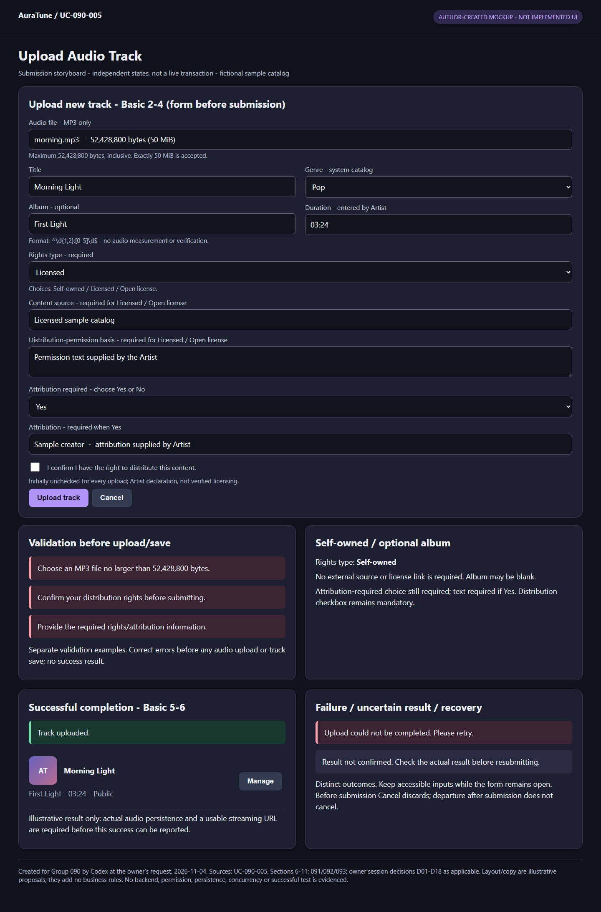
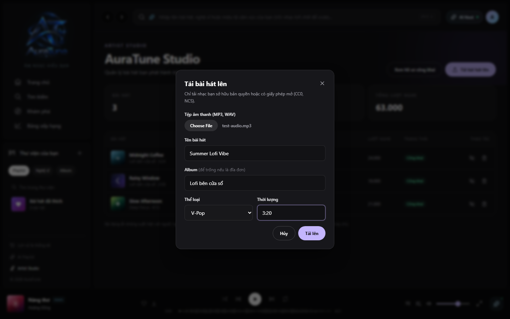

# UC-090-005 – Upload Audio Track

## 1. Metadata

| Field | Value |
|---|---|
| Use Case ID | UC-090-005 |
| Use Case Name | Upload Audio Track |
| Functional Group | 090 – Artist Profile & Studio |
| Primary Actor | Artist, uploading a new track for their own account |
| Supporting Actors | External Cloud Media/Blob Storage Service — logical upload-persistence role supported by Vision Section 4.1 and 093-FR-010; provider and equivalence to the shared model's CDN label remain unconfirmed |
| Related FR IDs | 093-FR-001, 093-FR-004, 093-FR-005, 093-FR-009, 093-FR-010; 111-FR-011 as a protected-access ban constraint |
| Related Feature ID | 093 – Artist Track Management |
| Related Spec Kit File | [093 spec](../../../../specs/090-artist-profile-studio/093-artist-track-management/spec.md) |
| Writer | Thái Hoàng |
| Reviewer | Not assigned |
| Status | Draft |
| Last Updated | 2026-11-04 |

This Draft retains all 15 sections of the extracted UC template. Feature-qualified FR references identify literal requirements in the linked source, not new source IDs. Five 093 FRs apply directly, matching the inventory. File format/size was confirmed by the group owner on 2026-11-04; rights metadata was confirmed by the owner in G090-D03 on 2026-11-04; D08-D14 settle the selected recovery outcomes; technical mechanisms and complete sequence evidence remain separate. No peer review or approval is claimed.

## 2. Goal

The artist publishes a new track they have the right to distribute, with its descriptive metadata and genuinely stored playable audio, so it appears in their Studio catalog and becomes available under the platform's public-visibility rules.

## 3. Description

AuraTune accepts a new audio file and the source-defined metadata from its authorized artist-owner, validates the defined inputs, stores the binary audio in cloud media/blob storage and associates its permanent playable URL with the new track. A successful upload creates an active track, displays a success toast and shows it in the artist's catalog. This is a new-track goal, not replacement of a published track's audio, metadata-only editing, album management or moderation.

### Source limits and supporting-actor boundary

[Vision Section 4.1](../../../proposal/Auratune_Vision_Document.md) places media storage among external services and explicitly shows AuraTune services saving uploads to it. [093-FR-010](../../../../specs/090-artist-profile-studio/093-artist-track-management/spec.md) requires binary persistence and a permanent audio URL. Together they support the external upload-storage role named above. This does not infer upload responsibility from CDN delivery or select Cloudinary, Cloudflare, S3, a direct browser-upload architecture or an interface. The shared model's existing actor-name association remains a documentation-alignment question (Q-07); it is not changed here. Internal application/database components are not supporting actors.

## 4. Preconditions

- The actor can attempt to access Studio and its new-track upload capability. Successful processing requires current authenticated artist-role access, no active account ban, and the current artist as track owner; checks occur in the flow so denied/expired attempts are not excluded by a contradictory global precondition.
- Under Vision AD-10, project artist accounts upload only licensed/team-created material they have the right to distribute. The original source does not define the attestation interaction. Owner-confirmed session decision G090-D02 (2026-11-04) now requires a separate, initially unchecked distribution-rights checkbox for each upload. Rights metadata follows owner-confirmed G090-D03; the checkbox is an Artist declaration, not system verification of a license.
- Existing artist association, platform genre vocabulary and cloud media persistence are dependencies. File selection, metadata validity and actual storage success are evaluated during the flow, not presumed by the trigger.
- File format/size is evaluated during validation under session decision G090-D01 (2026-11-04): MP3 only, at most 52,428,800 bytes (50 MiB), inclusive. This is a newly confirmed owner decision, not a pre-existing 093/API requirement or evidence of implemented validation.

## 5. Trigger

The artist selects the new-track upload action from Studio, including the first-upload prompt when their catalog is empty. Dashboard viewing remains [UC-090-004](./UC-090-004-access-artist-studio-dashboard.md).

## 6. Basic Flow

This is the source-supported success path for a new track under the current academic rights assumption. Steps 4–5 precede any claimed publication/success. The Draft does not equate choosing a filename, creating metadata or assigning an unusable URL with a completed upload.

1. **Actor (Artist):** Requests to upload a new track for their own Studio.
2. **System:** Checks current artist access and presents the upload dialog with audio file selection, title, optional album, genre and duration inputs (093 US2 scenario 1), plus a distribution-rights confirmation checkbox, initially unchecked for each upload (G090-D02), and rights-type, conditionally required source/distribution-basis text, attribution-required choice and conditional attribution text (G090-D03).
3. **Actor (Artist):** Selects the audio file, supplies title, genre and duration, optionally supplies an album name, selects the rights type, supplies the applicable G090-D03 rights/attribution declarations, explicitly checks the distribution-rights confirmation for this upload, and submits the new-track upload request.
4. **System:** Checks current authentication, role, ban state and owner scope, and validates the defined required inputs, including the exact duration pattern in BR-02; G090-D04 confirms that this validates Artist-entered text without measuring or comparing the audio length. A missing required field or invalid duration follows AF-01 before audio persistence or publication proceeds. Before starting audio upload or saving the track, it checks that this upload's distribution-rights checkbox is selected; if not, AF-07 applies. It also checks MP3 format and file size of at most 52,428,800 bytes (50 MiB), accepting exactly that limit under G090-D01. A non-MP3 or oversized file follows AF-06 before persistence/publication. Before starting audio upload or saving the track, it also validates the G090-D03 declarations under BR-09; missing required declarations follow AF-08. No schema/API or verification mechanism is selected.
5. **System:** Stores the actual binary audio through the external media/blob storage service and obtains the permanent playable streaming URL required by 093-FR-010. A confirmed storage failure follows EX-02 instead of the success step.
6. **System:** Associates that URL and the submitted metadata with the new track owned by the current artist, adds the track with active status, displays the upload-success toast and shows the new track in the Studio catalog (093 US2 scenario 2; FR-009/010).

**Outcome:** Ends successfully only when real audio persistence, the playable URL association and the source-required catalog/result state are achieved. Under the current AD-10 assumption, active content can be publicly available under existing visibility/moderation rules without an invented admin-preapproval stage. This is not a claim of immediate propagation to every cached page or a redefinition of playback. UC-090-004 owns dashboard inspection; its aggregate semantics follow D06 and partial-data recovery follows D14.

## 7. Alternative Flows

### AF-01 – Required Input Missing or Duration Invalid

- **Starting step:** Basic Flow step 4, after submission and before storage/publication.
- **Condition:** A defined required field is missing or the supplied duration does not match `^\d{1,2}:[0-5]\d$`.

1. **System:** Highlights the validation error in the upload dialog without closing it, as required by 093 US2 scenario 3. It does not proceed to audio persistence/publication for the rejected input.
2. **Actor (Artist):** Corrects the input and submits it again.

- **Outcome:** Resume at Basic Flow step 4 with the corrected submission from step 3. Repeated invalid input repeats AF-01 step 1. This supported correction loop is not an upload/storage retry policy, does not create a duplicate-handling mechanism, and retains entered form values and file selection while accessible under G090-D11.

### AF-02 – Album Name Omitted

- **Starting step:** Basic Flow step 4.
- **Condition:** The artist leaves the optional album name empty while the other source-defined inputs are supplied and valid.

1. **System:** Accepts the absence of an album name under 093-FR-004 rather than treating it as a missing required field.

- **Outcome:** Continue at Basic Flow step 5. No album creation, album-ownership assignment, default album title or replacement of an existing album is specified by this optional input.

### AF-03 – Missing Authentication or Non-Artist Role

- **Starting step:** Basic Flow step 2 or 4 before the affected upload operation is accepted.
- **Condition:** The requester is unauthenticated or has a role other than artist.

1. **System:** Denies Studio/upload access. For unauthenticated Studio access it presents the login-required notice; for an authenticated non-artist it presents the artist-only forbidden notice, following 093 US6.

- **Outcome:** Ends without accepting the denied upload. A later valid artist request starts at Basic Flow step 1; no automatic submission replay is specified. Artist/Admin permission on separate song-management APIs does not grant an Admin role alone access to this artist Studio goal.

### AF-04 – Upload Attempts Another Artist's Ownership

- **Starting step:** Basic Flow step 4, before persistence/publication for the request.
- **Condition:** The request attempts to create the track under another artist's identity or otherwise exceeds the authenticated artist's authorized ownership scope.

1. **System:** Enforces server-side authenticated ownership and rejects the unauthorized assignment rather than creating an owned record for another artist.

- **Outcome:** The denied request ends without performing that ownership assignment. No owner-selector UI, alternate identity, impersonation or exact error wording is introduced. A fresh valid own-artist request may start at Basic Flow step 1; handling already accepted work under an account switch remains Q-06.

### AF-05 – Artist Account Is Banned

- **Starting step:** Basic Flow step 2 or 4, or a later protected request serving the upload.
- **Condition:** The authenticated artist account is currently banned, including a ban applied while an existing token remains unexpired.

1. **System:** Denies the protected request without executing it, in accordance with 111-FR-011.

- **Outcome:** The denied protected operation ends without acceptance. Login/unban recovery belongs to the existing authentication/account features; 111 requires sign-in after unban. The outcome of work accepted before the ban is not inferred, and no cleanup, rollback or cancellation of an already accepted upload is promised.

### AF-06 – Unsupported format or oversized audio

- **Starting step:** Basic Flow step 4, before persistence/publication.
- **Condition:** The selected audio file is not MP3, exceeds 52,428,800 bytes (50 MiB), or both.

1. **System:** Rejects the file and provides an appropriate message identifying the unsupported format and/or exceeded maximum size. It does not proceed to the successful-upload outcome or display an upload-success notification for this rejected submission.

- **Outcome:** The submission ends unsuccessfully. An MP3 file of exactly 52,428,800 bytes passes the size boundary, subject to the other applicable validations. G090-D11 retains values and accessible file selection while the form remains open for correction/manual retry; no automatic resubmission or exact error layout is selected. Source: owner-confirmed session decision G090-D01, 2026-11-04.

### AF-07 – Distribution-rights confirmation not selected

- **Starting step:** Basic Flow step 4, before any audio upload or track saving begins.
- **Condition:** The Artist submits without selecting the distribution-rights confirmation checkbox for this upload.

1. **System:** Rejects the submission and displays an appropriate message that distribution-rights confirmation is required. It does not start audio upload, save the track or report upload success for this submission.

- **Outcome:** The submission ends unsuccessfully. The checkbox is initially unchecked for each upload and requires the Artist's affirmative selection. This declaration is not evidence that the system verified the license. G090-D11 retains entered values while the form remains open for correction/manual retry; the checkbox is not automatically selected on the Artist's behalf. Source: owner-confirmed session decision G090-D02, 2026-11-04.

### AF-08 – Required rights or attribution information missing

- **Starting step:** Basic Flow step 4, before any audio upload or track saving begins.
- **Condition:** The Artist has not selected Self-owned, Licensed or Open license; Licensed/Open license lacks non-empty content-source or distribution-permission-basis text; the attribution-required choice is missing; or attribution is required but its text is empty.

1. **System:** Identifies the missing required information and displays appropriate feedback so the Artist can correct it. It does not start audio upload, save the track or report upload success for this rejected submission.
2. **Artist:** Supplies the missing declarations and resubmits if they wish to continue.

- **Outcome:** Resume at Basic Flow step 4 for validation of the corrected submission; if the Artist stops, the submission ends without upload/track saving. Self-owned material does not require an external source/license link; Licensed/Open license requires text declarations but no proof-document upload. The G090-D02 checkbox remains required for every upload. G090-D11 retains entered values and accessible file selection while the form remains open for correction/manual retry. No license-verification mechanism is prescribed. Source: owner-confirmed session decision G090-D03, 2026-11-04.

### AF-09 – Repeated or concurrent operation

- **Starting step:** Basic Flow step 4, 5 or 6 before a change is accepted; also during EX-03 recovery.
- **Condition:** The same intended request is repeated, or valid operations affecting the track overlap.

1. **System:** Evaluates current access, ownership, restriction and existence. The last successfully processed applicable change determines saved state, not device click time; no request restores a deleted track or bypasses restriction. An unsuccessful request is not treated as a successful ordering event.
2. **System:** Reflects the confirmed current result rather than overwriting it with an older delayed response. A repeated recovery of the same upload submission creates no additional track; this does not prohibit a separately intended new upload. Missing-target requests follow the existing not-found branch, without inventing a special transport response for duplicate deletion.

- **Outcome:** Ends with the confirmed saved result when known. If further authorized processing is needed, resume at Basic Flow step 4 for the same intended submission, then steps 5-6 only if needed; an uncertain result uses EX-03 first. No specific synchronization, versioning, schema or idempotency-key design is selected. Source: G090-D08.

### AF-10 – Cancel or close before submission

- **Starting step:** Basic Flow step 2 or 3, before the upload submission is sent.
- **Condition:** The Artist selects Cancel or closes the upload form before submitting it.

1. **Artist:** Cancels or closes the form.
2. **System:** Dismisses the form and discards the entered form data. It starts no audio upload and saves no track for this unsubmitted form.

- **Outcome:** The interaction ends with pre-submission cancellation, without an upload or success claim. A later new upload begins at Basic Flow step 1 with G090-D02's initially unchecked checkbox. Source: G090-D09.

### AF-11 – Leave the form after submission

- **Starting step:** After Basic Flow step 3 sends the submission, while step 4, 5 or 6 is pending or its response has not been confirmed.
- **Condition:** The Artist leaves or closes the submitted upload form.

1. **Artist:** Leaves or closes the form after submitting.
2. **System:** Does not interpret leaving as cancellation of the submitted operation and does not claim that the operation failed, was rolled back or was cancelled merely because the form closed.
3. **Artist:** Returns to inspect the result of that submission.
4. **System:** Rechecks current access and reconciles the actual result under G090-D08/EX-03 before a definitive success/failure claim or retry. It does not create a duplicate track by blindly submitting again.

- **Outcome:** Present a confirmed result when available; otherwise enter EX-03 with uncertainty preserved. If authorized retry is still needed, resume Basic Flow step 4 for the same intended submission under EX-03. No technical mechanism for retaining operation identity or form input is selected. Source: G090-D09.

G090-D11 applies to validation branches while the form remains open: preserve entered values and any selected audio still accessible, give corrective feedback and allow manual correction/retry. Existing checkbox, rights, format/size and duration validations remain enforced. An uncertain submitted result must be reconciled under G090-D08 before resubmission; keeping input is not proof of a saved or unchanged result. Explicit pre-submission upload Cancel and pre-Save edit Cancel retain their discard behavior.

## 8. Exception Flows

### EX-01 – Session expiry with account-bound recovery

- **Starting step:** Basic Flow step 2 or 4, any later protected request, or recovery while this upload/edit interaction is pending.
- **Condition:** Authenticated access expires or becomes invalid while the Artist is entering data or awaiting a submitted request's outcome.

1. **System:** Rejects unauthenticated protected requests and does not continue protected processing merely because the form was previously opened. It retains temporary entered data and an upload file only while still accessible within the working session; it does not promise recovery after that data/file becomes unavailable.
2. **Artist:** Uses the existing authentication flow to sign in again if they wish to continue.
3. **System:** If the same account signs in, rechecks current Artist permission, ownership, ban state and target validity as applicable. For an already-submitted request, first reconciles its actual outcome under G090-D08/EX-03; no automatic replay occurs. If a different account signs in, it does not expose or transfer the old draft, pending action or delayed result to that account.

- **Outcome:** For the same account with valid access and unsubmitted accessible input, resume the form interaction at Basic Flow step 3; inaccessible values/file must be supplied again before a new submission. For submitted work, use EX-03 before retry or a definitive claim. If recovery fails, access is denied, or a different account becomes current, the old interaction cannot continue as that account; no request is reassigned or assumed rolled back. Existing explicit Cancel/close rules remain separate. Source: owner-confirmed session decision G090-D13.

### EX-02 – Audio Persistence or Track Completion Definitely Fails

- **Starting step:** Basic Flow step 5 or 6.
- **Condition:** The system establishes that required audio persistence, a permanent playable URL association or completion of the track operation failed.

1. **System:** Returns a failure outcome under the shared API failure conventions and does not claim the source-required successful upload/publication result. Metadata or an unusable URL alone does not satisfy FR-010.

- **Outcome:** Ends without confirmed successful completion. G090-D08/EX-03 defines manual retry, uncertainty reconciliation and no duplicate track for the same submission. G090-D11 retains values and any accessible selected file while the form remains open; physical cleanup, atomicity and rollback mechanisms remain unselected. No claim is made that all storage or metadata side effects were reversed, or that the catalog necessarily remained unchanged.

### Remaining File, Cancel and Connection-Loss Outcomes

- **File policy:** MP3-only and inclusive 52,428,800-byte maximum are now defined by session decision G090-D01 and AF-06. Detailed file-inspection/corruption handling and validation mechanisms are not selected by that decision. Missing file selection remains AF-01.
- **Cancel/close:** G090-D09 defines AF-10 before submission and AF-11 after submission. Leaving a submitted form does not cancel accepted work; actual outcome must be reconciled on return. Storage cleanup and operation-identity mechanisms remain unselected.
- **Lost connection after submission:** G090-D08/EX-03 requires uncertainty feedback, reconciliation before definitive outcome/resubmission and manual retry without creating another track for the same submission; no automatic replay or technical mechanism selected.

These gaps make recovery coverage incomplete; the section does not represent unconfirmed flows as finished specifications.

### EX-03 – Error or uncertain result with manual recovery

- **Starting step:** Basic Flow step 4, 5 or 6.
- **Condition:** Loading/processing fails, or no definitive response establishes the result of a submitted operation.

1. **System:** Shows understandable failure or uncertainty feedback, distinct from a valid empty collection/zero statistic. It offers manual retry and retains entered values while the form remains open under G090-D11, including an upload file still accessible. It does not claim success, unchanged data or deletion solely from a missing response.
2. **Artist:** Requests manual retry/recovery if they wish to continue.
3. **System:** Checks current authentication, role, ownership, restriction and target existence as applicable. For an unanswered operation, it first reconciles the actual saved result; it does not blindly resubmit. If the intended result is already confirmed, it presents that result without executing a duplicate change. Otherwise, an authorized retry may proceed under current rules. For the same upload submission, recovery/retry creates no duplicate track.

- **Outcome:** On a successful read, present the confirmed current result. If further processing is needed, resume at Basic Flow step 4 for the same intended submission, then steps 5-6 only if needed. If failure or uncertainty persists, return to EX-03 step 1; if the Artist stops, end without a definitive success claim. Access denial/missing-target outcomes use the existing branches. No old-account request is reassigned to a different account. No automatic retry, persistence atomicity or physical cleanup policy is chosen. Source: G090-D08.

## 9. Postconditions

### 9.1 Success Postconditions

- Required rights-type, conditional source/distribution-basis and attribution declarations were supplied under G090-D03; this does not establish verified rights/license validity.

- The Artist affirmatively selected the distribution-rights checkbox for this upload under G090-D02. This is a declaration, not a claim of system-verified licensing.

- A new track belongs to the authorized uploading artist, with supplied source-defined metadata and actual audio persisted in cloud media/blob storage. Its associated permanent URL is playable for public streaming as required by FR-010.
- The track has active status, appears in the artist's Studio catalog and is accompanied by the source-required success toast. Publication follows existing public eligibility and moderation rules, not a new draft/review state.
- Existing published tracks' audio is not replaced. No unrelated artist/account ownership, existing metadata, moderation restriction or profile state is changed by this new-track goal.
- Catalog/dashboard visibility is the observable integration outcome; aggregate semantics follow the separately confirmed G090-D06 in UC-090-004. Sample values or metadata-only demo behavior are not proof of this outcome.

### 9.2 Failure Postconditions

- G090-D13 permits temporary input retention only while accessible in the working session; resumption requires the same account and current authorization. A new account never receives the former account's draft/pending action/result. Submitted work is reconciled before retry and is not presumed cancelled by expiry.

- While the form remains open after validation/operation error, entered data is retained for correction/manual retry under G090-D11. Upload file selection is retained only while accessible; this is not a durable-storage guarantee. Reconcile uncertain results before resubmission; explicit Cancel/close rules remain separate.

- **Pre-submission cancellation:** Form data is discarded, and this unsubmitted interaction starts no audio upload or track saving (G090-D09/AF-10).
- **Post-submission departure:** Closing/leaving is not cancellation or proof of failure; return requires reconciliation under AF-11/EX-03 before definitive outcome or retry.

- G090-D08 requires explicit error/uncertainty feedback and manual recovery; unresolved results do not become definitive saved/unchanged/deleted claims. Reconciled retry of the same upload submission creates no duplicate track; all ownership/restriction/deleted-state boundaries remain enforced.

- Missing required G090-D03 declarations produce corrective feedback and prevent audio upload/track saving for that rejected submission (AF-08).

- A submission without its selected distribution-rights checkbox is rejected with appropriate feedback before audio upload or track saving starts (AF-07); no upload success is reported.

- A missing-field/duration rejection (AF-01) does not advance to persistence/publication and keeps the dialog open. A format/size rejection (AF-06) provides appropriate feedback and does not report upload success; G090-D11 retains entered values while the form remains open for correction/manual retry. An access/ownership rejection does not execute that rejected protected operation or grant another artist's ownership.
- A definite storage/completion failure is not declared a successful upload merely because a filename, metadata record or unusable URL exists.
- Storage and metadata may have partial effects if processing fails after acceptance. This Draft makes no transactional atomicity, deletion/cleanup, rollback, unchanged-catalog or no-charge guarantee.
- A lost response, expired session or ban occurring after acceptance does not prove that an earlier accepted operation failed or left no side effects. The outcome remains unconfirmed until reconciliation under G090-D08/EX-03 establishes it.

## 10. Special Requirements

- **Security:** Server-side authenticated artist ownership and least privilege apply to each protected operation; 111-FR-011 blocks banned accounts. [Security principles](../../../design/security/README.md) and [data security rules](../../../design/database/security-rules.md) do not permit frontend-only checks. [Vision](../../../proposal/Auratune_Vision_Document.md), Section 6.2, requires encrypted client/server transmission.
- **Performance:** 093-SC-002 states catalog/store reflection within 500 ms of submission. This is the current requirement target, not a measured result or a license to report success before binary persistence. File-size/network scope and feasibility require technical validation; no async-metadata shortcut or new timeout is selected.
- **Usability and Accessibility:** Validation errors remain in the open dialog (US2 scenario 3), and success uses a toast (FR-009). Vision Section 6.3 requires responsive web and mouse/keyboard/touch interaction. G090-D09 defines pre-submission discard and post-submission departure/reconciliation. Upload-progress UI and validation/error retention while the form remains open follows G090-D11; session-recovery retention follows G090-D13 without durable-access guarantees.
- **Privacy:** Do not expose another artist's private Studio data, credentials, storage secrets or private Admin information. Public release does not bypass moderation restrictions on existing content.
- **Other:** Rights to distribute are required by Vision AD-10. Do not treat the image's copyright notice as proof of a recorded attestation, verified license or specified rights-schema. Apply the owner-confirmed G090-D01 format/size rule without treating it as a pre-existing source requirement. Apply G090-D02 as an Artist declaration only, not verified licensing. Apply G090-D03 conditional rights/attribution declarations as stated in BR-09, without selecting a schema/API or treating declarations as verified licensing. Do not invent a metadata schema, provider, upload endpoint, transport status, chunking, rollback, automatic retry or deduplication mechanism.

## 11. Business Rules

Rule labels below are local references, not new source FR IDs.

| Rule ID | Rule Description | Source |
|---|---|---|
| BR-01 | Upload a new owned track using audio file, title, optional album name, genre and duration. The authenticated account determines ownership; no upload under another artist's identity. | [093 spec](../../../../specs/090-artist-profile-studio/093-artist-track-management/spec.md), FR-001/004, Input; [093 checklist](../../../../specs/090-artist-profile-studio/093-artist-track-management/checklists/requirements.md), ownership note; shared security |
| BR-02 | Duration input matches `^\d{1,2}:[0-5]\d$`: one or two minute digits and two second digits 00–59. This validates entered text, not audio-derived duration. G090-D04 confirms manual entry/edit with no required audio measurement or length comparison; duration is not system-verified. | [093 spec](../../../../specs/090-artist-profile-studio/093-artist-track-management/spec.md), clarification and FR-005; owner scope confirmation G090-D04, 2026-11-04 |
| BR-03 | Missing required fields/invalid duration produce a highlighted validation error without closing the modal. Album is optional. | [093 spec](../../../../specs/090-artist-profile-studio/093-artist-track-management/spec.md), FR-004/005, US2 scenario 3 |
| BR-04 | Successful upload requires persisted binary audio and an associated permanent playable streaming URL, then active track/catalog presence and success toast. Metadata-only demo behavior is insufficient. | [093 spec](../../../../specs/090-artist-profile-studio/093-artist-track-management/spec.md), FR-009/010, US2 scenario 2 |
| BR-05 | Under AD-10's rights assumption, valid uploads are active rather than awaiting a new admin-preapproval stage; if rights cannot be trusted, Vision calls for review, not an assumed implemented workflow. | [Vision](../../../proposal/Auratune_Vision_Document.md), AD-10; [093 spec](../../../../specs/090-artist-profile-studio/093-artist-track-management/spec.md), US2 scenario 2; [093 checklist](../../../../specs/090-artist-profile-studio/093-artist-track-management/checklists/requirements.md), publication note |
| BR-06 | This new-track goal does not replace audio of an existing published/restricted track or clear moderation to republish it. | [093 spec](../../../../specs/090-artist-profile-studio/093-artist-track-management/spec.md), US2 versus FR-006; [112 spec](../../../../specs/110-admin-functions/112-content-moderation/spec.md), FR-025 |
| BR-07 | Accept MP3 audio only, with each file no larger than 52,428,800 bytes (50 MiB); the exact threshold is accepted. Reject another format or an oversized file with appropriate feedback and no upload-success result. | Owner-confirmed session decision G090-D01, 2026-11-04; newly confirmed here, not present in original 093/API |
| BR-08 | Every upload requires an affirmative distribution-rights checkbox, initially unchecked. If not selected, reject the submission with appropriate feedback before starting audio upload or saving a track; no success claim. The checkbox is the Artist's declaration, not system license verification. | Owner-confirmed session decision G090-D02, 2026-11-04; newly confirmed in this conversation, not an original source requirement |
| BR-09 | Select one rights type: Self-owned, Licensed, or Open license. For Self-owned material, the G090-D02 checkbox is mandatory but no external source/license link is required. For Licensed or Open license material, content source and distribution-permission basis are both required as non-empty text; uploading proof documents is not required. For every rights type, explicitly state whether attribution is required; if yes, supply non-empty attribution text. These are Artist declarations, not system verification of legal rights or license validity. Missing required information receives corrective feedback and blocks submission before upload/track saving. | Owner-confirmed session decision G090-D03, 2026-11-04; newly confirmed in this conversation, not an original source requirement |
| BR-11 | Owner-confirmed session decision G090-D09 (2026-11-04), option A: before submission, Cancel/close dismisses the upload form and discards entered form data without starting audio upload or track saving. After submission, leaving/closing the form does not cancel the submitted operation. On returning, reconcile the actual outcome under G090-D08 before claiming success/failure or retrying the same submission. No cancellation request, rollback, file cleanup or technical persistence mechanism is selected. | Owner-confirmed session decision G090-D09; newly confirmed here, not original source policy or group approval |

### Upload Input and Policy Register

| Item | Current source-backed rule | Unresolved or conflicting evidence |
|---|---|---|
| Audio file | Required binary audio under FR-004/010; MP3 only and size <= 52,428,800 bytes under G090-D01. | Original 093/API did not supply the format/size rule. Detailed inspection/corruption checks are not selected. |
| Exact file-size limit and unit | **Not specified**: no byte value, MB/MiB convention or inclusive/exclusive boundary is defined in the reviewed source. | API conventions Section 5 requests that such limits be documented; it supplies no number. Browser/provider limits cannot be substituted for a product rule. |
| Formats | MP3 only; owner-confirmed G090-D01, 2026-11-04. | MP3/WAV mockup wording and broad demo selection are stale against this session decision; no WAV acceptance. |
| Title | Supplied under FR-004; US2 explicitly includes title in valid inputs. | Exact length/normalization rules are absent in the spec. The demo's 100-character limit/trim behavior is not promoted to a requirement. |
| Album name | Explicitly optional under FR-004. | Empty-album display/default and album entity assignment are unspecified; demo default Single is not a business decision here. |
| Genre | Supplied under FR-004; dropdown in US2; Assumptions refer to the platform genre vocabulary. | US2's abbreviated valid-input list names title/duration/audio but omits genre. Treat the FR as requiring a genre value, without inventing a default/empty-value validation rule; source wording should be aligned. |
| Duration | Entered `minutes:seconds`, validated by the exact FR-005 pattern. | G090-D04 confirms none is required within current scope: no audio measurement, automatic duration, length comparison or system-verification claim. US2 shorthand `m:ss` must not silently narrow the explicit one-or-two-digit-minute regex. |
| Distribution rights | Vision AD-10 assumes artists hold distribution rights and use licensed/team-created content. | G090-D02 now requires the initially unchecked checkbox for each upload and rejection before upload/save if unselected. It is an Artist declaration, not verified licensing. Exact checkbox wording and persistence design are not selected; rights declarations are decided by G090-D03. The mockup has only a notice and lacks checkbox evidence. |
| Source/rights, license/distribution, attribution fields | Vision AD-03 calls for team license records for selected catalog sources; AD-05 has conditional Spotify metadata attribution. 112 reviews rights metadata only when defined elsewhere. | Original sources did not define a per-upload field policy. Owner session decision G090-D03 now defines the rights-type, conditional source/distribution-basis and attribution declarations in BR-09. No schema/API or proof-document upload is required by that decision. |
| Replace published audio | No replacement operation defined by this new-upload spec. | Metadata editing in FR-006 names title/album/genre/duration, not audio replacement. No alternate replacement flow or moderation workaround added. |
| BR-10 | Owner-confirmed session decision G090-D08 (2026-11-04), option A: distinguish Studio errors from valid empty/zero results and offer manual retry. An unanswered submitted operation remains explicitly uncertain; reconcile its actual result before a definitive state claim or resubmission. Retrying the same upload submission must not create another track. Concurrent valid operations take effect in successful processing order, with the last successful applicable change prevailing, subject to current ownership, Admin restriction and deletion rules; deleted content cannot be resurrected. No automatic resubmission, schema/API, transaction or deduplication mechanism is selected. | Owner-confirmed session decision G090-D08; not an original 093 requirement or group approval |
| BR-12 | Owner-confirmed session decision G090-D11 (2026-11-04), option A: while an upload/edit form remains open, retain entered data after validation or operation errors so the Artist can correct it or retry manually. Retain the selected audio file if it remains accessible; do not promise durable file access after it is lost. A lost response still requires actual-outcome reconciliation before resubmission under G090-D08. This does not override explicit Cancel/close discard decisions or decide session recovery, post-Save departure, schema or storage mechanisms. | Owner-confirmed session decision G090-D11; not an original source requirement or group approval |
| BR-13 | Owner-confirmed session decision G090-D13 (2026-11-04), option A: on session expiry during upload/edit, retain temporary entered data within the working session only while it remains accessible. Continue only after the same account signs in again and current authorization is rechecked. Reconcile any already-submitted request before retry; expiry does not prove failure or cancellation. A different account must not receive the former account's draft, pending action or delayed result. No durable draft/file retention, automatic replay, authentication mechanism or schema/API is selected. | Owner-confirmed session decision G090-D13; newly confirmed in this conversation, not an original source requirement or group approval |

## 12. Prototype and Screenshots

### 12.0 Current Submission Evidence

**Type/provenance:** Author-created HTML/CSS mockup storyboard, generated by Codex at the owner's request on 2026-11-04; fictional catalog data. [Editable HTML](./prototypes/UC-090-005-basic-flow-and-key-states.html). Sources: this UC's current flows/rules, relevant 091/092/093 requirements and confirmed D01-D18 decisions. Layout and sample feedback wording are illustrative, not additional approved requirements or implemented UI.

**Illustration:** Basic Flow presentation and key UI states for AF-01, AF-02, AF-06, AF-07, AF-08, AF-10, AF-11, EX-02, EX-03. Multiple panels are independent alternative states, not one live screen or executed sequence. This is **Partial** evidence: no backend, current permissions, storage, persistence, license validation, concurrency or passed test is established. Per-flow residual Missing/Partial states are recorded in the [prototype index](./prototypes/README.md).

**Shared access/recovery illustration:** [P-025 mockup](./prototypes/Group090-access-and-recovery-states.png) illustrates applicable AF-03, AF-04, AF-05, EX-01. These are independent UI states, not proof of enforcement or a complete recovery sequence.

**Later-result illustration:** [P-026 mockup](./prototypes/Group090-next-load-and-request-results.png) shows applicable AF-09 result snapshots; not a complete executed sequence or proof of runtime ordering.

**Historical reference review below:** Earlier source-image observations and missing-state statements describe the original assets only. They do not override the new storyboard or current index. No original source image was changed; new local mockups supersede incompatible old UI for submission illustration.

### 12.1 Basic Flow

**Covered steps:** Visually inspected on 2026-11-03. Basic Flow steps 2–3: new-upload modal with selected `test-audio.mp3`, title Summer Lofi Vibe, album input, genre V-Pop, duration 3:20 and Upload action. The image contains an MP3/WAV label, copyright notice and Cancel/close controls. Its MP3/WAV wording is outdated against G090-D01. It shows neither the confirmed size limit/unit nor source/license/attribution fields nor an affirmative rights-attestation input.

**Prototype type:** Reference UI mockup; implementation provenance unverified, not a verified screenshot of a deployed storage/upload service. Selection of a filename is not proof of binary transfer, file validation, permanent URL usability, publication or ownership. The image shows no success toast, new catalog row, storage failure or completed upload. No new/copy image was created.

**Outdated/demo evidence:** The dashboard asset's footer already noted in UC-090-004 says the demo stores metadata only. Read-only inspection of the referenced [AppStore.jsx](../../../../src/frontend/src/context/AppStore.jsx) upload function and [StudioPage.jsx](../../../../src/frontend/src/pages/Studio/StudioPage.jsx) form shows the selected filename/metadata being used to create a demo record; that path does not establish FR-010's binary cloud persistence. Demo code/image details are evidence of limitations, not authority for upload policy, success semantics, deduplication or cancel guarantees. No implementation file is changed.

G090-D11 retained-input/error/correction/retry states have no verified prototype evidence; static populated fields do not prove retention after failure.

G090-D13 temporary retention, same-account recovery, different-account isolation and submitted-outcome reconciliation have no verified prototype evidence.

### 12.2 Alternative Flows

| Flow | Evidence status |
|---|---|
| AF-01 validation | No error shown; 3:20 is valid sample text, not proof of invalid/missing-field rejection or corrected resubmission. |
| AF-02 optional album | Image has a filled album and an optional/single-release hint; no empty-album accepted-result evidence. |
| AF-03 access denied | No guest/non-artist denial shown. |
| AF-04 ownership | No attempted cross-artist upload or server rejection evidence. |
| AF-05 ban | No banned-artist protected-request evidence. |
| AF-08 rights metadata | No evidence for rights-type selection, conditional source/distribution-basis text, attribution-required choice, required attribution text or correction before upload/save. |
| AF-10/11 cancel/departure | No evidence for pre-submission discard, submitted operation continuing after departure or reconciliation on return. Visible Cancel/close buttons do not prove these behaviors. |
| AF-07 rights confirmation | No evidence for the initially unchecked checkbox, affirmative selection or rejection before upload/save when unselected; not evidence of license verification. |
| AF-06 format/size rejection | No evidence for non-MP3 rejection, exact 52,428,800-byte acceptance, larger-file rejection or appropriate feedback. |

### 12.3 Exceptions and Missing States

No inspected image demonstrates expiry/invalid authentication, storage/completion failure or a successfully persisted playable upload. Format/size policy is confirmed by G090-D01, but its boundary/rejection evidence is missing. The G090-D02 checkbox and unselected-submission rejection are decided but lack visual evidence. G090-D03 rights metadata is decided but lacks suitable prototype evidence. G090-D08/D09 define manual uncertainty recovery, pre-submission discard and post-submission departure/reconciliation, but suitable visual evidence is missing. G090-D11 input retention after validation/operation error is decided but lacks evidence; session-recovery retention follows G090-D13; suitable recovery evidence is missing. There is no screenshot-derived size/unit requirement. Prototype/flow coverage is incomplete; no placeholder links are supplied.

## 13. Related Use Cases

- [UC-090-004 – Access Artist Studio Dashboard](./UC-090-004-access-artist-studio-dashboard.md): entry and catalog/dashboard inspection after upload. Its Q-01–Q-06, including aggregates and dashboard retry gaps, remain unchanged by this Draft.
- UC-090-006 – Edit Track Metadata remains a separate goal. Specification: [Draft specification](./UC-090-006-edit-track-metadata.md). It does not establish published-audio replacement.
- UC-090-007 – Hide or Unhide Track and UC-090-008 – Delete Track from Studio remain separate goals. Specifications: [Draft specification](./UC-090-007-hide-or-unhide-track.md) and [Draft specification](./UC-090-008-delete-track-from-studio.md).
- [UC-090-001](./UC-090-001-view-public-artist-profile.md) owns public profile presentation; [UC-090-002](./UC-090-002-follow-or-unfollow-artist.md) and [UC-090-003](./UC-090-003-view-followed-artists.md) own personal following. Their retry/reconciliation rules are not imported as upload requirements.
- Authentication and Group 110 ban/moderation operations retain their boundaries. No new include/extend relation or admin review UC is invented.

## 14. Traceability and Sources

| Source Type | ID / File | Relevant Section |
|---|---|---|
| Authoring guide | `C:/Users/Admin/Downloads/AuraTune_Use_Case_Documentation_Guide.md` | Verified requirements, actor/system flows, source preservation and honest prototype evidence |
| Extracted template | `C:/Users/Admin/Downloads/AuraTune_UC_Templates_Extracted/AuraTune_Use_Case_Templates/uc-specification/UC.template.md` | Complete 15-section structure |
| Group artifacts | [README](./README.md); [inventory](./use-case-inventory.md) | Stable UC ID/name/path and five applicable FRs |
| Owner session decision | G090-D01, confirmed by Thái Hoàng on 2026-11-04 | MP3 only; <= 52,428,800 bytes (50 MiB), inclusive; inappropriate format/oversize rejected with suitable feedback and no success. New session decision, not an original spec requirement; Basic 4, AF-06, BR-07. |
| Owner session decision | G090-D02, confirmed by Thái Hoàng on 2026-11-04 | Each upload requires an initially unchecked checkbox confirming distribution rights; if unselected, reject with suitable feedback before upload/track saving. Artist declaration only, not verified license evidence. Basic 2-4, AF-07, BR-08; rights metadata subsequently confirmed in G090-D03. |
| Owner session decision | G090-D03, confirmed by Thái Hoàng on 2026-11-04 | Rights type and conditional source/distribution-basis/attribution declarations; no required proof-document upload; Artist declaration, not verified license validity. Basic 2-4, AF-08, BR-09. |
| Owner scope confirmation | G090-D04, confirmed by Thái Hoàng on 2026-11-04 | Owner scope confirmation G090-D04 (2026-11-04): the Artist enters duration at upload and may edit it in metadata. Validate exactly `^\d{1,2}:[0-5]\d$`. Within current scope, no measurement from audio or comparison against actual audio length is required; do not claim system-verified duration. This retains current scope rather than changing the source regex/editable-field requirements. |
| Owner session decision | G090-D08, confirmed by Thái Hoàng on 2026-11-04 | Owner-confirmed session decision G090-D08 (2026-11-04), option A: distinguish Studio errors from valid empty/zero results and offer manual retry. An unanswered submitted operation remains explicitly uncertain; reconcile its actual result before a definitive state claim or resubmission. Retrying the same upload submission must not create another track. Concurrent valid operations take effect in successful processing order, with the last successful applicable change prevailing, subject to current ownership, Admin restriction and deletion rules; deleted content cannot be resurrected. No automatic resubmission, schema/API, transaction or deduplication mechanism is selected. Remaining cancel/input-retention/partial-presentation details are B-06; mechanics are C-02. |
| Owner session decision | G090-D09, confirmed by Thái Hoàng on 2026-11-04 | Owner-confirmed session decision G090-D09 (2026-11-04), option A: before submission, Cancel/close dismisses the upload form and discards entered form data without starting audio upload or track saving. After submission, leaving/closing the form does not cancel the submitted operation. On returning, reconcile the actual outcome under G090-D08 before claiming success/failure or retrying the same submission. No cancellation request, rollback, file cleanup or technical persistence mechanism is selected. AF-10/11, failure/cancellation postconditions and BR-11. |
| Owner session decision | G090-D11, confirmed by Thái Hoàng on 2026-11-04 | Owner-confirmed session decision G090-D11 (2026-11-04), option A: while an upload/edit form remains open, retain entered data after validation or operation errors so the Artist can correct it or retry manually. Retain the selected audio file if it remains accessible; do not promise durable file access after it is lost. A lost response still requires actual-outcome reconciliation before resubmission under G090-D08. This does not override explicit Cancel/close discard decisions or decide session recovery, post-Save departure, schema or storage mechanisms. Applies to validation branches, manual recovery and failure postconditions; UI evidence remains missing. |
| Owner session decision | G090-D13, confirmed by Thái Hoàng on 2026-11-04 | Owner-confirmed session decision G090-D13 (2026-11-04), option A: on session expiry during upload/edit, retain temporary entered data within the working session only while it remains accessible. Continue only after the same account signs in again and current authorization is rechecked. Reconcile any already-submitted request before retry; expiry does not prove failure or cancellation. A different account must not receive the former account's draft, pending action or delayed result. No durable draft/file retention, automatic replay, authentication mechanism or schema/API is selected. EX-01, failure postconditions and business rule; recovery UI evidence remains missing. |
| Spec Kit Specification | [093 spec](../../../../specs/090-artist-profile-studio/093-artist-track-management/spec.md) | Entire current spec: clarifications, US2/US6, FRs, SC-002, Assumptions/Dependencies and upload-image description |
| Source quality artifact | [093 requirements checklist](../../../../specs/090-artist-profile-studio/093-artist-track-management/checklists/requirements.md) | Own-artist/immediate-publication notes; no implementation approval or missing-policy substitute |
| Vision / boundary | [Vision](../../../proposal/Auratune_Vision_Document.md); [system model](../../use-case-model.md) | Vision Section 4.1 saves-uploads boundary, AD-03/04/05/10 and G09; model Sections 3.1–3.3 external storage versus inside AuraTune |
| API Contract | [API Contract](../../../analysis-and-design/api-contract.md); [API conventions](../../../design/api/api-conventions.md) | Existing song-create capability and shared access/error guidance; conventions Section 5 leaves specific file limits to feature/design, not a defined size policy |
| Security | [Security principles](../../../design/security/README.md); [data security rules](../../../design/database/security-rules.md) | Backend artist ownership, role enforcement, least privilege and private-data protection |
| Cross-group constraints | [111 spec](../../../../specs/110-admin-functions/111-user-management/spec.md); [112 spec](../../../../specs/110-admin-functions/112-content-moderation/spec.md) | 111-FR-011 ban; 112-FR-003/008 conditional rights metadata boundaries, FR-025 moderation protection; no new upload/preapproval workflow |
| Demo evidence only | [AppStore.jsx](../../../../src/frontend/src/context/AppStore.jsx); [StudioPage.jsx](../../../../src/frontend/src/pages/Studio/StudioPage.jsx); [mockData.js](../../../../src/frontend/src/utils/mockData.js) | Referenced state/genre/UI context inspected read-only; metadata/demo choices do not override spec or prove storage success |

| Feature-qualified FR | Current requirement / scope | Handling / owner |
|---|---|---|
| [093-FR-001](../../../../specs/090-artist-profile-studio/093-artist-track-management/spec.md) | Artist-only authenticated Studio access. | Basic Flow 2/4; AF-03/04/05; EX-01; shared ownership/ban constraints. |
| [093-FR-002](../../../../specs/090-artist-profile-studio/093-artist-track-management/spec.md) | Artist dashboard summary statistics. | UC-090-004; do not invent upload-specific aggregate formulas or resolve its open questions here. |
| [093-FR-003](../../../../specs/090-artist-profile-studio/093-artist-track-management/spec.md) | Complete owned catalog row presentation/management controls. | UC-090-004; Basic Flow 6's new-row outcome derives from US2 scenario 2, not a duplicated dashboard specification. |
| [093-FR-004](../../../../specs/090-artist-profile-studio/093-artist-track-management/spec.md) | Upload new audio with title, optional album, genre and duration. | Basic Flow 2–6; AF-01/02; BR-01/03 and input-policy register. Format/size: session decision G090-D01, Basic 4, AF-06 and BR-07. Rights confirmation: G090-D02, Basic 2-4, AF-07 and BR-08. Rights metadata: G090-D03, Basic 2-4, AF-08 and BR-09; Q-02/B-04 resolved. FR-004 is Covered for its defined input goal; separate recovery questions and technical/evidence gaps do not imply full UC completion. |
| [093-FR-005](../../../../specs/090-artist-profile-studio/093-artist-track-management/spec.md) | Validate exact duration input pattern. | Basic Flow 4 before persistence; AF-01; BR-02. G090-D04 confirms no audio-derived duration/comparison is required in current scope; no verified-duration claim. |
| [093-FR-006](../../../../specs/090-artist-profile-studio/093-artist-track-management/spec.md) | Edit title/album/genre/duration. | UC-090-006; no published-audio replacement inferred. |
| [093-FR-007](../../../../specs/090-artist-profile-studio/093-artist-track-management/spec.md) | Toggle active/hidden. | UC-090-007; successful new upload starts active under US2, not a toggle flow. |
| [093-FR-008](../../../../specs/090-artist-profile-studio/093-artist-track-management/spec.md) | Confirm before permanently deleting a track. | UC-090-008; not an upload-cancel/rollback rule. |
| [093-FR-009](../../../../specs/090-artist-profile-studio/093-artist-track-management/spec.md) | Toast on upload/update/toggle/deletion. | Upload success only: Basic Flow 6; other operation toasts belong to UC-090-006–008. No success toast before required storage success. |
| [093-FR-010](../../../../specs/090-artist-profile-studio/093-artist-track-management/spec.md) | Persist audio to backend cloud media/blob storage and associate permanent audio URL for public streaming. | Basic Flow 5–6; EX-02; BR-04; success postconditions; external logical role supported by Vision boundary, no provider selected. |
| [111-FR-011](../../../../specs/110-admin-functions/111-user-management/spec.md) | Ban blocks protected requests/new login until unban. | AF-05; EX-01; existing ban/authentication constraints only. |
| [112-FR-025](../../../../specs/110-admin-functions/112-content-moderation/spec.md) | Artist cannot bypass restriction through playing/self-unrestricting/republishing restricted track. | Boundary: BR-06 and scope. No replacement/republication workaround or moderation flow introduced. |

The spec, image and demo do not provide identical input-policy evidence: spec duration text/regex requires manual formatted input; image offers MP3/WAV and copyright notice; implementation uses a broad audio selector and metadata-only state creation. The owner separately confirmed MP3-only and the inclusive 52,428,800-byte limit in G090-D01 on 2026-11-04. The mockup/demo did not establish that rule. G090-D02 separately adds the owner-confirmed checkbox interaction; it is not derived from the mockup/source. No duration extraction or system license verification is added. Current FR-010's genuine audio requirement governs success. Its implementation evidence is missing, not satisfied by the demo.

## 15. Open Questions

Question IDs are local to this Draft. None changes or closes UC-090-004's existing questions.

| Question ID | Question | Owner | Status | Resolution |
|---|---|---|---|---|
| Q-01 | Business: accepted audio containers/codecs and exact inclusive size limit. | Thái Hoàng / group | Resolved | Owner selected option B on 2026-11-04: MP3 only; <= 52,428,800 bytes (50 MiB), exact threshold accepted. Other formats/oversized files are rejected with appropriate feedback and no success claim. G090-D01; only format/size closed, rights metadata was subsequently resolved by D03 in Q-02/B-04. |
| Q-02 | Business: remaining source/rights, license/distribution and attribution fields. | Thái Hoàng / group | Resolved | Owner confirmed G090-D03 on 2026-11-04: rights type required; Licensed/Open license requires non-empty source and distribution-permission-basis text, no proof-document upload; attribution-required choice mandatory, with non-empty attribution if yes. Self-owned needs no external source/license link. G090-D02 checkbox still applies to every upload. Artist declarations only, not system license verification. [B-04](./README.md#shared-open-issues) resolved. |
| Q-03 | Business: whether an additional audio-derived duration check is required. | Thái Hoàng / group | Resolved | Owner scope confirmation G090-D04 (2026-11-04): the Artist enters duration at upload and may edit it in metadata. Validate exactly `^\d{1,2}:[0-5]\d$`. Within current scope, no measurement from audio or comparison against actual audio length is required; do not claim system-verified duration. [B-05](./README.md#shared-open-issues) closed as confirmation of existing scope; other validation remains unchanged. |
| Q-04 | Scope note: published-audio replacement is not specified by this new-upload goal. | Thái Hoàng / group | Resolved | Resolved as a scope classification under 093-FR-004/006; no replacement permission or prohibition is established. Any future request needs separate scope confirmation, not a blocking upload decision. |
| Q-05 | Business/UX: remaining partial/stale-data presentation. | Thái Hoàng / group | Resolved | G090-D08-D13 settle the selected recovery/cancel/retention/session rules; G090-D14 settles the remaining partial/stale Studio presentation: preserve successful portions, per-failed-portion error/manual retry, earlier data explicitly not updated and never substituted for current/zero values. [B-06](./README.md#shared-open-issues) resolved. Technical implementation and missing prototype evidence remain separate. |
| Q-06 | Business: user-visible reconciliation after an accepted request loses its response or account/session context. | Thái Hoàng / group | Resolved | Owner-confirmed session decision G090-D08 (2026-11-04), option A: distinguish Studio errors from valid empty/zero results and offer manual retry. An unanswered submitted operation remains explicitly uncertain; reconcile its actual result before a definitive state claim or resubmission. Retrying the same upload submission must not create another track. Concurrent valid operations take effect in successful processing order, with the last successful applicable change prevailing, subject to current ownership, Admin restriction and deletion rules; deleted content cannot be resurrected. No automatic resubmission, schema/API, transaction or deduplication mechanism is selected. B-09 is resolved; B-06 is resolved by D08-D14; technical/evidence work remains open. |
| Q-07 | Technical Follow-up: upload-storage provider/interface and shared actor label. | Thái Hoàng / group | Open | [Group issue C-02](./README.md#shared-open-issues); the logical external role is supported by Vision 4.1 and 093-FR-010. |
| Q-08 | Technical Follow-up: satisfy the existing binary-persistence and 500 ms reflection requirements. | Thái Hoàng / group | Open | [Group issue C-02](./README.md#shared-open-issues); no metadata-only success or new timing policy selected. |
| Q-09 | Evidence/review: when will binary storage, URL playability, active publication, ownership/access, validation and failure states be demonstrated and independently reviewed? | Thái Hoàng | Open | One mockup inspected. Metadata-only demo is not FR-010 evidence; Reviewer Not assigned and coverage incomplete. |

Existing dashboard D06/D14 rules and group D18/deferred-album scope are recorded in [UC-090-004](./UC-090-004-access-artist-studio-dashboard.md#15-open-questions) and the [group README](./README.md#8-open-issues-and-decisions), respectively. The submission scope note defers full album management without changing the source or creating a new UC.
