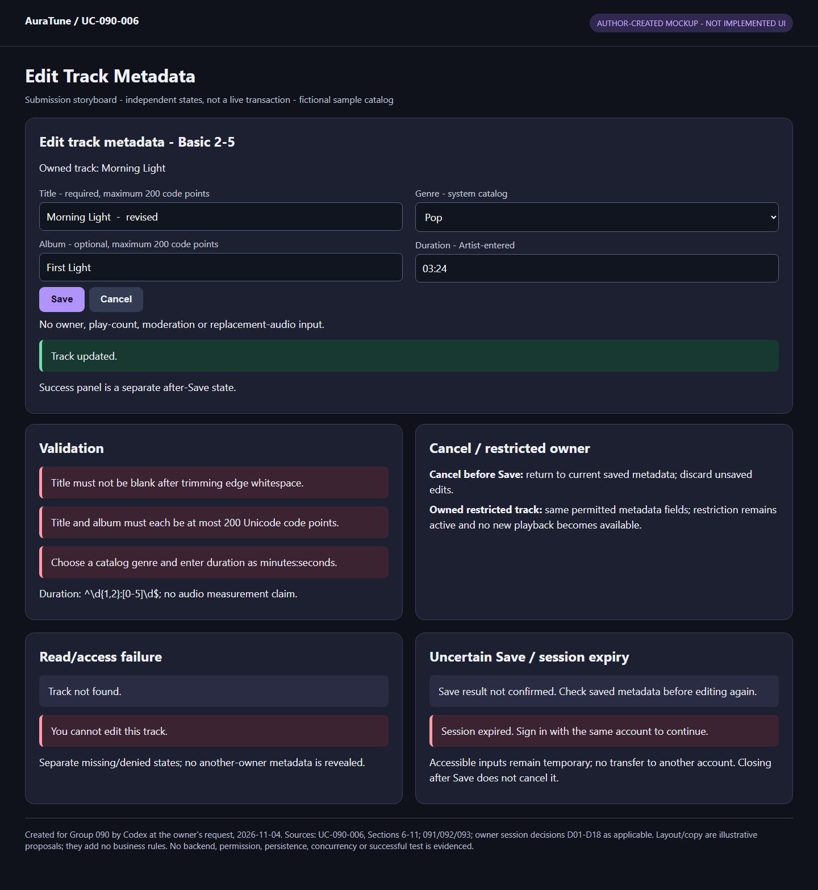
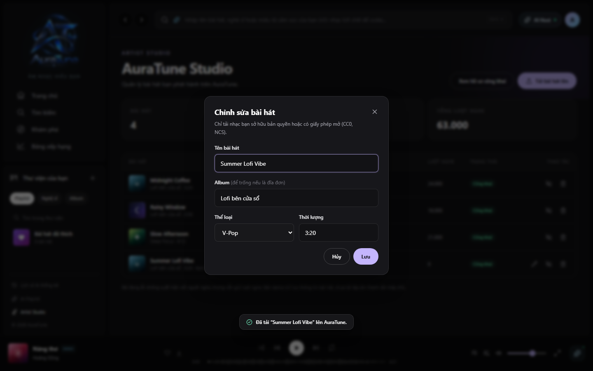

# UC-090-006 – Edit Track Metadata

## 1. Metadata

| Field | Value |
|---|---|
| Use Case ID | UC-090-006 |
| Use Case Name | Edit Track Metadata |
| Functional Group | 090 – Artist Profile & Studio |
| Primary Actor | Artist, acting on their own uploaded track |
| Supporting Actors | None identified for metadata editing |
| Related FR IDs | 093-FR-001, 093-FR-005, 093-FR-006, 093-FR-009 |
| Related Feature ID | 093 – Artist Track Management |
| Related Spec Kit File | [093 spec](../../../../specs/090-artist-profile-studio/093-artist-track-management/spec.md) |
| Writer | Thái Hoàng |
| Reviewer | Not assigned |
| Status | Draft |
| Last Updated | 2026-11-04 |

## 2. Goal

The Artist corrects the title, album, genre or duration of an existing track they uploaded and sees confirmation and the saved values in their Studio catalog.

## 3. Description

The system presents the current metadata in an edit dialog, accepts permitted changes and confirms a successful update. This goal does not upload a new track, replace published audio, change ownership or play counts, change visibility, moderate content or delete a track. Album editing here means the track's album metadata, not album creation, deletion, ordering or full membership management.

## 4. Preconditions

- The Artist starts from an existing Studio catalog entry, as described in UC-090-004. The ordinary successful path uses an existing track uploaded by that Artist.
- Authentication, Artist role, account eligibility, track existence and ownership are checked when protected data is read or changed. They are not assumed permanently valid merely because a row or dialog was previously displayed; rejected direct requests and changes in eligibility are covered below.
- 093-FR-006 and User Story 3 apply to owned uploaded tracks without a self-hidden exclusion. The same metadata flow applies to ordinary self-hidden tracks. G090-D05 permits the same four-field metadata-edit flow for an owned Admin-restricted track; no moderation override, public availability or new playback is granted.

## 5. Trigger

The Artist selects the pencil/edit action on an uploaded track in their Studio catalog (093 User Story 3, scenario 1).

## 6. Basic Flow

1. **Artist:** Selects the edit action for their existing uploaded track.
2. **System:** Checks access and ownership, obtains the current track metadata and opens a dialog populated with its title, album, genre and duration.
3. **Artist:** Changes one or more of those four fields and selects Save ("Lưu").
4. **System:** Checks current authentication, Artist permission, ownership and track existence before applying the request; validates title as non-empty after trimming leading/trailing whitespace, permits an omitted/cleared album, requires genre to belong to the system genre catalog (G090-D15), requires title and album each to contain at most 200 Unicode code points (G090-D16), and validates the submitted duration against `^\d{1,2}:[0-5]\d$` before saving, and updates the permitted metadata of that existing track when the submission is valid. This also applies to an Admin-restricted owned track under G090-D05, without clearing restriction, publishing it or permitting a new play start.
5. **System:** Displays an update-confirmation toast and reflects the saved metadata in the Studio table. The use case ends successfully.

G090-D04 confirms that step 4 validates Artist-entered duration syntax only; no audio measurement/comparison is required and no system-verified duration is claimed. G090-D15 settles title edge-whitespace trimming/non-empty validation, optional/clearable album and catalog-member genre. G090-D16 sets an inclusive 200-Unicode-code-point maximum for each title/album field; no additional normalization or default is selected.

## 7. Alternative Flows

### AF-01 – Invalid duration

- **Starting step:** Basic Flow step 4.
- **Condition:** The submitted duration does not match 093-FR-005.

1. **System:** Rejects the invalid submission under the duration rule and shared API validation conventions; it does not save that invalid submitted value or report update success.

- **Outcome:** The submission ends unsuccessfully. G090-D11 retains entered values while the form remains open and permits correction/manual retry. After the Artist corrects duration and selects Save, resume Basic Flow step 4; if they stop, end with no successful update. Exact error placement remains design work.

### AF-02 – Track no longer exists

- **Starting step:** Basic Flow step 2 or 4.
- **Condition:** The requested track cannot be found, including when it disappeared after the catalog or dialog was displayed.

1. **System:** Returns the existing API not-found outcome rather than presenting an editable record or reporting a successful update to the missing track.

- **Outcome:** The use case ends unsuccessfully. No message wording, redirect, restoration or deletion-cleanup behavior is specified here.

### AF-03 – Repeated or concurrent operation

- **Starting step:** Basic Flow step 2 or 4 before a change is accepted; also during EX-04 recovery.
- **Condition:** The same intended request is repeated, or valid operations affecting the track overlap.

1. **System:** Evaluates current access, ownership, restriction and existence. The last successfully processed applicable change determines saved state, not device click time; no request restores a deleted track or bypasses restriction. An unsuccessful request is not treated as a successful ordering event.
2. **System:** Reflects the confirmed current result rather than overwriting it with an older delayed response. Missing-target requests follow the existing not-found branch, without inventing a special transport response for duplicate deletion.

- **Outcome:** Ends with the confirmed saved result when known. If further authorized processing is needed, resume at Basic Flow step 4 for the intended save, or step 2 if the record must be read again; an uncertain result uses EX-04 first. No specific synchronization, versioning, schema or idempotency-key design is selected. Source: G090-D08.

### AF-04 – Cancel or close before Save submission

- **Starting step:** Basic Flow step 2 or 3, before the Artist submits Save.
- **Condition:** The Artist chooses Cancel or closes the edit form without submitting Save.

1. **Artist:** Cancels or closes the edit form before Save submission.
2. **System:** Dismisses the form and discards its unsaved metadata edits; this action sends no metadata update.
3. **Artist:** Later opens Edit for the track again, if they wish to continue.
4. **System:** Rechecks current access, ownership and track existence, and retrieves the current saved metadata instead of restoring the discarded edits. Current data may include other successfully processed changes.

- **Outcome:** If the Artist does not reopen, the interaction ends with pre-save cancellation. On successful reopening, resume at Basic Flow step 3 with the freshly loaded saved values. If the record is missing use AF-02; access failure uses the existing exception, and a load error uses EX-04. No previously submitted save is cancelled by this branch. Source: G090-D10.

G090-D11 applies to validation branches while the form remains open: preserve entered values and any selected audio still accessible, give corrective feedback and allow manual correction/retry. Existing checkbox, rights, format/size and duration validations remain enforced. An uncertain submitted result must be reconciled under G090-D08 before resubmission; keeping input is not proof of a saved or unchanged result. Explicit pre-submission upload Cancel and pre-Save edit Cancel retain their discard behavior.

### AF-05 – Close after Save submission

- **Starting step:** After Basic Flow step 3 submits Save, while step 4 or 5 is pending or the result has not been confirmed.
- **Condition:** The Artist closes or leaves the metadata form after submitting Save and before receiving a confirmed result.

1. **Artist:** Closes or leaves the submitted edit form.
2. **System:** Allows departure without cancelling the submitted Save request and without claiming saved, unchanged or failed state solely because the form closed.
3. **Artist:** Returns to the track's edit interaction.
4. **System:** Checks current access, ownership and track existence, reconciles the actual Save result under G090-D08/EX-04 and loads current saved metadata before allowing further edits or resubmission. Discarding a pre-save draft under G090-D10 does not undo a submitted request.

- **Outcome:** If reconciliation and loading succeed, resume at Basic Flow step 3 with current saved values. If still uncertain or a load fails, enter EX-04 without a definitive state claim; access/missing-target outcomes use their existing branches. No automatic replay or cancellation/rollback mechanism is added. Source: G090-D12.

### AF-06 – Invalid title, album length or genre

- **Starting step:** Basic Flow step 4, before applying the metadata update.
- **Condition:** Title is empty after trimming leading/trailing whitespace, title or album exceeds 200 Unicode code points, or genre is missing or not in the system genre catalog.

1. **System:** Rejects the invalid submission with appropriate corrective feedback instead of saving invalid metadata or reporting update success. While the form remains open, entered values remain available for correction under G090-D11.
2. **Artist:** Corrects the title/album length and/or selects a valid genre, then selects Save again if they wish to continue.

- **Outcome:** Resume at Basic Flow step 4 for current validation/access checks; if the Artist stops, end without a successful update from this rejected submission. Empty album is accepted and is not a missing-required-field error; a valid save may clear the existing album metadata. Duration validation remains AF-01 and all other existing rules remain in force. Source: G090-D15 and G090-D16.

## 8. Exception Flows

### EX-01 – Session expiry with account-bound recovery

- **Starting step:** Basic Flow step 2 or 4, any later protected request, or recovery while this upload/edit interaction is pending.
- **Condition:** Authenticated access expires or becomes invalid while the Artist is entering data or awaiting a submitted request's outcome.

1. **System:** Rejects unauthenticated protected requests and does not continue protected processing merely because the form was previously opened. It retains temporary entered data and an upload file only while still accessible within the working session; it does not promise recovery after that data/file becomes unavailable.
2. **Artist:** Uses the existing authentication flow to sign in again if they wish to continue.
3. **System:** If the same account signs in, rechecks current Artist permission, ownership, ban state and target validity as applicable. For an already-submitted request, first reconciles its actual outcome under G090-D08/EX-04; no automatic replay occurs. If a different account signs in, it does not expose or transfer the old draft, pending action or delayed result to that account.

- **Outcome:** For the same account with valid access and unsubmitted accessible input, resume the form interaction at Basic Flow step 3; inaccessible values/file must be supplied again before a new submission. For submitted work, use EX-04 before retry or a definitive claim. If recovery fails, access is denied, or a different account becomes current, the old interaction cannot continue as that account; no request is reassigned or assumed rolled back. Existing explicit Cancel/close rules remain separate. Source: owner-confirmed session decision G090-D13.

### EX-02 – Role or ownership denied

- **Starting step:** Basic Flow step 2 or 4.
- **Condition:** The requester lacks Artist permission or attempts to read/edit another artist's track.

1. **System:** Enforces Artist-only Studio access and server-side ownership rules; rejects the unauthorized read or change without disclosing another account's private track data.

- **Outcome:** The use case ends unsuccessfully. The rejected request does not perform a metadata update. Admin moderation privileges do not imply Artist Studio permission.

### EX-03 – Account banned

- **Starting step:** Basic Flow step 2 or 4.
- **Condition:** A successful administrative ban applies to the account, even if its token has not expired.

1. **System:** Rejects the protected request under 111-FR-011; an existing dialog or token does not authorize the edit.

- **Outcome:** The use case ends unsuccessfully without executing that rejected request. This UC does not define banning or unbanning.

Read/save errors and uncertain outcomes now follow G090-D08/EX-04. Pre-save Cancel/close now follows G090-D10/AF-04. G090-D11 settles retention after validation/operation error while the form stays open. G090-D12 permits closing after Save submission without cancellation, requiring reconciliation and current metadata loading on return. G090-D13 now settles account-bound temporary retention and same-account reauthentication; partial/stale presentation remains the separate open B-06 component.

### EX-04 – Error or uncertain result with manual recovery

- **Starting step:** Basic Flow step 2 or 4.
- **Condition:** Loading/processing fails, or no definitive response establishes the result of a submitted operation.

1. **System:** Shows understandable failure or uncertainty feedback, distinct from a valid empty collection/zero statistic. It offers manual retry and retains entered values while the form remains open under G090-D11, including an upload file still accessible. It does not claim success, unchanged data or deletion solely from a missing response.
2. **Artist:** Requests manual retry/recovery if they wish to continue.
3. **System:** Checks current authentication, role, ownership, restriction and target existence as applicable. For an unanswered operation, it first reconciles the actual saved result; it does not blindly resubmit. If the intended result is already confirmed, it presents that result without executing a duplicate change. Otherwise, an authorized retry may proceed under current rules.

- **Outcome:** On a successful read, present the confirmed current result. If further processing is needed, resume at Basic Flow step 4 for the intended save, or step 2 if the record must be read again. If failure or uncertainty persists, return to EX-04 step 1; if the Artist stops, end without a definitive success claim. Access denial/missing-target outcomes use the existing branches. No old-account request is reassigned to a different account. No automatic retry, persistence atomicity or physical cleanup policy is chosen. Source: G090-D08.

## 9. Postconditions

### 9.1 Success Postconditions

- Edited title and album each satisfy the inclusive 200-Unicode-code-point maximum under G090-D16; exact-boundary acceptance does not bypass title, genre or duration validation.

- Edited title satisfies non-empty validation after leading/trailing whitespace trimming; genre belongs to the system catalog; album may be empty/cleared under G090-D15. Existing exact duration validation remains unchanged.

- Under G090-D05, a restricted track stays non-public and cannot start new playback after permitted metadata/preference changes. Delete does not create a restore path. A later valid Admin unrestrict permits public availability only if the Artist preference is public and the track has not been deleted; viewing itself changes no state.

- The existing owned track's permitted metadata has been updated, an update toast is displayed and its Studio table entry reflects the saved values (093 User Story 3, scenario 2; FR-006/009).
- This goal does not request an audio replacement, ownership transfer, play-count change, visibility toggle or moderation-state change. It makes no claim about independent concurrent actions.

### 9.2 Failure Postconditions

- Invalid title/genre is rejected before applying the update; appropriate feedback and open-form retention support correction under G090-D15/AF-06 and G090-D11. The 200-code-point maximum is enforced under G090-D16; values of exactly 200 code points pass the length check subject to all other validation.

- G090-D13 permits temporary input retention only while accessible in the working session; resumption requires the same account and current authorization. A new account never receives the former account's draft/pending action/result. Submitted work is reconciled before retry and is not presumed cancelled by expiry.

- **Post-Save departure:** Closing after Save submission does not cancel the request or establish its outcome. G090-D12/AF-05 requires reconciliation and current saved metadata loading before further editing or resubmission.

- While the form remains open after validation/operation error, entered data is retained for correction/manual retry under G090-D11. Upload file selection is retained only while accessible; this is not a durable-storage guarantee. Reconcile uncertain results before resubmission; explicit Cancel/close rules remain separate.

- **Pre-save cancellation:** Unsaved edits are discarded without sending a metadata update; reopening loads current saved values under G090-D10/AF-04. This does not assert that another actor or an already-submitted request left the record unchanged.

- G090-D08 requires explicit error/uncertainty feedback and manual recovery; unresolved results do not become definitive saved/unchanged/deleted claims. All ownership/restriction/deleted-state boundaries remain enforced.

- A request rejected for invalid duration, missing authentication, insufficient permission, ownership or a ban is not executed as a successful metadata update; a missing record is not recreated by this UC.
- No success is established by an unanswered request. For read/save failures or loss of response, the sources do not establish a final saved state, atomicity, cleanup or recovery policy; this Draft does not promise that data was saved or remained unchanged.

## 10. Special Requirements

- **Security:** Enforce authentication, Artist role and ownership on protected reads and writes at the server, following shared security rules; 111-FR-011 applies after a ban. Do not rely solely on visible controls.
- **Performance:** 093-SC-002 requires metadata edits to reflect in the catalog/store within 500 ms of submission. Measurement conditions and failure handling need technical definition; no measured compliance is claimed.
- **Usability and Accessibility:** Present the pre-populated edit dialog and successful-update toast defined by 093 User Story 3 and FR-009. Vision Section 6.3 provides responsive, keyboard/touch usability context; no new focus, modal-dismissal or error-placement behavior is inferred.
- **Privacy:** Do not disclose another account's private data or private administrative information. 112-FR-024 permits eligible owners to view their own restricted metadata/reason and G090-D05 separately confirms permitted metadata editing without lifting restriction.
- **Other:** Exact duration input validation follows FR-005. G090-D04 confirms manual input/edit within current scope; no measurement from audio or comparison to actual length is required, and metadata editing does not establish system-verified duration.

## 11. Business Rules

| Rule ID | Rule Description | Source |
|---|---|---|
| BR-01 | Only an eligible authenticated Artist edits their own uploaded track. Admin access to administrative song operations does not grant Studio access. | 093-FR-001/006; shared ownership rules |
| BR-02 | The editable fields in this goal are title, album, genre and duration. Owner/uploader, play count, moderation status and audio replacement are outside this edit contract. | 093-FR-006; User Story 3 |
| BR-03 | Duration input matches `^\d{1,2}:[0-5]\d$`: one or two minute digits, a colon and two second digits from 00 to 59. G090-D04 confirms manual entry/edit with no required audio measurement or length comparison; duration is not system-verified. | 093-FR-005; clarification dated 2026-10-31; owner scope confirmation G090-D04, 2026-11-04 |
| BR-04 | Successful editing produces an update toast and updated table values. | 093-FR-009; User Story 3, scenario 2 |
| BR-05 | Editing album metadata does not establish a complete album-management goal. | 093-FR-006; Vision G09 scope discrepancy |
| BR-06 | Owner viewing of restricted content does not authorize self-unrestriction or republishing to bypass moderation. G090-D05 separately permits Artist-owner metadata editing while restriction remains active. | 112-FR-008/024/025 |
| BR-07 | Owner-confirmed session decision G090-D05 (2026-11-04): an eligible Artist-owner may edit the already-permitted metadata, delete through the existing confirmation/cancel flow, and change only their self-hide preference while Admin restriction remains active. None of these actions clears that restriction, publishes the track or permits a new play start. After Admin lifts restriction, public availability requires Artist-public preference and a non-deleted track. Unhide/unrestrict cannot restore a deleted track. | Owner-confirmed session decision G090-D05, 2026-11-04; not group approval |
| BR-08 | Owner-confirmed session decision G090-D08 (2026-11-04), option A: distinguish Studio errors from valid empty/zero results and offer manual retry. An unanswered submitted operation remains explicitly uncertain; reconcile its actual result before a definitive state claim or resubmission. Retrying the same upload submission must not create another track. Concurrent valid operations take effect in successful processing order, with the last successful applicable change prevailing, subject to current ownership, Admin restriction and deletion rules; deleted content cannot be resurrected. No automatic resubmission, schema/API, transaction or deduplication mechanism is selected. | Owner-confirmed session decision G090-D08; not an original 093 requirement or group approval |
| BR-09 | Owner-confirmed session decision G090-D10 (2026-11-04), option A: before submitting Save, Cancel/close discards the unsaved metadata edits. Reopening the edit form retrieves the current saved metadata rather than restoring those discarded edits. This pre-save cancellation sends no metadata update and makes no claim about independent concurrent changes. It does not decide cancellation after Save submission, validation/error/session input retention, schema or storage mechanisms. | Owner-confirmed session decision G090-D10; newly confirmed in this conversation, not an original source requirement or group approval |
| BR-10 | Owner-confirmed session decision G090-D11 (2026-11-04), option A: while an upload/edit form remains open, retain entered data after validation or operation errors so the Artist can correct it or retry manually. Retain the selected audio file if it remains accessible; do not promise durable file access after it is lost. A lost response still requires actual-outcome reconciliation before resubmission under G090-D08. This does not override explicit Cancel/close discard decisions or decide session recovery, post-Save departure, schema or storage mechanisms. | Owner-confirmed session decision G090-D11; not an original source requirement or group approval |
| BR-11 | Owner-confirmed session decision G090-D12 (2026-11-04), option A: after the Artist submits Save metadata and before the result is confirmed, closing/leaving the form is allowed and does not cancel that Save request. On returning, reconcile the actual result and load current saved metadata before further editing or resubmission. An unanswered request is not assumed saved, failed or unchanged. No automatic replay, rollback, schema/API or technical request-tracking mechanism is selected. | Owner-confirmed session decision G090-D12; newly confirmed in this conversation, not an original source requirement or group approval |
| BR-12 | Owner-confirmed session decision G090-D13 (2026-11-04), option A: on session expiry during upload/edit, retain temporary entered data within the working session only while it remains accessible. Continue only after the same account signs in again and current authorization is rechecked. Reconcile any already-submitted request before retry; expiry does not prove failure or cancellation. A different account must not receive the former account's draft, pending action or delayed result. No durable draft/file retention, automatic replay, authentication mechanism or schema/API is selected. | Owner-confirmed session decision G090-D13; newly confirmed in this conversation, not an original source requirement or group approval |
| BR-13 | Owner-confirmed session decision G090-D15 (2026-11-04), option A for metadata editing: title must be non-empty after trimming leading/trailing whitespace; album is optional and may be cleared; genre must be a member of the system genre catalog; duration keeps the already-confirmed exact regex. No maximum title/album length is selected. This does not introduce album management, a genre default, further normalization, schema/API or an audio-duration measurement requirement. | Owner-confirmed session decision G090-D15; newly confirmed here, not original source requirement or group approval |
| BR-14 | Owner-confirmed session decision G090-D16 (2026-11-04), option A for metadata editing: title and album each have a maximum of 200 Unicode code points, inclusive. Count code points, not bytes or UTF-16 code units; do not claim a grapheme-cluster limit. Existing title non-empty/edge-whitespace, optional-clearable album, catalog-genre and exact duration validations remain unchanged. This decision does not automatically extend the new maximum to upload or select schema/API/storage. Invalid lengths are rejected before update with corrective feedback and open-form retention under G090-D11. | Owner-confirmed session decision G090-D16; newly confirmed in this conversation, not original source requirement or group approval |

## 12. Prototype and Screenshots

### 12.0 Current Submission Evidence

**Type/provenance:** Author-created HTML/CSS mockup storyboard, generated by Codex at the owner's request on 2026-11-04; fictional catalog data. [Editable HTML](./prototypes/UC-090-006-basic-flow-and-key-states.html). Sources: this UC's current flows/rules, relevant 091/092/093 requirements and confirmed D01-D18 decisions. Layout and sample feedback wording are illustrative, not additional approved requirements or implemented UI.

**Illustration:** Basic Flow presentation and key UI states for AF-01, AF-02, AF-04, AF-05, AF-06, EX-01, EX-02, EX-04. Multiple panels are independent alternative states, not one live screen or executed sequence. This is **Partial** evidence: no backend, current permissions, storage, persistence, license validation, concurrency or passed test is established. Per-flow residual Missing/Partial states are recorded in the [prototype index](./prototypes/README.md).

**Shared access/recovery illustration:** [P-025 mockup](./prototypes/Group090-access-and-recovery-states.png) illustrates applicable EX-01, EX-02, EX-03. These are independent UI states, not proof of enforcement or a complete recovery sequence.

**Later-result illustration:** [P-026 mockup](./prototypes/Group090-next-load-and-request-results.png) shows applicable AF-03 result snapshots; not a complete executed sequence or proof of runtime ordering.

**Historical reference review below:** Earlier source-image observations and missing-state statements describe the original assets only. They do not override the new storyboard or current index. No original source image was changed; new local mockups supersede incompatible old UI for submission illustration.

### 12.1 Basic Flow

**Covered steps:** Partial visual illustration of Basic Flow steps 2–3: the edit dialog shows populated title, album, genre and duration inputs and a Save button. Visible values include Summer Lofi Vibe, Lofi bên cửa sổ, V-Pop and 3:20. A static image cannot prove those values were loaded from the correct owned record.

**Prototype type:** Reference UI mockup, visually inspected; not a verified screenshot of a deployed system. Source: Feature 093 UI asset `03-edit-track.png`, referenced by the source spec's edit-track illustration.

The visible toast says the track was uploaded to AuraTune; it is an upload message, not evidence of the metadata-update toast required at step 5. The reused copyright notice also uses upload wording and does not establish an edit-time rights attestation. Save persistence and refreshed table values are not demonstrated. Cancel and close controls are visible, but do not demonstrate G090-D10 pre-save discard or reopening with current saved metadata.

G090-D11 retained-input/error/correction/retry states have no verified prototype evidence; static populated fields do not prove retention after failure.

G090-D13 temporary retention, same-account recovery, different-account isolation and submitted-outcome reconciliation have no verified prototype evidence.

### 12.2 Alternative and Exception Evidence

G090-D16 exact-200-code-point acceptance, over-limit title/album rejection and Unicode counting have no verified result evidence. Current static short strings do not establish boundary handling.

G090-D15/AF-06 title/genre rejection, title edge-whitespace validation and successful album clearing lack verified result evidence; prefilled inputs do not prove validation.

G090-D12/AF-05 post-Save closing, non-cancellation and reconciliation/current-value reload on return lack verified prototype evidence.

G090-D10/AF-04 is specified but lacks a cancel-result/reopen illustration; static controls do not establish discarded inputs or fresh retrieval.

No verified image demonstrates AF-01 duration rejection, AF-02 missing track or EX-01–03 authentication/permission/ban outcomes. Evidence is also missing for successful save, read/save failure, cancellation, hidden/restricted edit eligibility and an uncertain result. Prototype coverage remains incomplete; no image was created or copied.

## 13. Related Use Cases

- [UC-090-004 – Access Artist Studio Dashboard](./UC-090-004-access-artist-studio-dashboard.md): provides the own-track catalog and receives the updated table values; its statistics and catalog-loading goal are not repeated.
- [UC-090-005 – Upload Audio Track](./UC-090-005-upload-audio-track.md): creates a new audio track. Its upload validation-dialog behavior does not automatically apply to editing.
- UC-090-007 – Hide or Unhide Track: separate visibility goal; specification [Draft specification](./UC-090-007-hide-or-unhide-track.md).
- UC-090-008 – Delete Track from Studio: separate deletion goal; specification [Draft specification](./UC-090-008-delete-track-from-studio.md).
- Group 110 moderation: administrative restriction decisions remain outside this UC.

## 14. Traceability and Sources

Every FR below is a feature-qualified reference to the literal FR ID in the [current 093 spec](../../../../specs/090-artist-profile-studio/093-artist-track-management/spec.md). The four applicable IDs match the inventory; the other six are boundaries, not additional edit requirements.

| Source FR | Application to this UC | Coverage / Boundary |
|---|---|---|
| 093-FR-001 | Shared Artist access gate | Basic 2/4; EX-01/02; security |
| 093-FR-002 | Dashboard totals | UC-090-004; no new edit KPI or aggregation rule |
| 093-FR-003 | Catalog fields/actions | UC-090-004 context; not all displayed fields become editable |
| 093-FR-004 | New audio upload | UC-090-005; optional album on upload does not independently define edit clearing/requiredness |
| 093-FR-005 | Shared duration input validation | Basic 4; AF-01; BR-03 |
| 093-FR-006 | Edit title, album, genre, duration | Basic 1–5; BR-02; success postconditions; G090-D10/AF-04/BR-09 pre-save cancellation and reopening; G090-D15 Basic 4/AF-06/BR-13 title/genre validation and optional/clearable album; G090-D16 Basic 4/AF-06/BR-14 inclusive 200-code-point length validation; B-08 resolved |
| 093-FR-007 | Active/hidden toggle | UC-090-007; not performed by editing metadata |
| 093-FR-008 | Confirmed permanent deletion | UC-090-008; no deletion or unfounded edit confirmation |
| 093-FR-009 | Shared operation notifications | Update toast only at Basic 5; other operation toasts belong to their UCs |
| 093-FR-010 | Persist uploaded binary audio and playable URL | UC-090-005; no new upload or audio replacement in this goal |

| Source Type | ID / File | Relevant Section |
|---|---|---|
| Owner scope confirmation | G090-D04, confirmed by Thái Hoàng on 2026-11-04 | Owner scope confirmation G090-D04 (2026-11-04): the Artist enters duration at upload and may edit it in metadata. Validate exactly `^\d{1,2}:[0-5]\d$`. Within current scope, no measurement from audio or comparison against actual audio length is required; do not claim system-verified duration. This retains current scope rather than changing the source regex/editable-field requirements. |
| Owner session decision | G090-D05, confirmed by Thái Hoàng on 2026-11-04 | Owner-confirmed session decision G090-D05 (2026-11-04): an eligible Artist-owner may edit the already-permitted metadata, delete through the existing confirmation/cancel flow, and change only their self-hide preference while Admin restriction remains active. None of these actions clears that restriction, publishes the track or permits a new play start. After Admin lifts restriction, public availability requires Artist-public preference and a non-deleted track. Unhide/unrestrict cannot restore a deleted track. Newly confirmed in this conversation; source specs remain unchanged. |
| Owner session decision | G090-D08, confirmed by Thái Hoàng on 2026-11-04 | Owner-confirmed session decision G090-D08 (2026-11-04), option A: distinguish Studio errors from valid empty/zero results and offer manual retry. An unanswered submitted operation remains explicitly uncertain; reconcile its actual result before a definitive state claim or resubmission. Retrying the same upload submission must not create another track. Concurrent valid operations take effect in successful processing order, with the last successful applicable change prevailing, subject to current ownership, Admin restriction and deletion rules; deleted content cannot be resurrected. No automatic resubmission, schema/API, transaction or deduplication mechanism is selected. Remaining cancel/input-retention/partial-presentation details are B-06; mechanics are C-02. |
| Owner session decision | G090-D10, confirmed by Thái Hoàng on 2026-11-04 | Owner-confirmed session decision G090-D10 (2026-11-04), option A: before submitting Save, Cancel/close discards the unsaved metadata edits. Reopening the edit form retrieves the current saved metadata rather than restoring those discarded edits. This pre-save cancellation sends no metadata update and makes no claim about independent concurrent changes. It does not decide cancellation after Save submission, validation/error/session input retention, schema or storage mechanisms. AF-04, cancellation postconditions and BR-09. |
| Owner session decision | G090-D11, confirmed by Thái Hoàng on 2026-11-04 | Owner-confirmed session decision G090-D11 (2026-11-04), option A: while an upload/edit form remains open, retain entered data after validation or operation errors so the Artist can correct it or retry manually. Retain the selected audio file if it remains accessible; do not promise durable file access after it is lost. A lost response still requires actual-outcome reconciliation before resubmission under G090-D08. This does not override explicit Cancel/close discard decisions or decide session recovery, post-Save departure, schema or storage mechanisms. Applies to validation branches, manual recovery and failure postconditions; UI evidence remains missing. |
| Owner session decision | G090-D12, confirmed by Thái Hoàng on 2026-11-04 | Owner-confirmed session decision G090-D12 (2026-11-04), option A: after the Artist submits Save metadata and before the result is confirmed, closing/leaving the form is allowed and does not cancel that Save request. On returning, reconcile the actual result and load current saved metadata before further editing or resubmission. An unanswered request is not assumed saved, failed or unchanged. No automatic replay, rollback, schema/API or technical request-tracking mechanism is selected. AF-05, departure postconditions and BR-11. |
| Owner session decision | G090-D13, confirmed by Thái Hoàng on 2026-11-04 | Owner-confirmed session decision G090-D13 (2026-11-04), option A: on session expiry during upload/edit, retain temporary entered data within the working session only while it remains accessible. Continue only after the same account signs in again and current authorization is rechecked. Reconcile any already-submitted request before retry; expiry does not prove failure or cancellation. A different account must not receive the former account's draft, pending action or delayed result. No durable draft/file retention, automatic replay, authentication mechanism or schema/API is selected. EX-01, failure postconditions and business rule; recovery UI evidence remains missing. |
| Owner session decision | G090-D15, confirmed by Thái Hoàng on 2026-11-04 | Owner-confirmed session decision G090-D15 (2026-11-04), option A for metadata editing: title must be non-empty after trimming leading/trailing whitespace; album is optional and may be cleared; genre must be a member of the system genre catalog; duration keeps the already-confirmed exact regex. No maximum title/album length is selected. This does not introduce album management, a genre default, further normalization, schema/API or an audio-duration measurement requirement. Basic 4, AF-06, BR-13 and postconditions; maximum lengths remain B-08. |
| Owner session decision | G090-D16, confirmed by Thái Hoàng on 2026-11-04 | Owner-confirmed session decision G090-D16 (2026-11-04), option A for metadata editing: title and album each have a maximum of 200 Unicode code points, inclusive. Count code points, not bytes or UTF-16 code units; do not claim a grapheme-cluster limit. Existing title non-empty/edge-whitespace, optional-clearable album, catalog-genre and exact duration validations remain unchanged. This decision does not automatically extend the new maximum to upload or select schema/API/storage. Basic 4, AF-06, BR-14 and postconditions; B-08 resolved. |
| Spec Kit Specification | [Feature 093](../../../../specs/090-artist-profile-studio/093-artist-track-management/spec.md) | Full spec; User Stories 2/3/6, FR-001/005/006/009, SC-002, clarifications and assumptions |
| Cross-group constraints | [Feature 111](../../../../specs/110-admin-functions/111-user-management/spec.md) | FR-011: ban enforcement on subsequent protected requests |
| Cross-group constraints | [Feature 112](../../../../specs/110-admin-functions/112-content-moderation/spec.md) | FR-006/008/024/025: publication, Admin limits, owner viewing and moderation boundary |
| API contract | [API Contract](../../../analysis-and-design/api-contract.md) | Song operations; shared validation, authentication, permission and not-found conventions; Artist ownership scope |
| API conventions | [API conventions](../../../design/api/api-conventions.md) | Protected requests, authorization and errors; no new endpoint/schema/status introduced |
| Security | [Security principles](../../../design/security/README.md); [data security rules](../../../design/database/security-rules.md) | Authentication, least privilege and server-side ownership checks |
| Vision Document | [Vision](../../../proposal/Auratune_Vision_Document.md) | G09 artist editing/album scope; G11 moderation; Sections 6.2/6.3 |
| Group allocation | [Inventory](./use-case-inventory.md#4-coverage-check) | Current qualified FR allocation and unresolved model/UI drift |
| Related Use Case | [UC-090-004](./UC-090-004-access-artist-studio-dashboard.md); [UC-090-005](./UC-090-005-upload-audio-track.md) | Catalog context and upload boundary; D06/D08-D14 settle statistics/recovery; source-alignment, technical and evidence follow-ups remain |

Source alignment: FR-006 and User Story 3 both explicitly include duration among editable fields; FR-005 gives the precise input pattern. User Story 2's shorthand `m:ss` is upload wording and does not override that pattern or prove audio-derived duration. Its invalid-input scenario retaining the upload modal is not an edit scenario. Feature 112 FR-008 restricts what an Admin may edit during moderation; it does not grant Admin Studio access. Artist-owner restricted metadata editing is now confirmed separately by G090-D05. These distinctions avoid inventing a resolution where a policy is absent.

## 15. Open Questions

| Question ID | Question | Owner | Status | Resolution |
|---|---|---|---|---|
| Q-01 | Business: editing an Admin-restricted track beyond the explicit owner-view permission. | Thái Hoàng / group | Resolved | Owner-confirmed session decision G090-D05 (2026-11-04): an eligible Artist-owner may edit the already-permitted metadata, delete through the existing confirmation/cancel flow, and change only their self-hide preference while Admin restriction remains active. None of these actions clears that restriction, publishes the track or permits a new play start. After Admin lifts restriction, public availability requires Artist-public preference and a non-deleted track. Unhide/unrestrict cannot restore a deleted track. [B-07](./README.md#shared-open-issues) resolved; other source-alignment, technical and evidence follow-ups remain separately tracked. |
| Q-02 | Business: remaining maximum title/album lengths for editing. | Thái Hoàng / group | Resolved | G090-D15 settles title requiredness/edge trim, clearable optional album and catalog genre; G090-D16 confirms title and album each <= 200 Unicode code points, inclusive, for editing. G090-D04 duration regex unchanged. [B-08](./README.md#shared-open-issues) resolved; no upload expansion, schema/API or implementation/prototype approval. |
| Q-03 | Business: whether to add audio-derived duration verification to metadata editing. | Thái Hoàng / group | Resolved | Owner scope confirmation G090-D04 (2026-11-04): the Artist enters duration at upload and may edit it in metadata. Validate exactly `^\d{1,2}:[0-5]\d$`. Within current scope, no measurement from audio or comparison against actual audio length is required; do not claim system-verified duration. [B-05](./README.md#shared-open-issues) closed as confirmation of existing scope; other validation remains unchanged. |
| Q-04 | Business/UX: remaining partial/stale-data presentation. | Thái Hoàng / group | Resolved | G090-D08-D13 settle the selected recovery/cancel/retention/session rules; G090-D14 settles the remaining partial/stale Studio presentation: preserve successful portions, per-failed-portion error/manual retry, earlier data explicitly not updated and never substituted for current/zero values. [B-06](./README.md#shared-open-issues) resolved. Technical implementation and missing prototype evidence remain separate. |
| Q-05 | Business: reconcile an unanswered submitted save before a definitive result. | Thái Hoàng / group | Resolved | Owner-confirmed session decision G090-D08 (2026-11-04), option A: distinguish Studio errors from valid empty/zero results and offer manual retry. An unanswered submitted operation remains explicitly uncertain; reconcile its actual result before a definitive state claim or resubmission. Retrying the same upload submission must not create another track. Concurrent valid operations take effect in successful processing order, with the last successful applicable change prevailing, subject to current ownership, Admin restriction and deletion rules; deleted content cannot be resurrected. No automatic resubmission, schema/API, transaction or deduplication mechanism is selected. B-09 is resolved; B-06 is resolved by D08-D14; technical/evidence work remains open. |
| Q-06 | Technical Follow-up: contracts, presentation and 500 ms measurement; business concurrency tracked separately. | Thái Hoàng / technical team | Open | [Group issue C-02](./README.md#shared-open-issues); concurrent-edit outcomes are [Group issue B-09](./README.md#shared-open-issues) |
| Q-07 | Evidence: provide correct edit-success toast/table, validation, access/ownership, restricted/hidden and failure/recovery illustrations; correct reused upload wording in a separately authorized pass. | Thái Hoàng | Open | Current P-022/P-025/P-026 illustrate edit-success, validation and key access/recovery/result states; complete sequence/runtime evidence remains incomplete |

The group README distinguishes the remaining business issues from technical/model and evidence follow-ups. No peer review or approval has occurred.
