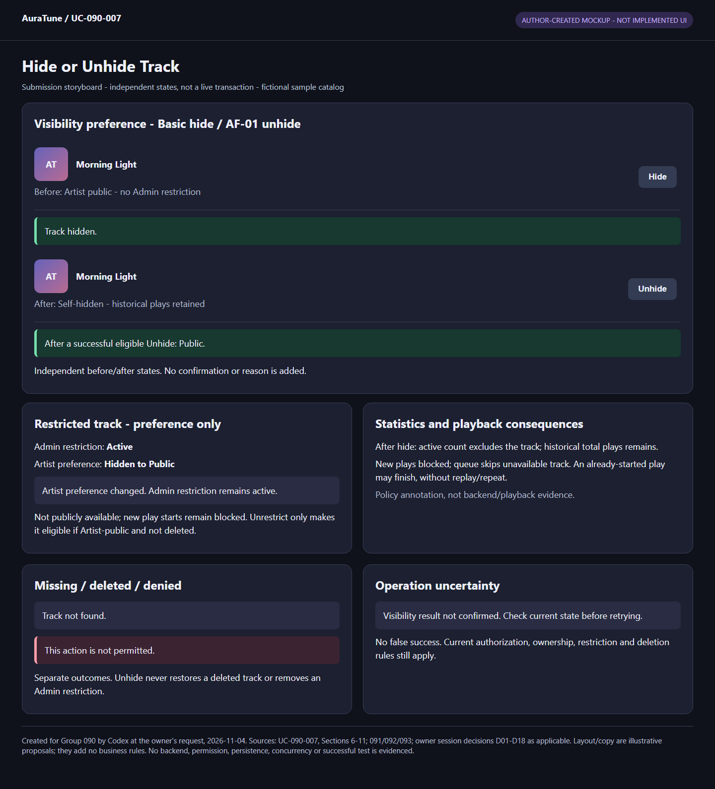
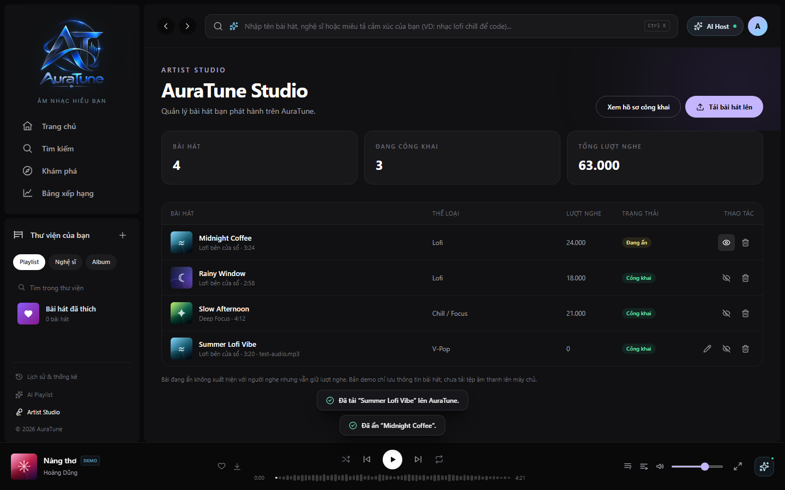

# UC-090-007 – Hide or Unhide Track

## 1. Metadata

| Field | Value |
|---|---|
| Use Case ID | UC-090-007 |
| Use Case Name | Hide or Unhide Track |
| Functional Group | 090 – Artist Profile & Studio |
| Primary Actor | Artist, acting on their own track |
| Supporting Actors | None identified |
| Related FR IDs | 093-FR-001, 093-FR-007, 093-FR-009 |
| Related Feature ID | 093 – Artist Track Management |
| Related Spec Kit File | [093 spec](../../../../specs/090-artist-profile-studio/093-artist-track-management/spec.md) |
| Writer | Thái Hoàng |
| Reviewer | Not assigned |
| Status | Draft |
| Last Updated | 2026-11-04 |

## 2. Goal

The Artist temporarily hides their own track or makes a self-hidden track public again when it is eligible, without deleting its playback history.

## 3. Description

Hide and unhide are opposite directions of one visibility-management goal. Artist-selected visibility and Admin restriction are distinct: removing an Artist self-hide does not clear an Admin restriction or restore a deleted song. The ordinary unhide success path applies to an existing self-hidden track with no remaining restriction preventing publication.

This UC does not upload or replace audio, edit metadata, delete tracks, manage albums or perform administrative moderation. Public discovery and playback enforce their own eligibility rules; this UC documents the visibility consequences supported by the cited sources.

## 4. Preconditions

- Normal entry is the Artist's own Studio catalog from UC-090-004. A displayed entry is not proof that authentication, ownership or track existence remains valid at submission time.
- The Basic Flow's ordinary hide branch uses an existing Artist-active track without an active Admin restriction. AF-01 handles eligible public unhide; AF-04 branches at Basic step 2 for either self-hide preference direction while Admin restriction remains active.
- Protected requests must be checked against current access and ownership. Missing/expired access, banned accounts, unauthorized direct requests and disappeared records are rejected as described below; these checks are not assumed to have passed permanently at entry.
- Unhide is not a restore workflow for a deleted song. Restricted-song owner viewing under 112 does not imply permission to self-unrestrict.

## 5. Trigger

The Artist chooses the hide or unhide visibility action for a track in their own Studio catalog.

## 6. Basic Flow

1. **Artist:** Chooses the visibility action on their own track: Hide (EyeOff) for an active track, or Unhide (Eye) for a self-hidden track.
2. **System:** Checks current authentication, Artist permission, ownership, track existence and applicable visibility/moderation constraints. For an allowed preference change on a restricted owned track, use AF-04 before either ordinary transition. For an eligible self-hidden track without active restriction, continue with AF-01; the remaining Basic Flow applies to the hide direction.
3. **System:** Changes the Artist-active track to hidden ("Đang ẩn"). The track is excluded from public listener searches/catalog queries and is ineligible for public artist-profile sections; playback history and historical play counts remain preserved in Studio. G090-D06 excludes this hidden track from active count without subtracting its recorded historical plays. Under G090-D07, new starts via player, playlist, queue and direct URL are denied; the queue skips it. A playback started before this successful hide may finish, but no replay/repeat is allowed while unavailable.
4. **System:** Updates the row's status badge to amber "Đang ẩn" and displays the hide toast `Đã ẩn “<Tiêu đề>”.` The use case ends successfully.

The public-profile consequence follows 091-FR-007/008, including omission without revealing hidden items through counts or placeholders. This flow does not add an Artist confirmation or reason prompt. Concurrency follows owner decision G090-D08; Artist-action playback consequences follow G090-D07.

## 7. Alternative Flows

### AF-01 – Unhide an eligible self-hidden track

- **Starting step:** Basic Flow step 2, before the hide-specific transition at step 3.
- **Condition:** The Artist selected Unhide at step 1; the owned track exists, is self-hidden, and no active Admin restriction or other applicable publication restriction prevents public availability.

1. **System:** Changes the Artist-selected visibility from hidden to active ("Công khai"). This changes the existing track rather than uploading or restoring a deleted track.
2. **System:** Updates the status badge to green and displays the toast `“<Tiêu đề>” đã công khai trở lại.`
3. **System:** Treats the track as eligible for public availability and new playback only when Artist preference is public, no Admin restriction remains and it is not deleted (G090-D07), subject to the existing public display/playback rules. It is not guaranteed placement in a limited or ranked profile section merely because it became eligible.

- **Outcome:** The use case ends successfully with the track Artist-public and eligible under the applicable restrictions. Playback history is not deleted by the visibility toggle (093 User Story 4).

### AF-02 – Attempt to bypass Admin restriction

- **Starting step:** Basic Flow step 2, including evaluation of AF-01 eligibility.
- **Condition:** The track has an active Admin restriction and the requested action would self-unrestrict or republish it to bypass that decision.

1. **System:** Rejects the bypass under 112-FR-025; the Admin restriction remains in effect and the song does not become public or available for a new play attempt.
2. **System:** Limits any eligible owner's Studio viewing to the metadata, restriction state and reason permitted by 112-FR-024, without private Admin information. This does not add a new viewing flow to the dashboard UC.

- **Outcome:** The forbidden bypass attempt ends unsuccessfully. This does not reject an allowed self-hide preference-only change; that distinct request follows AF-04 under G090-D05. Neither path clears Admin restriction.

### AF-03 – Missing or deleted track

- **Starting step:** Basic Flow step 2, before either direction is applied.
- **Condition:** The target no longer exists or the request would restore a track already deleted from distribution.

1. **System:** Does not perform a visibility transition that restores deleted content. A missing record uses the shared API not-found outcome.

- **Outcome:** The use case ends unsuccessfully. The exact response for a retained deleted/removed record requires source alignment; no deleted-song restoration or physical cleanup mechanism is defined here.

### AF-04 – Change Artist preference while Admin restriction remains active

- **Starting step:** Basic Flow step 2, before the ordinary hide or unhide transition.
- **Condition:** An eligible Artist-owner requests Hide or Unhide as a change to their own preference for an existing, non-deleted Admin-restricted track.

1. **System:** Applies only the selected Artist preference: Hide selects self-hidden; Unhide selects Artist-public. The Admin restriction remains effective.
2. **System:** Reflects the preference change while keeping effective availability restricted; G090-D06 excludes it from active count and retains historical plays regardless of its current preference; the operation toast required by 093-FR-009 must not claim that a still-restricted song became publicly available. No exact new toast wording, badge layout or schema is selected here.

- **Outcome:** The preference-change goal ends successfully, but the track is still non-public and cannot start new playback. After a valid Admin unrestrict, it may become public only if Artist preference is public and the track has not been deleted. No unhide/unrestrict restores deleted content. Source: owner-confirmed session decision G090-D05, 2026-11-04.

### AF-05 – Repeated or concurrent operation

- **Starting step:** Basic Flow step 2 or AF-01/AF-04 processing before a change is accepted; also during EX-04 recovery.
- **Condition:** The same intended request is repeated, or valid operations affecting the track overlap.

1. **System:** Evaluates current access, ownership, restriction and existence. The last successfully processed applicable change determines saved state, not device click time; no request restores a deleted track or bypasses restriction. An unsuccessful request is not treated as a successful ordering event.
2. **System:** Reflects the confirmed current result rather than overwriting it with an older delayed response. Missing-target requests follow the existing not-found branch, without inventing a special transport response for duplicate deletion.

- **Outcome:** Ends with the confirmed saved result when known. If further authorized processing is needed, resume at Basic Flow step 2, then the applicable hide/unhide/preference direction; an uncertain result uses EX-04 first. No specific synchronization, versioning, schema or idempotency-key design is selected. Source: G090-D08.

## 8. Exception Flows

### EX-01 – Missing or expired authentication

- **Starting step:** Basic Flow step 2.
- **Condition:** The visibility request has no valid authenticated session, including expiry after the catalog was displayed.

1. **System:** Rejects the protected request under shared authentication rules. At Studio entry, 093 User Story 6 specifies the login-required prompt for an Artist account.

- **Outcome:** The request ends unsuccessfully without executing the rejected visibility change. Original 093 does not define its mechanism; current manual recovery follows D08/EX-04 without automatic replay.

### EX-02 – Artist permission or ownership denied

- **Starting step:** Basic Flow step 2.
- **Condition:** The requester lacks Artist permission or requests an action on another account's track.

1. **System:** Denies the request using server-side role and ownership checks, without exposing another account's non-public data. Studio entry for a regular User uses 093's forbidden notice.

- **Outcome:** The request ends unsuccessfully without executing the rejected visibility change. Admin moderation rights do not grant Artist Studio rights.

### EX-03 – Banned account

- **Starting step:** Basic Flow step 2.
- **Condition:** A successful account ban applies, even if the previously issued token has not expired.

1. **System:** Rejects the protected request as required by 111-FR-011.

- **Outcome:** The request ends unsuccessfully without executing the rejected change. Ban/unban management remains outside this UC.

Operation errors, uncertainty and manual retry now follow G090-D08/EX-04. The Artist concurrency rule is independently owner-confirmed, not inferred from Admin-only 112 rules.

### EX-04 – Error or uncertain result with manual recovery

- **Starting step:** Basic Flow step 2 or AF-01/AF-04 processing.
- **Condition:** Loading/processing fails, or no definitive response establishes the result of a submitted operation.

1. **System:** Shows understandable failure or uncertainty feedback, distinct from a valid empty collection/zero statistic. It offers manual retry and does not claim success, unchanged data or deletion solely from a missing response.
2. **Artist:** Requests manual retry/recovery if they wish to continue.
3. **System:** Checks current authentication, role, ownership, restriction and target existence as applicable. For an unanswered operation, it first reconciles the actual saved result; it does not blindly resubmit. If the intended result is already confirmed, it presents that result without executing a duplicate change. Otherwise, an authorized retry may proceed under current rules.

- **Outcome:** On a successful read, present the confirmed current result. If further processing is needed, resume at Basic Flow step 2, then the applicable hide/unhide/preference direction. If failure or uncertainty persists, return to EX-04 step 1; if the Artist stops, end without a definitive success claim. Access denial/missing-target outcomes use the existing branches. No old-account request is reassigned to a different account. No automatic retry, persistence atomicity or physical cleanup policy is chosen. Source: G090-D08.

## 9. Postconditions

### 9.1 Success Postconditions

- G090-D07 blocks new play starts via player/playlist/queue/direct URL after successful hide/delete, skips unavailable queue items and permits only playback already started before success to finish. No replay/repeat while unavailable; hidden-track eligibility requires Artist-public, no Admin restriction and no deletion. No deleted-track restore is introduced.

- Studio statistics follow G090-D06: only non-deleted, unrestricted Artist-public tracks count as active; hide/restrict/delete do not themselves reduce validly recorded historical total plays. Missing statistical data is not reported as 0. No storage/cleanup or platform-wide statistics policy is implied.

- Under G090-D05, a restricted track stays non-public and cannot start new playback after permitted metadata/preference changes. Delete does not create a restore path. A later valid Admin unrestrict permits public availability only if the Artist preference is public and the track has not been deleted; viewing itself changes no state.

- Hide: the existing track is Artist-hidden, its badge and hide toast reflect success, and it is excluded from public listener searches/catalog queries and public profile sections under their eligibility rules.
- Eligible unhide: the existing track becomes Artist-active, with the green badge and unhide toast; effective public availability still requires no Admin restriction and no deletion or other applicable visibility restriction.
- Playback history and historical play counts are retained in Studio through this temporary visibility goal. No broader preservation guarantee for unspecified data is added.

### 9.2 Failure Postconditions

- G090-D08 requires explicit error/uncertainty feedback and manual recovery; unresolved results do not become definitive saved/unchanged/deleted claims. All ownership/restriction/deleted-state boundaries remain enforced.

- A request rejected for authentication, role, ownership or ban is not executed as a successful visibility change. An Artist cannot clear an Admin restriction or restore a deleted song through this UC.
- For an operation error or unanswered request, no definitive saved state is promised without evidence. This Draft does not assert rollback, atomicity, unchanged data or successful publication when the result is unknown.

## 10. Special Requirements

- **Security:** Recheck authentication, role and ownership server-side. Enforce 111's ban and 112's prohibition on Artist moderation bypass.
- **Performance:** 093-SC-003 requires exclusion of hidden tracks from all public listener searches/catalog queries while retaining historical counts. The 500 ms target in SC-002 names upload and metadata editing, not visibility toggles; no toggle timing target is inferred.
- **Usability and Accessibility:** Use the direction-specific badge, action and toast defined in 093 User Story 4 for ordinary unrestricted transitions. AF-04 distinguishes Artist preference from effective restricted availability and must not reuse a public-success message to claim publication. No additional confirmation, reason, focus or automatic-refresh behavior is specified.
- **Privacy:** Apply 091-FR-007/008 to public profiles. Restricted-owner viewing must not expose private Admin information (112-FR-024).
- **Other:** For Admin-restricted/deleted content, 112-FR-021/022 blocks newly loaded discovery and new playback, treating existing playlist/queue entries as unavailable. FR-023 allows already-started playback to finish while blocking replay/repeat/new starts. Artist hide/delete now independently follows owner-confirmed G090-D07 rather than an inferred transfer of moderation policy; Q-02 is resolved. Streaming mechanics remain technical follow-up.

## 11. Business Rules

| Rule ID | Rule Description | Source |
|---|---|---|
| BR-01 | An eligible Artist manages visibility of their own tracks; protected actions require server-side authorization and ownership. | 093-FR-001/007; security rules |
| BR-02 | Artist hide/unhide toggles hidden/active with the direction-specific badge and toast. | 093-FR-007/009; User Story 4 |
| BR-03 | Hiding preserves playback history and historical play counts/statistics in Studio while excluding the track from public search/catalog. | 093 clarifications; User Story 4; SC-003 |
| BR-04 | Public profiles omit hidden/unauthorized content without revealing it through counts, labels, placeholders or error details. | 091-FR-007/008 |
| BR-05 | Public availability requires Artist-public visibility, no active Admin restriction and no deletion. Artist cannot self-unrestrict or republish to bypass Admin. | 112-FR-006/025 |
| BR-06 | Owner visibility of a restricted song is limited by current access and does not confer playback or moderation override. | 112-FR-024/025 |
| BR-07 | Owner-confirmed session decision G090-D05 (2026-11-04): an eligible Artist-owner may edit the already-permitted metadata, delete through the existing confirmation/cancel flow, and change only their self-hide preference while Admin restriction remains active. None of these actions clears that restriction, publishes the track or permits a new play start. After Admin lifts restriction, public availability requires Artist-public preference and a non-deleted track. Unhide/unrestrict cannot restore a deleted track. | Owner-confirmed session decision G090-D05, 2026-11-04; not group approval |
| BR-08 | Owner-confirmed session decision G090-D06 (2026-11-04), own-Artist Studio statistics: active count includes only Artist-public tracks without Admin restriction that are not deleted. Total plays retains all validly recorded historical plays, including tracks later hidden, restricted or deleted; those actions do not themselves subtract historical plays. An empty catalog has active count 0 but retains historical total plays, which is 0 only if there are no recorded plays. Unavailable data must be distinguishable from 0. | Owner-confirmed session decision G090-D06, 2026-11-04; not group approval or a source-spec edit |
| BR-09 | Owner-confirmed session decision G090-D07 (2026-11-04): after a successful Artist hide or delete, deny new play starts through player, playlist, queue or direct URL; queue skips unavailable tracks. Playback already started before success may finish, but replay/repeat is blocked while the track remains unavailable. A hidden track can start new playback again only when Artist preference is public, no Admin restriction remains and the track is not deleted. Unhide/unrestrict cannot restore a deleted track. No physical-file deletion, URL-revocation or streaming mechanism is selected. | Owner-confirmed session decision G090-D07, 2026-11-04; not source-spec edit or group approval |
| BR-10 | Owner-confirmed session decision G090-D08 (2026-11-04), option A: distinguish Studio errors from valid empty/zero results and offer manual retry. An unanswered submitted operation remains explicitly uncertain; reconcile its actual result before a definitive state claim or resubmission. Retrying the same upload submission must not create another track. Concurrent valid operations take effect in successful processing order, with the last successful applicable change prevailing, subject to current ownership, Admin restriction and deletion rules; deleted content cannot be resurrected. No automatic resubmission, schema/API, transaction or deduplication mechanism is selected. | Owner-confirmed session decision G090-D08; not an original 093 requirement or group approval |

## 12. Prototype and Screenshots

### 12.0 Current Submission Evidence

**Type/provenance:** Author-created HTML/CSS mockup storyboard, generated by Codex at the owner's request on 2026-11-04; fictional catalog data. [Editable HTML](./prototypes/UC-090-007-basic-flow-and-key-states.html). Sources: this UC's current flows/rules, relevant 091/092/093 requirements and confirmed D01-D18 decisions. Layout and sample feedback wording are illustrative, not additional approved requirements or implemented UI.

**Illustration:** Basic Flow presentation and key UI states for AF-01, AF-02, AF-03, AF-04, EX-02, EX-04. Multiple panels are independent alternative states, not one live screen or executed sequence. This is **Partial** evidence: no backend, current permissions, storage, persistence, license validation, concurrency or passed test is established. Per-flow residual Missing/Partial states are recorded in the [prototype index](./prototypes/README.md).

**Shared access/recovery illustration:** [P-025 mockup](./prototypes/Group090-access-and-recovery-states.png) illustrates applicable EX-01, EX-02, EX-03. These are independent UI states, not proof of enforcement or a complete recovery sequence.

**Later-result illustration:** [P-026 mockup](./prototypes/Group090-next-load-and-request-results.png) shows applicable AF-05 result snapshots; not a complete executed sequence or proof of runtime ordering.

**Historical reference review below:** Earlier source-image observations and missing-state statements describe the original assets only. They do not override the new storyboard or current index. No original source image was changed; new local mockups supersede incompatible old UI for submission illustration.

### 12.1 Basic Flow

**Covered steps:** Partial illustration of Basic Flow steps 3–4: Midnight Coffee has an amber "Đang ẩn" badge, a visible Eye action and a hide-confirmation toast. The row shows 24,000 plays; the dashboard shows four tracks, three public and 63,000 plays.

**Prototype type:** Reference UI mockup, visually inspected; not a verified screenshot of a deployed system. Source: Feature 093 UI asset `04-hide-track.png`, described by its spec as the hide action.

The image shows one post-hide state, not the actual transition or a before/after comparison proving retained history or correct totals. It does not prove ownership enforcement, public removal or playback behavior. A separate upload toast remains visible; the footer's metadata-only demo wording is stale against current 093-FR-010 and is not implementation evidence.

### 12.2 Alternative Flow – AF-01

The Eye action on the hidden row illustrates an unhide affordance only. No inspected asset demonstrates a completed unhide transition, its green badge/toast or effective public availability after moderation checks. AF-01 evidence is missing.

### 12.3 Other Alternative and Exception Evidence

AF-02/03/04 and EX-01–03 lack verified state illustrations, including a preference-only change that stays Admin-restricted. Public discovery, queue/new playback versus in-progress playback, operation failure/retry, uncertain outcomes and conflicting actions also lack evidence. Prototype coverage remains incomplete; no image was created or copied.

## 13. Related Use Cases

- [UC-090-004 – Access Artist Studio Dashboard](./UC-090-004-access-artist-studio-dashboard.md): catalog entry point; aggregate semantics are now confirmed by G090-D06; other unresolved questions remain open.
- [UC-090-005 – Upload Audio Track](./UC-090-005-upload-audio-track.md): creates a new track; unhide is not upload.
- [UC-090-006 – Edit Track Metadata](./UC-090-006-edit-track-metadata.md): edits permitted metadata, not visibility.
- [UC-090-001 – View Public Artist Profile](./UC-090-001-view-public-artist-profile.md): consumes eligible public content; no Studio action is added there.
- UC-090-008 – Delete Track from Studio: specification [Draft specification](./UC-090-008-delete-track-from-studio.md); deletion is a separate goal.
- Group 110 moderation owns Admin restriction/removal/restore; playback and queue features own playback execution.

## 14. Traceability and Sources

The three applicable 093 FRs match the [inventory allocation](./use-case-inventory.md#4-coverage-check). Feature-qualified IDs refer to literal IDs in their linked spec; cross-group constraints do not add to the group's count of 57 FRs.

| Source FR | Treatment | Flow / Boundary |
|---|---|---|
| 093-FR-001 | Shared role gate | Basic 2; EX-01/02 |
| 093-FR-002 | Dashboard statistics | UC-090-004 owns statistics; G090-D06/BR-08 specifies eligibility and historical-play retention without choosing implementation |
| 093-FR-003 | Catalog rows/actions | UC-090-004 context; visibility result uses the existing row |
| 093-FR-004 | Audio upload | UC-090-005; not an unhide step |
| 093-FR-005 | Duration validation | UC-090-005/006; no duration input here |
| 093-FR-006 | Metadata edit | UC-090-006; separate from status toggle |
| 093-FR-007 | Toggle Artist visibility | Basic 1–4; AF-01/04; constrained by AF-02/03; G090-D05 preference versus effective availability; G090-D07 new-start/queue/in-progress playback boundary |
| 093-FR-008 | Confirmed deletion | UC-090-008; no hide/unhide confirmation inferred |
| 093-FR-009 | Shared operation toast | Hide/unhide notifications only: Basic 4, AF-01 step 2 |
| 093-FR-010 | Persist audio on upload | UC-090-005; no upload/storage actor needed here |

| Source Type | ID / File | Relevant Section |
|---|---|---|
| Owner session decision | G090-D05, confirmed by Thái Hoàng on 2026-11-04 | Owner-confirmed session decision G090-D05 (2026-11-04): an eligible Artist-owner may edit the already-permitted metadata, delete through the existing confirmation/cancel flow, and change only their self-hide preference while Admin restriction remains active. None of these actions clears that restriction, publishes the track or permits a new play start. After Admin lifts restriction, public availability requires Artist-public preference and a non-deleted track. Unhide/unrestrict cannot restore a deleted track. Newly confirmed in this conversation; source specs remain unchanged. |
| Owner session decision | G090-D06, confirmed by Thái Hoàng on 2026-11-04 | Owner-confirmed session decision G090-D06 (2026-11-04), own-Artist Studio statistics: active count includes only Artist-public tracks without Admin restriction that are not deleted. Total plays retains all validly recorded historical plays, including tracks later hidden, restricted or deleted; those actions do not themselves subtract historical plays. An empty catalog has active count 0 but retains historical total plays, which is 0 only if there are no recorded plays. Unavailable data must be distinguishable from 0. No technical data source, schema, history-storage/cleanup mechanism or Group 113 formula is selected. |
| Owner session decision | G090-D07, confirmed by Thái Hoàng on 2026-11-04 | Owner-confirmed session decision G090-D07 (2026-11-04): after a successful Artist hide or delete, deny new play starts through player, playlist, queue or direct URL; queue skips unavailable tracks. Playback already started before success may finish, but replay/repeat is blocked while the track remains unavailable. A hidden track can start new playback again only when Artist preference is public, no Admin restriction remains and the track is not deleted. Unhide/unrestrict cannot restore a deleted track. No physical-file deletion, URL-revocation or streaming mechanism is selected. Newly confirmed for Artist actions in this conversation, not automatically inherited from Admin moderation. |
| Owner session decision | G090-D08, confirmed by Thái Hoàng on 2026-11-04 | Owner-confirmed session decision G090-D08 (2026-11-04), option A: distinguish Studio errors from valid empty/zero results and offer manual retry. An unanswered submitted operation remains explicitly uncertain; reconcile its actual result before a definitive state claim or resubmission. Retrying the same upload submission must not create another track. Concurrent valid operations take effect in successful processing order, with the last successful applicable change prevailing, subject to current ownership, Admin restriction and deletion rules; deleted content cannot be resurrected. No automatic resubmission, schema/API, transaction or deduplication mechanism is selected. Remaining cancel/input-retention/partial-presentation details are B-06; mechanics are C-02. |
| Spec Kit Specification | [Feature 093](../../../../specs/090-artist-profile-studio/093-artist-track-management/spec.md) | Entire spec; clarifications; User Stories 4/6; FR-001/007/009; SC-003 |
| Public visibility | [Feature 091](../../../../specs/090-artist-profile-studio/091-artist-profile/spec.md) | FR-007/008, 010/014 eligibility, 025 Studio boundary |
| Moderation boundary | [Feature 112](../../../../specs/110-admin-functions/112-content-moderation/spec.md) | FR-006/021/022/023/024/025; clarifications on distinct restrictions and deletion |
| Account eligibility | [Feature 111](../../../../specs/110-admin-functions/111-user-management/spec.md) | FR-011: subsequent protected requests denied after ban |
| Security | [Security principles](../../../design/security/README.md); [data security rules](../../../design/database/security-rules.md) | Server-side authorization, ownership, least privilege, private-data protection |
| API context | [API Contract](../../../analysis-and-design/api-contract.md); [API conventions](../../../design/api/api-conventions.md) | Shared authentication/permission/not-found and error conventions; no new endpoint/schema/status |
| Group documentation | [README](./README.md); [inventory](./use-case-inventory.md) | Stable goal division, FR allocation and review status |

Source assessment: see [S-01](./README.md#source-assessment-s-01) for exact 112 quotations, line references and action/state analysis. Only the confirmation requirement versus one-click execution is retained as a conditional same-action conflict; reason defaults are compatible, and playback/state wording is not declared irreconcilable without matching scopes. Independent 093 Artist behavior remains in force.

## 15. Open Questions

| Question ID | Question | Owner | Status | Resolution |
|---|---|---|---|---|
| Q-01 | Business: changing only Artist self-hide preference while Admin restriction stays active. | Thái Hoàng / group | Resolved | Owner-confirmed session decision G090-D05 (2026-11-04): an eligible Artist-owner may edit the already-permitted metadata, delete through the existing confirmation/cancel flow, and change only their self-hide preference while Admin restriction remains active. None of these actions clears that restriction, publishes the track or permits a new play start. After Admin lifts restriction, public availability requires Artist-public preference and a non-deleted track. Unhide/unrestrict cannot restore a deleted track. [B-07](./README.md#shared-open-issues) resolved; other source-alignment, technical and evidence follow-ups remain separately tracked. |
| Q-02 | Business: Artist-self-hide effects on new playback, queue entries and already-started playback. | Thái Hoàng / group | Resolved | Owner-confirmed session decision G090-D07 (2026-11-04): after a successful Artist hide or delete, deny new play starts through player, playlist, queue or direct URL; queue skips unavailable tracks. Playback already started before success may finish, but replay/repeat is blocked while the track remains unavailable. A hidden track can start new playback again only when Artist preference is public, no Admin restriction remains and the track is not deleted. Unhide/unrestrict cannot restore a deleted track. No physical-file deletion, URL-revocation or streaming mechanism is selected. [B-10](./README.md#shared-open-issues) resolved for playback. Existing public omission rules still apply; Studio stale/partial presentation follows D14; public-surface refresh mechanisms remain C-02 and no new automatic refresh is selected. |
| Q-03 | Source assessment: distinguish moderation removal/deletion and playback scopes. | Thái Hoàng / group | Open | [Group issue S-01](./README.md#shared-open-issues); no blanket conflict asserted. Deleted content is not restored through this UC. |
| Q-04 | Business/UX: visibility-operation errors, retry and unknown outcomes. | Thái Hoàng / group | Resolved | Owner-confirmed session decision G090-D08 (2026-11-04), option A: distinguish Studio errors from valid empty/zero results and offer manual retry. An unanswered submitted operation remains explicitly uncertain; reconcile its actual result before a definitive state claim or resubmission. Retrying the same upload submission must not create another track. Concurrent valid operations take effect in successful processing order, with the last successful applicable change prevailing, subject to current ownership, Admin restriction and deletion rules; deleted content cannot be resurrected. No automatic resubmission, schema/API, transaction or deduplication mechanism is selected. B-09 is resolved; B-06 is resolved by D08-D14; technical/evidence work remains open. |
| Q-05 | Business: repeated/opposing Artist toggles and overlap with other operations. | Thái Hoàng / group | Resolved | Owner-confirmed session decision G090-D08 (2026-11-04), option A: distinguish Studio errors from valid empty/zero results and offer manual retry. An unanswered submitted operation remains explicitly uncertain; reconcile its actual result before a definitive state claim or resubmission. Retrying the same upload submission must not create another track. Concurrent valid operations take effect in successful processing order, with the last successful applicable change prevailing, subject to current ownership, Admin restriction and deletion rules; deleted content cannot be resurrected. No automatic resubmission, schema/API, transaction or deduplication mechanism is selected. B-09 is resolved; B-06 is resolved by D08-D14; technical/evidence work remains open. |
| Q-06 | Technical Follow-up: separate visibility/moderation representation and enforcement. | Thái Hoàng / technical team | Open | [Group issue C-02](./README.md#shared-open-issues) |
| Q-07 | Evidence: obtain unhide-success, moderation boundary, public omission/playback, preserved-history and failure/access illustrations. | Thái Hoàng | Open | Current P-023/P-025/P-026 add unhide, restriction/preference and key access/recovery/result illustrations; public/playback runtime and full sequence evidence remain incomplete |

Earlier unresolved issues remain open; source-answered subquestions and shared follow-ups are tracked in the group README. Reviewer is not assigned; no peer review, approval or complete prototype coverage is claimed.
