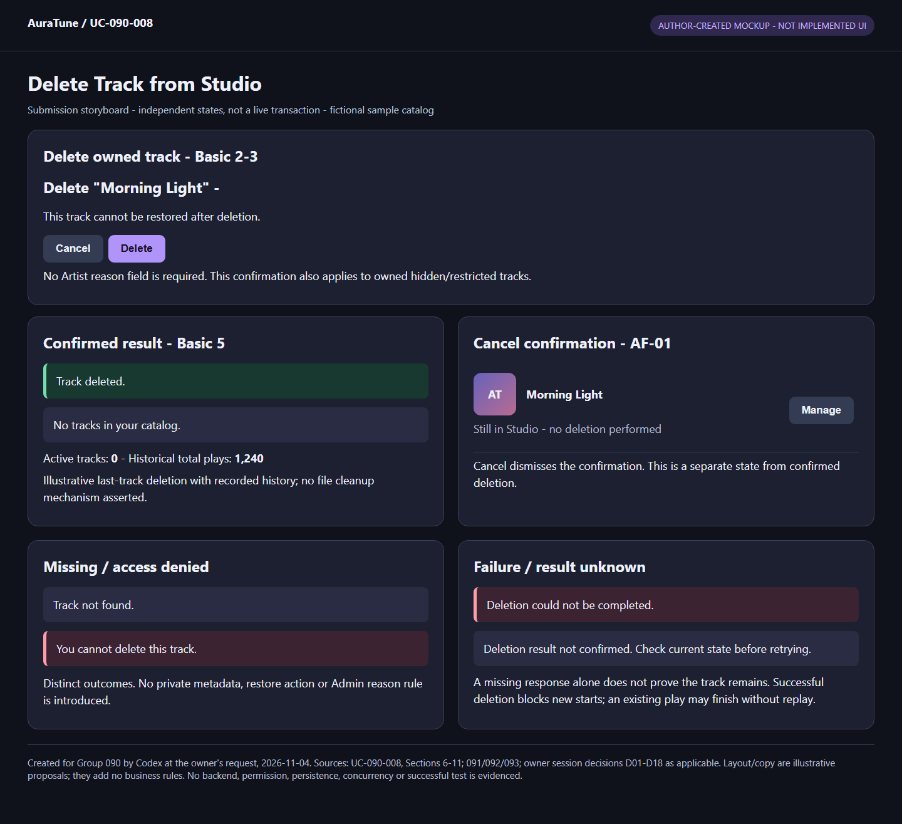
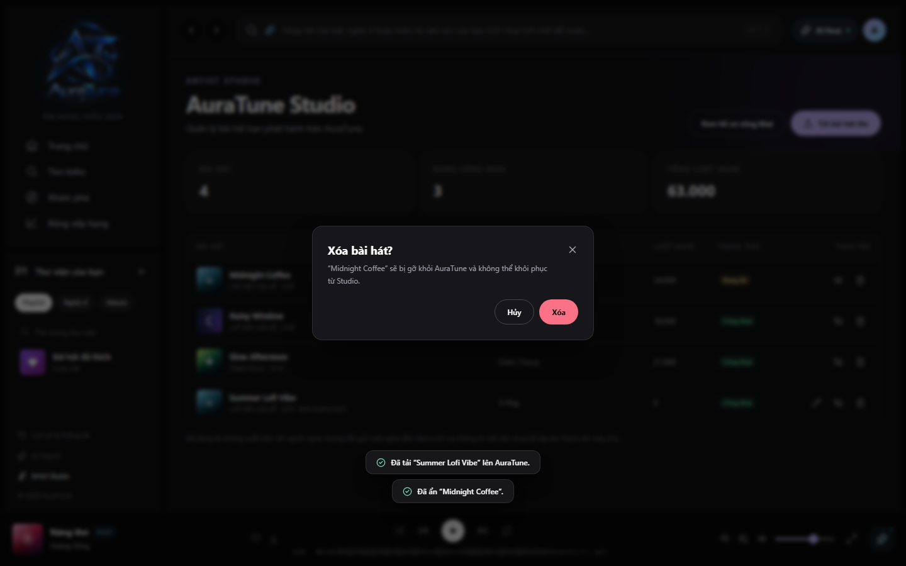

# UC-090-008 – Delete Track from Studio

## 1. Metadata

| Field | Value |
|---|---|
| Use Case ID | UC-090-008 |
| Use Case Name | Delete Track from Studio |
| Functional Group | 090 – Artist Profile & Studio |
| Primary Actor | Artist, acting on their own track |
| Supporting Actors | None confirmed for deletion; physical storage cleanup is not specified |
| Related FR IDs | 093-FR-001, 093-FR-008, 093-FR-009 |
| Related Feature ID | 093 – Artist Track Management |
| Related Spec Kit File | [093 spec](../../../../specs/090-artist-profile-studio/093-artist-track-management/spec.md) |
| Writer | Thái Hoàng |
| Reviewer | Not assigned |
| Status | Draft |
| Last Updated | 2026-11-04 |

## 2. Goal

The Artist permanently removes their own track from Studio and public distribution after confirming the deletion, or cancels before deletion is submitted.

## 3. Description

The Artist chooses a track, reviews a confirmation naming it and warning that it cannot be restored, and confirms or cancels. Successful deletion removes the Studio entry, displays a confirmation toast and updates the statistics cards as required by 093 User Story 5. Hiding is a separate reversible visibility goal; this UC provides no restore feature.

Permanent removal is the business outcome, not a decision about hard/soft deletion, physical audio removal or related-data cleanup. Admin moderation reason, one-click removal, retention and restore rules are not adopted as Artist deletion rules.

## 4. Preconditions

- Normal entry is a track entry in the Artist's Studio catalog (UC-090-004). The ordinary successful path targets an existing owned track eligible for deletion under the current contract.
- Authentication, Artist role, account eligibility, track existence and ownership must be checked on protected reads and deletion requests. A previously displayed catalog or confirmation does not establish continuing authorization or existence; denial branches cover direct requests and changes since display.
- 093 User Story 5 and FR-008 specify owned-track deletion without a self-hidden exclusion; ordinary self-hidden tracks use the same confirmation/cancel/delete flow. G090-D05 also permits Artist-owner deletion of an Admin-restricted track through this same confirmation/cancel flow, without making the track public, permitting new playback or introducing restore/moderation override.

## 5. Trigger

The Artist selects the delete (Trash) action for a track in their own Studio catalog.

## 6. Basic Flow

1. **Artist:** Selects Delete for their track.
2. **System:** Checks access, ownership and track existence, then displays a confirmation modal containing the track title and a warning that the track cannot be restored.
3. **Artist:** Selects Delete ("Xóa") to confirm this track's deletion.
4. **System:** Checks current authentication, Artist permission, account eligibility, ownership and track existence before executing the confirmed deletion. G090-D05 permits deletion of an owned Admin-restricted track through this same flow; it does not require unrestriction or publication first.
5. **System:** Removes the track from Studio and public distribution; under G090-D07, denies new starts via player/playlist/queue/direct URL, makes the queue skip the unavailable item and permits only a playback already started before successful deletion to finish, without replay/repeat. It displays a deletion-confirmation toast and updates the Studio statistics cards under G090-D06: the deleted track is excluded from active count without subtracting its validly recorded historical plays; when no catalog tracks remain, active count is 0 and historical total plays remains available.

The use case ends successfully. Step 5 follows 093's observable outcomes without deciding the storage mechanism; Studio active/total-play semantics follow G090-D06. No Artist deletion reason field is introduced.

## 7. Alternative Flows

### AF-01 – Cancel confirmation

- **Starting step:** Basic Flow step 3, before confirmation is submitted.
- **Condition:** The Artist selects Cancel ("Hủy") instead of Delete.

1. **Artist:** Selects Cancel in the confirmation modal.
2. **System:** Closes the modal without modifying the catalog through this action (093 User Story 5, scenario 2).

- **Outcome:** The use case ends with cancellation; no deletion is submitted by this flow. This does not guarantee that another independent actor has not changed the track concurrently.

### AF-02 – Track not found

- **Starting step:** Basic Flow step 2 or 4.
- **Condition:** The requested record no longer exists, including disappearance after the catalog or confirmation was displayed.

1. **System:** Returns the existing shared API not-found outcome rather than executing a deletion against a missing track or claiming new deletion success.

- **Outcome:** The request ends unsuccessfully. This does not define an idempotent success response for repeated Artist deletions, a retained deleted-record response or a restore/cleanup procedure.

### AF-03 – Repeated or concurrent operation

- **Starting step:** Basic Flow step 4 or 5 before a change is accepted; also during EX-05 recovery.
- **Condition:** The same intended request is repeated, or valid operations affecting the track overlap.

1. **System:** Evaluates current access, ownership, restriction and existence. The last successfully processed applicable change determines saved state, not device click time; no request restores a deleted track or bypasses restriction. An unsuccessful request is not treated as a successful ordering event.
2. **System:** Reflects the confirmed current result rather than overwriting it with an older delayed response. Missing-target requests follow the existing not-found branch, without inventing a special transport response for duplicate deletion.

- **Outcome:** Ends with the confirmed saved result when known. If further authorized processing is needed, resume at Basic Flow step 4 for the already-confirmed intended deletion; a new deletion intent uses the existing confirmation flow; an uncertain result uses EX-05 first. No specific synchronization, versioning, schema or idempotency-key design is selected. Source: G090-D08.

## 8. Exception Flows

### EX-01 – Missing or expired session

- **Starting step:** Basic Flow step 2 or 4.
- **Condition:** The protected request has no valid authenticated session, including expiry while the confirmation was open.

1. **System:** Rejects the unauthenticated protected request under the shared authentication contract. At Studio entry, 093 User Story 6 specifies the Artist-login-required prompt.

- **Outcome:** The request ends unsuccessfully without executing that rejected deletion. Original deletion source does not define a recovery mechanism; D08/EX-05 governs current manual recovery and rechecks without automatic replay.

### EX-02 – Role or ownership denied

- **Starting step:** Basic Flow step 2 or 4.
- **Condition:** The requester lacks Artist permission or attempts to delete another account's track.

1. **System:** Denies the protected action using server-side role and ownership checks, without disclosing another account's non-public track information. Regular User access to Studio follows 093's forbidden outcome.

- **Outcome:** The request ends unsuccessfully without executing that rejected deletion. Admin moderation permission does not independently confer Artist Studio access.

### EX-03 – Banned account

- **Starting step:** Basic Flow step 2 or 4.
- **Condition:** A successful administrative ban applies, even if the token issued earlier is unexpired.

1. **System:** Denies the subsequent protected request under 111-FR-011.

- **Outcome:** The request ends unsuccessfully without executing that rejected deletion; account ban/unban management is outside this UC.

### EX-04 – Reported operation failure

- **Starting step:** Basic Flow step 4 or 5, after confirmation.
- **Condition:** Processing returns an explicit operation-error result rather than confirmed deletion success.

1. **System:** Returns the failure using existing shared API error conventions; the successful-deletion outcome and success toast are not established by that error.

- **Outcome:** The operation error enters EX-05 for G090-D08 manual recovery. Modal retention, partial effects and rollback mechanisms are not selected; the error alone does not prove that the record remains.

A lost response is not a confirmed failure. Use EX-05 to reconcile the actual result before a definitive claim or retry under G090-D08.

### EX-05 – Error or uncertain result with manual recovery

- **Starting step:** Basic Flow step 4 or 5.
- **Condition:** Loading/processing fails, or no definitive response establishes the result of a submitted operation.

1. **System:** Shows understandable failure or uncertainty feedback, distinct from a valid empty collection/zero statistic. It offers manual retry and does not claim success, unchanged data or deletion solely from a missing response.
2. **Artist:** Requests manual retry/recovery if they wish to continue.
3. **System:** Checks current authentication, role, ownership, restriction and target existence as applicable. For an unanswered operation, it first reconciles the actual saved result; it does not blindly resubmit. If the intended result is already confirmed, it presents that result without executing a duplicate change. Otherwise, an authorized retry may proceed under current rules.

- **Outcome:** On a successful read, present the confirmed current result. If further processing is needed, resume at Basic Flow step 4 for the already-confirmed intended deletion; a new deletion intent uses the existing confirmation flow. If failure or uncertainty persists, return to EX-05 step 1; if the Artist stops, end without a definitive success claim. Access denial/missing-target outcomes use the existing branches. No old-account request is reassigned to a different account. No automatic retry, persistence atomicity or physical cleanup policy is chosen. Source: G090-D08.

## 9. Postconditions

### 9.1 Success Postconditions

- G090-D07 blocks new play starts via player/playlist/queue/direct URL after successful hide/delete, skips unavailable queue items and permits only playback already started before success to finish. No replay/repeat while unavailable; hidden-track eligibility requires Artist-public, no Admin restriction and no deletion. No deleted-track restore is introduced.

- Studio statistics follow G090-D06: only non-deleted, unrestricted Artist-public tracks count as active; hide/restrict/delete do not themselves reduce validly recorded historical total plays. Missing statistical data is not reported as 0. No storage/cleanup or platform-wide statistics policy is implied.

- Under G090-D05, a restricted track stays non-public and cannot start new playback after permitted metadata/preference changes. Delete does not create a restore path. A later valid Admin unrestrict permits public availability only if the Artist preference is public and the track has not been deleted; viewing itself changes no state.

- The confirmed owned track is removed from the Studio catalog and public distribution; a deletion-confirmation toast is displayed and the statistics cards update (093 clarification and User Story 5, scenario 3).
- Public profile sections omit removed/unauthorized content under 091-FR-007/008. The song is not restored through this UC.
- These outcomes do not assert physical file erasure, cleanup of playlists/history or any hard/soft-delete implementation. G090-D06 does require preservation of the user-visible historical total-play aggregate; it does not select how that aggregate is stored.

### 9.2 Failure Postconditions

- G090-D08 requires explicit error/uncertainty feedback and manual recovery; unresolved results do not become definitive saved/unchanged/deleted claims. All ownership/restriction/deleted-state boundaries remain enforced.

- **Cancellation:** AF-01 closes the modal without changing the catalog through this action and submits no deletion.
- **Rejected request:** Authentication, permission, ownership or ban rejection does not execute the rejected deletion; a missing track is not recreated or reported newly deleted by this request.
- **Reported operation error:** Successful deletion has not been established. No unsupported assertion of complete rollback or continued record existence is made.
- **Unknown result:** Loss of response after submission does not prove success or failure; neither deletion nor unchanged data is promised without reconciliation evidence.

## 10. Special Requirements

- **Security:** Enforce authentication, Artist role and ownership server-side at protected access and execution; apply 111-FR-011 after a ban. Previously displayed controls or confirmation do not bypass these checks.
- **Performance:** No Artist-deletion response-time target is identified. 093-SC-002's 500 ms target explicitly concerns upload and metadata edit, not deletion.
- **Usability and Accessibility:** Use the source-defined confirmation with title, irreversible-removal warning, Cancel and Delete actions. No reason prompt, additional confirmation, modal-close shortcut is inferred; manual retry follows G090-D08.
- **Privacy:** Public profiles must not reveal removed/unauthorized items through counts, labels, placeholders or error details (091-FR-008); protected errors must not expose private data.
- **Other:** G090-D07 independently confirms Artist-delete new-start/queue/in-progress playback outcomes. It does not select URL revocation or streaming mechanics. Public-distribution removal remains required; exact stale public-surface refresh presentation is not selected. 112 moderation wording remains assessed separately in group S-01, not silently imported.

## 11. Business Rules

| Rule ID | Rule Description | Source |
|---|---|---|
| BR-01 | Only an eligible authenticated Artist may perform the Studio deletion action on their own track. | 093-FR-001; security ownership rules |
| BR-02 | Deletion requires a modal confirmation naming the track and warning that it cannot be restored. | 093-FR-008; User Story 5, scenario 1 |
| BR-03 | Cancel closes the confirmation without modifying the catalog through that action. | 093 User Story 5, scenario 2 |
| BR-04 | Successful confirmed deletion removes the track from Studio/public distribution, displays a confirmation toast and updates statistics cards. | 093 clarification; User Story 5, scenario 3; FR-009 |
| BR-05 | Hide/unhide is separate from deletion; no restore operation is added. G090-D06 separately confirms that deletion does not itself subtract historical total plays. | 093 User Stories 4/5 |
| BR-06 | Admin reason, moderation removal and restoration rules remain in Group 110; Artist deletion does not clear restrictions or republish content. | 112-FR-007/016/025; 093 scope |
| BR-07 | Owner-confirmed session decision G090-D05 (2026-11-04): an eligible Artist-owner may edit the already-permitted metadata, delete through the existing confirmation/cancel flow, and change only their self-hide preference while Admin restriction remains active. None of these actions clears that restriction, publishes the track or permits a new play start. After Admin lifts restriction, public availability requires Artist-public preference and a non-deleted track. Unhide/unrestrict cannot restore a deleted track. | Owner-confirmed session decision G090-D05, 2026-11-04; not group approval |
| BR-08 | Owner-confirmed session decision G090-D06 (2026-11-04), own-Artist Studio statistics: active count includes only Artist-public tracks without Admin restriction that are not deleted. Total plays retains all validly recorded historical plays, including tracks later hidden, restricted or deleted; those actions do not themselves subtract historical plays. An empty catalog has active count 0 but retains historical total plays, which is 0 only if there are no recorded plays. Unavailable data must be distinguishable from 0. | Owner-confirmed session decision G090-D06, 2026-11-04; not group approval or a source-spec edit |
| BR-09 | Owner-confirmed session decision G090-D07 (2026-11-04): after a successful Artist hide or delete, deny new play starts through player, playlist, queue or direct URL; queue skips unavailable tracks. Playback already started before success may finish, but replay/repeat is blocked while the track remains unavailable. A hidden track can start new playback again only when Artist preference is public, no Admin restriction remains and the track is not deleted. Unhide/unrestrict cannot restore a deleted track. No physical-file deletion, URL-revocation or streaming mechanism is selected. | Owner-confirmed session decision G090-D07, 2026-11-04; not source-spec edit or group approval |
| BR-10 | Owner-confirmed session decision G090-D08 (2026-11-04), option A: distinguish Studio errors from valid empty/zero results and offer manual retry. An unanswered submitted operation remains explicitly uncertain; reconcile its actual result before a definitive state claim or resubmission. Retrying the same upload submission must not create another track. Concurrent valid operations take effect in successful processing order, with the last successful applicable change prevailing, subject to current ownership, Admin restriction and deletion rules; deleted content cannot be resurrected. No automatic resubmission, schema/API, transaction or deduplication mechanism is selected. | Owner-confirmed session decision G090-D08; not an original 093 requirement or group approval |

## 12. Prototype and Screenshots

### 12.0 Current Submission Evidence

**Type/provenance:** Author-created HTML/CSS mockup storyboard, generated by Codex at the owner's request on 2026-11-04; fictional catalog data. [Editable HTML](./prototypes/UC-090-008-basic-flow-and-key-states.html). Sources: this UC's current flows/rules, relevant 091/092/093 requirements and confirmed D01-D18 decisions. Layout and sample feedback wording are illustrative, not additional approved requirements or implemented UI.

**Illustration:** Basic Flow presentation and key UI states for AF-01, AF-02, EX-02, EX-04, EX-05. Multiple panels are independent alternative states, not one live screen or executed sequence. This is **Partial** evidence: no backend, current permissions, storage, persistence, license validation, concurrency or passed test is established. Per-flow residual Missing/Partial states are recorded in the [prototype index](./prototypes/README.md).

**Shared access/recovery illustration:** [P-025 mockup](./prototypes/Group090-access-and-recovery-states.png) illustrates applicable EX-01, EX-02, EX-03. These are independent UI states, not proof of enforcement or a complete recovery sequence.

**Later-result illustration:** [P-026 mockup](./prototypes/Group090-next-load-and-request-results.png) shows applicable AF-03 result snapshots; not a complete executed sequence or proof of runtime ordering.

**Historical reference review below:** Earlier source-image observations and missing-state statements describe the original assets only. They do not override the new storyboard or current index. No original source image was changed; new local mockups supersede incompatible old UI for submission illustration.

### 12.1 Basic Flow

**Covered steps:** Basic Flow step 2 and the available choice at step 3 only. The modal is titled "Xóa bài hát?", names Midnight Coffee, warns that it will be removed from AuraTune and cannot be restored from Studio, and shows Cancel ("Hủy") and red Delete ("Xóa") buttons.

**Prototype type:** Reference UI mockup, visually inspected; not a verified screenshot of a deployed system. Source: Feature 093 UI asset `05-delete-track.png`, its Delete Track Confirmation Modal illustration.

The blurred background retains the track and pre-deletion statistics. Visible background toasts report an upload and a hide; neither is deletion confirmation. The image does not demonstrate execution, record removal, updated statistics, public delisting, playback consequences, ownership or physical cleanup. Although the background appears to contain a hidden track, an open dialog does not establish hidden-track deletion eligibility or success.

### 12.2 Alternative Flow – AF-01

The Cancel button is visible in the same mockup; the resulting modal dismissal and unchanged catalog are not illustrated. AF-01's behavior comes from 093 User Story 5, scenario 2, not from inferred image interaction. No distinct cancellation-result evidence was found in the referenced asset.

### 12.3 Remaining Evidence

No verified asset demonstrates completed deletion/toast/statistics, AF-02 not-found, EX-01–04 access/ban/error outcomes, restricted-track deletion, repeated/concurrent requests or uncertain outcomes. Public discovery and playback effects also lack evidence. Prototype coverage remains incomplete; no image was created or copied.

## 13. Related Use Cases

- [UC-090-004 – Access Artist Studio Dashboard](./UC-090-004-access-artist-studio-dashboard.md): catalog entry point and statistics display; its historical-play/active-count semantics are confirmed by G090-D06; technical retrieval and recovery remain separate.
- [UC-090-005 – Upload Audio Track](./UC-090-005-upload-audio-track.md): creates audio content; its storage role does not establish a deletion-cleanup actor.
- [UC-090-006 – Edit Track Metadata](./UC-090-006-edit-track-metadata.md): changes metadata, not existence.
- [UC-090-007 – Hide or Unhide Track](./UC-090-007-hide-or-unhide-track.md): temporary visibility change preserving history; not deletion or restoration.
- [UC-090-001 – View Public Artist Profile](./UC-090-001-view-public-artist-profile.md): omits removed/unauthorized content; no delete action belongs in that public goal.
- Group 110 moderation and the playback/queue features retain their own action boundaries.

## 14. Traceability and Sources

Feature-qualified references identify literal FR IDs in the [current 093 spec](../../../../specs/090-artist-profile-studio/093-artist-track-management/spec.md). Three FRs apply directly/shared as allocated in the inventory; the other seven are boundaries/context.

| Source FR | Treatment | Flow / Boundary |
|---|---|---|
| 093-FR-001 | Shared Artist access gate | Basic 2/4; EX-01/02 |
| 093-FR-002 | Dashboard statistics | UC-090-004; Basic 5 applies User Story 5 card updates and G090-D06 historical-play retention/active eligibility |
| 093-FR-003 | Catalog fields/actions | UC-090-004 entry context; confirmed removal follows User Story 5 |
| 093-FR-004 | New upload | UC-090-005; not deletion |
| 093-FR-005 | Duration validation | UC-090-005/006; no duration input here |
| 093-FR-006 | Metadata editing | UC-090-006; separate goal |
| 093-FR-007 | Visibility toggle | UC-090-007; not permanent deletion |
| 093-FR-008 | Modal-confirmed permanent deletion | Basic 2–5; AF-01; success/cancel postconditions |
| 093-FR-009 | Shared operation notifications | Deletion toast only at Basic 5; not the upload/hide toasts in the mockup |
| 093-FR-010 | Persist audio on upload | UC-090-005; does not specify physical deletion or storage cleanup |

| Source Type | ID / File | Relevant Section |
|---|---|---|
| Owner session decision | G090-D05, confirmed by Thái Hoàng on 2026-11-04 | Owner-confirmed session decision G090-D05 (2026-11-04): an eligible Artist-owner may edit the already-permitted metadata, delete through the existing confirmation/cancel flow, and change only their self-hide preference while Admin restriction remains active. None of these actions clears that restriction, publishes the track or permits a new play start. After Admin lifts restriction, public availability requires Artist-public preference and a non-deleted track. Unhide/unrestrict cannot restore a deleted track. Newly confirmed in this conversation; source specs remain unchanged. |
| Owner session decision | G090-D06, confirmed by Thái Hoàng on 2026-11-04 | Owner-confirmed session decision G090-D06 (2026-11-04), own-Artist Studio statistics: active count includes only Artist-public tracks without Admin restriction that are not deleted. Total plays retains all validly recorded historical plays, including tracks later hidden, restricted or deleted; those actions do not themselves subtract historical plays. An empty catalog has active count 0 but retains historical total plays, which is 0 only if there are no recorded plays. Unavailable data must be distinguishable from 0. No technical data source, schema, history-storage/cleanup mechanism or Group 113 formula is selected. |
| Owner session decision | G090-D07, confirmed by Thái Hoàng on 2026-11-04 | Owner-confirmed session decision G090-D07 (2026-11-04): after a successful Artist hide or delete, deny new play starts through player, playlist, queue or direct URL; queue skips unavailable tracks. Playback already started before success may finish, but replay/repeat is blocked while the track remains unavailable. A hidden track can start new playback again only when Artist preference is public, no Admin restriction remains and the track is not deleted. Unhide/unrestrict cannot restore a deleted track. No physical-file deletion, URL-revocation or streaming mechanism is selected. Newly confirmed for Artist actions in this conversation, not automatically inherited from Admin moderation. |
| Owner session decision | G090-D08, confirmed by Thái Hoàng on 2026-11-04 | Owner-confirmed session decision G090-D08 (2026-11-04), option A: distinguish Studio errors from valid empty/zero results and offer manual retry. An unanswered submitted operation remains explicitly uncertain; reconcile its actual result before a definitive state claim or resubmission. Retrying the same upload submission must not create another track. Concurrent valid operations take effect in successful processing order, with the last successful applicable change prevailing, subject to current ownership, Admin restriction and deletion rules; deleted content cannot be resurrected. No automatic resubmission, schema/API, transaction or deduplication mechanism is selected. Remaining cancel/input-retention/partial-presentation details are B-06; mechanics are C-02. |
| Spec Kit Specification | [Feature 093](../../../../specs/090-artist-profile-studio/093-artist-track-management/spec.md) | Entire spec; deletion clarification; User Stories 4/5/6; FR-001/008/009; UI illustration 5 |
| Public visibility | [Feature 091](../../../../specs/090-artist-profile-studio/091-artist-profile/spec.md) | FR-007/008: removed/unauthorized content omission; FR-025: Studio boundary |
| Moderation boundaries | [Feature 112](../../../../specs/110-admin-functions/112-content-moderation/spec.md) | FR-007/016/019/021–025/027/029/030; separate Admin deletion, playback and restore wording |
| Account eligibility | [Feature 111](../../../../specs/110-admin-functions/111-user-management/spec.md) | FR-011: ban enforcement on subsequent protected requests |
| API contract | [API Contract](../../../analysis-and-design/api-contract.md) | Artist-owned song deletion and common authentication, permission, not-found and operation errors; no new endpoint/schema/status |
| API conventions | [API conventions](../../../design/api/api-conventions.md) | Shared protected-request and error conventions |
| Security | [Security principles](../../../design/security/README.md); [data security rules](../../../design/database/security-rules.md) | Server-side role/ownership checks and minimal private-data disclosure |
| Group allocation | [Inventory](./use-case-inventory.md#4-coverage-check); [README](./README.md) | Current FR allocation and existing unresolved scope/evidence issues |

Source assessment: see [S-01](./README.md#source-assessment-s-01) for exact 112 quotations, line references and action/state analysis. Only the confirmation requirement versus one-click execution is retained as a conditional same-action conflict; reason defaults are compatible, and playback/state wording is not declared irreconcilable without matching scopes. Independent 093 Artist behavior remains in force.

## 15. Open Questions

| Question ID | Question | Owner | Status | Resolution |
|---|---|---|---|---|
| Q-01 | Business: Artist deletion of an Admin-restricted track. | Thái Hoàng / group | Resolved | Owner-confirmed session decision G090-D05 (2026-11-04): an eligible Artist-owner may edit the already-permitted metadata, delete through the existing confirmation/cancel flow, and change only their self-hide preference while Admin restriction remains active. None of these actions clears that restriction, publishes the track or permits a new play start. After Admin lifts restriction, public availability requires Artist-public preference and a non-deleted track. Unhide/unrestrict cannot restore a deleted track. [B-07](./README.md#shared-open-issues) resolved; other source-alignment, technical and evidence follow-ups remain separately tracked. |
| Q-02 | Business: detailed Artist-delete playback and stale public-surface consequences. | Thái Hoàng / group | Resolved | Owner-confirmed session decision G090-D07 (2026-11-04): after a successful Artist hide or delete, deny new play starts through player, playlist, queue or direct URL; queue skips unavailable tracks. Playback already started before success may finish, but replay/repeat is blocked while the track remains unavailable. A hidden track can start new playback again only when Artist preference is public, no Admin restriction remains and the track is not deleted. Unhide/unrestrict cannot restore a deleted track. No physical-file deletion, URL-revocation or streaming mechanism is selected. [B-10](./README.md#shared-open-issues) resolved for playback. Existing public omission rules still apply; Studio stale/partial presentation follows D14; public-surface refresh mechanisms remain C-02 and no new automatic refresh is selected. |
| Q-03 | Business: repeated Artist deletion and overlapping operations. | Thái Hoàng / group | Resolved | Owner-confirmed session decision G090-D08 (2026-11-04), option A: distinguish Studio errors from valid empty/zero results and offer manual retry. An unanswered submitted operation remains explicitly uncertain; reconcile its actual result before a definitive state claim or resubmission. Retrying the same upload submission must not create another track. Concurrent valid operations take effect in successful processing order, with the last successful applicable change prevailing, subject to current ownership, Admin restriction and deletion rules; deleted content cannot be resurrected. No automatic resubmission, schema/API, transaction or deduplication mechanism is selected. B-09 is resolved; B-06 is resolved by D08-D14; technical/evidence work remains open. |
| Q-04 | Business/UX: deletion errors, reconciliation and retry after lost responses. | Thái Hoàng / group | Resolved | Owner-confirmed session decision G090-D08 (2026-11-04), option A: distinguish Studio errors from valid empty/zero results and offer manual retry. An unanswered submitted operation remains explicitly uncertain; reconcile its actual result before a definitive state claim or resubmission. Retrying the same upload submission must not create another track. Concurrent valid operations take effect in successful processing order, with the last successful applicable change prevailing, subject to current ownership, Admin restriction and deletion rules; deleted content cannot be resurrected. No automatic resubmission, schema/API, transaction or deduplication mechanism is selected. B-09 is resolved; B-06 is resolved by D08-D14; technical/evidence work remains open. |
| Q-05 | Source assessment: reason/confirmation and distinct moderation states. | Thái Hoàng / group | Open | [Group issue S-01](./README.md#shared-open-issues); 093 independently requires Artist confirmation and provides no reason field. |
| Q-06 | Technical Follow-up: physical persistence, audio lifecycle and related-data handling. | Thái Hoàng / technical team | Open | [Group issue C-02](./README.md#shared-open-issues); no hard/soft-delete or cleanup decision is needed to state permanent public/Studio removal. |
| Q-07 | Evidence: provide cancel-result, deletion-success/toast/statistics, public/playback, access/failure and uncertain-outcome illustrations. | Thái Hoàng | Open | Current P-024/P-025/P-026 add cancel/result/statistics and key access/recovery illustrations; public/playback runtime and full sequence evidence remain incomplete |

Post-deletion total-play/active-count semantics are confirmed by owner session decision G090-D06 and shared with UC-090-004; B-02 is resolved without a persistence/cleanup decision. Earlier unresolved issues remain open; source-answered subquestions and shared follow-ups are tracked in the group README. Reviewer is not assigned; this is a Draft without peer review or approval.
