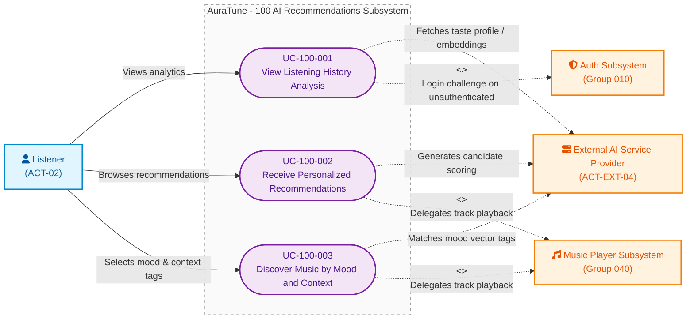

# Functional Group 100: AI Recommendations – Use-Case Documentation

---

## 5.1. Group Information

| Attribute | Details |
|---|---|
| **Group ID** | 100 |
| **Group Name** | AI Recommendations |
| **Group Owner** | Lê Công Minh Nhựt |
| **Module Purpose** | Delivers intelligent, passive music recommendations, personal listening analytics, and situational mood/context discovery without requiring manual keyword searches. |
| **Documentation Status** | Draft — Baseline for Sprint 3 (PA3) Review |
| **Applicable Standards** | AuraTune Use-Case Documentation Guide, Spec Kit Architecture, PA3 Use-Case Specification Standard |

---

## 5.2. Scope

### 5.2.1 Purpose and Objectives
Functional Group 100 provides automated music discovery and behavioral listening habit insights. By analyzing historical playback activity and user preference signals, the system assists listeners in discovering relevant open-copyright music, understanding their listening trends, and matching tracks to their current emotional vibe or activity context.

### 5.2.2 In-Scope Capabilities
The verified capabilities within Group 100 comprise three distinct subfeatures:

1. **Listening History Analysis (Feature 101)**:
   - Aggregating personal playback duration and identifying top genres ranked by accumulated listening duration.
   - Enforcing strict account boundary isolation (zero cross-account data leakage).
   - Graceful handling of empty or insufficient listening history (< 1 eligible playback entry) without fabricating fake insights.
   - Refreshing statistics dynamically upon user access.

2. **Personalized Recommendations (Feature 102)**:
   - Generating a personalized music discovery stream spanning multiple supported entity types: **Songs**, **Albums**, **Artists**, and **Playlists**.
   - Incorporating verified user signals: qualifying listening history entries ($\ge 30$ seconds), liked songs (`user_liked_songs`), and followed artists (`user_follows_artist`).
   - Seamless cold-start fallback to trending/popular platform content for newly registered accounts.
   - Graceful degradation with non-blocking subtle notification when the external AI service times out or is offline.
   - One-click navigation and playback delegation for recommended items.

3. **Mood and Context Recommendations (Feature 103)**:
   - Situational music discovery based on curated preset tag chips: 4 core moods (*Chill*, *Energetic*, *Melancholy*, *Focus*) and 4 activity contexts (*Study/Work*, *Workout*, *Late Night*, *Travel/Commute*).
   - Delivering recommended individual Songs and curated theme Mood Playlists.
   - Resilient fallback with friendly empty state and alternative tag suggestion chips when no catalog matches exist.

### 5.2.3 Out-of-Scope Exclusions
To maintain strict architectural boundaries, the following capabilities are explicitly excluded from Group 100:
- **Interactive Conversational AI Dialogue**: Real-time chat, intent parsing, and conversational prompt-based music recommendations belong exclusively to **Group 120 – AI Conversational Agent**.
- **Keyword & Semantic Search**: Free-form natural language querying and lyric vector search are owned by **Group 030 – Search** (`031`, `032`, `033`).
- **Raw Playback Event Logging & Management**: Capturing raw stream events and clearing history records are owned by **Group 070 – Listening History**.
- **Audio Streaming & Player Controls**: Track playback, buffering, volume adjustment, and seeking are owned by **Group 040 – Music Player**.
- **Queue & Playlist Management**: Modifying the active play queue and CRUD operations on custom playlists belong to **Group 050** and **Group 060**.
- **Custom User-Typed Free-Form Mood Prompts**: Natural language text prompts are not supported in Feature 103 (curated preset chips only).

### 5.2.4 Dependencies
- **Group 010 (Authentication)**: Validates JWT access tokens and supplies the authenticated `user_id` to ensure private data isolation (Decree 13/2023/ND-CP).
- **Group 020 (Home Dashboard)**: Hosts the visual containers for personalized recommendation feeds and discovery hubs.
- **Group 040 (Music Player)**: Executes playback when a recommended song or playlist is selected.
- **Group 070 (Listening History)**: Supplies raw playback logs (`listening_history`) for statistical analysis and recommendation generation.
- **Group 080 & 090 (Catalog Interaction)**: Provides entity detail views when recommended albums or artists are opened.
- **External AI Service Provider (`ACT-EXT-04`)**: Powers offline/online vector embeddings and candidate relevance scoring.

---

## 5.3. Related Requirements and Features

| Feature ID | Feature Name | Related FR IDs | Spec Path |
|---|---|---|---|
| **101** | Listening History Analysis | `101-FR-001` to `101-FR-014` | [`specs/100-ai-recommendations/101-listening-history-analysis/spec.md`](file:///F:/CSC_HCMUS/Chuy%C3%AAn%20ng%C3%A0nh/NM%20SE/AuraTune/specs/100-ai-recommendations/101-listening-history-analysis/spec.md) |
| **102** | Personalized Recommendations | `102-FR-001` to `102-FR-015` | [`specs/100-ai-recommendations/102-personalized-recommendations/spec.md`](file:///F:/CSC_HCMUS/Chuy%C3%AAn%20ng%C3%A0nh/NM%20SE/AuraTune/specs/100-ai-recommendations/102-personalized-recommendations/spec.md) |
| **103** | Mood and Context Recommendations | `103-FR-001` to `103-FR-015` | [`specs/100-ai-recommendations/103-mood-and-context-recommendations/spec.md`](file:///F:/CSC_HCMUS/Chuy%C3%AAn%20ng%C3%A0nh/NM%20SE/AuraTune/specs/100-ai-recommendations/103-mood-and-context-recommendations/spec.md) |

---

## 5.4. Actors

| Actor | Actor Type | Description | Related Use Cases |
|---|---|---|---|
| **Listener** (`ACT-02`) | Primary Human Actor | Authenticated platform user who requests personal listening insights, browses personalized music suggestions, and selects mood/context tags. | `UC-100-001`, `UC-100-002`, `UC-100-003` |
| **External AI Service Provider** (`ACT-EXT-04`) | External System (Supporting Actor) | Third-party cloud AI service or internal vector embedding inference engine providing recommendation candidate matching. | `UC-100-001`, `UC-100-002`, `UC-100-003` |
| **Guest / Visitor** (`ACT-01`) | Primary Human Actor (Boundary Enforcement) | Unauthenticated user. Group 100 features reject unauthenticated access and redirect to authentication (`UC-010-002`). | Restricted / Exception Flows |

---

## 5.5. Use-Case Diagram

The following Mermaid diagram visualizes the boundary, actors, confirmed use cases, and external relationships for **Group 100 – AI Recommendations**.

> **Note**: This diagram is rendered using Mermaid `flowchart LR` syntax to represent conceptual UML Use-Case structures within standard Markdown viewers. Ovals denote Use Cases, square nodes represent Actors, and dashed lines represent relationships across boundaries.



### Diagram Legend
- **Ovals (`([ ... ])`)**: Confirmed Use Cases.
- **Solid Arrow (`-->`)**: Direct primary actor invocation.
- **Dashed Arrow (`-.->`)**: External system dependency or cross-group inclusion (`<<include>>` / `<<extend>>`).
- **Subsystem Boundary (`subgraph`)**: Scope boundary of Group 100.

---

## 5.6. Use-Case List

| UC ID | Use-Case Name | Primary Actor | Related FRs | Specification File |
|---|---|---|---|---|
| **UC-100-001** | View Listening History Analysis | Listener | `101-FR-001` to `101-FR-014` | [`UC-100-001-view-listening-history-analysis.md`](./UC-100-001-view-listening-history-analysis.md) |
| **UC-100-002** | Receive Personalized Recommendations | Listener | `102-FR-001` to `102-FR-015` | [`UC-100-002-receive-personalized-recommendations.md`](./UC-100-002-receive-personalized-recommendations.md) |
| **UC-100-003** | Discover Music by Mood and Context | Listener | `103-FR-001` to `103-FR-015` | [`UC-100-003-discover-music-by-mood-and-context.md`](./UC-100-003-discover-music-by-mood-and-context.md) |

---

## 5.7. Dependencies and Integration

```
                 +---------------------------+
                 |    Group 010: Auth        |
                 |  (JWT Token / User Scope) |
                 +-------------+-------------+
                               |
                               v
+------------------+     +-------------------+     +-------------------------+
| Group 070:       |     |   Group 100:      |     | External AI Service /   |
| Listening History| --> | AI Recommendations| <-> | Vector Database         |
| (Raw Play Logs)  |     +---------+---------+     | (Embeddings & Scoring)  |
+------------------+               |               +-------------------------+
                                   |
         +-------------------------+-------------------------+
         |                                                   |
         v                                                   v
+--------------------+                             +--------------------+
| Group 020:         |                             | Group 040:         |
| Home Dashboard     |                             | Music Player       |
| (UI Feed Display)  |                             | (Playback Stream)  |
+--------------------+                             +--------------------+
```

1. **Authentication Token Flow**: Every inbound request is scoped to the authenticated caller's identity via Group 010. Unauthenticated requests are rejected at the route level.
2. **Historical Data Pipeline**: Analytics and preference models consume records from `listening_history` (qualifying entries $\ge 30$ seconds), `user_liked_songs`, and `user_follows_artist`.
3. **Display Container Integration**: Personalized and mood recommendations are rendered inside designated dashboard containers provided by Group 020 (`022-recommended-content`).
4. **Playback Delegation**: Selecting any recommended track dispatches an playback event to Group 040 (`UC-040-001`), loading audio bytes directly from the CDN.

---

## 5.8. Open Issues and Architecture Clarifications

1. **Vector Storage & Similarity Lookup (`Q-100-01`)**:
   - *Status*: Open architecture decision.
   - *Detail*: Evaluating PostgreSQL `pgvector` vs. a decoupled ChromaDB vector instance. Feature specifications require that query latency remain $< 2.0$ seconds under normal load.
2. **Cold-Start Duration Threshold (`Q-100-02`)**:
   - *Status*: Confirmed baseline, subject to empirical tuning in Sprint 3.
   - *Detail*: A user must have $\ge 1$ eligible playback entry with known metadata to render listening history analysis. Below this threshold, the cold-start trending baseline applies.
3. **Recommendation Refresh Policy (`Q-100-03`)**:
   - *Status*: Confirmed.
   - *Detail*: Recommendation feeds and listening statistics are dynamically refreshed when the user navigates to or reloads the respective view. No background WebSockets are required for passive recommendations.

---

## 5.9. References

- `docs/proposal/proposal.md` – Section 6.10: AI-Powered Recommendations
- `docs/proposal/Auratune_Vision_Document.md` – Feature Group G10 & Section 3.5
- `docs/management/team-contract.md` – Feature Ownership & Responsibilities
- `docs/requirements/use-case-model.md` – System-Level Use-Case Model
- `docs/requirements/use-cases/README.md` – Use-Case Documentation Standards
- `specs/100-ai-recommendations/101-listening-history-analysis/spec.md`
- `specs/100-ai-recommendations/102-personalized-recommendations/spec.md`
- `specs/100-ai-recommendations/103-mood-and-context-recommendations/spec.md`
- `docs/requirements/use-cases/100-ai-recommendations/prototypes/README.md`
