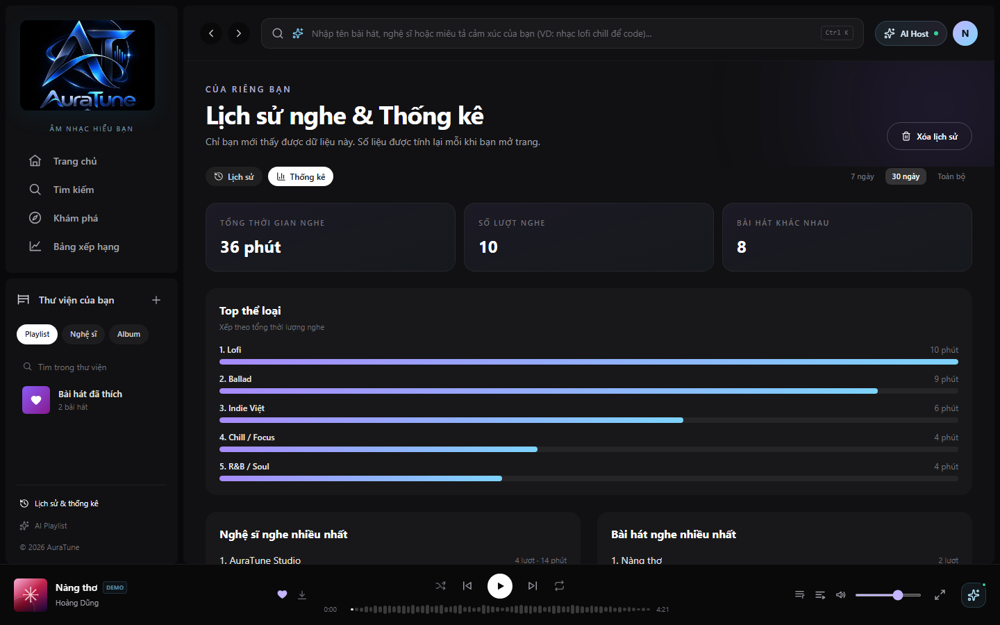
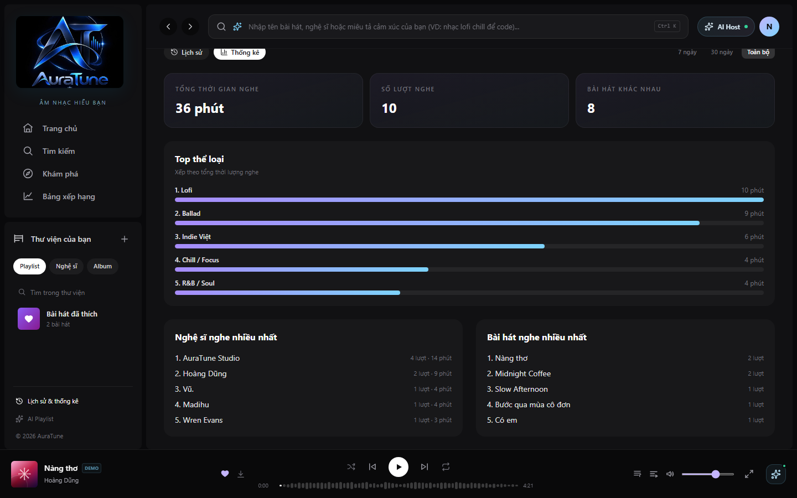
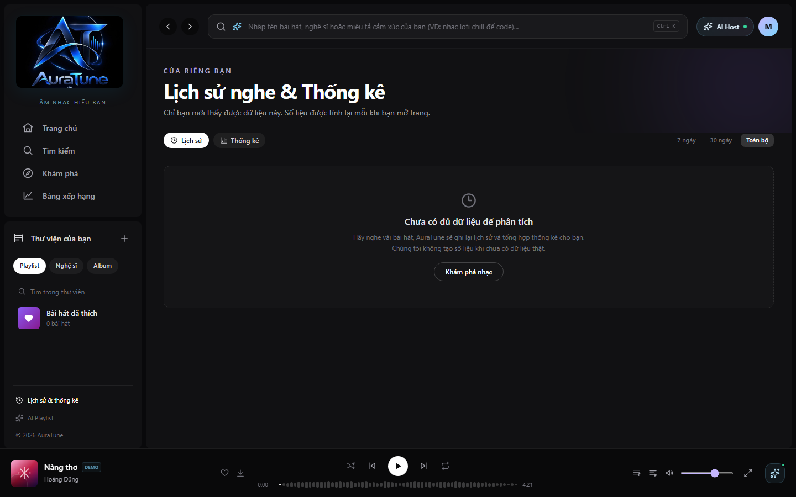
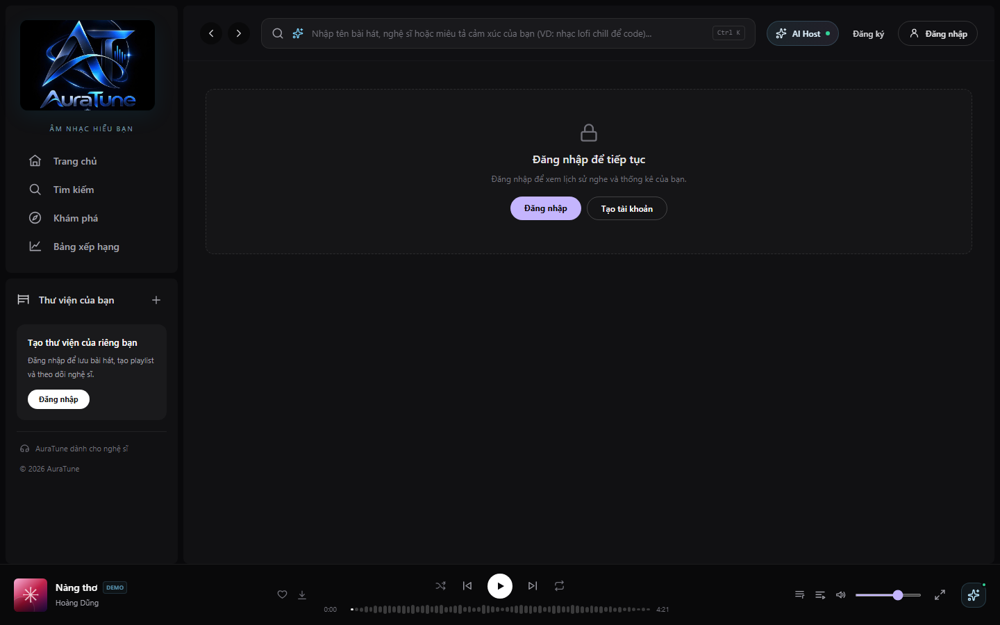

# UC-100-001 – View Listening History Analysis

---

## 1. Metadata

| Field | Value |
|---|---|
| **Use Case ID** | UC-100-001 |
| **Use Case Name** | View Listening History Analysis |
| **Functional Group** | 100 – AI Recommendations |
| **Primary Actor** | Listener (`ACT-02`) |
| **Supporting Actors** | External AI Service Provider (`ACT-EXT-04`) |
| **Related FR IDs** | `101-FR-001`, `101-FR-002`, `101-FR-003`, `101-FR-004`, `101-FR-005`, `101-FR-006`, `101-FR-007`, `101-FR-008`, `101-FR-009`, `101-FR-010`, `101-FR-011`, `101-FR-012`, `101-FR-013`, `101-FR-014` |
| **Related Feature/Spec** | Feature 101: Listening History Analysis (`specs/100-ai-recommendations/101-listening-history-analysis/spec.md`) |
| **Status** | Draft |
| **Writer** | Lê Công Minh Nhựt |
| **Reviewer** | TBD |

---

## 2. Description

An authenticated listener requests and reviews statistical insights derived from their personal listening history. The system analyzes historical playback events to compute total listening duration and generate a ranked list of top genres ordered by accumulated listening duration, presenting the insights in a dedicated analytics dashboard while strictly isolating private user data.

---

## 3. Preconditions

- The user is authenticated as a valid `Listener` (`ACT-02`) with an active session token.
- The platform database is reachable and contains the listener's account profile.
- The listener has at least one eligible playback record in `listening_history` linked to a valid song identifier (`101-FR-012`).

---

## 4. Trigger

The listener navigates to the Listening History page (`/history`) and selects the "Thống kê" (Statistics / Analytics) view tab.

---

## 5. Basic Flow

1. **Actor:** Navigates to `/history` and clicks on the "Thống kê" tab on the view mode switcher.
2. **System:** Verifies the listener's authentication session, extracts the authenticated `user_id`, and queries the `listening_history` table for records belonging exclusively to this account (`101-FR-005`, `101-FR-006`).
3. **System:** Filters out any history records with null `user_id` or null `song_id`, verifying that at least one valid record exists (`101-FR-012`).
4. **System:** Computes the total listening duration by summing `listened_duration` across all eligible history entries (`101-FR-011`, `101-FR-013`).
5. **System:** Aggregates eligible playback duration by song genre, calculates the accumulated duration per genre, and sorts genres in descending order (`101-FR-014`).
6. **System:** Formats total duration into human-readable hours and minutes and renders the Listening Analysis Dashboard, displaying summary metric cards and the Top Genres ranking with proportional visual bars (`101-FR-013`).
7. **Actor:** Reviews their total listening duration and explores their top genre breakdown.

---

## 6. Alternative Flows

### AF-01 – Insufficient or Empty Listening History
- **Starting step:** Step 3 of the Basic Flow.
- **Condition:** The authenticated listener has zero eligible entries in `listening_history` (e.g., a newly registered account or an account whose history was recently cleared).
1. **System:** Identifies that eligible history record count is less than 1 (`101-FR-012`).
2. **System:** Suppresses analytics computation and renders a friendly empty-state card ("Chưa có đủ dữ liệu để phân tích") stating that listening insights require at least one played track (`101-FR-007`).
3. **System:** Presents a "Khám phá âm nhạc" (Discover Music) call-to-action button linking to the Home Dashboard.
4. **Actor:** Clicks the call-to-action button to start listening to tracks.
- **Continuation:** Use Case ends.

### AF-02 – Switching Time Range Filter
- **Starting step:** Step 6 of the Basic Flow.
- **Condition:** The listener selects a different time period filter (e.g., "7 ngày", "30 ngày", or "Toàn bộ").
1. **Actor:** Clicks a time range filter button on the dashboard interface.
2. **System:** Applies the selected date-time boundary filter to the history aggregation query.
3. **System:** Re-computes duration and genre ranking for the filtered window and updates the display without a full page refresh.
- **Continuation:** Resumes at Step 7 of the Basic Flow.

### AF-03 – Dynamic Statistics Refresh
- **Starting step:** Step 7 of the Basic Flow.
- **Condition:** The listener plays additional tracks in another session and returns to or re-opens the analytics view.
1. **Actor:** Reloads the page or switches back to the "Thống kê" tab.
2. **System:** Re-queries `listening_history` to incorporate newly recorded playback events (`101-FR-013`).
3. **System:** Updates the metric cards and genre bars dynamically with refreshed values.
- **Continuation:** Resumes at Step 7 of the Basic Flow.

---

## 7. Exception Flows

### EF-01 – Unauthenticated Visitor Access Attempt
- **Starting step:** Step 1 of the Basic Flow.
- **Condition:** An unauthenticated visitor (`Guest`) attempts to access `/history` or calls the listening analysis API.
1. **System:** Intercepts the request and detects the absence of a valid JWT authentication token (`101-FR-006`).
2. **System:** Blocks access to private analytics data, renders an "Authentication Required" prompt, and displays a modal directing the visitor to log in.
3. **Actor:** Acknowledges the prompt and navigates to the Login page.
- **Continuation:** Redirects to `UC-010-002` (Log In with Email); this use case terminates in failure.

### EF-02 – History Database Query Failure
- **Starting step:** Step 2 of the Basic Flow.
- **Condition:** The database connection times out or encounters an internal query error.
1. **System:** Intercepts the query failure and logs the technical error securely without exposing internal database schemas.
2. **System:** Displays an error notification ("Thông tin phân tích tạm thời không khả dụng, vui lòng thử lại sau") with a "Thử lại" (Retry) action.
3. **Actor:** Clicks "Thử lại" to re-attempt the query.
- **Continuation:** System re-executes Step 2 of the Basic Flow. If error persists, use case terminates in failure.

---

## 8. Postconditions

### Success
- The listener views their accurate total listening duration and top genres breakdown.
- All presented data is strictly derived from the caller's own eligible `listening_history` records.
- Zero listening activity or insights belonging to any other user is disclosed.

### Failure
- No personal listening analytics are rendered.
- No misleading or fabricated placeholder data is presented to the user.
- System security and privacy boundaries remain fully intact.

---

## 9. Special Requirements

- **Performance**: Analytics aggregation for accounts with up to 10,000 listening events must complete and render within 1.5 seconds.
- **Security & Privacy**: Strict compliance with Vietnamese Personal Data Protection Decree 13/2023/ND-CP. SQL queries must explicitly enforce `WHERE user_id = $authenticated_user_id`.
- **Data Integrity**: Null user and song references in `listening_history` must be cleanly ignored without causing runtime exceptions.
- **Scope Discipline**: Does not compute top songs or top artists (reserved for Group 070), and does not use likes or follows as input signals (`101-FR-003`, `101-FR-004`).

---

## 10. Prototype and Screenshots

### Basic Flow

*Figure 1: Complete listening analysis dashboard on the "Thống kê" tab of `/history` showing metric summaries and top genres.*

*Figure 2: Total listening duration metric card alongside total play count and unique tracks.*

*Figure 3: Top genres ranked by accumulated listening duration with proportional visual bars.*

### Alternative Flow – AF-01 (Insufficient History)

*Figure 4: Empty state presented when an account has fewer than 1 eligible playback entry.*

### Exception Flow – EF-01 (Login Required)

*Figure 5: Access denial and login prompt presented when an unauthenticated guest attempts access.*

---

## 11. Related Use Cases

- **Preceding Use Case**: `UC-010-002` (Log In with Email) – Establishes the authenticated listener session.
- **Related Use Case**: `UC-070-002` (View Listening History) – Co-located on `/history` under the "Lịch sử" tab.
- **Related Use Case**: `UC-070-004` (Clear Listening History) – Purging history immediately transitions this use case into AF-01.

---

## 12. Source References

- `specs/100-ai-recommendations/101-listening-history-analysis/spec.md` – Requirements FR-001 through FR-014, User Stories 1–3.
- `docs/proposal/Auratune_Vision_Document.md` – Section 3.5 & Group G10.
- `docs/proposal/proposal.md` – Section 6.10: Listening habit analytics.
- `docs/analysis-and-design/api-contract.md` – Listening history endpoints.

---

## 13. Notes and Open Questions

- **Scope Boundary with Group 070**: As resolved in clarification session 2026-10-20, Group 100 provides aggregate listening time and top genres, while Group 070 retains ownership of top songs and top artists.
- **Aggregate Table (`user_listening_stats`)**: The database schema includes an optional pre-computed table. However, per FR-003, this feature dynamically queries `listening_history` to guarantee real-time freshness until a formal background aggregation worker is scheduled.
