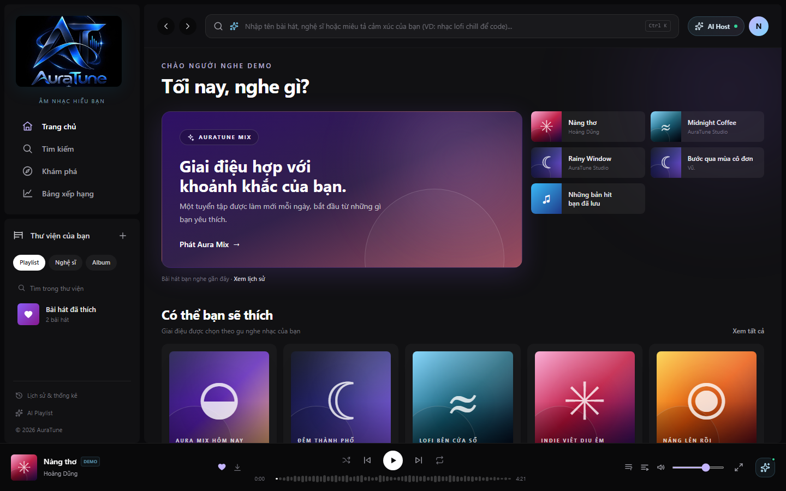
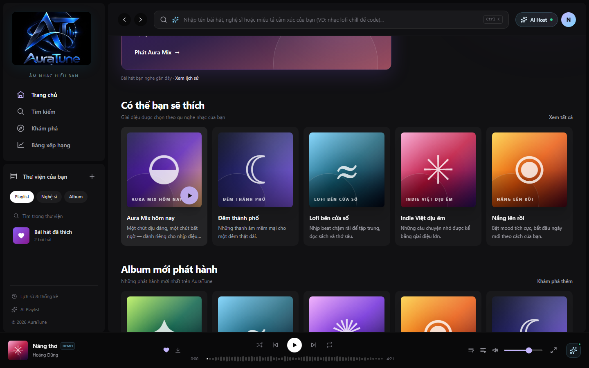
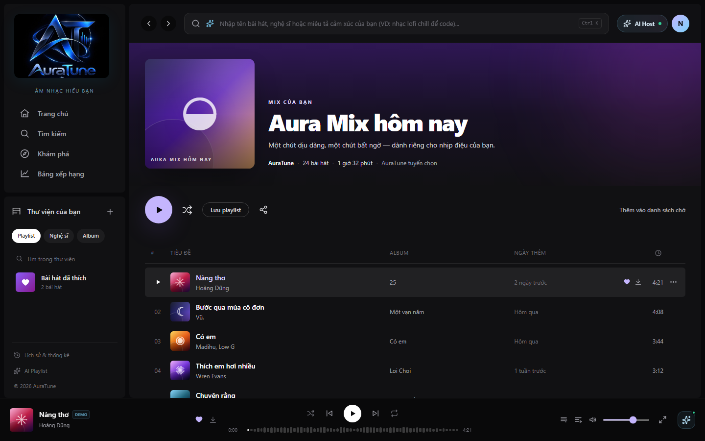

# UC-100-002 – Receive Personalized Recommendations

---

## 1. Metadata

| Field | Value |
|---|---|
| **Use Case ID** | UC-100-002 |
| **Use Case Name** | Receive Personalized Recommendations |
| **Functional Group** | 100 – AI Recommendations |
| **Primary Actor** | Listener (`ACT-02`) |
| **Supporting Actors** | External AI Service Provider (`ACT-EXT-04`) |
| **Related FR IDs** | `102-FR-001`, `102-FR-002`, `102-FR-003`, `102-FR-004`, `102-FR-005`, `102-FR-006`, `102-FR-007`, `102-FR-008`, `102-FR-009`, `102-FR-010`, `102-FR-011`, `102-FR-012`, `102-FR-013`, `102-FR-014`, `102-FR-015` |
| **Related Feature/Spec** | Feature 102: Personalized Recommendations (`specs/100-ai-recommendations/102-personalized-recommendations/spec.md`) |
| **Status** | Draft |
| **Writer** | Lê Công Minh Nhựt |
| **Reviewer** | TBD |

---

## 2. Description

An authenticated listener receives a tailored music recommendation feed on their home view, derived from their listening history ($\ge 30$ seconds), liked songs, and followed artists. The system returns multi-entity recommendations (Songs, Albums, Artists, and Playlists), handles cold-start scenarios for new listeners via trending fallbacks, and gracefully degrades during external AI service timeouts while strictly protecting account privacy.

---

## 3. Preconditions

- The user is authenticated as a `Listener` (`ACT-02`) with a valid JWT session (`102-FR-003`).
- The music catalog contains active, playable open-copyright songs, albums, and curated playlists (`102-FR-008`).

---

## 4. Trigger

The listener navigates to the Home Dashboard (`/`) or scrolls to the "Gợi ý cho bạn" (Recommended For You) section.

---

## 5. Basic Flow

1. **Actor:** Accesses the Home Dashboard view (`/`).
2. **System:** Extracts the caller's authenticated `user_id` from the session token and queries user preference signals: qualifying playback records in `listening_history` ($\ge 30$ seconds), liked tracks in `user_liked_songs`, and followed artists in `user_follows_artist` (`102-FR-003`, `102-FR-009`).
3. **System:** Verifies that the listener has sufficient listening activity to compute a personalized preference vector.
4. **System:** Requests candidate recommendations from the recommendation backend / External AI Service Provider (`ACT-EXT-04`) using the user's affinity profile.
5. **System:** Filters candidate recommendations to remove any inactive, deleted, or unplayable items, and deduplicates repeated items within the list (`102-FR-008`, `102-FR-015`).
6. **System:** Organizes results into supported entity types: Songs, Albums, Artists, and Playlists with artwork, title, artist name, and type badge (`102-FR-002`).
7. **System:** Renders the "Gợi ý cho bạn" recommendation feed container on the dashboard (`102-FR-001`).
8. **Actor:** Browses the personalized recommendations and clicks on a recommended item card (`102-FR-007`).
9. **System:** Dispatches interaction based on entity type:
   - If a **Song**: delegates playback initiation to the Music Player (`UC-040-001`), streaming audio bytes from Cloud Media Storage.
   - If an **Album**, **Artist**, or **Playlist**: routes the user to the corresponding entity detail view (`UC-080-001`, `UC-090-001`, or `UC-060-002`).
10. **Actor:** Listens to the selected track or explores the entity collection.

---

## 6. Alternative Flows

### AF-01 – Cold-Start Fallback for New or Low-Data Listeners
- **Starting step:** Step 3 of the Basic Flow.
- **Condition:** The authenticated listener has zero listening history or insufficient activity to construct a personalized profile (`102-FR-005`).
1. **System:** Identifies that historical playback activity is below the personalization threshold.
2. **System:** Triggers the cold-start fallback policy, retrieving current platform-wide trending/popular songs and starter playlists (`102-FR-005`).
3. **System:** Renders the fallback recommendation cards labeled with "Phổ biến" (Popular / Trending) badges, ensuring immediate playable discovery without blank screens.
4. **Actor:** Selects a trending item to begin listening.
- **Continuation:** Resumes at Step 9 of the Basic Flow.

### AF-02 – Manual Recommendation Feed Refresh
- **Starting step:** Step 7 of the Basic Flow.
- **Condition:** The listener triggers a page reload or navigates back to the Home Dashboard after listening to new music (`102-FR-014`).
1. **Actor:** Reloads the page or clicks the recommendation refresh control.
2. **System:** Gathers newly recorded playback logs from `listening_history` and queries for updated recommendation candidates.
3. **System:** Updates the recommendation cards with fresh items matching the listener's evolving taste.
- **Continuation:** Resumes at Step 8 of the Basic Flow.

### AF-03 – Transition to Cold-Start Following History Purge
- **Starting step:** Step 2 of the Basic Flow.
- **Condition:** The listener cleared their entire listening history in Group 070 (`UC-070-004`).
1. **System:** Detects that historical playback records have been purged (`102-FR-009`).
2. **System:** Invalidates any cached personal vectors for this account and immediately transitions the recommendation feed to the AF-01 cold-start trending baseline.
- **Continuation:** Continues via AF-01 at Step 2.

---

## 7. Exception Flows

### EF-01 – External AI Service Timeout or Outage
- **Starting step:** Step 4 of the Basic Flow.
- **Condition:** The External AI Service Provider / recommendation inference engine times out ($> 2.5$ seconds) or returns an HTTP 5xx error (`102-FR-006`).
1. **System:** Intercepts the service exception and prevents dashboard rendering failure.
2. **System:** Gracefully degrades by serving cached platform-wide popular songs and curated starter collections (`102-FR-006`).
3. **System:** Displays a subtle, non-intrusive fallback notice ("Hiển thị nội dung thịnh hành do hệ thống gợi ý đang bảo trì") without blocking playback or browsing.
4. **Actor:** Acknowledges the notice and interacts with the popular content.
- **Continuation:** Resumes at Step 8 of the Basic Flow; use case completes in degraded mode.

### EF-02 – Unauthenticated Visitor Request
- **Starting step:** Step 1 of the Basic Flow.
- **Condition:** An unauthenticated visitor (`Guest`) visits the home view.
1. **System:** Identifies guest state and suppresses private recommendation generation (`102-FR-004`).
2. **System:** Renders standard public discovery feeds (Trending Charts and Public Playlists) managed by Group 020 (`UC-020-001`, `UC-020-004`).
- **Continuation:** Use Case terminates; guest remains on public dashboard.

---

## 8. Postconditions

### Success
- The listener receives a relevant, multi-entity recommendation list tailored to their personal taste profile.
- Selecting an item reliably initiates audio playback or opens entity details in 1 interaction step (`SC-004`).
- All displayed items correspond to active, accessible catalog entities with zero broken references (`SC-005`).
- Account data and preference vectors remain strictly confidential to the authenticated account (`SC-001`).

### Failure
- The system serves standard popular fallback tracks accompanied by an informative notice.
- The home dashboard remains fully operational without application crashes or blank sections (`SC-002`, `SC-003`).

---

## 9. Special Requirements

- **Performance**: Recommendation feed response time must not exceed 2.0 seconds under standard server load. AI service timeout is enforced at 2.5 seconds.
- **Security & Privacy**: Zero cross-account data disclosure (Decree 13/2023/ND-CP). Under no circumstances are User A's history, likes, or personalized picks exposed to User B (`102-FR-004`).
- **Data Integrity**: Null user references and deleted songs must be strictly filtered out prior to UI presentation (`102-FR-008`, `102-FR-009`).
- **Catalog Consistency**: Deduplication must guarantee no identical item appears twice in the same recommendation feed (`102-FR-015`).

---

## 10. Prototype and Screenshots

### Basic Flow

*Figure 1: "Gợi ý cho bạn" recommendation section entry on the AuraTune Home Dashboard.*

*Figure 2: Multi-entity recommendation cards presenting recommended songs, albums, artists, and playlists.*

*Figure 3: Interactive recommendation card detail triggering track playback or entity navigation.*

### Alternative Flow – AF-01 (Cold-Start Trending Fallback)
*[Prototype Pending - To be generated during UI implementation]*  
*Planned Interface: Home dashboard recommendation block showing popular badges and starter tracks for new accounts with 0 listening history.*

### Exception Flow – EF-01 (AI Service Degradation)
*[Prototype Pending - To be generated during UI implementation]*  
*Planned Interface: Non-blocking alert banner notifying the listener that popular music is served while AI recommendation services are offline.*

---

## 11. Related Use Cases

- **Preceding Use Case**: `UC-010-002` (Log In with Email) – Authenticates the listener.
- **Context Container**: `UC-020-001` (Browse Home Dashboard) – Embeds the recommendation stream.
- **Included / Delegated Playback**: `UC-040-001` (Control Audio Playback) – Triggered when a recommended track is clicked.
- **Target Detail Navigation**:
  - `UC-080-001` (View Album Details)
  - `UC-090-001` (View Artist Profile)
  - `UC-060-002` (View Playlist Details)
- **Data Reset Trigger**: `UC-070-004` (Clear Listening History) – Initiates transition to AF-01.

---

## 12. Source References

- `specs/100-ai-recommendations/102-personalized-recommendations/spec.md` – Requirements FR-001 through FR-015, User Stories 1–4.
- `docs/proposal/Auratune_Vision_Document.md` – Section 3.5 & Group G10.
- `docs/proposal/proposal.md` – Section 6.10: Personalized song recommendations.
- `docs/design/database/er-diagram.md` – Tables `listening_history`, `user_liked_songs`, `user_follows_artist`.

---

## 13. Notes and Open Questions

- **Multi-Entity Scope**: Clarification session 2026-10-30 explicitly resolved that recommendations span Songs, Albums, Artists, and Playlists (Option 1B).
- **Offline Ingestion Boundary**: Spotify Web API metadata used during offline song preparation is strictly for catalog seeding and must never be merged into vector prompts (ED-02).
