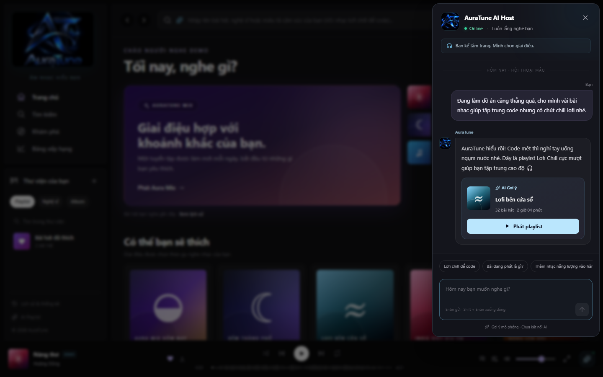
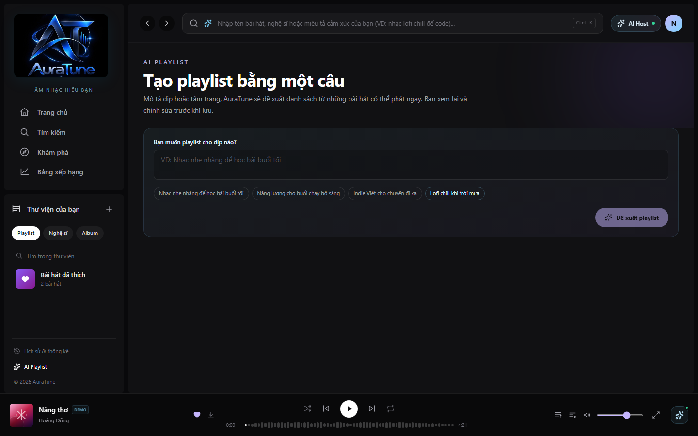
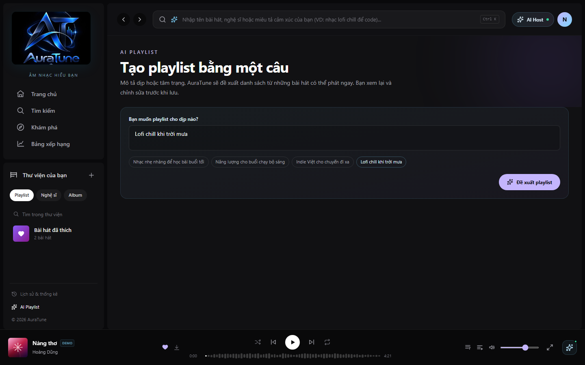
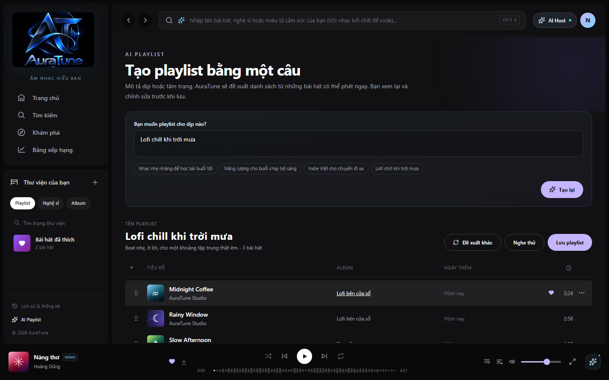

# UC-100-003 – Discover Music by Mood and Context

---

## 1. Metadata

| Field | Value |
|---|---|
| **Use Case ID** | UC-100-003 |
| **Use Case Name** | Discover Music by Mood and Context |
| **Functional Group** | 100 – AI Recommendations |
| **Primary Actor** | Listener (`ACT-02`) |
| **Supporting Actors** | External AI Service Provider (`ACT-EXT-04`) |
| **Related FR IDs** | `103-FR-001`, `103-FR-002`, `103-FR-003`, `103-FR-004`, `103-FR-005`, `103-FR-006`, `103-FR-007`, `103-FR-008`, `103-FR-009`, `103-FR-010`, `103-FR-011`, `103-FR-012`, `103-FR-013`, `103-FR-014`, `103-FR-015` |
| **Related Feature/Spec** | Feature 103: Mood and Context Recommendations (`specs/100-ai-recommendations/103-mood-and-context-recommendations/spec.md`) |
| **Status** | Draft |
| **Writer** | Lê Công Minh Nhựt |
| **Reviewer** | TBD |

---

## 2. Description

An authenticated listener discovers music tailored to their real-time emotional state or situational context by selecting from curated mood preset tags (*Chill*, *Energetic*, *Melancholy*, *Focus*) or activity context preset tags (*Study/Work*, *Workout*, *Late Night*, *Travel/Commute*). The system generates a dedicated recommendation stream comprising individual songs and theme-curated mood playlists, handles empty results gracefully with alternative mood suggestions, and delegates playback or playlist viewing.

---

## 3. Preconditions

- The user is authenticated as a `Listener` (`ACT-02`) with an active JWT session (`103-FR-005`).
- The music catalog contains active tracks and curated mood playlists associated with mood and contextual attributes (`103-FR-003`, `103-FR-008`).

---

## 4. Trigger

The listener navigates to the Music Discovery section (`/discovery`) or clicks on a mood/context chip in the discovery interface.

---

## 5. Basic Flow

1. **Actor:** Navigates to the Music Discovery hub (`/discovery`) and views the curated mood and context selection bar.
2. **System:** Renders curated preset tags organized into two distinct categories (`103-FR-002`):
   - **Core Moods**: *Chill*, *Energetic*, *Melancholy*, *Focus*.
   - **Activity Contexts**: *Study/Work*, *Workout*, *Late Night*, *Travel/Commute*.
3. **Actor:** Clicks on a desired tag chip (e.g., "Chill" or "Workout").
4. **System:** Visually highlights the active chip and issues a recommendation query scoped to the selected tag and authenticated session (`103-FR-005`).
5. **System:** Queries the External AI Service Provider (`ACT-EXT-04`) to retrieve songs and curated mood playlists matching the tag's acoustic vector profile.
6. **System:** Filters candidates to remove any deactivated or missing catalog entities and ensures zero duplicate items appear in the list (`103-FR-008`, `103-FR-014`).
7. **System:** Renders the recommendation results stream, displaying individual Songs and themed Mood Playlists with cover artwork, entity titles, creator names, and mood badges (`103-FR-001`, `103-FR-003`).
8. **Actor:** Selects a recommended item from the results stream (`103-FR-007`).
9. **System:** Executes the corresponding action based on entity type:
   - If a **Song**: delegates playback initiation to the Music Player (`UC-040-001`), loading audio bytes directly from Cloud Media Storage.
   - If a **Mood Playlist**: opens the playlist detail view (`UC-060-002`), displaying the track collection.
10. **Actor:** Enjoys the music matching their current vibe or activity.

---

## 6. Alternative Flows

### AF-01 – Switching Selected Mood or Context Tag
- **Starting step:** Step 7 of the Basic Flow.
- **Condition:** The listener selects a different mood or context tag (e.g., switching from "Chill" to "Workout") (`103-FR-015`).
1. **Actor:** Clicks a different preset chip on the selection bar.
2. **System:** Updates the visual selection state, clearing the previous tag and highlighting the new tag.
3. **System:** Queries the recommendation backend for candidates matching the newly selected tag.
4. **System:** Refreshes the recommendation results stream dynamically without requiring a full page reload.
- **Continuation:** Resumes at Step 8 of the Basic Flow.

### AF-02 – Empty Matches for Selected Tag
- **Starting step:** Step 5 of the Basic Flow.
- **Condition:** The selected tag currently matches zero active catalog songs or playlists (`103-FR-004`).
1. **System:** Identifies an empty recommendation response.
2. **System:** Renders a friendly empty-state card ("Hiện chưa có bài hát phù hợp với tâm trạng này") accompanied by quick suggestion chips for popular alternative moods (e.g., "Thử nghe Chill hoặc Focus") (`103-FR-004`).
3. **Actor:** Clicks one of the suggested alternative mood chips.
- **Continuation:** Re-enters Basic Flow at Step 4 with the newly selected suggestion tag.

---

## 7. Exception Flows

### EF-01 – AI Recommendation Backend Timeout or Outage
- **Starting step:** Step 5 of the Basic Flow.
- **Condition:** The External AI Service or vector matching engine times out ($> 2.5$ seconds) or responds with a service error (`103-FR-004`).
1. **System:** Intercepts the exception to prevent interface freezing or crashes.
2. **System:** Renders an informative service-unavailable state ("Dịch vụ gợi ý tâm trạng tạm thời không phản hồi") with quick navigation shortcuts to browse platform trending charts or saved playlists.
3. **Actor:** Acknowledges the message and clicks an alternative exploration shortcut.
- **Continuation:** Use Case completes in failure mode.

### EF-02 – Unauthenticated Visitor Request
- **Starting step:** Step 1 of the Basic Flow.
- **Condition:** An unauthenticated visitor (`Guest`) accesses `/discovery`.
1. **System:** Allows the visitor to view available mood chips, but requesting private recommendations or saving mood playlists triggers an authentication check (`103-FR-006`).
2. **System:** Displays a non-intrusive login prompt modal linking to `UC-010-002`.
- **Continuation:** Visitor logs in via `UC-010-002` or continues browsing public catalog items.

---

## 8. Postconditions

### Success
- The listener receives an accurate, curated stream of songs and mood playlists tailored to the selected mood/context tag.
- Selecting an item reliably initiates track playback or opens playlist details in 1 interaction step (`SC-004`).
- All displayed items correspond to active catalog entities (`SC-005`).
- The listener's mood interactions remain strictly confidential (`SC-001`).

### Failure
- The system presents a friendly empty state with suggested alternatives or an informative service-unavailable notice.
- The platform remains fully functional without crashes or interface blocking (`SC-002`, `SC-003`).

---

## 9. Special Requirements

- **Performance**: Recommendation stream must render within 2.0 seconds upon tag selection. Toggling between chips must update the results stream within 1.0 second.
- **Security & Privacy**: Strict account isolation (Decree 13/2023/ND-CP). User mood choices are confidential and never exposed to other listeners (`103-FR-006`).
- **Scope Discipline**: Excludes free-form text queries (reserved for Group 030 Search) and interactive conversational prompts (reserved for Group 120 AI Conversational Agent) (`103-FR-011`, `103-FR-013`).
- **Catalog Consistency**: Deduplication guarantees no identical song or playlist appears twice in the same recommendation list (`103-FR-014`).

---

## 10. Prototype and Screenshots

### Basic Flow

*Figure 1: Mood & Context discovery hub entry on the AuraTune discovery view.*

*Figure 2: Curated core mood preset chips: Chill, Energetic, Melancholy, Focus.*

*Figure 3: Curated situational activity preset chips: Study/Work, Workout, Late Night, Travel/Commute.*

*Figure 4: Filtered recommendation results stream presenting matching songs and theme-curated mood playlists.*

### Alternative Flow – AF-02 (Empty Mood Matches)
*[Prototype Pending - To be generated during UI implementation]*  
*Planned Interface: Empty state card with friendly messaging and alternative mood suggestion chips.*

### Exception Flow – EF-01 (AI Service Unavailable)
*[Prototype Pending - To be generated during UI implementation]*  
*Planned Interface: Informative service-offline notice with navigation shortcuts to platform trending charts.*

---

## 11. Related Use Cases

- **Preceding Use Case**: `UC-010-002` (Log In with Email) – Authenticates the listener.
- **Context Container**: `UC-020-001` (Browse Home Dashboard) – Discovery navigation link.
- **Included / Delegated Playback**: `UC-040-001` (Control Audio Playback) – Initiated when a recommended song is clicked.
- **Target Playlist Navigation**: `UC-060-002` (View Playlist Details) – Initiated when a mood playlist card is clicked.

---

## 12. Source References

- `specs/100-ai-recommendations/103-mood-and-context-recommendations/spec.md` – Requirements FR-001 through FR-015, User Stories 1–4.
- `docs/proposal/Auratune_Vision_Document.md` – Section 3.5 & Group G10.
- `docs/proposal/proposal.md` – Section 6.10: Mood and context recommendations.
- `docs/PA/AuraTune_Use_Case_Documentation_Guide.md` – Specification standards.

---

## 13. Notes and Open Questions

- **Preset Tag Scope**: Clarification session 2026-10-30 explicitly established 4 core moods (Chill, Energetic, Melancholy, Focus) and 4 activity contexts (Study/Work, Workout, Late Night, Travel/Commute). Custom free-form tagging by listeners is excluded.
- **Multi-Entity Delivery**: Mood recommendations return individual songs and curated mood playlists (unlike Feature 102, which also recommends individual albums and artists).
