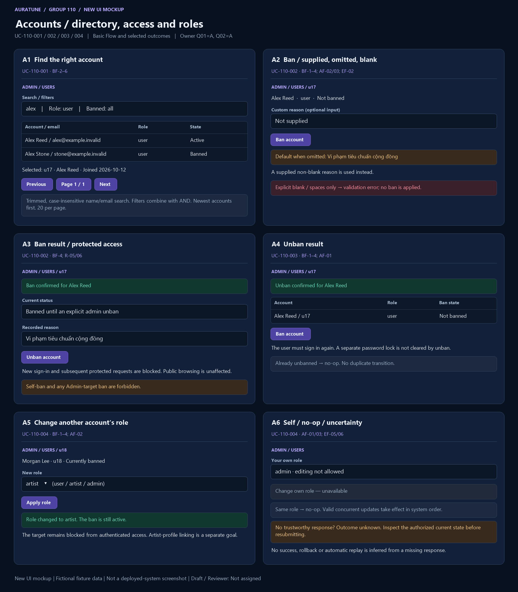

# UC-110-001 — View and Find Platform Users

## 1. Document Information

- **Use Case ID**: UC-110-001
- **Use Case Name**: View and Find Platform Users
- **Functional Group**: 110 — Admin Functions / Feature 111
- **Primary Actor**: Administrator (ACT-05)
- **Supporting Actors**: None evidenced; internal modules are not actors.
- **Author**: Not assigned
- **Reviewer**: Not assigned
- **Status**: Draft
- **Last Updated**: 2026-11-04
- **Decision provenance**: Owner-confirmed session choices dated 2026-11-04 — the decision register does not change this goal’s existing source-backed behavior. These are session decisions by the owner, not pre-existing source requirements, collective team approval or review sign-off.
- **Behavior completeness**: Specified in Draft for the applicable behavior, including the owner decisions cited below.

## 2. Description

The Administrator identifies the correct account and its role and ban status. Search, filters and paging refine this single directory-review goal.

## 3. Preconditions

The actor has a valid Administrator session. The directory may legitimately contain no accounts or no matching accounts.

Preconditions do not replace request-time checks. Loss of access is EF-01; missing/unavailable data is an outcome to handle, not a reason to bypass authorization.

## 4. Trigger

The Administrator opens user management or submits directory criteria.

## 5. Basic Flow (Main Success Scenario)

1. **Actor:** Requests the user directory. 
2. **System:** Checks current authentication and Administrator authorization and presents the directory with the minimum permitted identity and status fields. 
3. **Actor:** Provides a search term and any role or ban-state filters to identify relevant accounts. 
4. **System:** Validates the criteria, applies the search, matching, order and first-page rules in R-05, and shows matching accounts and their current ban states. 
5. **Actor:** Requests another result page when more matching accounts are needed. 
6. **System:** Returns that page in the same deterministic order without changing any account. 

## 6. Alternative Flows

### AF-01 — Empty directory or no matches

- **Starting step / Branching Point**: Basic Flow step 4.
- **Condition**: The directory is empty or the valid criteria match no accounts.

1. **System:** Displays a valid empty result, distinct from load failure.
2. **Actor:** May revise the criteria.

- **Outcome / Continuation / Exit**: Return to Basic Flow step 3 if revised; otherwise exit successfully with an empty result.

### AF-02 — Change criteria

- **Starting step / Branching Point**: Basic Flow step 6.
- **Condition**: The actor changes search or filter criteria while viewing a later page.

1. **Actor:** Submits the revised criteria.
2. **System:** Resets the page to the first page and applies R-05.

- **Outcome / Continuation / Exit**: Resume Basic Flow step 5 after the new results are returned.

### AF-03 — Leave before dispatch

- **Starting step / Branching Point**: Basic Flow step 3.
- **Condition**: The actor leaves before submitting the requested read or change.

1. **Actor:** Leaves the view or declines to submit.
2. **System:** Applies no action for an unsubmitted intention; leaving after dispatch does not establish cancellation or undo.

- **Outcome / Continuation / Exit**: Exit canceled before dispatch only. For an already sent request, use the unknown-outcome exception if no result is known.

## 7. Exception Flows

### EF-01 — Authentication or permission denied

- **Starting step / Branching Point**: Basic Flow step 2.
- **Condition**: Authentication is missing, expired or invalid, or the actor lacks current Administrator permission.

1. **System:** Denies the privileged request without exposing protected data or applying the requested mutation.
2. **Actor:** Acknowledges the denial; any later attempt requires valid access.

- **Outcome / Continuation / Exit**: Exit denied. This also applies if authorization is lost before a later read or mutation.

### EF-02 — Invalid request

- **Starting step / Branching Point**: Basic Flow step 4.
- **Condition**: The submitted target, criteria, role or required reason is malformed or invalid for this goal’s source branch.

1. **System:** Reports a validation failure without applying the invalid request or exposing sensitive data.
2. **Actor:** May correct the request before a new attempt.

- **Outcome / Continuation / Exit**: Exit failed validation; a corrected submission starts a new applicable request.

### EF-03 — Read unavailable

- **Starting step / Branching Point**: Basic Flow step 4.
- **Condition**: The list/detail cannot be retrieved reliably.

1. **System:** Shows a read failure distinct from valid empty, missing and intentionally restricted states; does not fabricate returned data.
2. **Actor:** May request another authorized read.

- **Outcome / Continuation / Exit**: Exit unavailable; retry is a new read, not proof the previous result was empty.

### EF-04 — Read result not yet known

- **Starting step / Branching Point**: Basic Flow step 6.
- **Condition**: A read was submitted but no trustworthy complete response has been received.

1. **System:** Does not label the read as successful or infer empty/not-found from the missing response.
2. **Actor:** May leave or later request a fresh authorized read.

- **Outcome / Continuation / Exit**: Exit unknown/unavailable read outcome; this read caused no mutation. No timeout duration or automatic retry is specified.

## 8. Postconditions

### 8.1 Success Postconditions

The authorized actor sees accurate permitted account fields or a valid empty result under the submitted criteria. Accounts are unchanged.

### 8.2 Failure Postconditions

The read does not mutate source data. Failed reads are not represented as successful empty results. Protected information is withheld when access is denied.

### 8.3 Cancellation Postconditions

Before dispatch, leaving without submitting produces no action. After dispatch, leaving or dismissing feedback does not prove cancellation or undo; cancellation of an in-flight request is not defined by the source.

### 8.4 Unknown-Outcome Postconditions

A missing/unreliable response establishes neither successful data retrieval nor a valid empty/not-found result. This read has no mutation; a later read is a fresh observation.

## 9. Special Requirements

- **Performance**: No numeric response-time target is established for this goal in the reviewed feature source; none is invented.
- **Security & Privacy**: Apply backend Administrator authorization for privileged reads/actions at every request; do not disclose credentials, secrets or unrelated private data. Actor roles are not UI-only safeguards.
- **Accessibility**: No source-specific conformance target is established here. Feedback must identify the actual outcome rather than imply success from a control’s appearance; detailed interaction/accessibility design is a technical follow-up.
- **Result integrity**: Distinguish confirmed success, no-op, cancellation before dispatch, known rejection/failure and unknown completion. Apply the confirmed owner session choices only within their documented scope; no collective approval is inferred.

## 10. Related Functional Requirements

Source-local IDs are qualified with the feature number. “Specified in Draft” means a concrete behavior/rule is written, not implemented/tested/approved. “Needs Clarification” may concern only part of an FR; retain the settled clauses and the open branch. The [inventory](./use-case-inventory.md#complete-fr-traceability) remains the distinct 74-FR accounting ledger.

| Source FR | Source requirement | Actual flow / rule | Behavior status |
|---|---|---|---|
| 111-FR-001 | The system MUST allow a valid authenticated admin to access the user-management capability. | [BF-2](#bf-2); [R-01](#r-01) | Specified in Draft — source-backed clauses |
| 111-FR-002 | The system MUST allow a valid authenticated admin to view the user list within the currently approved project scope and must not expose password, password hash, token, or secret material. | [BF-2](#bf-2); [R-02](#r-02) | Specified in Draft — source-backed clauses |
| 111-FR-003 | The system MUST allow a valid authenticated admin to search or filter the user list by the currently defined criteria from the active contract, including `q`, `role`, and `is_banned` where they are active in the project contract. | [BF-3](#bf-3), [BF-4](#bf-4); [R-05](#r-05) | Specified in Draft — source-backed clauses |
| 111-FR-004 | The system MUST show enough user information to identify the correct account and its current status without exposing sensitive authentication data. The permitted admin-visible user fields are: `user_id`, `display_name`, `email`, `role`, `created_at`, `is_banned`, and `ban_reason` when a reason is recorded. | [BF-2](#bf-2), [BF-5](#bf-5); [R-02](#r-02) | Specified in Draft — source-backed clauses |
| 111-FR-007 | The system MUST reject any request that does not originate from a valid authenticated admin. | [EF-01](#ef-01); [R-01](#r-01) | Specified in Draft — source-backed clauses |
| 111-FR-008 | The system MUST reject requests with expired, invalid, or missing authentication and MUST not perform any user-management action without a valid session. | [EF-01](#ef-01); [R-01](#r-01) | Specified in Draft — source-backed clauses |
| 111-FR-009 | The system MUST deny access to non-admin accounts and must not disclose any user-management data or perform state changes for unauthorized roles. | [EF-01](#ef-01); [R-01](#r-01) | Specified in Draft — source-backed clauses |
| 111-FR-013 | The system MUST return a validation error for malformed requests, invalid filter values, blank ban reasons, or missing required fields and MUST not mutate state. | [EF-02](#ef-02); [R-03](#r-03) | Specified in Draft — owner session resolution: [Q02](./use-case-inventory.md#q02) |
| 111-FR-014 | The system MUST handle empty results as a valid empty state rather than as a failure. | [AF-01](#af-01) | Specified in Draft — source-backed clauses |
| 111-FR-015 | The system MUST not expose password, password hash, tokens, session IDs, secrets, or similar sensitive fields in list results, error responses, or status messages. | [R-02](#r-02); [EF-01](#ef-01), [EF-02](#ef-02), [EF-03](#ef-03) | Specified in Draft — source-backed clauses |
| 111-FR-017 | The system MUST clearly distinguish between a valid empty result, a validation failure, an authorization failure, a not-found result, and an operation failure; a failed operation MUST never be reported as successful. | [R-03](#r-03); [AF-01](#af-01); [EF-01](#ef-01), [EF-02](#ef-02), [EF-03](#ef-03), [EF-04](#ef-04) | Specified in Draft — source-backed clauses |
| 111-FR-018 | The system MUST keep the feature focused on account management. It MUST NOT add account deletion, password reset, impersonation, or export, and MUST NOT include content moderation or platform statistics in this feature. | [R-04](#r-04) | Specified in Draft — source-backed clauses |
| 111-FR-019 | The system MUST keep user-to-artist linking and artist administrative actions outside this feature scope and must not merge them into account management. | [R-04](#r-04) | Specified in Draft — source-backed clauses |
| 111-FR-021 | The admin list MUST support the documented default query semantics: `q` is a trimmed case-insensitive substring match on `email` or `display_name`, `role` is an exact match, `is_banned` is a boolean filter, all filters apply by AND, results sort by `created_at` descending then `user_id` ascending, and each page contains at most 20 records. | [BF-4](#bf-4), [BF-6](#bf-6); [AF-02](#af-02); [R-05](#r-05) | Specified in Draft — source-backed clauses |

## 11. Related Use Cases

- **Includes**: None asserted.
- **Extended by**: None asserted.
- **Preceding / related goals**: [UC-110-002](./UC-110-002-ban-user-account.md), [UC-110-003](./UC-110-003-unban-user-account.md), [UC-110-004](./UC-110-004-change-user-role.md). These are navigation/state dependencies, not unproved UML include/extend claims.

## 12. Source References

- [Feature 111 specification](../../../../specs/110-admin-functions/111-user-management/spec.md) — embedded Clarifications (2026-10-30, 2026-11-01), User Scenarios & Testing, Functional Requirements, Edge Cases and scope sections.
- [Feature checklist](../../../../specs/110-admin-functions/111-user-management/checklists/requirements.md) — quality/source review, not approval evidence.
- [API contract](../../../analysis-and-design/api-contract.md#210-admin) — §2.10 Admin endpoint and permission evidence; missing payloads/routes are not invented in the flows.
- [Use-case guide/template](../README.md#6-standard-use-case-specification-template), [shared actor/UC model](../../use-case-model.md), [security guidance](../../../design/security/README.md), [database security](../../../design/database/security-rules.md).
- [Vision G11](../../../proposal/Auratune_Vision_Document.md) — broad administration context, not a grant to expand these flows.

## 13. Prototype and Screenshot References

### Basic Flow Mockup

**Figure UC-110-001: A1.** BF-2/3/4 directory/search/filter result; BF-5/6 paging affordance only. This is a **new conceptual UI mockup**, rendered for requirements review with fictional fixtures; **not a screenshot of a deployed system**, implementation validation or proof of persisted results. Request/result/branch annotations within a panel are illustrative composites, not a captured interaction timeline. The image is intentionally shared where one storyboard covers several actor goals.

### Alternative / Exception Coverage

**Partial overall.** A true multi-page transition, empty result and invalid/unauthorized directory states remain Missing. See the [per-goal evidence matrix](./prototypes/README.md#coverage-per-actor-goal) for Illustrated/Partial/Missing distinctions.

### Existing Source References

- [01-user-management-list.png](../../../../specs/110-admin-functions/111-user-management/ui/01-user-management-list.png) — pre-existing source UI prototype/demo evidence, reused by reference only.
- [02-user-search.png](../../../../specs/110-admin-functions/111-user-management/ui/02-user-search.png) — pre-existing source UI prototype/demo evidence, reused by reference only.

The [prototype register](./prototypes/README.md) preserves all fourteen original source references and records the six new mockups separately. Source conflicts, owner-session provenance, actor permissions and FR completeness are unchanged by drawing a screen.

## 14. Business Rules and Scope Constraints

- **R-01**: Every list, review or mutation request requires a valid authenticated Administrator and backend role checks. Missing, invalid or expired authentication and non-admin access disclose no protected account data and perform no account-management action.
- **R-02**: Only user_id, display_name, email, role, created_at, is_banned and recorded ban_reason are admin-visible. Never return passwords, hashes, tokens, session IDs or secrets in results, errors or toasts.
- **R-03**: Distinguish a valid empty list, invalid input, denied authorization, missing account and failed operation. A confirmed failed mutation changes no saved state; a missing response alone does not prove failure or rollback.
- **R-04**: Account deletion, password reset, impersonation, export, content moderation, platform statistics, user-to-artist linking and artist administration are outside these account goals. Role management follows the owner-confirmed Q01=A resolution of C1; the original exclusion remains preserved in the source archive.
- **R-05**: Trim the search text and match a case-insensitive substring of email or display name. Role matches exactly user, artist or admin; ban status matches true/false. Combine filters with AND. Sort by creation time descending then account ID ascending; at most 20 records per page. A filter change resets to the first page. No custom sorting policy is introduced.

## 15. Source Conflicts and Behavioral Impact

No conflicting source passages affect this goal’s specified clauses. This is not a claim that all Group 110 source documents are consistent.

## 16. Open Questions and Follow-ups

The existing source-backed behavior remains unchanged by the confirmed choices.

No unanswered behavior choice from Q01–Q11 remains for this goal. Technical mechanisms and image gaps are not new product decisions.

See the [owner decision register](./use-case-inventory.md#decision-register). These are owner session confirmations, not whole-team approval or review sign-off. [Technical follow-ups](./use-case-inventory.md#technical-follow-ups) and [prototype evidence](./prototypes/README.md) remain separate.

## 17. Draft Verification and Limitations

Sections 1–13 preserve every section actually present in the shared embedded template. Sections 14–17 supplement it with rules, source conflicts, questions and verification because the guide calls it a 17-section template but only prints 13 sections; no missing canonical headings are claimed. The template discrepancy is an authoring follow-up, not a behavior question.

This file is a Draft with Reviewer: Not assigned. Numbered Actor/System flows and FR-to-rule mappings describe documentation, not executed tests or a completed prototype. Missing source evidence, deferred behavior and unknown execution outcomes must not be reported as fully Covered. Owner-confirmed choices govern this documentation scope only. No reviewer, product approval, implementation readiness or policy choice is inferred.
