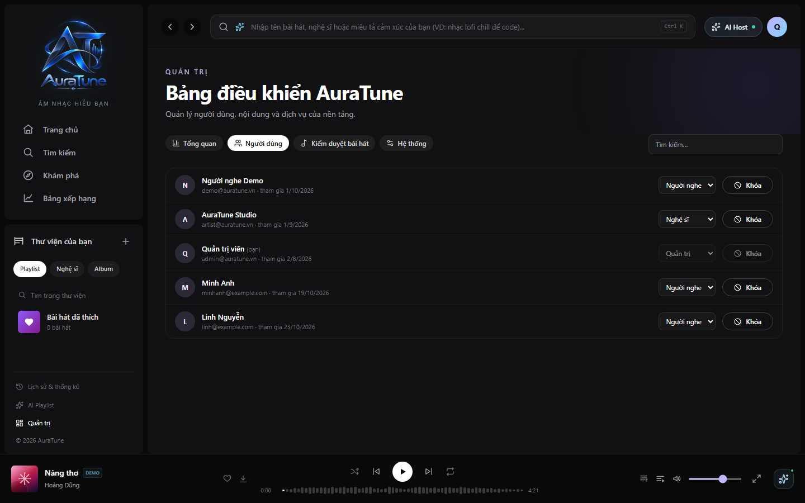

# UC-110-001: View and Search Platform Users
Performed by: Thái Hoàng | Reviewed by: Group 10 team | Edited by: Lê Công Minh Nhựt

## 1. Metadata
Performed by: Thái Hoàng | Reviewed by: Group 10 team | Edited by: Lê Công Minh Nhựt

| Field | Value |
| --- | --- |
| Use Case ID | UC-110-001 |
| Use Case Name | View and Search Platform Users |
| Primary Actor | Administrator |
| Related FR IDs | 111-FR-001..004, 007..009, 012..015, 017, 021; FR-110-001 |
| Status | Draft; pending team review |
| Writer | Lê Công Minh Nhựt |
| Reviewer | Group 10 team |
| Date | 2026-11-20 |

## 2. Goal and source
Performed by: Thái Hoàng | Reviewed by: Group 10 team | Edited by: Lê Công Minh Nhựt

Identify accounts by the approved directory fields and filters.

Source: [specs/110-admin-functions/111-user-management/spec.md](../../../../specs/110-admin-functions/111-user-management/spec.md). Feature-qualified IDs identify local FR numbers; Vision FR IDs keep their original namespace.

## 3. Preconditions
Performed by: Thái Hoàng | Reviewed by: Group 10 team | Edited by: Lê Công Minh Nhựt

- The acting account has a valid, non-banned Administrator session.
- The requested operation is within the acting account's authorized scope.

## 4. Trigger
Performed by: Thái Hoàng | Reviewed by: Group 10 team | Edited by: Lê Công Minh Nhựt

The admin opens Users or changes its search/filter/page.

## 5. Basic flow
Performed by: Thái Hoàng | Reviewed by: Group 10 team | Edited by: Lê Công Minh Nhựt

1. Actor opens the user directory.
2. System verifies the current admin session.
3. System applies trimmed case-insensitive email/display-name query, exact role and ban filters with AND semantics.
4. System sorts by created_at descending, then user_id ascending, returning at most 20 records per page.
5. System displays only user_id, display_name, email, role, created_at, is_banned and an available ban_reason.
6. Actor changes filters or requests another page; a filter change starts at page one.

## 6. Alternative flows
Performed by: Thái Hoàng | Reviewed by: Group 10 team | Edited by: Lê Công Minh Nhựt

### AF-01: Empty result
Performed by: Thái Hoàng | Reviewed by: Group 10 team | Edited by: Lê Công Minh Nhựt

At Basic step 5, show a valid empty state when no account matches. Keep filter controls available.

## 7. Exception flows
Performed by: Thái Hoàng | Reviewed by: Group 10 team | Edited by: Lê Công Minh Nhựt

### EX-01: Invalid or unauthorized session
Performed by: Thái Hoàng | Reviewed by: Group 10 team | Edited by: Lê Công Minh Nhựt

At Basic step 2, reject a missing, expired, banned or non-admin session. Disclose no management data and perform no mutation. Re-authentication does not authorize a non-admin role.

### EX-02: Service or persistence failure
Performed by: Thái Hoàng | Reviewed by: Group 10 team | Edited by: Lê Công Minh Nhựt

At the retrieval or commit step, show a failure state and a permitted manual retry. Do not display success or fabricate data from a failed response; reconcile uncertain writes before claiming an outcome.

### EX-03: Missing or malformed target
Performed by: Thái Hoàng | Reviewed by: Group 10 team | Edited by: Lê Công Minh Nhựt

Reject a missing target or invalid input at validation without fabricating a successful operation. For a read-only overview, metric unavailability follows its own partial-data flow.

## 8. Postconditions
Performed by: Thái Hoàng | Reviewed by: Group 10 team | Edited by: Lê Công Minh Nhựt

Success: The admin sees the authorized page of matching accounts, with no credentials or session material.

Failure: No denied or failed operation is presented as successful. No unauthorized data is disclosed.

## 9. Special requirements and business rules
Performed by: Thái Hoàng | Reviewed by: Group 10 team | Edited by: Lê Công Minh Nhựt

Required behavior follows the cited sources and recorded PA4 decisions. Success is shown only after the required operation succeeds. An empty result is distinct from a failed retrieval. Access checks apply at the service boundary when an API is involved; browser-only goals do not gain a new backend dependency. No new storage schema, endpoint, retry policy or audit service is selected by this draft.

## 10. Prototype evidence
Performed by: Thái Hoàng | Reviewed by: Group 10 team | Edited by: Lê Công Minh Nhựt

Source UI reference only. It is not evidence that backend permission, persistence or every error state passes acceptance.

## 11. Open questions and implementation boundary
Performed by: Thái Hoàng | Reviewed by: Group 10 team | Edited by: Lê Công Minh Nhựt

Source wording, route reachability and database enforcement still require group review and acceptance.

`src/frontend/src/pages/Admin/AdminPage.jsx` and AppStore provide browser-state administration. No Admin API module is mounted in the current backend entrypoint. UI role checks, toasts and local state updates do not establish server authorization, audit persistence, session enforcement or authoritative aggregates.

## 12. Acceptance checks
Performed by: Thái Hoàng | Reviewed by: Group 10 team | Edited by: Lê Công Minh Nhựt

- [ ] Execute the basic flow and verify its success postcondition.
- [ ] Execute the alternative and exception flows and verify their outcomes.
- [ ] Verify the actor/ownership boundary and inspect observable output for private data.
- [ ] Verify required persistence independently of browser-only state, where applicable.
- [ ] Review the prototype coverage and source decisions with the group owner.

Results are pending. This document is a specification draft, not a test execution report.
