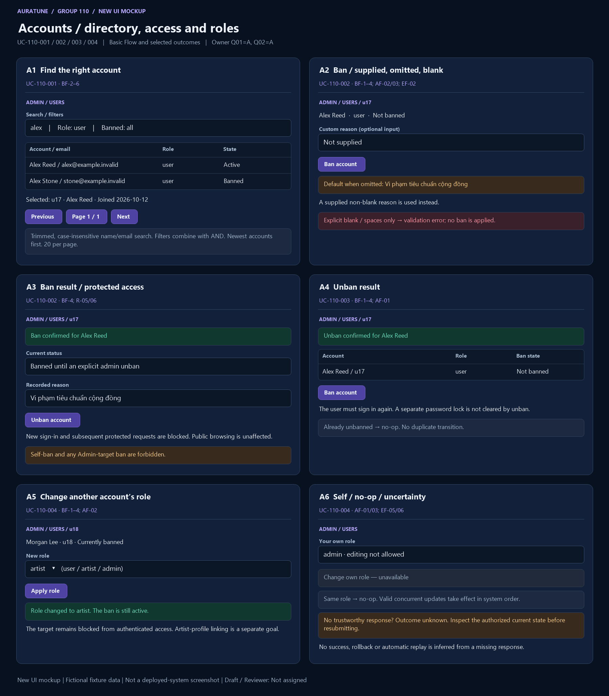

# UC-110-002 — Ban User Account

## 1. Document Information

- **Use Case ID**: UC-110-002
- **Use Case Name**: Ban User Account
- **Functional Group**: 110 — Admin Functions / Feature 111
- **Primary Actor**: Administrator (ACT-05)
- **Supporting Actors**: None evidenced; internal modules are not actors.
- **Author**: Not assigned
- **Reviewer**: Not assigned
- **Status**: Draft
- **Last Updated**: 2026-11-04
- **Decision provenance**: Owner-confirmed session choices dated 2026-11-04 — [Q02](./use-case-inventory.md#q02). These are session decisions by the owner, not pre-existing source requirements, collective team approval or review sign-off.
- **Behavior completeness**: Specified in Draft for the applicable behavior, including the owner decisions cited below.

## 2. Description

The Administrator applies a persistent ban to another non-admin account. Owner-confirmed session decision Q02=A permits direct ban with a default reason when custom input is omitted; an explicitly blank custom reason is rejected.

## 3. Preconditions

The acting Administrator has valid access and identifies an existing non-admin account. Self-ban and banning another Administrator remain forbidden.

Check current permission on each submitted action; earlier preconditions do not excuse missing/expired/invalid access. A missing target or unknown result remains an explicitly handled outcome.

## 4. Trigger

The Administrator requests a ban for an identified account.

## 5. Basic Flow (Main Success Scenario)

1. **Actor:** Selects a non-admin target and requests ban, with an optional custom reason. 
2. **System:** Rechecks current Administrator authorization, target existence and current role; rejects self or any Administrator target. 
3. **Actor:** Submits the ban action directly without a separate confirmation requirement. 
4. **System:** Rejects explicit blank/whitespace custom input; otherwise uses the supplied non-blank reason or the default “Vi phạm tiêu chuẩn cộng đồng” when no custom reason was sent, persists the ban/reason, and provides a success toast only after confirmed persistence. 

## 6. Alternative Flows

### AF-01 — Already banned

- **Starting step / Branching Point**: Basic Flow step 2.
- **Condition**: The permitted target is already banned.

1. **System:** Reports a duplicate/no-op result with the target still banned and no contradictory state transition.
2. **Actor:** Reviews the current status.

- **Outcome / Continuation / Exit**: Exit no-op, not a newly applied ban.

### AF-02 — Custom reason

- **Starting step / Branching Point**: Basic Flow step 3.
- **Condition**: The actor supplies a custom reason.

1. **Actor:** Submits a reason containing non-whitespace characters.
2. **System:** Validates the trimmed input and uses the supplied reason.

- **Outcome / Continuation / Exit**: Continue at Basic Flow step 4; explicit blank follows EF-02.

### AF-03 — No custom reason supplied

- **Starting step / Branching Point**: Basic Flow step 3.
- **Condition**: The request omits a custom reason entirely.

1. **Actor:** Submits the direct ban action.
2. **System:** Records “Vi phạm tiêu chuẩn cộng đồng” as the non-blank default reason.

- **Outcome / Continuation / Exit**: Continue at Basic Flow step 4; omission is distinct from an explicitly blank field.

### AF-04 — Leave before dispatch

- **Starting step / Branching Point**: Basic Flow step 3.
- **Condition**: No ban request has been dispatched.

1. **Actor:** Leaves without submitting.
2. **System:** Applies no ban for an unsubmitted intention.

- **Outcome / Continuation / Exit**: Exit canceled; leaving after dispatch does not undo a possible persisted ban.

## 7. Exception Flows

### EF-01 — Authentication or permission denied

- **Starting step / Branching Point**: Basic Flow step 2.
- **Condition**: Authentication is missing, expired or invalid, or the actor lacks current Administrator permission.

1. **System:** Denies the privileged request without exposing protected data or applying the requested mutation.
2. **Actor:** Acknowledges the denial; any later attempt requires valid access.

- **Outcome / Continuation / Exit**: Exit denied. This also applies if authorization is lost before a later read or mutation.

### EF-02 — Invalid request

- **Starting step / Branching Point**: Basic Flow step 3.
- **Condition**: The submitted target, criteria, role or required reason is malformed or invalid for this goal’s source branch.

1. **System:** Reports a validation failure without applying the invalid request or exposing sensitive data.
2. **Actor:** May correct the request before a new attempt.

- **Outcome / Continuation / Exit**: Exit failed validation; a corrected submission starts a new applicable request.

### EF-03 — Target unavailable

- **Starting step / Branching Point**: Basic Flow step 2.
- **Condition**: The selected account or song no longer exists.

1. **System:** Returns not found without applying a transition. A repeated final-delete of a missing song is not-found, not a contradictory successful restore.
2. **Actor:** Acknowledges the result.

- **Outcome / Continuation / Exit**: Exit without a newly applied action. This does not resolve state identity or reset scope questions.

### EF-04 — Confirmed operation failure

- **Starting step / Branching Point**: Basic Flow step 4.
- **Condition**: The system confirms the requested operation failed rather than merely losing its response.

1. **System:** Reports the failed operation and applies no saved change for that failed request; does not issue a success toast.
2. **Actor:** Reviews the reported outcome.

- **Outcome / Continuation / Exit**: Exit failed. A later retry is not an automatic replay guarantee; unknown completion is EF-06.

### EF-05 — Self or admin-target ban

- **Starting step / Branching Point**: Basic Flow step 2.
- **Condition**: The target is the acting Administrator or any other Administrator.

1. **System:** Rejects the ban as forbidden without changing the target state.
2. **Actor:** Acknowledges the rejection.

- **Outcome / Continuation / Exit**: Exit failed; no ban is applied.

### EF-06 — Dispatched result unknown

- **Starting step / Branching Point**: Basic Flow step 4.
- **Condition**: The request was dispatched but persistence or completion cannot be established because the response is lost or unreliable.

1. **System:** Does not claim success, failure, cancellation or rollback solely from the missing response. The operation may have taken effect.
2. **Actor:** May later inspect the authorized current state before deciding whether to submit another action.

- **Outcome / Continuation / Exit**: Exit unknown outcome, not confirmed failure. This is a truthfulness boundary, not a new retry, transaction, audit, or recovery mechanism.

## 8. Postconditions

### 8.1 Success Postconditions

The eligible non-admin account is banned until an authorized explicit unban, with the supplied or default non-blank reason. A confirmed success toast reflects persisted state. A duplicate is a no-op. Subsequent protected requests/new login are blocked; public unauthenticated browsing is unchanged.

### 8.2 Failure Postconditions

Authorization/validation rejection, missing target or a confirmed failed action does not mutate saved state for that request. Other valid concurrent actors may change the current record; this Draft does not promise a global state freeze.

### 8.3 Cancellation Postconditions

Before dispatch, leaving without submitting produces no action. After dispatch, leaving or dismissing feedback does not prove cancellation or undo; cancellation of an in-flight request is not defined by the source.

### 8.4 Unknown-Outcome Postconditions

A dispatched mutation with no trustworthy result may or may not have committed. Do not claim unchanged state, rollback, success or a successful cancel. Read the current authorized state when possible; no automatic replay or recovery guarantee is introduced.

## 9. Special Requirements

- **Performance**: No numeric response-time target is established for this goal in the reviewed feature source; none is invented.
- **Security & Privacy**: Apply backend Administrator authorization for privileged reads/actions at every request; do not disclose credentials, secrets or unrelated private data. Actor roles are not UI-only safeguards.
- **Accessibility**: No source-specific conformance target is established here. Feedback must identify the actual outcome rather than imply success from a control’s appearance; detailed interaction/accessibility design is a technical follow-up.
- **Result integrity**: Distinguish confirmed success, no-op, cancellation before dispatch, known rejection/failure and unknown completion. Apply the confirmed owner session choices only within their documented scope; no collective approval is inferred.

## 10. Related Functional Requirements

Source-local IDs are qualified with the feature number. “Specified in Draft” means a concrete behavior/rule is written, not implemented/tested/approved. “Needs Clarification” may concern only part of an FR; retain the settled clauses and the open branch. The [inventory](./use-case-inventory.md#complete-fr-traceability) remains the distinct 74-FR accounting ledger.

| Source FR | Source requirement | Actual flow / rule | Behavior status |
|---|---|---|---|
| 111-FR-001 | The system MUST allow a valid authenticated admin to access the user-management capability. | [BF-2](#bf-2); [R-01](#r-01) | Specified in Draft — source-backed clauses |
| 111-FR-005 | The system MUST allow a valid authenticated admin to ban only a non-admin account and MUST require a non-blank reason for the ban action. | [BF-2](#bf-2), [BF-3](#bf-3), [BF-4](#bf-4); [AF-02](#af-02), [AF-03](#af-03); [R-07](#r-07) | Specified in Draft — owner session resolution: [Q02](./use-case-inventory.md#q02) |
| 111-FR-007 | The system MUST reject any request that does not originate from a valid authenticated admin. | [EF-01](#ef-01); [R-01](#r-01) | Specified in Draft — source-backed clauses |
| 111-FR-008 | The system MUST reject requests with expired, invalid, or missing authentication and MUST not perform any user-management action without a valid session. | [EF-01](#ef-01); [R-01](#r-01) | Specified in Draft — source-backed clauses |
| 111-FR-009 | The system MUST deny access to non-admin accounts and must not disclose any user-management data or perform state changes for unauthorized roles. | [EF-01](#ef-01); [R-01](#r-01) | Specified in Draft — source-backed clauses |
| 111-FR-010 | The system MUST reject any attempt to ban the acting admin or another admin account, and MUST treat that action as forbidden without changing state. | [BF-2](#bf-2); [EF-05](#ef-05) | Specified in Draft — source-backed clauses |
| 111-FR-011 | After a successful admin ban, the system MUST reject new login attempts for that account and MUST deny subsequent authenticated protected requests from the banned account until the account is explicitly unbanned. Public content access that does not require authenticated access remains outside this restriction. | [R-06](#r-06) | Specified in Draft — source-backed clauses |
| 111-FR-012 | The system MUST return a not-found result when the target user does not exist and MUST make no state change. | [EF-03](#ef-03) | Specified in Draft — source-backed clauses |
| 111-FR-013 | The system MUST return a validation error for malformed requests, invalid filter values, blank ban reasons, or missing required fields and MUST not mutate state. | [EF-02](#ef-02); [R-07](#r-07) | Specified in Draft — owner session resolution: [Q02](./use-case-inventory.md#q02) |
| 111-FR-015 | The system MUST not expose password, password hash, tokens, session IDs, secrets, or similar sensitive fields in list results, error responses, or status messages. | [R-02](#r-02) | Specified in Draft — source-backed clauses |
| 111-FR-016 | The system MUST handle duplicate or repeated ban or unban requests consistently, either as a no-op or an idempotent success/failure result, without creating contradictory state. | [AF-01](#af-01) | Specified in Draft — source-backed clauses |
| 111-FR-017 | The system MUST clearly distinguish between a valid empty result, a validation failure, an authorization failure, a not-found result, and an operation failure; a failed operation MUST never be reported as successful. | [R-03](#r-03); [EF-01](#ef-01), [EF-02](#ef-02), [EF-03](#ef-03), [EF-04](#ef-04) | Specified in Draft — source-backed clauses |
| 111-FR-018 | The system MUST keep the feature focused on account management. It MUST NOT add account deletion, password reset, impersonation, or export, and MUST NOT include content moderation or platform statistics in this feature. | [R-04](#r-04) | Specified in Draft — source-backed clauses |
| 111-FR-019 | The system MUST keep user-to-artist linking and artist administrative actions outside this feature scope and must not merge them into account management. | [R-04](#r-04) | Specified in Draft — source-backed clauses |
| 111-FR-020 | A user ban is a separate administrative state from temporary login failure locking; the system MUST treat ban enforcement and password-lock enforcement as distinct behaviors unless a separate product decision explicitly merges them. | [R-05](#r-05) | Specified in Draft — source-backed clauses |
| 111-FR-023 | The system MUST support direct one-click ban and unban actions with immediate visual toast feedback, persisting a system default reason ("Vi phạm tiêu chuẩn cộng đồng") when a custom reason is not provided. | [AF-03](#af-03); [BF-4](#bf-4); [R-07](#r-07) | Specified in Draft — owner session resolution: [Q02](./use-case-inventory.md#q02) |

## 11. Related Use Cases

- **Includes**: None asserted.
- **Extended by**: None asserted.
- **Preceding / related goals**: [UC-110-001](./UC-110-001-view-and-find-platform-users.md), [UC-110-003](./UC-110-003-unban-user-account.md). These are navigation/state dependencies, not unproved UML include/extend claims.

## 12. Source References

- [Feature 111 specification](../../../../specs/110-admin-functions/111-user-management/spec.md) — embedded Clarifications (2026-10-30, 2026-11-01), User Scenarios & Testing, Functional Requirements, Edge Cases and scope sections.
- [Feature checklist](../../../../specs/110-admin-functions/111-user-management/checklists/requirements.md) — quality/source review, not approval evidence.
- [API contract](../../../analysis-and-design/api-contract.md#210-admin) — §2.10 Admin endpoint and permission evidence; missing payloads/routes are not invented in the flows.
- [Use-case guide/template](../README.md#6-standard-use-case-specification-template), [shared actor/UC model](../../use-case-model.md), [security guidance](../../../design/security/README.md), [database security](../../../design/database/security-rules.md).
- [Vision G11](../../../proposal/Auratune_Vision_Document.md) — broad administration context, not a grant to expand these flows.

## 13. Prototype and Screenshot References

### Basic Flow Mockup

**Figure UC-110-002: A2–A3.** BF-1–4 omitted-reason request and confirmed ban; custom/blank distinctions and R-05/06 annotated. This is a **new conceptual UI mockup**, rendered for requirements review with fictional fixtures; **not a screenshot of a deployed system**, implementation validation or proof of persisted results. Request/result/branch annotations within a panel are illustrative composites, not a captured interaction timeline. The image is intentionally shared where one storyboard covers several actor goals.

### Alternative / Exception Coverage

**Partial overall.** Filled custom-reason and blank-input rejection screens, actual protected-request denial, other-admin ban rejection and ban-specific unknown outcomes remain Missing; annotations are not executed evidence. See the [per-goal evidence matrix](./prototypes/README.md#coverage-per-actor-goal) for Illustrated/Partial/Missing distinctions.

### Existing Source References

- [04-ban-user.png](../../../../specs/110-admin-functions/111-user-management/ui/04-ban-user.png) — pre-existing source UI prototype/demo evidence, reused by reference only.

The [prototype register](./prototypes/README.md) preserves all fourteen original source references and records the six new mockups separately. Source conflicts, owner-session provenance, actor permissions and FR completeness are unchanged by drawing a screen.

## 14. Business Rules and Scope Constraints

- **R-01**: Every list, review or mutation request requires a valid authenticated Administrator and backend role checks. Missing, invalid or expired authentication and non-admin access disclose no protected account data and perform no account-management action.
- **R-02**: Only user_id, display_name, email, role, created_at, is_banned and recorded ban_reason are admin-visible. Never return passwords, hashes, tokens, session IDs or secrets in results, errors or toasts.
- **R-03**: Distinguish a valid empty list, invalid input, denied authorization, missing account and failed operation. A confirmed failed mutation changes no saved state; a missing response alone does not prove failure or rollback.
- **R-04**: Account deletion, password reset, impersonation, export, content moderation, platform statistics, user-to-artist linking and artist administration are outside these account goals. Role management follows the owner-confirmed Q01=A resolution of C1; the original exclusion remains preserved in the source archive.
- **R-05**: A ban persists until explicit authorized unban; there is no automatic expiry, scheduled release or temporary suspension. It is distinct from temporary password-lock enforcement.
- **R-06**: After confirmed ban, reject new login attempts and every subsequent authenticated protected request from that account even if its previous access token has not expired. Public browsing requiring no authentication remains unaffected. After unban, the user must sign in again, as stated by the Oct 30 session clarification.
- **R-07**: Owner Q02=A: omitted custom reason uses the non-blank default “Vi phạm tiêu chuẩn cộng đồng”; explicit blank/whitespace-only input is invalid. The recorded reason remains mandatory. Success feedback follows confirmed persistence; unknown completion does not justify a success toast.

## 15. Source Conflicts and Behavioral Impact

### C2

**Passage A** — [specs/110-admin-functions/111-user-management/spec.md, line 162](../../../../specs/110-admin-functions/111-user-management/spec.md#L162):

> - **FR-013**: The system MUST return a validation error for malformed requests, invalid filter values, blank ban reasons, or missing required fields and MUST not mutate state.

**Passage B** — [specs/110-admin-functions/111-user-management/spec.md, line 172](../../../../specs/110-admin-functions/111-user-management/spec.md#L172):

> - **FR-023**: The system MUST support direct one-click ban and unban actions with immediate visual toast feedback, persisting a system default reason ("Vi phạm tiêu chuẩn cộng đồng") when a custom reason is not provided.

**Historical impact before this owner decision:** Reason entry, default substitution and blank-input validation change the ban path. The unban toast is not evidence that an unban reason is required.

**Resolution reference — owner confirmed in this session:** [Q02](./use-case-inventory.md#q02)

**Current treatment:** Apply [Q02](./use-case-inventory.md#q02). All original source passages above remain verbatim. The owner resolved the documentation behavior locally; source specs/shared artifacts are unchanged. These decisions are not pre-existing or collectively approved requirements.

## 16. Open Questions and Follow-ups

Applied owner-confirmed session choices: [Q02](./use-case-inventory.md#q02).

No unanswered behavior choice from Q01–Q11 remains for this goal. Technical mechanisms and image gaps are not new product decisions.

See the [owner decision register](./use-case-inventory.md#decision-register). These are owner session confirmations, not whole-team approval or review sign-off. [Technical follow-ups](./use-case-inventory.md#technical-follow-ups) and [prototype evidence](./prototypes/README.md) remain separate.

## 17. Draft Verification and Limitations

Sections 1–13 preserve every section actually present in the shared embedded template. Sections 14–17 supplement it with rules, source conflicts, questions and verification because the guide calls it a 17-section template but only prints 13 sections; no missing canonical headings are claimed. The template discrepancy is an authoring follow-up, not a behavior question.

This file is a Draft with Reviewer: Not assigned. Numbered Actor/System flows and FR-to-rule mappings describe documentation, not executed tests or a completed prototype. Missing source evidence, deferred behavior and unknown execution outcomes must not be reported as fully Covered. Owner-confirmed choices govern this documentation scope only. No reviewer, product approval, implementation readiness or policy choice is inferred.
