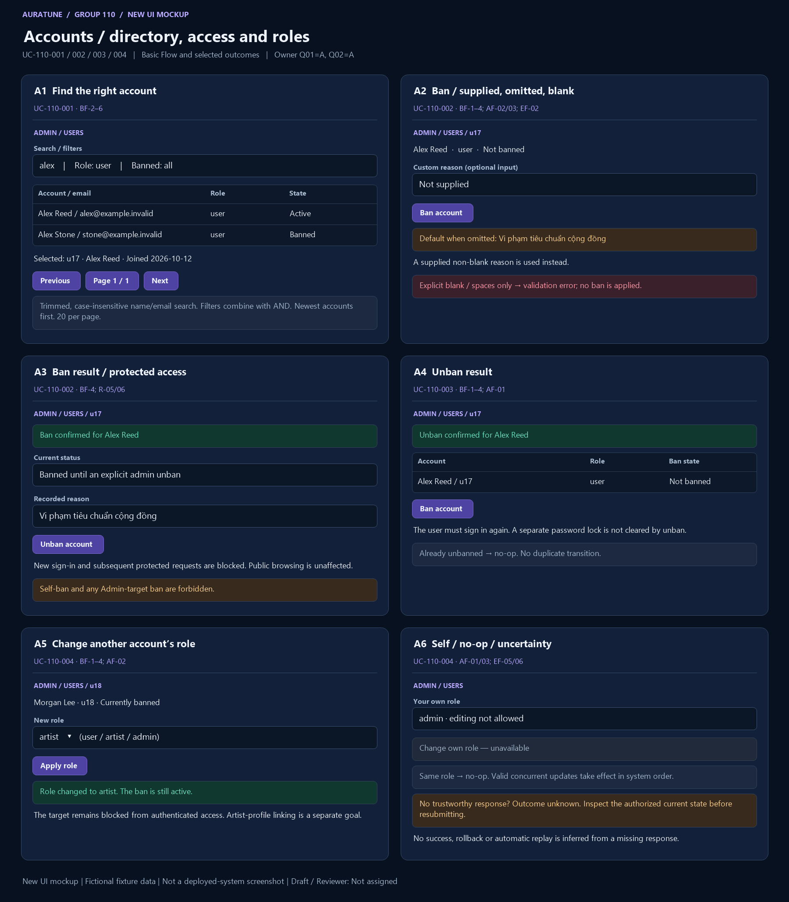

# UC-110-004 — Change User Role

## 1. Document Information

- **Use Case ID**: UC-110-004
- **Use Case Name**: Change User Role
- **Functional Group**: 110 — Admin Functions / Feature 111
- **Primary Actor**: Administrator (ACT-05)
- **Supporting Actors**: None evidenced; internal modules are not actors.
- **Author**: Not assigned
- **Reviewer**: Not assigned
- **Status**: Draft
- **Last Updated**: 2026-11-04
- **Decision provenance**: Owner-confirmed session choices dated 2026-11-04 — [Q01](./use-case-inventory.md#q01). These are session decisions by the owner, not pre-existing source requirements, collective team approval or review sign-off.
- **Behavior completeness**: Specified in Draft for the applicable behavior, including the owner decisions cited below.

## 2. Description

The Administrator changes another existing account between user, artist and admin. Owner-confirmed session decision Q01=A includes currently banned targets without clearing their ban; own-role changes remain prohibited.

## 3. Preconditions

The acting Administrator has valid current access and identifies another existing account. A banned target may receive a role change but remains banned and blocked under the existing ban rules.

Check current permission on each submitted action; earlier preconditions do not excuse missing/expired/invalid access. A missing target or unknown result remains an explicitly handled outcome.

## 4. Trigger

The Administrator requests a role change for another account.

## 5. Basic Flow (Main Success Scenario)

1. **Actor:** Selects another existing account for role management. 
2. **System:** Rechecks current Administrator access and target existence, rejecting a request that changes the acting Administrator’s own role. 
3. **Actor:** Selects user, artist or admin as the desired role. 
4. **System:** Validates the role and processes valid changes in system order, saves the resulting role without clearing a ban or password lock, and reports confirmed success; a request for the current role is a no-op. 

## 6. Alternative Flows

### AF-01 — Same role requested

- **Starting step / Branching Point**: Basic Flow step 4.
- **Condition**: The desired role already equals the target’s current role when processed.

1. **System:** Returns a no-op with the current role and no extra state change.
2. **Actor:** Reviews the result.

- **Outcome / Continuation / Exit**: Exit no-op.

### AF-02 — Banned target

- **Starting step / Branching Point**: Basic Flow step 4.
- **Condition**: The target currently has an active ban.

1. **System:** Updates the role but preserves the ban and its authenticated-access blocking, including when the selected role is admin.
2. **Actor:** Reviews role and ban as separate states.

- **Outcome / Continuation / Exit**: Exit role-change success; this is not unban or session restoration.

### AF-03 — Concurrent valid role requests

- **Starting step / Branching Point**: Basic Flow step 4.
- **Condition**: Other valid role requests for the same target overlap this request.

1. **System:** Processes valid requests in system order; the last successful applicable update determines the resulting role. Rejected self/unauthorized requests do not take effect.
2. **Actor:** Reads the current authorized result before relying on it.

- **Outcome / Continuation / Exit**: Exit with current confirmed state; a response is not a guarantee that no later valid update occurred.

### AF-04 — Leave before dispatch

- **Starting step / Branching Point**: Basic Flow step 3.
- **Condition**: The actor has not submitted the change.

1. **Actor:** Leaves without submitting a role.
2. **System:** Applies no change for that intention.

- **Outcome / Continuation / Exit**: Exit canceled; dispatched unknown outcomes remain EF-06.

## 7. Exception Flows

### EF-01 — Authentication or permission denied

- **Starting step / Branching Point**: Basic Flow step 2.
- **Condition**: Authentication is missing, expired or invalid, or the actor lacks current Administrator permission.

1. **System:** Denies the privileged request without exposing protected data or applying the requested mutation.
2. **Actor:** Acknowledges the denial; any later attempt requires valid access.

- **Outcome / Continuation / Exit**: Exit denied. This also applies if authorization is lost before a later read or mutation.

### EF-02 — Invalid request

- **Starting step / Branching Point**: Basic Flow step 3.
- **Condition**: The submitted target, criteria, role or required reason is malformed or invalid for this goal’s source branch.

1. **System:** Reports a validation failure without applying the invalid request or exposing sensitive data.
2. **Actor:** May correct the request before a new attempt.

- **Outcome / Continuation / Exit**: Exit failed validation; a corrected submission starts a new applicable request.

### EF-03 — Target unavailable

- **Starting step / Branching Point**: Basic Flow step 2.
- **Condition**: The selected account or song no longer exists.

1. **System:** Returns not found without applying a transition. A repeated final-delete of a missing song is not-found, not a contradictory successful restore.
2. **Actor:** Acknowledges the result.

- **Outcome / Continuation / Exit**: Exit without a newly applied action. This does not resolve state identity or reset scope questions.

### EF-04 — Confirmed operation failure

- **Starting step / Branching Point**: Basic Flow step 4.
- **Condition**: The system confirms the requested operation failed rather than merely losing its response.

1. **System:** Reports the failed operation and applies no saved change for that failed request; does not issue a success toast.
2. **Actor:** Reviews the reported outcome.

- **Outcome / Continuation / Exit**: Exit failed. A later retry is not an automatic replay guarantee; unknown completion is EF-06.

### EF-05 — Self-role change

- **Starting step / Branching Point**: Basic Flow step 2.
- **Condition**: The actor attempts to change their own role.

1. **System:** Rejects the request without changing the role.
2. **Actor:** Acknowledges the rejection.

- **Outcome / Continuation / Exit**: Exit failed; own role unchanged under every supported source branch.

### EF-06 — Dispatched result unknown

- **Starting step / Branching Point**: Basic Flow step 4.
- **Condition**: The request was dispatched but persistence or completion cannot be established because the response is lost or unreliable.

1. **System:** Does not claim success, failure, cancellation or rollback solely from the missing response. The operation may have taken effect.
2. **Actor:** May later inspect the authorized current state before deciding whether to submit another action.

- **Outcome / Continuation / Exit**: Exit unknown outcome, not confirmed failure. This is a truthfulness boundary, not a new retry, transaction, audit, or recovery mechanism.

## 8. Postconditions

### 8.1 Success Postconditions

Another eligible account has the selected role after confirmed processing, or a same-role no-op. Its ban/password-lock state is not cleared and the actor’s own role is unchanged. Concurrent valid updates are reflected in system processing order.

### 8.2 Failure Postconditions

Authorization/validation rejection, missing target or a confirmed failed action does not mutate saved state for that request. Other valid concurrent actors may change the current record; this Draft does not promise a global state freeze.

### 8.3 Cancellation Postconditions

Before dispatch, leaving without submitting produces no action. After dispatch, leaving or dismissing feedback does not prove cancellation or undo; cancellation of an in-flight request is not defined by the source.

### 8.4 Unknown-Outcome Postconditions

A dispatched mutation with no trustworthy result may or may not have committed. Do not claim unchanged state, rollback, success or a successful cancel. Read the current authorized state when possible; no automatic replay or recovery guarantee is introduced.

## 9. Special Requirements

- **Performance**: No numeric response-time target is established for this goal in the reviewed feature source; none is invented.
- **Security & Privacy**: Apply backend Administrator authorization for privileged reads/actions at every request; do not disclose credentials, secrets or unrelated private data. Actor roles are not UI-only safeguards.
- **Accessibility**: No source-specific conformance target is established here. Feedback must identify the actual outcome rather than imply success from a control’s appearance; detailed interaction/accessibility design is a technical follow-up.
- **Result integrity**: Distinguish confirmed success, no-op, cancellation before dispatch, known rejection/failure and unknown completion. Apply the confirmed owner session choices only within their documented scope; no collective approval is inferred.

## 10. Related Functional Requirements

Source-local IDs are qualified with the feature number. “Specified in Draft” means a concrete behavior/rule is written, not implemented/tested/approved. “Needs Clarification” may concern only part of an FR; retain the settled clauses and the open branch. The [inventory](./use-case-inventory.md#complete-fr-traceability) remains the distinct 74-FR accounting ledger.

| Source FR | Source requirement | Actual flow / rule | Behavior status |
|---|---|---|---|
| 111-FR-001 | The system MUST allow a valid authenticated admin to access the user-management capability. | [BF-2](#bf-2); [R-01](#r-01) | Specified in Draft — source-backed clauses |
| 111-FR-007 | The system MUST reject any request that does not originate from a valid authenticated admin. | [EF-01](#ef-01); [R-01](#r-01) | Specified in Draft — source-backed clauses |
| 111-FR-008 | The system MUST reject requests with expired, invalid, or missing authentication and MUST not perform any user-management action without a valid session. | [EF-01](#ef-01); [R-01](#r-01) | Specified in Draft — source-backed clauses |
| 111-FR-009 | The system MUST deny access to non-admin accounts and must not disclose any user-management data or perform state changes for unauthorized roles. | [EF-01](#ef-01); [R-01](#r-01) | Specified in Draft — source-backed clauses |
| 111-FR-012 | The system MUST return a not-found result when the target user does not exist and MUST make no state change. | [EF-03](#ef-03) | Specified in Draft — source-backed clauses |
| 111-FR-013 | The system MUST return a validation error for malformed requests, invalid filter values, blank ban reasons, or missing required fields and MUST not mutate state. | [EF-02](#ef-02) (invalid target/role, conditional scope) | Specified in Draft — owner session resolution: [Q02](./use-case-inventory.md#q02) |
| 111-FR-015 | The system MUST not expose password, password hash, tokens, session IDs, secrets, or similar sensitive fields in list results, error responses, or status messages. | [R-02](#r-02) | Specified in Draft — source-backed clauses |
| 111-FR-017 | The system MUST clearly distinguish between a valid empty result, a validation failure, an authorization failure, a not-found result, and an operation failure; a failed operation MUST never be reported as successful. | [R-03](#r-03); [EF-01](#ef-01), [EF-02](#ef-02), [EF-03](#ef-03), [EF-04](#ef-04) | Specified in Draft — source-backed clauses |
| 111-FR-018 | The system MUST keep the feature focused on account management. It MUST NOT add account deletion, password reset, impersonation, or export, and MUST NOT include content moderation or platform statistics in this feature. | [R-04](#r-04) | Specified in Draft — source-backed clauses |
| 111-FR-019 | The system MUST keep user-to-artist linking and artist administrative actions outside this feature scope and must not merge them into account management. | [R-04](#r-04), [R-05](#r-05) | Specified in Draft — source-backed clauses |
| 111-FR-022 | The system MUST allow an authenticated admin to change the role of another user account between `user`, `artist`, and `admin`, but MUST strictly prohibit an admin from changing their own role. | [BF-2](#bf-2), [BF-3](#bf-3), [BF-4](#bf-4); [AF-01](#af-01), [AF-02](#af-02), [AF-03](#af-03); [R-05](#r-05), [R-06](#r-06) | Specified in Draft — owner session resolution: [Q01](./use-case-inventory.md#q01) |

## 11. Related Use Cases

- **Includes**: None asserted.
- **Extended by**: None asserted.
- **Preceding / related goals**: [UC-110-001](./UC-110-001-view-and-find-platform-users.md). These are navigation/state dependencies, not unproved UML include/extend claims.

## 12. Source References

- [Feature 111 specification](../../../../specs/110-admin-functions/111-user-management/spec.md) — embedded Clarifications (2026-10-30, 2026-11-01), User Scenarios & Testing, Functional Requirements, Edge Cases and scope sections.
- [Feature checklist](../../../../specs/110-admin-functions/111-user-management/checklists/requirements.md) — quality/source review, not approval evidence.
- [API contract](../../../analysis-and-design/api-contract.md#210-admin) — §2.10 Admin endpoint and permission evidence; missing payloads/routes are not invented in the flows.
- [Use-case guide/template](../README.md#6-standard-use-case-specification-template), [shared actor/UC model](../../use-case-model.md), [security guidance](../../../design/security/README.md), [database security](../../../design/database/security-rules.md).
- [Vision G11](../../../proposal/Auratune_Vision_Document.md) — broad administration context, not a grant to expand these flows.

## 13. Prototype and Screenshot References

### Basic Flow Mockup

**Figure UC-110-004: A5–A6.** BF-1–4 role selection/result for another banned target; self-change restriction and same-role/order/unknown rules. This is a **new conceptual UI mockup**, rendered for requirements review with fictional fixtures; **not a screenshot of a deployed system**, implementation validation or proof of persisted results. Request/result/branch annotations within a panel are illustrative composites, not a captured interaction timeline. The image is intentionally shared where one storyboard covers several actor goals.

### Alternative / Exception Coverage

**Partial overall.** A role request rejected at the permission boundary, actual concurrent/no-op transitions and expired-session states remain Missing. See the [per-goal evidence matrix](./prototypes/README.md#coverage-per-actor-goal) for Illustrated/Partial/Missing distinctions.

### Existing Source References

- [03-change-user-role.png](../../../../specs/110-admin-functions/111-user-management/ui/03-change-user-role.png) — pre-existing source UI prototype/demo evidence, reused by reference only.

The [prototype register](./prototypes/README.md) preserves all fourteen original source references and records the six new mockups separately. Source conflicts, owner-session provenance, actor permissions and FR completeness are unchanged by drawing a screen.

## 14. Business Rules and Scope Constraints

- **R-01**: Every list, review or mutation request requires a valid authenticated Administrator and backend role checks. Missing, invalid or expired authentication and non-admin access disclose no protected account data and perform no account-management action.
- **R-02**: Only user_id, display_name, email, role, created_at, is_banned and recorded ban_reason are admin-visible. Never return passwords, hashes, tokens, session IDs or secrets in results, errors or toasts.
- **R-03**: Distinguish a valid empty list, invalid input, denied authorization, missing account and failed operation. A confirmed failed mutation changes no saved state; a missing response alone does not prove failure or rollback.
- **R-04**: Account deletion, password reset, impersonation, export, content moderation, platform statistics, user-to-artist linking and artist administration are outside these account goals. Role management follows the owner-confirmed Q01=A resolution of C1; the original exclusion remains preserved in the source archive.
- **R-05**: Owner Q01=A permits changing another account between user, artist and admin, including a banned target. Strictly reject own-role changes. This is not user-to-artist profile linking.
- **R-06**: Owner Q01=A: role change does not clear the target’s ban or a separate password lock and does not restore sessions. Same-role requests are no-ops. Process valid concurrent role changes in system order; the last successful applicable change determines the role. Current authorization and no-self-change checks still apply at processing time.

## 15. Source Conflicts and Behavioral Impact

### C1

**Passage A** — [specs/110-admin-functions/111-user-management/spec.md, line 9](../../../../specs/110-admin-functions/111-user-management/spec.md#L9):

> **Input**: User description: "Admin is allowed to view, search, filter, and manage user account status within the project-defined scope. The feature must include listing users, searching and filtering by the currently defined criteria (including q, role and is_banned where the active contract still uses them), showing only the account information needed to identify the correct account and its status, banning and unbanning accounts, recording the ban reason, and handling empty results, missing accounts, invalid requests, expired sessions, insufficient permissions, and failed operations. Only valid admins can perform user-management operations. Passwords, password hashes, tokens and secrets must never be exposed. Clarify unresolved points: whether an administrator may ban themselves or other admins, whether a ban reason is mandatory, whether a ban is temporary or indefinite, effects on current sessions and authenticated operations, which user fields are visible to admins, and the expected search/filter/sort/pagination behavior when not already defined. Do not mix in content moderation or platform statistics. Do not add account deletion, password reset, impersonation, export, or admin-role grant/revoke. User-to-artist linking is not part of this feature."

**Passage B** — [specs/110-admin-functions/111-user-management/spec.md, line 171](../../../../specs/110-admin-functions/111-user-management/spec.md#L171):

> - **FR-022**: The system MUST allow an authenticated admin to change the role of another user account between `user`, `artist`, and `admin`, but MUST strictly prohibit an admin from changing their own role.

**Historical impact before this owner decision:** Role changes cannot be treated as an unconditional available capability; the input excludes grant/revoke while FR-022 permits it. Self-role changes remain prohibited in every conditional branch.

**Resolution reference — owner confirmed in this session:** [Q01](./use-case-inventory.md#q01)

**Current treatment:** Apply [Q01](./use-case-inventory.md#q01). All original source passages above remain verbatim. The owner resolved the documentation behavior locally; source specs/shared artifacts are unchanged. These decisions are not pre-existing or collectively approved requirements.

## 16. Open Questions and Follow-ups

Applied owner-confirmed session choices: [Q01](./use-case-inventory.md#q01).

No unanswered behavior choice from Q01–Q11 remains for this goal. Technical mechanisms and image gaps are not new product decisions.

See the [owner decision register](./use-case-inventory.md#decision-register). These are owner session confirmations, not whole-team approval or review sign-off. [Technical follow-ups](./use-case-inventory.md#technical-follow-ups) and [prototype evidence](./prototypes/README.md) remain separate.

## 17. Draft Verification and Limitations

Sections 1–13 preserve every section actually present in the shared embedded template. Sections 14–17 supplement it with rules, source conflicts, questions and verification because the guide calls it a 17-section template but only prints 13 sections; no missing canonical headings are claimed. The template discrepancy is an authoring follow-up, not a behavior question.

This file is a Draft with Reviewer: Not assigned. Numbered Actor/System flows and FR-to-rule mappings describe documentation, not executed tests or a completed prototype. Missing source evidence, deferred behavior and unknown execution outcomes must not be reported as fully Covered. Owner-confirmed choices govern this documentation scope only. No reviewer, product approval, implementation readiness or policy choice is inferred.
