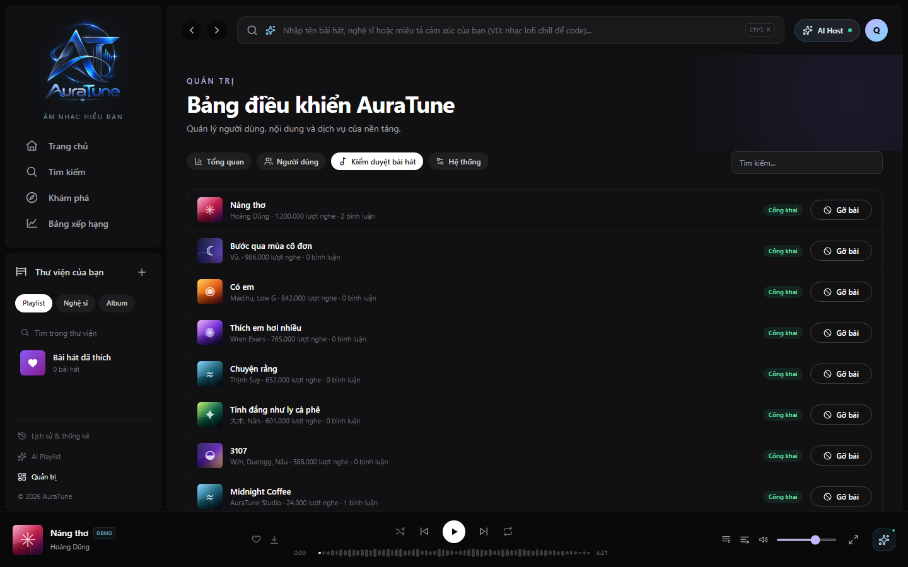

# UC-110-005: Moderate Platform Tracks
Performed by: Thái Hoàng | Reviewed by: Group 10 team | Edited by: Lê Công Minh Nhựt

## 1. Metadata
Performed by: Thái Hoàng | Reviewed by: Group 10 team | Edited by: Lê Công Minh Nhựt

| Field | Value |
| --- | --- |
| Use Case ID | UC-110-005 |
| Use Case Name | Moderate Platform Tracks |
| Primary Actor | Administrator |
| Related FR IDs | 112-FR-001..030; FR-110-005 |
| Status | Draft; pending team review |
| Writer | Lê Công Minh Nhựt |
| Reviewer | Group 10 team |
| Date | 2026-11-20 |

## 2. Goal and source
Performed by: Thái Hoàng | Reviewed by: Group 10 team | Edited by: Lê Công Minh Nhựt

Review track availability and apply the newer direct moderation policy selected in PA4-D06, preserving recorded history and audit data.

Source: [specs/110-admin-functions/112-content-moderation/spec.md](../../../../specs/110-admin-functions/112-content-moderation/spec.md). Feature-qualified IDs identify local FR numbers; Vision FR IDs keep their original namespace.

## 3. Preconditions
Performed by: Thái Hoàng | Reviewed by: Group 10 team | Edited by: Lê Công Minh Nhựt

- The acting account has a valid, non-banned Administrator session.
- The requested operation is within the acting account's authorized scope.

## 4. Trigger
Performed by: Thái Hoàng | Reviewed by: Group 10 team | Edited by: Lê Công Minh Nhựt

The admin opens Content or requests removal/restoration.

## 5. Basic flow
Performed by: Thái Hoàng | Reviewed by: Group 10 team | Edited by: Lê Công Minh Nhựt

1. Actor opens the non-deleted track moderation list.
2. System verifies current admin authority and applies documented search/filter/order/page behavior.
3. Actor selects the intended track and its removal/restriction or restoration action.
4. System checks target state and applies the newer direct-action policy with the applicable default copyright/community reason.
5. System commits availability state while retaining historical playback records and audit data.
6. After removal, new public streaming is blocked and the item is skipped in active queues. Restoration cannot bypass Artist visibility or restore a deleted song.
7. System displays the authoritative outcome and success feedback after completion.

## 6. Alternative flows
Performed by: Thái Hoàng | Reviewed by: Group 10 team | Edited by: Lê Công Minh Nhựt

### AF-01: Duplicate state request
Performed by: Thái Hoàng | Reviewed by: Group 10 team | Edited by: Lê Công Minh Nhựt

At Basic step 4, restriction of an already restricted item or restoration of an unrestricted item is a no-op without a reason overwrite.

### AF-02: Opposing actions
Performed by: Thái Hoàng | Reviewed by: Group 10 team | Edited by: Lê Công Minh Nhựt

Valid actions take effect in successful processing order; a failed action does not change saved state.

## 7. Exception flows
Performed by: Thái Hoàng | Reviewed by: Group 10 team | Edited by: Lê Công Minh Nhựt

### EX-01: Invalid or unauthorized session
Performed by: Thái Hoàng | Reviewed by: Group 10 team | Edited by: Lê Công Minh Nhựt

At Basic step 2, reject a missing, expired, banned or non-admin session. Disclose no management data and perform no mutation. Re-authentication does not authorize a non-admin role.

### EX-02: Service or persistence failure
Performed by: Thái Hoàng | Reviewed by: Group 10 team | Edited by: Lê Công Minh Nhựt

At the retrieval or commit step, show a failure state and a permitted manual retry. Do not display success or fabricate data from a failed response; reconcile uncertain writes before claiming an outcome.

### EX-03: Missing or malformed target
Performed by: Thái Hoàng | Reviewed by: Group 10 team | Edited by: Lê Công Minh Nhựt

Reject a missing target or invalid input at validation without fabricating a successful operation. For a read-only overview, metric unavailability follows its own partial-data flow.

## 8. Postconditions
Performed by: Thái Hoàng | Reviewed by: Group 10 team | Edited by: Lê Công Minh Nhựt

Success: The intended availability state is recorded, with history preserved and new unauthorized playback blocked.

Failure: No denied or failed operation is presented as successful. No unauthorized data is disclosed.

## 9. Special requirements and business rules
Performed by: Thái Hoàng | Reviewed by: Group 10 team | Edited by: Lê Công Minh Nhựt

Required behavior follows the cited sources and recorded PA4 decisions. Success is shown only after the required operation succeeds. An empty result is distinct from a failed retrieval. Access checks apply at the service boundary when an API is involved; browser-only goals do not gain a new backend dependency. No new storage schema, endpoint, retry policy or audit service is selected by this draft.

## 10. Prototype evidence
Performed by: Thái Hoàng | Reviewed by: Group 10 team | Edited by: Lê Công Minh Nhựt

Source UI reference only. It is not evidence that backend permission, persistence or every error state passes acceptance.

## 11. Open questions and implementation boundary
Performed by: Thái Hoàng | Reviewed by: Group 10 team | Edited by: Lê Công Minh Nhựt

PA4-D06 selects the newer direct-action/removal policy. Older permanent-delete and already-started-playback wording still needs a separately authorized spec alignment. This draft does not decide physical media deletion, override Artist visibility or authorize erasure of historical plays.

`src/frontend/src/pages/Admin/AdminPage.jsx` and AppStore provide browser-state administration. No Admin API module is mounted in the current backend entrypoint. UI role checks, toasts and local state updates do not establish server authorization, audit persistence, session enforcement or authoritative aggregates.

## 12. Acceptance checks
Performed by: Thái Hoàng | Reviewed by: Group 10 team | Edited by: Lê Công Minh Nhựt

- [ ] Execute the basic flow and verify its success postcondition.
- [ ] Execute the alternative and exception flows and verify their outcomes.
- [ ] Verify the actor/ownership boundary and inspect observable output for private data.
- [ ] Verify required persistence independently of browser-only state, where applicable.
- [ ] Review the prototype coverage and source decisions with the group owner.

Results are pending. This document is a specification draft, not a test execution report.
