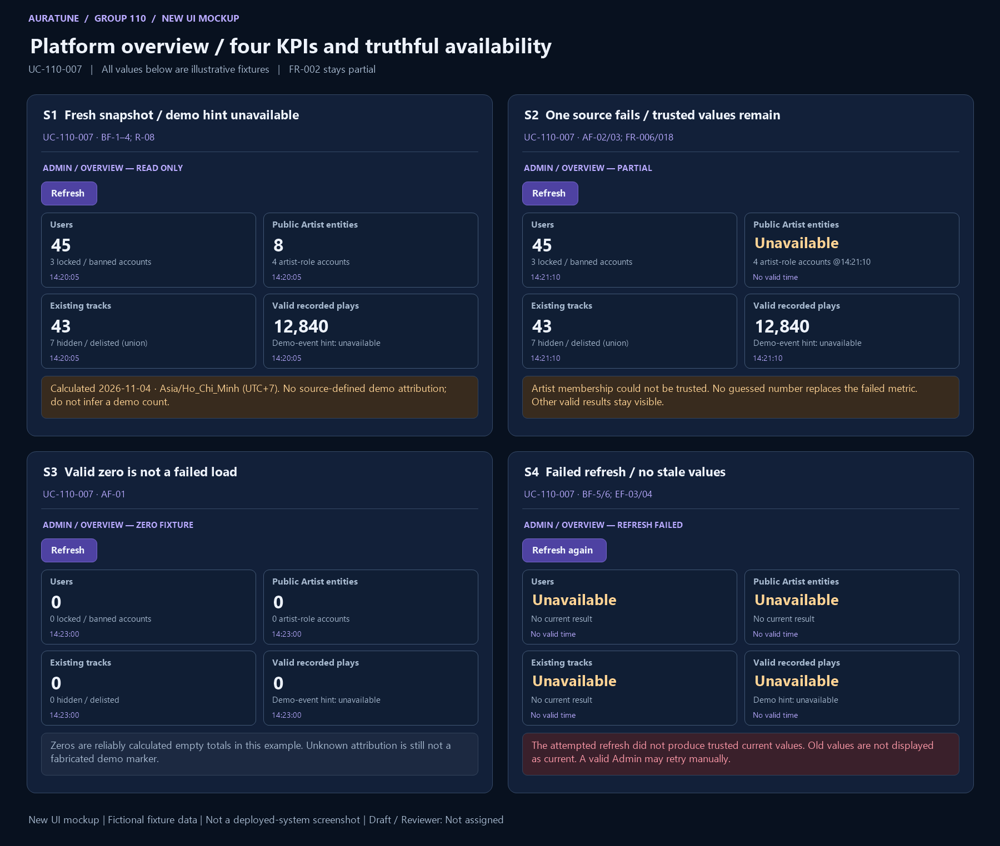

# UC-110-007 — View Platform Statistics

## 1. Document Information

- **Use Case ID**: UC-110-007
- **Use Case Name**: View Platform Statistics
- **Functional Group**: 110 — Admin Functions / Feature 113
- **Primary Actor**: Administrator (ACT-05)
- **Supporting Actors**: None evidenced; internal modules are not actors.
- **Author**: Not assigned
- **Reviewer**: Not assigned
- **Status**: Draft
- **Last Updated**: 2026-11-04
- **Decision provenance**: Owner-confirmed session choices dated 2026-11-04 — [Q07](./use-case-inventory.md#q07), [Q08](./use-case-inventory.md#q08), [Q09](./use-case-inventory.md#q09). These are session decisions by the owner, not pre-existing source requirements, collective team approval or review sign-off.
- **Behavior completeness**: Partial — count rules are owner-confirmed; demo attribution source remains missing.

## 2. Description

The Administrator views four aggregate cards — users, public Artist entities, existing tracks and retained valid plays — with separate source-supported hints. Owner Q07=A/Q08=A defines the count sets; a missing demo attribution source is disclosed as an unavailable hint rather than guessed.

## 3. Preconditions

The actor has valid Administrator access. The source may contain zero valid records or unreliable data; zero is not assumed from a failed source.

Preconditions do not replace request-time checks. Loss of access is EF-01; missing/unavailable data is an outcome to handle, not a reason to bypass authorization.

## 4. Trigger

The Administrator opens the overview or explicitly requests refresh.

## 5. Basic Flow (Main Success Scenario)

1. **Actor:** Opens the platform overview. 
2. **System:** Checks current Administrator authorization and calculates a fresh read-only snapshot for the four card/hint sets in R-03/R-04/R-08. 
3. **Actor:** Requests the metric values with their availability states and calculation timestamps. 
4. **System:** Shows each trusted value with its successful calculation time in Asia/Ho_Chi_Minh (UTC+7); shows each untrustworthy/missing value or hint as unavailable without zero substitution or inferred demo membership. 
5. **Actor:** Requests a manual refresh. 
6. **System:** Revalidates access, recalculates fresh results and replaces the prior snapshot without stale fallback or automatic periodic refresh. Independent failed metrics/hints do not hide trusted ones. 

## 6. Alternative Flows

### AF-01 — Valid zero versus no-data

- **Starting step / Branching Point**: Basic Flow step 2.
- **Condition**: A metric is reliably calculated as zero, or the source has no trustworthy value.

1. **System:** Displays 0 for a reliably established empty account/event set; otherwise labels the metric no-data/unavailable rather than fabricating zero.
2. **Actor:** Reviews the explicit state.

- **Outcome / Continuation / Exit**: Resume Basic Flow step 3; empty valid sets are not load errors.

### AF-02 — Partial success

- **Starting step / Branching Point**: Basic Flow step 2.
- **Condition**: Some metric results are trusted and others fail or are incomplete.

1. **System:** Shows each successful metric with its own calculation time and marks each unreliable metric unavailable without partial totals.
2. **Actor:** Reviews available results or requests refresh.

- **Outcome / Continuation / Exit**: Resume Basic Flow step 5 if refreshing; otherwise exit with a partial result, not full metric success. Also applies at step 6.

### AF-03 — Source cannot identify a hint subset

- **Starting step / Branching Point**: Basic Flow step 2.
- **Condition**: A card total is reliable, but membership for its hint subset cannot be established from existing source data.

1. **System:** Keeps the reliable card total and shows that hint as unavailable. In particular, no source-defined demo marker may be fabricated from names, seed lists, a demo account assumption or UI arithmetic.
2. **Actor:** Reviews the partial card without treating the hint as zero or part of an extra sum.

- **Outcome / Continuation / Exit**: Resume Basic Flow step 3; missing-source evidence remains recorded separately.

### AF-04 — Leave before dispatch

- **Starting step / Branching Point**: Basic Flow step 3.
- **Condition**: The actor leaves before submitting the requested read or change.

1. **Actor:** Leaves the view or declines to submit.
2. **System:** Applies no action for an unsubmitted intention; leaving after dispatch does not establish cancellation or undo.

- **Outcome / Continuation / Exit**: Exit canceled before dispatch only. For an already sent request, use the unknown-outcome exception if no result is known.

## 7. Exception Flows

### EF-01 — Authentication or permission denied

- **Starting step / Branching Point**: Basic Flow step 2.
- **Condition**: Authentication is missing, expired or invalid, or the actor lacks current Administrator permission.

1. **System:** Denies access and hides all metrics, including stale values. No statistics are disclosed and no data is changed.
2. **Actor:** Acknowledges the denial; any later attempt requires valid access.

- **Outcome / Continuation / Exit**: Exit denied. This also applies if authorization is lost before a later read or mutation.

### EF-02 — Invalid request

- **Starting step / Branching Point**: Basic Flow step 4.
- **Condition**: The overview request is malformed; no unsupported date or range controls are introduced.

1. **System:** Reports a validation failure without applying the invalid request or exposing sensitive data.
2. **Actor:** May correct the request before a new attempt.

- **Outcome / Continuation / Exit**: Exit failed validation; a corrected submission starts a new applicable request.

### EF-03 — Refresh or shared source failure

- **Starting step / Branching Point**: Basic Flow step 6.
- **Condition**: The fresh calculation fails, including a shared failure affecting all metrics.

1. **System:** Marks affected metrics unavailable and does not display old values as the current refresh result. Keeps retry available while authorized.
2. **Actor:** May request another authorized read.

- **Outcome / Continuation / Exit**: Exit unavailable; retry is a new read, not proof the previous result was empty.

### EF-04 — Read result not yet known

- **Starting step / Branching Point**: Basic Flow step 6.
- **Condition**: A read was submitted but no trustworthy complete response has been received.

1. **System:** Does not present missing or stale metric values as a successful current calculation.
2. **Actor:** May leave or later request a fresh authorized read.

- **Outcome / Continuation / Exit**: Exit unknown/unavailable read outcome; this read caused no mutation. No timeout duration or automatic retry is specified.

## 8. Postconditions

### 8.1 Success Postconditions

The authorized actor sees the four-card fresh snapshot with only trusted source-derived values and calculation timestamps. Missing hint/metric membership is explicitly unavailable; in particular the unresolved demo attribution is not fabricated. The overview performs no mutations. A partial card is not full FR-002 completion.

### 8.2 Failure Postconditions

The read does not mutate source data. Failed reads are not represented as successful empty results. Failed/unauthorized refresh does not keep stale metrics visible as current.

### 8.3 Cancellation Postconditions

Before dispatch, leaving without submitting produces no action. After dispatch, leaving or dismissing feedback does not prove cancellation or undo; cancellation of an in-flight request is not defined by the source.

### 8.4 Unknown-Outcome Postconditions

A missing/unreliable response establishes neither successful data retrieval nor a valid empty/not-found result. This read has no mutation; a later read is a fresh observation.

## 9. Special Requirements

- **Performance**: No numeric response-time target is established for this goal in the reviewed feature source; none is invented.
- **Security & Privacy**: Apply backend Administrator authorization for privileged reads/actions at every request; do not disclose credentials, secrets or unrelated private data. Actor roles are not UI-only safeguards.
- **Accessibility**: No source-specific conformance target is established here. Feedback must identify the actual outcome rather than imply success from a control’s appearance; detailed interaction/accessibility design is a technical follow-up.
- **Result integrity**: Distinguish confirmed success, no-op, cancellation before dispatch, known rejection/failure and unknown completion. Apply the confirmed owner session choices only within their documented scope; no collective approval is inferred.

## 10. Related Functional Requirements

Source-local IDs are qualified with the feature number. “Specified in Draft” means a concrete behavior/rule is written, not implemented/tested/approved. “Needs Clarification” may concern only part of an FR; retain the settled clauses and the open branch. The [inventory](./use-case-inventory.md#complete-fr-traceability) remains the distinct 74-FR accounting ledger.

| Source FR | Source requirement | Actual flow / rule | Behavior status |
|---|---|---|---|
| 113-FR-001 | The system MUST provide valid authenticated admins access to the platform-statistics overview defined by the current project scope and the admin endpoint in the API contract. | [BF-1](#bf-1), [BF-2](#bf-2); [R-01](#r-01) | Specified in Draft — source-backed clauses |
| 113-FR-002 | The system MUST provide 4 aggregate platform metrics in the Admin Overview: Total Users (with locked account hint), Total Artists (with artist role hint), Total Tracks (with hidden/removed hint), and Total Plays (with demo plays hint). | [BF-2](#bf-2), [BF-4](#bf-4); [AF-03](#af-03); [R-08](#r-08) — total/hint set table; G01 remains | Partially specified — owner-defined sets ([Q07](./use-case-inventory.md#q07), [Q08](./use-case-inventory.md#q08)); [G01 missing demo attribution](./use-case-inventory.md#g01) |
| 113-FR-003 | The system MUST treat total user count as the number of distinct user accounts currently existing in AuraTune. It includes all roles (`user`, `artist`, and `admin`), includes locked/banned/disabled accounts if the system already records that status, counts each account once by user ID regardless of login method or artist-profile linkage, excludes guests and accounts removed by the current lifecycle, and returns `0` when no accounts exist. | [R-03](#r-03); [AF-01](#af-01) | Specified in Draft — source-backed clauses |
| 113-FR-004 | The system MUST treat total play count as the count of valid listening-history records: each distinct recorded listening event counts as one play when it was recorded with a valid user and song reference at the time of the event, the record is not marked invalid by the system, and the source event identity is not duplicated by a known source-level duplicate rule. The feature does not add new session IDs, completion thresholds, or listening heuristics. It reads `listening_history` only and does not add, replace, or synchronize with `songs.total_plays`. | [R-04](#r-04) | Specified in Draft — source-backed clauses |
| 113-FR-005 | The system MUST distinguish valid zero values from missing or unavailable values. A zero result is valid when the underlying metric is legitimately zero; an unavailable or missing result must be shown as such and not as a fabricated number. | [AF-01](#af-01); [R-06](#r-06) | Specified in Draft — source-backed clauses |
| 113-FR-006 | The system MUST support partial-data, empty-data, and unavailable-data states without collapsing them into a single generic success state. If some metrics load and others fail, valid metrics remain visible and failed metrics are labeled as unavailable. | [AF-02](#af-02); [EF-03](#ef-03); [R-06](#r-06) | Specified in Draft — source-backed clauses |
| 113-FR-007 | The system MUST reject requests by unauthenticated users, normal users, or artists and MUST NOT disclose admin stats to non-admin roles. | [EF-01](#ef-01); [R-01](#r-01) | Specified in Draft — source-backed clauses |
| 113-FR-008 | The system MUST ensure that the admin statistics view is read-only and MUST NOT offer or perform any user-management, moderation, content-editing, or account-mutation actions. | [R-02](#r-02), [R-07](#r-07) | Specified in Draft — owner session resolution: [Q09](./use-case-inventory.md#q09) |
| 113-FR-009 | The system MUST not expose personal listening history, credentials, secrets, tokens, or private user data through the admin stats view. | [BF-4](#bf-4); [R-02](#r-02) | Specified in Draft — source-backed clauses |
| 113-FR-010 | The system MUST not add metrics not supported by the source set, including revenue, retention, live online counts, AI predictions, ranking tables, reports, or alerts unless a separate approved source document adds them. | [R-02](#r-02), [R-07](#r-07) | Specified in Draft — owner session resolution: [Q07](./use-case-inventory.md#q07) |
| 113-FR-011 | The system MUST respect the current Group 110 boundary and must not fold in user-ban/unban behavior from 111 or content moderation from 112. | [R-02](#r-02) | Specified in Draft — source-backed clauses |
| 113-FR-012 | The system MUST keep personal listening analytics and platform overview statistics separate. The admin stats feature must not expose the personal listening-history or user-level insights of Group 070/101 under the admin overview. | [R-02](#r-02) | Specified in Draft — source-backed clauses |
| 113-FR-013 | The system MUST keep the admin stats view limited to aggregate platform data required for operational understanding and MUST not show historical/behavioral detail that belongs to a separate personal analytics feature. | [BF-4](#bf-4); [R-02](#r-02) | Specified in Draft — source-backed clauses |
| 113-FR-014 | The system MUST allow the admin to view the current platform overview without requiring a new data mutation or background job to be created in 113, as long as the source documents and the backend are already capable of serving the data. | [R-02](#r-02), [R-07](#r-07) | Specified in Draft — owner session resolution: [Q09](./use-case-inventory.md#q09) |
| 113-FR-015 | The system MUST use no date filter, no month filter, and no time-range selector for 113. Total users is the count of distinct currently existing accounts at the time of the statistics calculation, not lifetime registrations. Total plays is the total count of valid listening-history events retained in the source system up to the time of the statistics calculation. | [R-03](#r-03), [R-04](#r-04), [R-05](#r-05) | Specified in Draft — source-backed clauses |
| 113-FR-016 | The system MUST recalculate the stats when the admin opens the page or explicitly triggers a refresh. The system MUST NOT implement automatic periodic refresh or real-time background refresh as part of this feature. Each refresh is a new calculation event and old and new data must not be merged into a single snapshot. | [BF-5](#bf-5), [BF-6](#bf-6); [R-05](#r-05) | Specified in Draft — source-backed clauses |
| 113-FR-017 | The system MUST display the successful calculation timestamp for each metric using Asia/Ho_Chi_Minh (UTC+7). The displayed timestamp MUST reflect the successful statistics calculation time, not the browser render time or client-side display time. | [BF-4](#bf-4); [R-05](#r-05) | Specified in Draft — source-backed clauses |
| 113-FR-018 | The system MUST handle each metric independently. If a metric is successfully retrieved and trusted, it is displayed with its own timestamp. If a metric is missing required data, has a source conflict, or cannot be trusted, it is displayed as `unavailable` and is never replaced by `0` or a partial total. If a shared data problem affects both metrics, both metrics are unavailable. | [AF-02](#af-02), [AF-03](#af-03); [R-06](#r-06), [R-08](#r-08) | Specified in Draft — owner session resolution: [Q07](./use-case-inventory.md#q07) |
| 113-FR-019 | The system MUST never display stale values after a failed refresh attempt. A failed refresh leaves the page available for another refresh attempt and does not silently reuse older statistics as the current state. | [EF-03](#ef-03); [R-06](#r-06) | Specified in Draft — source-backed clauses |
| 113-FR-020 | The system MUST withhold all statistics when the session is expired or the current user no longer has admin authorization. The feature follows the existing authentication and authorization rules and does not show metrics to unauthorized users. | [EF-01](#ef-01); [R-01](#r-01), [R-06](#r-06) | Specified in Draft — source-backed clauses |

## 11. Related Use Cases

- **Includes**: None asserted.
- **Extended by**: None asserted.
- **Preceding / related goals**: [UC-110-008](./UC-110-008-control-ai-availability.md), [UC-110-013](./UC-110-013-reset-demo-data.md). These are navigation/state dependencies, not unproved UML include/extend claims.

## 12. Source References

- [Feature 113 specification](../../../../specs/110-admin-functions/113-platform-statistics/spec.md) — embedded Clarifications (2026-10-30, 2026-11-01), User Scenarios & Testing, Functional Requirements, Edge Cases and scope sections.
- [Feature checklist](../../../../specs/110-admin-functions/113-platform-statistics/checklists/requirements.md) — quality/source review, not approval evidence.
- [API contract](../../../analysis-and-design/api-contract.md#210-admin) — §2.10 Admin endpoint and permission evidence; missing payloads/routes are not invented in the flows.
- [Use-case guide/template](../README.md#6-standard-use-case-specification-template), [shared actor/UC model](../../use-case-model.md), [security guidance](../../../design/security/README.md), [database security](../../../design/database/security-rules.md).
- [Vision G11](../../../proposal/Auratune_Vision_Document.md) — broad administration context, not a grant to expand these flows.

## 13. Prototype and Screenshot References

### Basic Flow Mockup

**Figure UC-110-007: S1–S4.** BF-1–6 four-card overview/refresh; AF-01 zero; AF-02/03 partial/unavailable hint; EF-03 failed refresh with no stale totals. This is a **new conceptual UI mockup**, rendered for requirements review with fictional fixtures; **not a screenshot of a deployed system**, implementation validation or proof of persisted results. Request/result/branch annotations within a panel are illustrative composites, not a captured interaction timeline. The image is intentionally shared where one storyboard covers several actor goals.

### Alternative / Exception Coverage

**Partial overall.** An expired/unauthorized session hiding all metrics and an actual refresh-in-progress sequence remain Missing. Count membership and data-source trust are not proven by fixture numbers; 113-FR-002 remains partial. See the [per-goal evidence matrix](./prototypes/README.md#coverage-per-actor-goal) for Illustrated/Partial/Missing distinctions.

### Existing Source References

- [01-admin-dashboard-overview.png](../../../../specs/110-admin-functions/113-platform-statistics/ui/01-admin-dashboard-overview.png) — pre-existing source UI prototype/demo evidence, reused by reference only.
- [02-user-statistics.png](../../../../specs/110-admin-functions/113-platform-statistics/ui/02-user-statistics.png) — pre-existing source UI prototype/demo evidence, reused by reference only.
- [03-artist-statistics.png](../../../../specs/110-admin-functions/113-platform-statistics/ui/03-artist-statistics.png) — pre-existing source UI prototype/demo evidence, reused by reference only.
- [04-track-statistics.png](../../../../specs/110-admin-functions/113-platform-statistics/ui/04-track-statistics.png) — pre-existing source UI prototype/demo evidence, reused by reference only.
- [05-play-statistics.png](../../../../specs/110-admin-functions/113-platform-statistics/ui/05-play-statistics.png) — pre-existing source UI prototype/demo evidence, reused by reference only.

The [prototype register](./prototypes/README.md) preserves all fourteen original source references and records the six new mockups separately. Source conflicts, owner-session provenance, actor permissions and FR completeness are unchanged by drawing a screen.

## 14. Business Rules and Scope Constraints

- **R-01**: Every overview load and refresh requires valid authenticated Administrator access checked at the backend. Missing/invalid/expired access and non-admin roles receive no metrics; if access is lost, hide all metrics including stale values.
- **R-02**: Read aggregate platform data only. No personal listening history, private user details, tokens, credentials or secrets; no account, moderation or content mutations. Separate Group 070/101 personal analytics, 111 account actions, 112 moderation and the disputed System controls. No unsupported revenue, retention, online counts, prediction, rankings, reports or alerts. No new mutation/background job is required to read existing data.
- **R-03**: Users: distinct currently existing accounts, once per user ID across login methods/profile linkage, including all roles and recorded locked/banned/disabled statuses and existing demo/test accounts; exclude guests and removed accounts. Count at calculation time, not lifetime registrations; reliable empty set gives 0.
- **R-04**: Plays: retained distinct listening events valid at recording with a valid user/song reference and not marked invalid; collapse duplicates only with an existing source event identity rule. No new session/completion threshold. Read listening_history only; do not replace/add/synchronize songs.total_plays. Historical valid events remain counted after hide/restrict/delete/lock. If required identifiers are lost or the result is untrustworthy, mark unavailable, never estimate. UI cumulative/demo labels alone do not establish a contradictory counting formula.
- **R-05**: No date/month/time-range selector, periodic refresh or real-time requirement. Calculate when opened or manually refreshed; every refresh is a fresh snapshot. Display each successful calculation timestamp in Asia/Ho_Chi_Minh (UTC+7), not render time.
- **R-06**: Evaluate metrics independently. Keep a trusted metric visible if another fails; a shared failure may make all affected metrics unavailable. Never substitute zero, a partial total or stale values after failed refresh. The page permits retry; expired/unauthorized sessions hide every metric.
- **R-07**: Owner Q07=A retains all four cards and Q09=A keeps System controls in a separate operational area of 113. The overview itself is read-only; no stats endpoint mutation is introduced. Owner Q11=C defers reset; owner Q10=A scopes the AI setting to the current browser demo, not platform-wide service control.
- **R-08**: Owner Q08=A defines the sets below. Count distinct identities in a consistent fresh snapshot; never infer Artist entity membership from account role or infer demo events without reliable existing attribution.

| Value / hint | Counting set and exclusions |
|---|---|
| Users card | U: distinct currently existing AuraTune accounts, all roles and existing locked/banned/disabled states, once per user ID; exclude guests and removed accounts. Existing demo accounts are not excluded merely for being demo (FR-003). |
| Locked-account hint | Distinct members of U explicitly recorded by an existing source as locked or banned; a member satisfying both is counted once. Do not infer a new lock field or classify all disabled states as locked without source evidence. This aggregate does not merge ban enforcement with temporary password locking. |
| Artists card | A: distinct existing public Artist entities, once per Artist identity. An Artist entity is not an account, and an account having role artist neither creates nor proves a public Artist entity. Use reliable existing public-eligibility information; if unavailable, mark this metric unavailable rather than inventing a public flag. |
| Artist-role-account hint | Distinct members of U whose current account role equals artist, once per user ID. This is a separate account subset; it need not equal, or be a numeric subset of, the count of Artist entities. No linkage/cardinality is invented. |
| Tracks card | T: distinct existing non-final-deleted songs, including public, Artist-hidden/private and admin-restricted/delisted (“removed”) songs. Exclude final-deleted songs. Artist entity publicity is not an extra filter on T. |
| Hidden/removed-track hint | Union of members of T with an existing Artist-hidden/private preference or an active Admin restriction/delisting. Count each song once even when both dimensions apply. Final-deleted songs are absent from T and this hint. |
| Total plays card | E: valid retained listening-history events defined by R-04/FR-004; retain valid history after restriction/final deletion/account lock. Do not add songs.total_plays, externally imported/cumulative demo display numbers or extra synthetic plays. |
| Demo-play hint | D: the subset of E reliably identified as demo events by an already-defined source attribution. It is not an extra term added to E. No demo marker/field/ID prefix/seed-user rule is defined by the reviewed feature/API/database sources. Until such a source exists and can determine D reliably, the hint is unavailable, not guessed or displayed as zero. Source gap G01 remains. |

All hints use the same fresh snapshot boundary as their relevant total, while each reliable result has its own actual successful-calculation timestamp. Missing eligibility/attribution data makes the impacted value unavailable, not a guessed total. These predicates are owner-confirmed additions in this session, not retrospectively attributed to the original spec or proof of available backend data.

## 15. Source Conflicts and Behavioral Impact

### C5

**Passage A** — [specs/110-admin-functions/113-platform-statistics/spec.md, line 17](../../../../specs/110-admin-functions/113-platform-statistics/spec.md#L17):

> - Q: What exact metrics are supported by the current source set? → A: The current, approved scope for 113 is exactly two aggregate metrics: total user count and total play count. No other KPI is in scope for this feature under the current project evidence. Other metrics such as active users, artist counts, song counts, banned users, deleted songs, retention, revenue, online users, AI metrics, charts, or alerts are explicitly out of scope for 113 and are not carried forward as pending requirements for this feature.

**Passage B** — [specs/110-admin-functions/113-platform-statistics/spec.md, line 131](../../../../specs/110-admin-functions/113-platform-statistics/spec.md#L131):

> - **FR-002**: The system MUST provide 4 aggregate platform metrics in the Admin Overview: Total Users (with locked account hint), Total Artists (with artist role hint), Total Tracks (with hidden/removed hint), and Total Plays (with demo plays hint).

**Historical impact before this owner decision:** Two-metric versus four-card scope changes which values and hints are present. Artist/track counting predicates are not supplied by naming the cards.

**Resolution reference — owner confirmed in this session:** [Q07](./use-case-inventory.md#q07), [Q08](./use-case-inventory.md#q08)

### C6

**Passage A** — [specs/110-admin-functions/113-platform-statistics/spec.md, line 183](../../../../specs/110-admin-functions/113-platform-statistics/spec.md#L183):

> - This feature is intentionally read-only and does not include data mutations or platform-wide operational actions.

**Passage B** — [specs/110-admin-functions/113-platform-statistics/spec.md, line 150](../../../../specs/110-admin-functions/113-platform-statistics/spec.md#L150):

> - **FR-021**: The Admin area MUST provide system availability controls, including a master AI service toggle (`aiAvailable`) to activate platform-wide graceful degradation and a demo data reset action (`resetDemo`) to restore initial application state.

**Historical impact before this owner decision:** System writes conflict with the feature-wide no-operations boundary. The read-only statistics goal never performs these writes; separate conditional goals record the proposed controls.

**Resolution reference — owner confirmed in this session:** [Q09](./use-case-inventory.md#q09)

**Current treatment:** Apply [Q07](./use-case-inventory.md#q07), [Q08](./use-case-inventory.md#q08), [Q09](./use-case-inventory.md#q09). All original source passages above remain verbatim. The owner resolved the documentation behavior locally; source specs/shared artifacts are unchanged. These decisions are not pre-existing or collectively approved requirements.

## 16. Open Questions and Follow-ups

Applied owner-confirmed session choices: [Q07](./use-case-inventory.md#q07), [Q08](./use-case-inventory.md#q08), [Q09](./use-case-inventory.md#q09).

The demo-play hint lacks source-defined reliable attribution. Count only a proven subset of valid recorded events; until the source can identify that subset, show the hint as unavailable. This is missing source evidence, not a reopened Q08 choice.

See the [owner decision register](./use-case-inventory.md#decision-register). These are owner session confirmations, not whole-team approval or review sign-off. [Technical follow-ups](./use-case-inventory.md#technical-follow-ups) and [prototype evidence](./prototypes/README.md) remain separate.

## 17. Draft Verification and Limitations

Sections 1–13 preserve every section actually present in the shared embedded template. Sections 14–17 supplement it with rules, source conflicts, questions and verification because the guide calls it a 17-section template but only prints 13 sections; no missing canonical headings are claimed. The template discrepancy is an authoring follow-up, not a behavior question.

This file is a Draft with Reviewer: Not assigned. Numbered Actor/System flows and FR-to-rule mappings describe documentation, not executed tests or a completed prototype. Missing source evidence, deferred behavior and unknown execution outcomes must not be reported as fully Covered. Owner-confirmed choices govern this documentation scope only. No reviewer, product approval, implementation readiness or policy choice is inferred.
