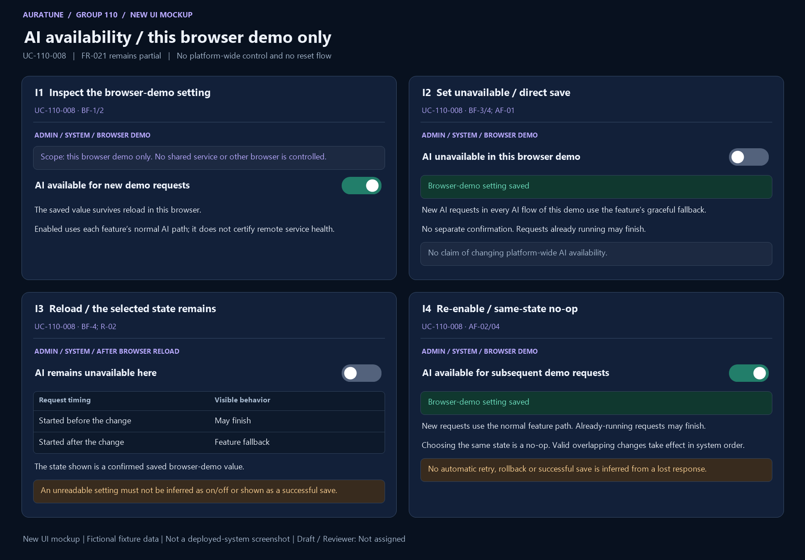

# UC-110-008 — Control AI Availability

## 1. Document Information

- **Use Case ID**: UC-110-008
- **Use Case Name**: Control AI Availability
- **Functional Group**: 110 — Admin Functions / Feature 113
- **Primary Actor**: Administrator (ACT-05)
- **Supporting Actors**: None evidenced; internal modules are not actors.
- **Author**: Not assigned
- **Reviewer**: Not assigned
- **Status**: Draft
- **Last Updated**: 2026-11-04
- **Decision provenance**: Owner-confirmed session choices dated 2026-11-04 — [Q09](./use-case-inventory.md#q09), [Q10](./use-case-inventory.md#q10). These are session decisions by the owner, not pre-existing source requirements, collective team approval or review sign-off.
- **Behavior completeness**: Browser-demo behavior specified; source platform-wide clause remains unfulfilled.

## 2. Description

The Administrator changes AI availability for the current browser demo only. Owner-confirmed Q10=A explicitly narrows the source’s platform-wide wording: the switch does not control shared services or AI availability in other browsers/users’ sessions.

## 3. Preconditions

The actor has valid current Administrator access to the demo System area. This goal governs a browser-demo setting, not a production-wide service operation or backend service-health guarantee.

Check current permission on each submitted action; earlier preconditions do not excuse missing/expired/invalid access. A missing target or unknown result remains an explicitly handled outcome.

## 4. Trigger

The Administrator requests an AI availability change in the System area described by the Nov 1 clarification.

## 5. Basic Flow (Main Success Scenario)

1. **Actor:** Opens the demo System area to inspect the current browser’s AI availability setting. 
2. **System:** Checks current demo Administrator access and displays the known saved browser-demo setting; an unreadable setting is not inferred as enabled or disabled. 
3. **Actor:** Requests enabled or unavailable directly, without a separate confirmation. 
4. **System:** Processes valid setting changes in system order, saves the current browser-demo value so it survives reload and reports the confirmed result. Every AI flow in this demo uses fallback for new requests while unavailable; re-enabling applies to new requests, while already-running requests may finish. 

## 6. Alternative Flows

### AF-01 — Set unavailable

- **Starting step / Branching Point**: Basic Flow step 3.
- **Condition**: The requested value is unavailable for this browser demo.

1. **Actor:** Submits the direct setting change.
2. **System:** Persists it for this browser across reload and routes subsequent demo AI requests to graceful fallback; already-running requests may complete.

- **Outcome / Continuation / Exit**: Exit confirmed setting success; no claim of changing a remote/shared service.

### AF-02 — Re-enable or same-state request

- **Starting step / Branching Point**: Basic Flow step 3.
- **Condition**: The desired value is enabled or already equals the saved current value.

1. **Actor:** Submits the desired setting.
2. **System:** For enabled, restores the normal demo AI path for new requests; same-state requests are no-ops. Actual service failures remain governed by each AI feature’s fallback rules.

- **Outcome / Continuation / Exit**: Exit confirmed change or no-op; no service-health guarantee.

### AF-03 — Leave before dispatch

- **Starting step / Branching Point**: Basic Flow step 3.
- **Condition**: The setting change has not been submitted.

1. **Actor:** Leaves without submitting a change.
2. **System:** Keeps the saved browser-demo setting unchanged for this unsubmitted intention.

- **Outcome / Continuation / Exit**: Exit canceled; leaving after dispatch is not proof of rollback.

### AF-04 — Overlapping valid setting changes

- **Starting step / Branching Point**: Basic Flow step 4.
- **Condition**: Multiple valid changes arrive for this browser demo.

1. **System:** Processes them in system order; the last successful applicable change determines the saved value.
2. **Actor:** Checks the current setting before relying on it.

- **Outcome / Continuation / Exit**: Exit with the current confirmed browser-demo setting; no cross-browser synchronization is specified.

## 7. Exception Flows

### EF-01 — Authentication or permission denied

- **Starting step / Branching Point**: Basic Flow step 2.
- **Condition**: Authentication is missing, expired or invalid, or the actor lacks current Administrator permission.

1. **System:** Denies the privileged request without exposing protected data or applying the requested mutation.
2. **Actor:** Acknowledges the denial; any later attempt requires valid access.

- **Outcome / Continuation / Exit**: Exit denied. This also applies if authorization is lost before a later read or mutation.

### EF-02 — Invalid request

- **Starting step / Branching Point**: Basic Flow step 3.
- **Condition**: The submitted request does not identify a valid enabled/unavailable setting for this browser demo.

1. **System:** Reports a validation failure without applying the invalid request or exposing sensitive data.
2. **Actor:** May correct the request before a new attempt.

- **Outcome / Continuation / Exit**: Exit failed validation; a corrected submission starts a new applicable request.

### EF-03 — Target unavailable

- **Starting step / Branching Point**: Basic Flow step 2.
- **Condition**: The current browser-demo setting cannot be read reliably.

1. **System:** Reports unavailable/undetermined state without inventing a target or claiming successful change.
2. **Actor:** Acknowledges the result.

- **Outcome / Continuation / Exit**: Exit without a newly applied action. No enabled/disabled value or shared platform state is inferred.

### EF-04 — Confirmed operation failure

- **Starting step / Branching Point**: Basic Flow step 4.
- **Condition**: The system confirms the requested operation failed rather than merely losing its response.

1. **System:** Reports failure without false success; the response must distinguish a confirmed saved setting from an unreadable/unknown result; no atomic rollback or automatic retry is promised.
2. **Actor:** Reviews the reported outcome.

- **Outcome / Continuation / Exit**: Exit failed. A later retry is not an automatic replay guarantee; unknown completion is EF-06.

### EF-06 — Dispatched result unknown

- **Starting step / Branching Point**: Basic Flow step 4.
- **Condition**: The request was dispatched but persistence or completion cannot be established because the response is lost or unreliable.

1. **System:** Does not claim success, failure, cancellation or rollback solely from the missing response. The operation may have taken effect.
2. **Actor:** May later inspect the authorized current state before deciding whether to submit another action.

- **Outcome / Continuation / Exit**: Exit unknown outcome, not confirmed failure. This is a truthfulness boundary, not a new retry, transaction, audit, or recovery mechanism.

## 8. Postconditions

### 8.1 Success Postconditions

The chosen setting is confirmed saved in the current browser demo and survives reload, or a same-state request is a no-op. New demo AI requests use fallback while unavailable or the normal feature path after re-enable; already-running requests may finish. No platform-wide service state is changed or claimed.

### 8.2 Failure Postconditions

An access/validation rejection applies no requested change. A confirmed failed save is not reported as success; an unreadable state or missing save result is unknown under EF-06. The prior value must not be claimed restored solely from a missing response. No shared service mutation is performed by this browser-demo setting.

### 8.3 Cancellation Postconditions

Before dispatch, leaving without submitting produces no action. After dispatch, leaving or dismissing feedback does not prove cancellation or undo; cancellation of an in-flight request is not defined by the source. There is no separate confirmation. No in-flight cancel/undo operation is specified; leaving after dispatch does not undo a saved setting.

### 8.4 Unknown-Outcome Postconditions

A dispatched mutation with no trustworthy result may or may not have committed. Do not claim unchanged state, rollback, success or a successful cancel. Read the current authorized state when possible; no automatic replay or recovery guarantee is introduced.

## 9. Special Requirements

- **Performance**: No numeric response-time target is established for this goal in the reviewed feature source; none is invented.
- **Security & Privacy**: Apply backend Administrator authorization for privileged reads/actions at every request; do not disclose credentials, secrets or unrelated private data. Actor roles are not UI-only safeguards.
- **Accessibility**: No source-specific conformance target is established here. Feedback must identify the actual outcome rather than imply success from a control’s appearance; detailed interaction/accessibility design is a technical follow-up.
- **Result integrity**: Distinguish confirmed success, no-op, cancellation before dispatch, known rejection/failure and unknown completion. Apply the confirmed owner session choices only within their documented scope; no collective approval is inferred.

## 10. Related Functional Requirements

Source-local IDs are qualified with the feature number. “Specified in Draft” means a concrete behavior/rule is written, not implemented/tested/approved. “Needs Clarification” may concern only part of an FR; retain the settled clauses and the open branch. The [inventory](./use-case-inventory.md#complete-fr-traceability) remains the distinct 74-FR accounting ledger.

| Source FR | Source requirement | Actual flow / rule | Behavior status |
|---|---|---|---|
| 113-FR-021 | The Admin area MUST provide system availability controls, including a master AI service toggle (`aiAvailable`) to activate platform-wide graceful degradation and a demo data reset action (`resetDemo`) to restore initial application state. | [BF-1](#bf-1), [BF-2](#bf-2), [BF-3](#bf-3), [BF-4](#bf-4); [AF-01](#af-01), [AF-02](#af-02), [AF-04](#af-04); [R-01](#r-01), [R-02](#r-02), [R-03](#r-03), [R-04](#r-04) — local AI clause only; global control and reset unfulfilled | Partially specified / Deferred — local browser scope differs from platform-wide source; reset deferred ([Q09](./use-case-inventory.md#q09), [Q10](./use-case-inventory.md#q10), [Q11](./use-case-inventory.md#q11)); [G02](./use-case-inventory.md#g02) |

## 11. Related Use Cases

- **Includes**: None asserted.
- **Extended by**: None asserted.
- **Preceding / related goals**: [UC-110-007](./UC-110-007-view-platform-statistics.md), [UC-110-013](./UC-110-013-reset-demo-data.md). These are navigation/state dependencies, not unproved UML include/extend claims.

## 12. Source References

- [Feature 113 specification](../../../../specs/110-admin-functions/113-platform-statistics/spec.md) — embedded Clarifications (2026-10-30, 2026-11-01), User Scenarios & Testing, Functional Requirements, Edge Cases and scope sections.
- [Feature checklist](../../../../specs/110-admin-functions/113-platform-statistics/checklists/requirements.md) — quality/source review, not approval evidence.
- [API contract](../../../analysis-and-design/api-contract.md#210-admin) — §2.10 Admin endpoint and permission evidence; missing payloads/routes are not invented in the flows.
- [Use-case guide/template](../README.md#6-standard-use-case-specification-template), [shared actor/UC model](../../use-case-model.md), [security guidance](../../../design/security/README.md), [database security](../../../design/database/security-rules.md).
- [Vision G11](../../../proposal/Auratune_Vision_Document.md) — broad administration context, not a grant to expand these flows.

## 13. Prototype and Screenshot References

### Basic Flow Mockup

**Figure UC-110-008: I1–I4.** BF-1–4 inspect/toggle/save; AF-01/02/04 fallback/re-enable/reload/no-op/order concepts. This is a **new conceptual UI mockup**, rendered for requirements review with fictional fixtures; **not a screenshot of a deployed system**, implementation validation or proof of persisted results. Request/result/branch annotations within a panel are illustrative composites, not a captured interaction timeline. The image is intentionally shared where one storyboard covers several actor goals.

### Alternative / Exception Coverage

**Partial overall.** Dedicated save/read-failure, unknown-outcome, concurrent-order and denied-access screens remain Missing; no-op/order/unknown text is an annotation, not proof of execution. This is browser-demo only; 113-FR-021 remains partial. See the [per-goal evidence matrix](./prototypes/README.md#coverage-per-actor-goal) for Illustrated/Partial/Missing distinctions.

### Existing Source References

No pre-existing source image directly illustrates this goal. The new mockup above fills its basic-state illustration gap without claiming deployed behavior.

The [prototype register](./prototypes/README.md) preserves all fourteen original source references and records the six new mockups separately. Source conflicts, owner-session provenance, actor permissions and FR completeness are unchanged by drawing a screen.

## 14. Business Rules and Scope Constraints

- **R-01**: Only a valid current Administrator may use the demo System setting. Check current demo access on each change; source-required backend authorization still governs any actual privileged admin endpoint. This browser-demo control is not evidence that backend service control or authorization has been implemented. No secrets/private data are exposed.
- **R-02**: Owner Q10=A: scope is this browser demo only. Persist the selected enabled/unavailable value across reload in this browser; no cross-browser/user synchronization or shared remote service change is specified. All AI flows in this demo fall back for new requests while unavailable. Already-running requests may finish. Re-enable applies to subsequent requests through their normal feature paths and does not certify remote service health.
- **R-03**: Owner Q09=A retains the System area separately from the read-only stats overview. FR-021 literally requires platform-wide graceful degradation; this local scope is an explicit owner-confirmed divergence, not fulfillment of that literal clause. Reset is separately deferred by Q11=C; full FR-021 is not complete.
- **R-04**: Owner Q10=A: no separate confirmation, same-state requests are no-ops, valid overlapping setting changes are processed in system order and the last successful applicable value is saved. Before submission the actor can leave without change; after dispatch no cancel/undo is promised. Confirmed persistence is needed for success; an unreadable or lost response remains unavailable/unknown and is not automatic rollback, resubmission or failure.

## 15. Source Conflicts and Behavioral Impact

### C6

**Passage A** — [specs/110-admin-functions/113-platform-statistics/spec.md, line 183](../../../../specs/110-admin-functions/113-platform-statistics/spec.md#L183):

> - This feature is intentionally read-only and does not include data mutations or platform-wide operational actions.

**Passage B** — [specs/110-admin-functions/113-platform-statistics/spec.md, line 150](../../../../specs/110-admin-functions/113-platform-statistics/spec.md#L150):

> - **FR-021**: The Admin area MUST provide system availability controls, including a master AI service toggle (`aiAvailable`) to activate platform-wide graceful degradation and a demo data reset action (`resetDemo`) to restore initial application state.

**Historical impact before this owner decision:** System writes conflict with the feature-wide no-operations boundary. The read-only statistics goal never performs these writes; separate conditional goals record the proposed controls.

**Resolution reference — owner confirmed in this session:** [Q09](./use-case-inventory.md#q09)

**Current treatment:** Apply [Q09](./use-case-inventory.md#q09), [Q10](./use-case-inventory.md#q10). All original source passages above remain verbatim. The owner resolved the documentation behavior locally; source specs/shared artifacts are unchanged. These decisions are not pre-existing or collectively approved requirements.

## 16. Open Questions and Follow-ups

Applied owner-confirmed session choices: [Q09](./use-case-inventory.md#q09), [Q10](./use-case-inventory.md#q10).

The toggle is browser-demo only. Source FR-021’s platform-wide control is not satisfied by this scope; its reset clause is deferred under Q11=C.

See the [owner decision register](./use-case-inventory.md#decision-register). These are owner session confirmations, not whole-team approval or review sign-off. [Technical follow-ups](./use-case-inventory.md#technical-follow-ups) and [prototype evidence](./prototypes/README.md) remain separate.

## 17. Draft Verification and Limitations

Sections 1–13 preserve every section actually present in the shared embedded template. Sections 14–17 supplement it with rules, source conflicts, questions and verification because the guide calls it a 17-section template but only prints 13 sections; no missing canonical headings are claimed. The template discrepancy is an authoring follow-up, not a behavior question.

This file is a Draft with Reviewer: Not assigned. Numbered Actor/System flows and FR-to-rule mappings describe documentation, not executed tests or a completed prototype. Missing source evidence, deferred behavior and unknown execution outcomes must not be reported as fully Covered. Owner-confirmed choices govern this documentation scope only. No reviewer, product approval, implementation readiness or policy choice is inferred.
