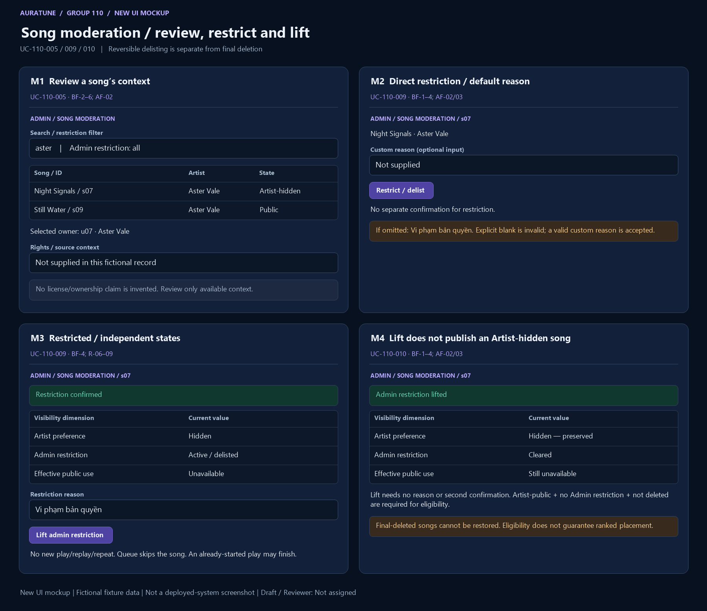

# UC-110-010 — Lift Track Restriction

## 1. Document Information

- **Use Case ID**: UC-110-010
- **Use Case Name**: Lift Track Restriction
- **Functional Group**: 110 — Admin Functions / Feature 112
- **Primary Actor**: Administrator (ACT-05)
- **Supporting Actors**: None evidenced; internal modules are not actors.
- **Author**: Not assigned
- **Reviewer**: Not assigned
- **Status**: Draft
- **Last Updated**: 2026-11-04
- **Decision provenance**: Owner-confirmed session choices dated 2026-11-04 — [Q03](./use-case-inventory.md#q03), [Q05](./use-case-inventory.md#q05), [Q06](./use-case-inventory.md#q06). These are session decisions by the owner, not pre-existing source requirements, collective team approval or review sign-off.
- **Behavior completeness**: Specified in Draft for the applicable behavior, including the owner decisions cited below.

## 2. Description

The Administrator lifts an admin restriction on an existing non-deleted song. Owner decision Q03=A treats removed/delisted as a reversible admin restriction, while Artist self-hide and final deletion remain separate constraints.

## 3. Preconditions

The acting Administrator has valid access. The main transition requires an existing admin-restricted song that has not been final-deleted; Artist self-hide is evaluated independently.

Check current permission on each submitted action; earlier preconditions do not excuse missing/expired/invalid access. A missing target or unknown result remains an explicitly handled outcome.

## 4. Trigger

The Administrator requests lifting of an admin restriction.

## 5. Basic Flow (Main Success Scenario)

1. **Actor:** Selects an admin-restricted/delisted song for lifting. 
2. **System:** Rechecks current Administrator authorization, song existence and final-deletion/restriction states. 
3. **Actor:** Submits lift directly, without a reason or second confirmation. 
4. **System:** Clears only the admin restriction and reports a confirmed result/toast. Public/playback eligibility is recalculated from Artist-public preference, absence of any active Admin restriction, non-deletion and existing public-surface eligibility; clearing the restriction alone is not a publication guarantee. 

## 6. Alternative Flows

### AF-01 — No admin restriction remains

- **Starting step / Branching Point**: Basic Flow step 2.
- **Condition**: The existing song has no active admin restriction.

1. **System:** Reports a no-op without state/reason overwrite.
2. **Actor:** Reviews the current state.

- **Outcome / Continuation / Exit**: Exit no-op.

### AF-02 — Artist remains hidden/private

- **Starting step / Branching Point**: Basic Flow step 4.
- **Condition**: The Artist-selected self-hide/private preference remains after the admin restriction is lifted.

1. **System:** Preserves that preference and keeps the song non-public and unavailable for new public playback.
2. **Actor:** Reviews the successful admin lift with Artist-hidden status still present.

- **Outcome / Continuation / Exit**: Exit success for the admin lift only; no Artist preference change or publication.

### AF-03 — Removed/delisted target

- **Starting step / Branching Point**: Basic Flow step 2.
- **Condition**: The selected song is removed/delisted by Admin but not final-deleted.

1. **System:** Treats it as the reversible admin-restriction state; validates current existence and restriction before lifting.
2. **Actor:** Submits the lift action.

- **Outcome / Continuation / Exit**: Resume Basic Flow step 4. Final-deleted targets follow EF-03, not this branch.

### AF-04 — Leave before dispatch

- **Starting step / Branching Point**: Basic Flow step 3.
- **Condition**: The lift request has not been dispatched.

1. **Actor:** Leaves without submitting.
2. **System:** Applies no lift for an unsubmitted intention.

- **Outcome / Continuation / Exit**: Exit canceled; after dispatch a missing result is unknown rather than canceled.

## 7. Exception Flows

### EF-01 — Authentication or permission denied

- **Starting step / Branching Point**: Basic Flow step 2.
- **Condition**: Authentication is missing, expired or invalid, or the actor lacks current Administrator permission.

1. **System:** Denies the privileged request without exposing protected data or applying the requested mutation.
2. **Actor:** Acknowledges the denial; any later attempt requires valid access.

- **Outcome / Continuation / Exit**: Exit denied. This also applies if authorization is lost before a later read or mutation.

### EF-02 — Invalid request

- **Starting step / Branching Point**: Basic Flow step 3.
- **Condition**: The submitted target, criteria, role or required reason is malformed or invalid for this goal’s source branch.

1. **System:** Reports a validation failure without applying the invalid request or exposing sensitive data.
2. **Actor:** May correct the request before a new attempt.

- **Outcome / Continuation / Exit**: Exit failed validation; a corrected submission starts a new applicable request.

### EF-03 — Target unavailable

- **Starting step / Branching Point**: Basic Flow step 2.
- **Condition**: The selected account or song no longer exists.

1. **System:** Returns not found without applying a transition. A repeated final-delete of a missing song is not-found, not a contradictory successful restore.
2. **Actor:** Acknowledges the result.

- **Outcome / Continuation / Exit**: Exit without a newly applied action. This does not resolve state identity or reset scope questions.

### EF-04 — Confirmed operation failure

- **Starting step / Branching Point**: Basic Flow step 4.
- **Condition**: The system confirms the requested operation failed rather than merely losing its response.

1. **System:** Reports the failed operation and applies no saved change for that failed request; does not issue a success toast.
2. **Actor:** Reviews the reported outcome.

- **Outcome / Continuation / Exit**: Exit failed. A later retry is not an automatic replay guarantee; unknown completion is EF-06.

### EF-06 — Dispatched result unknown

- **Starting step / Branching Point**: Basic Flow step 4.
- **Condition**: The request was dispatched but persistence or completion cannot be established because the response is lost or unreliable.

1. **System:** Does not claim success, failure, cancellation or rollback solely from the missing response. The operation may have taken effect.
2. **Actor:** May later inspect the authorized current state before deciding whether to submit another action.

- **Outcome / Continuation / Exit**: Exit unknown outcome, not confirmed failure. This is a truthfulness boundary, not a new retry, transaction, audit, or recovery mechanism.

## 8. Postconditions

### 8.1 Success Postconditions

Only the admin restriction is cleared after confirmed persistence, or the request is an already-clear no-op. Artist self-hide is preserved. A final-deleted song is never restored. Eligibility for new playback/public exposure requires all existing visibility conditions, and does not guarantee placement in limited/ranked sections.

### 8.2 Failure Postconditions

Authorization/validation rejection, missing target or a confirmed failed action does not mutate saved state for that request. Other valid concurrent actors may change the current record; this Draft does not promise a global state freeze.

### 8.3 Cancellation Postconditions

Before dispatch, leaving without submitting produces no action. After dispatch, leaving or dismissing feedback does not prove cancellation or undo; cancellation of an in-flight request is not defined by the source.

### 8.4 Unknown-Outcome Postconditions

A dispatched mutation with no trustworthy result may or may not have committed. Do not claim unchanged state, rollback, success or a successful cancel. Read the current authorized state when possible; no automatic replay or recovery guarantee is introduced.

## 9. Special Requirements

- **Performance**: No numeric response-time target is established for this goal in the reviewed feature source; none is invented.
- **Security & Privacy**: Apply backend Administrator authorization for privileged reads/actions at every request; do not disclose credentials, secrets or unrelated private data. Actor roles are not UI-only safeguards.
- **Accessibility**: No source-specific conformance target is established here. Feedback must identify the actual outcome rather than imply success from a control’s appearance; detailed interaction/accessibility design is a technical follow-up.
- **Result integrity**: Distinguish confirmed success, no-op, cancellation before dispatch, known rejection/failure and unknown completion. Apply the confirmed owner session choices only within their documented scope; no collective approval is inferred.

## 10. Related Functional Requirements

Source-local IDs are qualified with the feature number. “Specified in Draft” means a concrete behavior/rule is written, not implemented/tested/approved. “Needs Clarification” may concern only part of an FR; retain the settled clauses and the open branch. The [inventory](./use-case-inventory.md#complete-fr-traceability) remains the distinct 74-FR accounting ledger.

| Source FR | Source requirement | Actual flow / rule | Behavior status |
|---|---|---|---|
| 112-FR-001 | The system MUST allow a valid authenticated admin to access the content-moderation capability within the current project scope. | [BF-2](#bf-2); [R-01](#r-01) | Specified in Draft — source-backed clauses |
| 112-FR-004 | The system MUST ensure that moderation review does not expose unrelated user data, tokens, secrets, or password material. | [R-02](#r-02) | Specified in Draft — source-backed clauses |
| 112-FR-006 | The system MUST allow a valid authenticated admin to clear its own restriction on a song when the moderation condition is resolved and no higher-priority restriction remains in effect. This restore action MUST NOT require a reason or second confirmation. Admin may not override an artist-selected private/hidden state; a song becomes public only when the artist has made it public again, the admin restriction is cleared, and the song has not been deleted. | [BF-2](#bf-2), [BF-3](#bf-3), [BF-4](#bf-4); [AF-02](#af-02), [AF-03](#af-03); [R-07](#r-07), [R-09](#r-09) | Specified in Draft — owner session resolution: [Q03](./use-case-inventory.md#q03) |
| 112-FR-008 | The system MUST restrict admin update operations to moderation restriction handling and reason recording only. Admins MUST NOT edit `title`, `artist`, `album`, `duration`, `cover`, `tags`, audio file content, owner or uploader identity, source/rights, license/distribution, or attribution metadata within 112. There is no separate moderation-notes feature in this scope. | [R-04](#r-04) | Specified in Draft — source-backed clauses |
| 112-FR-009 | The system MUST reject any request that does not originate from a valid authenticated admin. | [EF-01](#ef-01); [R-01](#r-01) | Specified in Draft — source-backed clauses |
| 112-FR-010 | The system MUST reject expired, invalid, or missing authentication and MUST not perform moderation actions without a valid admin session. | [EF-01](#ef-01); [R-01](#r-01) | Specified in Draft — source-backed clauses |
| 112-FR-011 | The system MUST deny access to non-admin accounts and must not disclose moderation data or mutate state for unauthorized roles. | [EF-01](#ef-01); [R-01](#r-01) | Specified in Draft — source-backed clauses |
| 112-FR-012 | The system MUST return a not-found result when the target song does not exist and MUST make no state change. | [EF-03](#ef-03) | Specified in Draft — source-backed clauses |
| 112-FR-013 | The system MUST return a validation error for malformed requests, invalid song references, blank moderation reasons, or data that does not satisfy the current moderation contract; it MUST not mutate state on invalid input. | [EF-02](#ef-02) (malformed lift input) | Specified in Draft — owner session resolution: [Q03](./use-case-inventory.md#q03), [Q04](./use-case-inventory.md#q04) |
| 112-FR-015 | The system MUST distinguish among valid empty results, validation failures, authorization failures, not-found results, and operation failures without reporting false success. | [R-03](#r-03); [EF-01](#ef-01), [EF-02](#ef-02), [EF-03](#ef-03), [EF-04](#ef-04) | Specified in Draft — source-backed clauses |
| 112-FR-016 | The system MUST maintain the feature boundary for Group 110 and MUST NOT mix in user-account ban or unban behavior from feature 111, platform-statistics features from 113, or artist upload-management behavior from feature 093. | [R-04](#r-04) | Specified in Draft — source-backed clauses |
| 112-FR-017 | The system MUST keep moderation scoped to songs and relevant song metadata unless a separate source document approves a broader moderation scope. | [R-04](#r-04) | Specified in Draft — source-backed clauses |
| 112-FR-018 | The system SHOULD treat repeated or contradictory moderation requests consistently and avoid creating conflicting states when the same song is already restricted, restored, or deleted. The preferred behavior is a no-op on duplicate requests and a single authoritative persisted state for conflicting actions, but this policy remains a proposal pending product confirmation. | [AF-01](#af-01); [R-08](#r-08) | Specified in Draft — owner session resolution: [Q06](./use-case-inventory.md#q06) |
| 112-FR-019 | The system MUST not define or invent storage, delete mechanism, or implementation technology beyond the project’s current documentation; any exact persistence semantics must be decided in design or implementation after an explicit product decision. | [R-05](#r-05) | Specified in Draft — source-backed clauses |
| 112-FR-020 | The system MUST not add report-management, abuse-triage, AI review, notification flows, or full admin audit trail behavior unless those flows are explicitly defined by an approved source document. | [R-04](#r-04), [R-05](#r-05) | Specified in Draft — source-backed clauses |
| 112-FR-023 | The system MUST allow an already-started playback to continue until completion, but MUST prevent replay, repeat, or a new play attempt for the same song once it becomes unavailable. A restored song may become playable again only if the Artist remains publicly visible and the song has not been deleted. | [R-07](#r-07) | Specified in Draft — owner session resolution: [Q03](./use-case-inventory.md#q03), [Q05](./use-case-inventory.md#q05) |
| 112-FR-025 | The system MUST prevent an artist-owner from playing, self-unrestricting, or republishing a restricted song to bypass the admin moderation decision. The artist may only regain visibility if the product's valid restore path is satisfied, including a valid admin restore and the absence of any higher-priority visibility restriction. This rule applies only to restricted songs and does not create a default review or restore workflow for deleted songs. | [AF-02](#af-02); [R-07](#r-07) | Specified in Draft — owner session resolution: [Q03](./use-case-inventory.md#q03) |
| 112-FR-027 | The system MUST handle repeated or conflicting moderation actions consistently: restricted-if-already-restricted and unrestrict-if-not-restricted are no-ops with no state or reason overwrite; delete of a missing song returns not-found with no side effect; valid opposing requests are resolved in system order; the last successful action decides persisted state; failed actions do not mutate saved state; and a deleted song cannot be restored through 112. | [AF-01](#af-01), [AF-03](#af-03); [R-08](#r-08) | Specified in Draft — owner session resolution: [Q03](./use-case-inventory.md#q03), [Q06](./use-case-inventory.md#q06) |
| 112-FR-028 | The system MUST provide a clear distinction between an intentionally restricted song, a removed song, and a missing or unavailable song so that the admin experience remains accurate and does not imply a false state. | [BF-2](#bf-2), [BF-4](#bf-4); [R-03](#r-03) | Specified in Draft — owner session resolution: [Q03](./use-case-inventory.md#q03) |
| 112-FR-029 | The system MUST support direct one-click track removal and restoration actions in the admin content moderation interface, displaying an immediate toast notification and recording the default copyright or community violation reason. | [BF-3](#bf-3), [BF-4](#bf-4); [AF-03](#af-03); [R-09](#r-09) | Specified in Draft — owner session resolution: [Q03](./use-case-inventory.md#q03), [Q04](./use-case-inventory.md#q04) |

## 11. Related Use Cases

- **Includes**: None asserted.
- **Extended by**: None asserted.
- **Preceding / related goals**: [UC-110-005](./UC-110-005-review-platform-tracks.md), [UC-110-009](./UC-110-009-restrict-track.md), [UC-110-011](./UC-110-011-remove-track.md), [UC-110-012](./UC-110-012-view-owned-track-restriction.md). These are navigation/state dependencies, not unproved UML include/extend claims.

## 12. Source References

- [Feature 112 specification](../../../../specs/110-admin-functions/112-content-moderation/spec.md) — embedded Clarifications (2026-10-30, 2026-11-01), User Scenarios & Testing, Functional Requirements, Edge Cases and scope sections.
- [Feature checklist](../../../../specs/110-admin-functions/112-content-moderation/checklists/requirements.md) — quality/source review, not approval evidence.
- [API contract](../../../analysis-and-design/api-contract.md#210-admin) — §2.10 Admin endpoint and permission evidence; missing payloads/routes are not invented in the flows.
- [Use-case guide/template](../README.md#6-standard-use-case-specification-template), [shared actor/UC model](../../use-case-model.md), [security guidance](../../../design/security/README.md), [database security](../../../design/database/security-rules.md).
- [Vision G11](../../../proposal/Auratune_Vision_Document.md) — broad administration context, not a grant to expand these flows.
- [UC-090-007 visibility rules](../090-artist-profile-studio/UC-090-007-hide-or-unhide-track.md) — §§3/4, AF-01/04 and owner decisions G090-D05/G090-D07: independent Artist preference, no Admin bypass or deleted-song restoration. Group 110 Q03/Q05 are independently confirmed in this session.
- [091 public eligibility](../../../../specs/090-artist-profile-studio/091-artist-profile/spec.md#functional-requirements) — FR-007/008, featured-song and playlist eligibility: Admin lift confers eligibility, not guaranteed placement or non-public disclosure.

## 13. Prototype and Screenshot References

### Basic Flow Mockup

**Figure UC-110-010: M3–M4.** BF-1–4 lift of an existing restriction; AF-02 Artist-hidden preference remains; AF-03 reversible delisting. This is a **new conceptual UI mockup**, rendered for requirements review with fictional fixtures; **not a screenshot of a deployed system**, implementation validation or proof of persisted results. Request/result/branch annotations within a panel are illustrative composites, not a captured interaction timeline. The image is intentionally shared where one storyboard covers several actor goals.

### Alternative / Exception Coverage

**Partial overall.** No-op response and final-deleted/missing-song rejection remain Missing. Public eligibility after a lift is annotated, not proof of public distribution or ranked placement. See the [per-goal evidence matrix](./prototypes/README.md#coverage-per-actor-goal) for Illustrated/Partial/Missing distinctions.

### Existing Source References

- [04-restore-track.png](../../../../specs/110-admin-functions/112-content-moderation/ui/04-restore-track.png) — pre-existing source UI prototype/demo evidence, reused by reference only.

The [prototype register](./prototypes/README.md) preserves all fourteen original source references and records the six new mockups separately. Source conflicts, owner-session provenance, actor permissions and FR completeness are unchanged by drawing a screen.

## 14. Business Rules and Scope Constraints

- **R-01**: Admin moderation endpoints and actions require a valid authenticated Administrator with backend authorization. Missing, expired or invalid authentication and non-admin callers disclose no moderation-list data and cause no moderation mutation. The separate owner-only Studio read in UC-110-012 never grants Admin privileges.
- **R-02**: Review only the minimum song identity, available owner/artist association, state and existing source/rights/license/attribution context. Do not invent missing rights claims or expose unrelated personal data, credentials, tokens, secrets or private Admin details.
- **R-03**: Distinguish empty/invalid/not-found/service-unavailable outcomes from Artist-hidden, admin-restricted/delisted (“removed”) and final-deleted states. Q03=A maps the UI removed state to reversible admin restriction, not final deletion. Confirmed failure does not mutate saved state; a missing response is not proof of rollback.
- **R-04**: Moderation updates are limited to restriction handling and reason recording. No edits to title, artist, album, duration, cover, tags, audio, owner, uploader, source/rights, license/distribution or attribution; no separate notes, reports, AI review, notifications or audit-management workflow. Other account/statistics/upload/comment/album/playlist management remains out of scope. The shared-model broader edit/comment summary is not silently adopted.
- **R-05**: Final deletion is a non-restorable business outcome only. No hard-delete choice, physical audio/image/file removal, URL revocation, storage cleanup, schema or persistence technology is selected. Existing valid listening history/play counts and existing audit data remain preserved on moderation removal; this does not add an audit-management feature.
- **R-06**: After a confirmed restriction/removal, newly loaded search, recommendations, public browse and public artist-profile results must not expose the song. Existing playlist/queue entries become unavailable; queues skip the entry and new play/replay/repeat requests are denied. Previously loaded UI may remain stale until refresh, but that is not permission to play.
- **R-07**: Owner Q03=A/Q05=A: public/new-play eligibility requires Artist-public preference, no active Admin restriction, a non-deleted song and all applicable existing display/playback permissions. Lifting Admin restriction changes no Artist self-hide/private preference and never restores final-deleted content. Already-started playback may finish; replay/repeat/new starts are denied while unavailable. The 090 visibility rules are cross-checked below; eligibility is not guaranteed ranked/list placement.
- **R-08**: Owner Q06=A: restrict-already-restricted and lift-not-restricted are no-ops with no state or reason overwrite; final-delete on a missing/final-deleted song returns not-found without side effect. Valid opposing actions run in system order and the last successful applicable action determines persisted state. Failed actions do not mutate saved state; final-deleted songs cannot be resurrected by a later lift. Refresh observes the current successful state; no real-time UI synchronization is added.
- **R-09**: Lift the existing Admin restriction directly without a reason or second confirmation and report confirmed toast feedback. Under owner Q03=A, removed/delisted is eligible only while non-final-deleted. Artist self-hide/private is preserved; final-deleted songs are never lift/restore targets.

## 15. Source Conflicts and Behavioral Impact

### C3

**Passage A** — [specs/110-admin-functions/112-content-moderation/spec.md, line 212](../../../../specs/110-admin-functions/112-content-moderation/spec.md#L212):

> - **FR-027**: The system MUST handle repeated or conflicting moderation actions consistently: restricted-if-already-restricted and unrestrict-if-not-restricted are no-ops with no state or reason overwrite; delete of a missing song returns not-found with no side effect; valid opposing requests are resolved in system order; the last successful action decides persisted state; failed actions do not mutate saved state; and a deleted song cannot be restored through 112.

**Passage B** — [specs/110-admin-functions/112-content-moderation/spec.md, line 30](../../../../specs/110-admin-functions/112-content-moderation/spec.md#L30):

> - Q: How does the admin interface execute song removal and restoration actions? → A: The admin interface supports one-click direct actions with immediate toast notifications (`Đã gỡ “[Tên bài]” vì vi phạm bản quyền.` / `Đã khôi phục “[Tên bài]”.`). When executed without a custom reason prompt, the system assigns a default violation reason ("Vi phạm bản quyền").

**Preservation passage** — [specs/110-admin-functions/112-content-moderation/spec.md, line 31](../../../../specs/110-admin-functions/112-content-moderation/spec.md#L31):

> - Q: What is the underlying data preservation policy when a track is removed? → A: Content delisting is non-destructive: the song's status transitions to `removed`, it is skipped in active playback queues and delisted from search/home/public playlists, but historical play counts and moderation audit logs are preserved in the system.

**Historical impact before this owner decision:** The UI removed/restorable state cannot be equated with final deletion. Target eligibility, list membership, restore outcomes and preservation need a consistent state vocabulary.

**Resolution reference — owner confirmed in this session:** [Q03](./use-case-inventory.md#q03)

### C3B

**Passage A** — [specs/110-admin-functions/112-content-moderation/spec.md, line 208](../../../../specs/110-admin-functions/112-content-moderation/spec.md#L208):

> - **FR-023**: The system MUST allow an already-started playback to continue until completion, but MUST prevent replay, repeat, or a new play attempt for the same song once it becomes unavailable. A restored song may become playable again only if the Artist remains publicly visible and the song has not been deleted.

**Passage B** — [specs/110-admin-functions/112-content-moderation/spec.md, line 215](../../../../specs/110-admin-functions/112-content-moderation/spec.md#L215):

> - **FR-030**: When a track is removed for copyright or community violations, the system MUST non-destructively preserve historical playback records and audit logs while immediately blocking public streaming and skipping the item in active queues.

**Historical impact before this owner decision:** New play is blocked in both readings; treatment of audio already in progress differs between completion and immediate blocking.

**Resolution reference — owner confirmed in this session:** [Q05](./use-case-inventory.md#q05)

### C4

**Passage A** — [specs/110-admin-functions/112-content-moderation/spec.md, line 203](../../../../specs/110-admin-functions/112-content-moderation/spec.md#L203):

> - **FR-018**: The system SHOULD treat repeated or contradictory moderation requests consistently and avoid creating conflicting states when the same song is already restricted, restored, or deleted. The preferred behavior is a no-op on duplicate requests and a single authoritative persisted state for conflicting actions, but this policy remains a proposal pending product confirmation.

**Passage B** — [specs/110-admin-functions/112-content-moderation/spec.md, line 212](../../../../specs/110-admin-functions/112-content-moderation/spec.md#L212):

> - **FR-027**: The system MUST handle repeated or conflicting moderation actions consistently: restricted-if-already-restricted and unrestrict-if-not-restricted are no-ops with no state or reason overwrite; delete of a missing song returns not-found with no side effect; valid opposing requests are resolved in system order; the last successful action decides persisted state; failed actions do not mutate saved state; and a deleted song cannot be restored through 112.

**Historical impact before this owner decision:** One source marks no-op/ordering as pending while the other makes the detailed behavior mandatory. Conditional no-op and concurrent paths remain Needs Clarification.

**Resolution reference — owner confirmed in this session:** [Q06](./use-case-inventory.md#q06)

### C4B

**Passage A** — [specs/110-admin-functions/112-content-moderation/spec.md, line 193](../../../../specs/110-admin-functions/112-content-moderation/spec.md#L193):

> - **FR-008**: The system MUST restrict admin update operations to moderation restriction handling and reason recording only. Admins MUST NOT edit `title`, `artist`, `album`, `duration`, `cover`, `tags`, audio file content, owner or uploader identity, source/rights, license/distribution, or attribution metadata within 112. There is no separate moderation-notes feature in this scope.

**Passage B** — [docs/requirements/use-case-model.md, line 209](../../../../docs/requirements/use-case-model.md#L209):

> - **Confirmed Capabilities**: User management dashboard (`GET /admin/users` with search, role, and ban status filters); banning users with mandatory reason; unbanning accounts; session blocking for banned users; changing user roles (`user`, `artist`, `admin`) with self-modification prevention; content moderation (hiding/removing infringing tracks, editing track metadata, deleting abusive comments); platform statistics dashboard (KPI cards for total users, artists, songs, plays); system controls (AI availability toggle and browser demo data reset).

**Historical impact before this owner decision:** The shared Group 110 summary includes track metadata edits/comments, while this feature expressly excludes those actions. This Draft documents the narrow feature branch only as its stated scope, preserves this discrepancy, and does not add an edit/comment goal or rewrite the shared model.

**Resolution reference — owner confirmed in this session:** Source scope/wording reconciliation only; no additional behavior choice is invented.

**Current treatment:** Apply [Q03](./use-case-inventory.md#q03), [Q05](./use-case-inventory.md#q05), [Q06](./use-case-inventory.md#q06). All original source passages above remain verbatim. The owner resolved the documentation behavior locally; source specs/shared artifacts are unchanged. These decisions are not pre-existing or collectively approved requirements.

## 16. Open Questions and Follow-ups

Applied owner-confirmed session choices: [Q03](./use-case-inventory.md#q03), [Q05](./use-case-inventory.md#q05), [Q06](./use-case-inventory.md#q06).

No unanswered behavior choice from Q01–Q11 remains for this goal. Technical mechanisms and image gaps are not new product decisions.

See the [owner decision register](./use-case-inventory.md#decision-register). These are owner session confirmations, not whole-team approval or review sign-off. [Technical follow-ups](./use-case-inventory.md#technical-follow-ups) and [prototype evidence](./prototypes/README.md) remain separate.

## 17. Draft Verification and Limitations

Sections 1–13 preserve every section actually present in the shared embedded template. Sections 14–17 supplement it with rules, source conflicts, questions and verification because the guide calls it a 17-section template but only prints 13 sections; no missing canonical headings are claimed. The template discrepancy is an authoring follow-up, not a behavior question.

This file is a Draft with Reviewer: Not assigned. Numbered Actor/System flows and FR-to-rule mappings describe documentation, not executed tests or a completed prototype. Missing source evidence, deferred behavior and unknown execution outcomes must not be reported as fully Covered. Owner-confirmed choices govern this documentation scope only. No reviewer, product approval, implementation readiness or policy choice is inferred.
