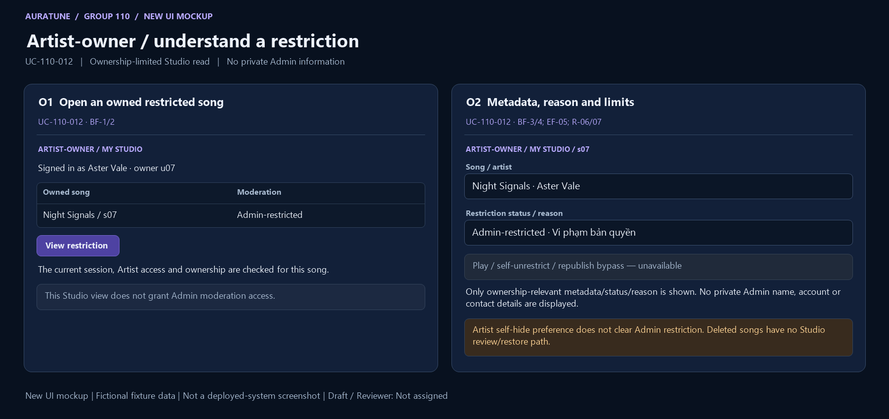

# UC-110-012 — View Owned Track Restriction

## 1. Document Information

- **Use Case ID**: UC-110-012
- **Use Case Name**: View Owned Track Restriction
- **Functional Group**: 110 — Admin Functions / Feature 112
- **Primary Actor**: Artist-owner (ACT-04)
- **Supporting Actors**: None evidenced; internal modules are not actors.
- **Author**: Not assigned
- **Reviewer**: Not assigned
- **Status**: Draft
- **Last Updated**: 2026-11-04
- **Decision provenance**: Owner-confirmed session choices dated 2026-11-04 — [Q03](./use-case-inventory.md#q03). These are session decisions by the owner, not pre-existing source requirements, collective team approval or review sign-off.
- **Behavior completeness**: Specified in Draft for the applicable behavior, including the owner decisions cited below.

## 2. Description

An actively authorized Artist-owner inspects their own restricted song’s metadata, state and reason in Studio. This limited read never authorizes playback, self-unrestriction, republishing, public access or access to Admin private information.

## 3. Preconditions

The actor is an authenticated Artist with active access and ownership of the identified restricted song. This is a Studio owner read, not access to Admin moderation endpoints.

Preconditions do not replace request-time checks. Loss of access is EF-01; missing/unavailable data is an outcome to handle, not a reason to bypass authorization.

## 4. Trigger

The Artist-owner opens the Studio record for their restricted song.

## 5. Basic Flow (Main Success Scenario)

1. **Actor:** Requests the Studio view for an owned restricted song. 
2. **System:** Checks current authentication, Artist access and ownership of that specific song. 
3. **Actor:** Opens the restriction information for the song. 
4. **System:** Shows ownership-relevant metadata, current restriction and restriction reason without private Admin information, while keeping playback and bypass actions unavailable. 

## 6. Alternative Flows

### AF-01 — Restriction has changed

- **Starting step / Branching Point**: Basic Flow step 4.
- **Condition**: The song is no longer restricted when the actor reads it.

1. **System:** Does not represent the former restriction as current; the ordinary Studio view belongs to Group 090.
2. **Actor:** May return to the ordinary owned-song view.

- **Outcome / Continuation / Exit**: Exit this restriction-review goal; no restore or edit is performed here.

### AF-02 — Leave before dispatch

- **Starting step / Branching Point**: Basic Flow step 3.
- **Condition**: The actor leaves before submitting the requested read or change.

1. **Actor:** Leaves the view or declines to submit.
2. **System:** Applies no action for an unsubmitted intention; leaving after dispatch does not establish cancellation or undo.

- **Outcome / Continuation / Exit**: Exit canceled before dispatch only. For an already sent request, use the unknown-outcome exception if no result is known.

## 7. Exception Flows

### EF-01 — Authentication or permission denied

- **Starting step / Branching Point**: Basic Flow step 2.
- **Condition**: Authentication/Artist access is missing, expired or invalid, or the actor is not the owner.

1. **System:** Denies the owner view without exposing non-public metadata; no ownership or moderation state is changed.
2. **Actor:** Acknowledges the denial; any later attempt requires valid access.

- **Outcome / Continuation / Exit**: Exit denied. This also applies if authorization is lost before a later read or mutation.

### EF-02 — Invalid request

- **Starting step / Branching Point**: Basic Flow step 4.
- **Condition**: The Studio read request has a malformed song reference; the owner is not required to provide a moderation reason or role selection.

1. **System:** Reports a validation failure without applying the invalid request or exposing sensitive data.
2. **Actor:** May correct the request before a new attempt.

- **Outcome / Continuation / Exit**: Exit failed validation; a corrected submission starts a new applicable request.

### EF-03 — Read unavailable

- **Starting step / Branching Point**: Basic Flow step 4.
- **Condition**: The list/detail cannot be retrieved reliably.

1. **System:** Shows a read failure distinct from valid empty, missing and intentionally restricted states; does not fabricate returned data.
2. **Actor:** May request another authorized read.

- **Outcome / Continuation / Exit**: Exit unavailable; retry is a new read, not proof the previous result was empty.

### EF-04 — Read result not yet known

- **Starting step / Branching Point**: Basic Flow step 4.
- **Condition**: A read was submitted but no trustworthy complete response has been received.

1. **System:** Does not label the read as successful or infer empty/not-found from the missing response.
2. **Actor:** May leave or later request a fresh authorized read.

- **Outcome / Continuation / Exit**: Exit unknown/unavailable read outcome; this read caused no mutation. No timeout duration or automatic retry is specified.

### EF-05 — Attempt to bypass restriction

- **Starting step / Branching Point**: Basic Flow step 4.
- **Condition**: The Artist-owner requests play, self-unrestriction or republishing to bypass the Admin restriction.

1. **System:** Rejects the bypass and keeps the restriction in effect.
2. **Actor:** Acknowledges the denied action.

- **Outcome / Continuation / Exit**: Exit denied for that request; the permitted owner read does not become a playback or restore privilege.

### EF-06 — Missing or deleted target

- **Starting step / Branching Point**: Basic Flow step 4.
- **Condition**: The selected song does not exist or is final-deleted under the applicable state model.

1. **System:** Returns the source-defined unavailable/not-found outcome without exposing hidden content or creating a deleted-item review/restore path.
2. **Actor:** Acknowledges the result.

- **Outcome / Continuation / Exit**: Exit not found; owner Q03=A distinguishes reversible delisting from final deletion.

## 8. Postconditions

### 8.1 Success Postconditions

The valid owner sees only the source-permitted current metadata/status/reason for their restricted song. No Admin private information is exposed and no playback, visibility change or restriction bypass occurs.

### 8.2 Failure Postconditions

The read does not mutate source data. Failed reads are not represented as successful empty results. Protected information is withheld when access is denied.

### 8.3 Cancellation Postconditions

Before dispatch, leaving without submitting produces no action. After dispatch, leaving or dismissing feedback does not prove cancellation or undo; cancellation of an in-flight request is not defined by the source.

### 8.4 Unknown-Outcome Postconditions

A missing/unreliable response establishes neither successful data retrieval nor a valid empty/not-found result. This read has no mutation; a later read is a fresh observation.

## 9. Special Requirements

- **Performance**: No numeric response-time target is established for this goal in the reviewed feature source; none is invented.
- **Security & Privacy**: Apply ownership and active Artist access for Studio reads at every request; do not disclose credentials, secrets or unrelated private data. Actor roles are not UI-only safeguards.
- **Accessibility**: No source-specific conformance target is established here. Feedback must identify the actual outcome rather than imply success from a control’s appearance; detailed interaction/accessibility design is a technical follow-up.
- **Result integrity**: Distinguish confirmed success, no-op, cancellation before dispatch, known rejection/failure and unknown completion. Apply the confirmed owner session choices only within their documented scope; no collective approval is inferred.

## 10. Related Functional Requirements

Source-local IDs are qualified with the feature number. “Specified in Draft” means a concrete behavior/rule is written, not implemented/tested/approved. “Needs Clarification” may concern only part of an FR; retain the settled clauses and the open branch. The [inventory](./use-case-inventory.md#complete-fr-traceability) remains the distinct 74-FR accounting ledger.

| Source FR | Source requirement | Actual flow / rule | Behavior status |
|---|---|---|---|
| 112-FR-004 | The system MUST ensure that moderation review does not expose unrelated user data, tokens, secrets, or password material. | [BF-4](#bf-4); [R-02](#r-02), [R-06](#r-06) | Specified in Draft — source-backed clauses |
| 112-FR-010 | The system MUST reject expired, invalid, or missing authentication and MUST not perform moderation actions without a valid admin session. | [EF-01](#ef-01); [R-06](#r-06) (valid owner read, no Admin action) | Specified in Draft — source-backed clauses |
| 112-FR-012 | The system MUST return a not-found result when the target song does not exist and MUST make no state change. | [EF-06](#ef-06) | Specified in Draft — source-backed clauses |
| 112-FR-015 | The system MUST distinguish among valid empty results, validation failures, authorization failures, not-found results, and operation failures without reporting false success. | [R-03](#r-03); [EF-01](#ef-01), [EF-02](#ef-02), [EF-03](#ef-03), [EF-04](#ef-04) | Specified in Draft — source-backed clauses |
| 112-FR-016 | The system MUST maintain the feature boundary for Group 110 and MUST NOT mix in user-account ban or unban behavior from feature 111, platform-statistics features from 113, or artist upload-management behavior from feature 093. | [R-04](#r-04) | Specified in Draft — source-backed clauses |
| 112-FR-017 | The system MUST keep moderation scoped to songs and relevant song metadata unless a separate source document approves a broader moderation scope. | [R-04](#r-04) | Specified in Draft — source-backed clauses |
| 112-FR-020 | The system MUST not add report-management, abuse-triage, AI review, notification flows, or full admin audit trail behavior unless those flows are explicitly defined by an approved source document. | [R-04](#r-04) | Specified in Draft — source-backed clauses |
| 112-FR-024 | The system MUST allow a valid artist-owner with active access to view their own restricted song in Artist Studio. The view MUST include the song metadata relevant to ownership and moderation, the current restricted state, and the restriction reason, but MUST NOT expose any private information about the Admin who applied the restriction. Other users may not access the non-public content through Studio or public UI. | [BF-2](#bf-2), [BF-4](#bf-4); [R-06](#r-06), [R-08](#r-08); [EF-01](#ef-01) | Specified in Draft — source-backed clauses |
| 112-FR-025 | The system MUST prevent an artist-owner from playing, self-unrestricting, or republishing a restricted song to bypass the admin moderation decision. The artist may only regain visibility if the product's valid restore path is satisfied, including a valid admin restore and the absence of any higher-priority visibility restriction. This rule applies only to restricted songs and does not create a default review or restore workflow for deleted songs. | [EF-05](#ef-05); [R-07](#r-07) | Specified in Draft — owner session resolution: [Q03](./use-case-inventory.md#q03) |
| 112-FR-028 | The system MUST provide a clear distinction between an intentionally restricted song, a removed song, and a missing or unavailable song so that the admin experience remains accurate and does not imply a false state. | [R-03](#r-03), [R-07](#r-07) | Specified in Draft — owner session resolution: [Q03](./use-case-inventory.md#q03) |

## 11. Related Use Cases

- **Includes**: None asserted.
- **Extended by**: None asserted.
- **Preceding / related goals**: [UC-110-005](./UC-110-005-review-platform-tracks.md), [UC-110-009](./UC-110-009-restrict-track.md), [UC-110-010](./UC-110-010-lift-track-restriction.md). These are navigation/state dependencies, not unproved UML include/extend claims.

## 12. Source References

- [Feature 112 specification](../../../../specs/110-admin-functions/112-content-moderation/spec.md) — embedded Clarifications (2026-10-30, 2026-11-01), User Scenarios & Testing, Functional Requirements, Edge Cases and scope sections.
- [Feature checklist](../../../../specs/110-admin-functions/112-content-moderation/checklists/requirements.md) — quality/source review, not approval evidence.
- [API contract](../../../analysis-and-design/api-contract.md#210-admin) — §2.10 Admin endpoint and permission evidence; missing payloads/routes are not invented in the flows.
- [Use-case guide/template](../README.md#6-standard-use-case-specification-template), [shared actor/UC model](../../use-case-model.md), [security guidance](../../../design/security/README.md), [database security](../../../design/database/security-rules.md).
- [Vision G11](../../../proposal/Auratune_Vision_Document.md) — broad administration context, not a grant to expand these flows.
- [UC-090-007 visibility rules](../090-artist-profile-studio/UC-090-007-hide-or-unhide-track.md) — §§3/4, AF-01/04 and owner decisions G090-D05/G090-D07: independent Artist preference, no Admin bypass or deleted-song restoration. Group 110 Q03/Q05 are independently confirmed in this session.
- [091 public eligibility](../../../../specs/090-artist-profile-studio/091-artist-profile/spec.md#functional-requirements) — FR-007/008, featured-song and playlist eligibility: Admin lift confers eligibility, not guaranteed placement or non-public disclosure.

## 13. Prototype and Screenshot References

### Basic Flow Mockup

**Figure UC-110-012: O1–O2.** BF-1–4 owned restricted-song Studio entry and metadata/status/reason; no private Admin data or bypass controls. This is a **new conceptual UI mockup**, rendered for requirements review with fictional fixtures; **not a screenshot of a deployed system**, implementation validation or proof of persisted results. Request/result/branch annotations within a panel are illustrative composites, not a captured interaction timeline. The image is intentionally shared where one storyboard covers several actor goals.

### Alternative / Exception Coverage

**Partial overall.** Non-owner/expired/banned-owner rejection, deleted-item handling and actual play/self-unrestrict/republish bypass rejections remain Missing. Disabled controls and notes do not prove authorization. See the [per-goal evidence matrix](./prototypes/README.md#coverage-per-actor-goal) for Illustrated/Partial/Missing distinctions.

### Existing Source References

No pre-existing source image directly illustrates this goal. The new mockup above fills its basic-state illustration gap without claiming deployed behavior.

The [prototype register](./prototypes/README.md) preserves all fourteen original source references and records the six new mockups separately. Source conflicts, owner-session provenance, actor permissions and FR completeness are unchanged by drawing a screen.

## 14. Business Rules and Scope Constraints

- **R-01**: Admin moderation endpoints and actions require a valid authenticated Administrator with backend authorization. Missing, expired or invalid authentication and non-admin callers disclose no moderation-list data and cause no moderation mutation. The separate owner-only Studio read in UC-110-012 never grants Admin privileges.
- **R-02**: Review only the minimum song identity, available owner/artist association, state and existing source/rights/license/attribution context. Do not invent missing rights claims or expose unrelated personal data, credentials, tokens, secrets or private Admin details.
- **R-03**: Distinguish empty/invalid/not-found/service-unavailable outcomes from Artist-hidden, admin-restricted/delisted (“removed”) and final-deleted states. Q03=A maps the UI removed state to reversible admin restriction, not final deletion. Confirmed failure does not mutate saved state; a missing response is not proof of rollback.
- **R-04**: Moderation updates are limited to restriction handling and reason recording. No edits to title, artist, album, duration, cover, tags, audio, owner, uploader, source/rights, license/distribution or attribution; no separate notes, reports, AI review, notifications or audit-management workflow. Other account/statistics/upload/comment/album/playlist management remains out of scope. The shared-model broader edit/comment summary is not silently adopted.
- **R-05**: Final deletion is a non-restorable business outcome only. No hard-delete choice, physical audio/image/file removal, URL revocation, storage cleanup, schema or persistence technology is selected. Existing valid listening history/play counts and existing audit data remain preserved on moderation removal; this does not add an audit-management feature.
- **R-06**: Only a valid Artist-owner with active access may read the restricted song’s ownership-relevant metadata, current status and reason through Studio. Non-owner, public and unauthenticated users must not see non-public song information. Do not expose private/personal Admin details.
- **R-07**: Owner Q03=A: current owner view is allowed only for an existing restricted/delisted song with active Artist-owner access. No playing, self-unrestricting or republishing to bypass moderation. Final-deleted songs are absent from owner Studio and have no owner review/restore path. An eligible owner may change only Artist self-hide preference through Group 090; this does not clear Admin restriction or permit playback. New public eligibility requires Artist-public preference, no Admin restriction, non-deletion and existing visibility/playback rules.
- **R-08**: R-01 applies to privileged moderation endpoints, not as a reason to deny the explicit FR-024 Studio owner read. C4A quotes the contradictory blanket edge-case wording; this draft neither expands the owner permission nor removes it.

## 15. Source Conflicts and Behavioral Impact

### C3

**Passage A** — [specs/110-admin-functions/112-content-moderation/spec.md, line 212](../../../../specs/110-admin-functions/112-content-moderation/spec.md#L212):

> - **FR-027**: The system MUST handle repeated or conflicting moderation actions consistently: restricted-if-already-restricted and unrestrict-if-not-restricted are no-ops with no state or reason overwrite; delete of a missing song returns not-found with no side effect; valid opposing requests are resolved in system order; the last successful action decides persisted state; failed actions do not mutate saved state; and a deleted song cannot be restored through 112.

**Passage B** — [specs/110-admin-functions/112-content-moderation/spec.md, line 30](../../../../specs/110-admin-functions/112-content-moderation/spec.md#L30):

> - Q: How does the admin interface execute song removal and restoration actions? → A: The admin interface supports one-click direct actions with immediate toast notifications (`Đã gỡ “[Tên bài]” vì vi phạm bản quyền.` / `Đã khôi phục “[Tên bài]”.`). When executed without a custom reason prompt, the system assigns a default violation reason ("Vi phạm bản quyền").

**Preservation passage** — [specs/110-admin-functions/112-content-moderation/spec.md, line 31](../../../../specs/110-admin-functions/112-content-moderation/spec.md#L31):

> - Q: What is the underlying data preservation policy when a track is removed? → A: Content delisting is non-destructive: the song's status transitions to `removed`, it is skipped in active playback queues and delisted from search/home/public playlists, but historical play counts and moderation audit logs are preserved in the system.

**Historical impact before this owner decision:** The UI removed/restorable state cannot be equated with final deletion. Target eligibility, list membership, restore outcomes and preservation need a consistent state vocabulary.

**Resolution reference — owner confirmed in this session:** [Q03](./use-case-inventory.md#q03)

### C4A

**Passage A** — [specs/110-admin-functions/112-content-moderation/spec.md, line 176](../../../../specs/110-admin-functions/112-content-moderation/spec.md#L176):

> - Restricted or deleted songs must be removed from public browse/search/recommendation results and must not be playable from player, queue, or direct URL access; only admins may still view the record. Existing queue or playlist entries are treated as unavailable and are skipped; stale cached UI state may remain until reload, but new playback requests are denied.

**Passage B** — [specs/110-admin-functions/112-content-moderation/spec.md, line 209](../../../../specs/110-admin-functions/112-content-moderation/spec.md#L209):

> - **FR-024**: The system MUST allow a valid artist-owner with active access to view their own restricted song in Artist Studio. The view MUST include the song metadata relevant to ownership and moderation, the current restricted state, and the restriction reason, but MUST NOT expose any private information about the Admin who applied the restriction. Other users may not access the non-public content through Studio or public UI.

**Historical impact before this owner decision:** The broad edge-case sentence conflicts with the explicit limited owner view. This Draft preserves the dedicated Artist-owner goal and never grants access to admin moderation endpoints; reconciliation of blanket wording is editorial, not a proposal to remove owner rights.

**Resolution reference — owner confirmed in this session:** Source wording reconciliation only; preserve the explicit Artist-owner permission as requested. No new business decision is proposed.

### C4B

**Passage A** — [specs/110-admin-functions/112-content-moderation/spec.md, line 193](../../../../specs/110-admin-functions/112-content-moderation/spec.md#L193):

> - **FR-008**: The system MUST restrict admin update operations to moderation restriction handling and reason recording only. Admins MUST NOT edit `title`, `artist`, `album`, `duration`, `cover`, `tags`, audio file content, owner or uploader identity, source/rights, license/distribution, or attribution metadata within 112. There is no separate moderation-notes feature in this scope.

**Passage B** — [docs/requirements/use-case-model.md, line 209](../../../../docs/requirements/use-case-model.md#L209):

> - **Confirmed Capabilities**: User management dashboard (`GET /admin/users` with search, role, and ban status filters); banning users with mandatory reason; unbanning accounts; session blocking for banned users; changing user roles (`user`, `artist`, `admin`) with self-modification prevention; content moderation (hiding/removing infringing tracks, editing track metadata, deleting abusive comments); platform statistics dashboard (KPI cards for total users, artists, songs, plays); system controls (AI availability toggle and browser demo data reset).

**Historical impact before this owner decision:** The shared Group 110 summary includes track metadata edits/comments, while this feature expressly excludes those actions. This Draft documents the narrow feature branch only as its stated scope, preserves this discrepancy, and does not add an edit/comment goal or rewrite the shared model.

**Resolution reference — owner confirmed in this session:** Source scope/wording reconciliation only; no additional behavior choice is invented.

**Current treatment:** Apply [Q03](./use-case-inventory.md#q03). All original source passages above remain verbatim. The owner resolved the documentation behavior locally; source specs/shared artifacts are unchanged. These decisions are not pre-existing or collectively approved requirements.

## 16. Open Questions and Follow-ups

Applied owner-confirmed session choices: [Q03](./use-case-inventory.md#q03).

No unanswered behavior choice from Q01–Q11 remains for this goal. Technical mechanisms and image gaps are not new product decisions.

See the [owner decision register](./use-case-inventory.md#decision-register). These are owner session confirmations, not whole-team approval or review sign-off. [Technical follow-ups](./use-case-inventory.md#technical-follow-ups) and [prototype evidence](./prototypes/README.md) remain separate.

## 17. Draft Verification and Limitations

Sections 1–13 preserve every section actually present in the shared embedded template. Sections 14–17 supplement it with rules, source conflicts, questions and verification because the guide calls it a 17-section template but only prints 13 sections; no missing canonical headings are claimed. The template discrepancy is an authoring follow-up, not a behavior question.

This file is a Draft with Reviewer: Not assigned. Numbered Actor/System flows and FR-to-rule mappings describe documentation, not executed tests or a completed prototype. Missing source evidence, deferred behavior and unknown execution outcomes must not be reported as fully Covered. Owner-confirmed choices govern this documentation scope only. No reviewer, product approval, implementation readiness or policy choice is inferred.
